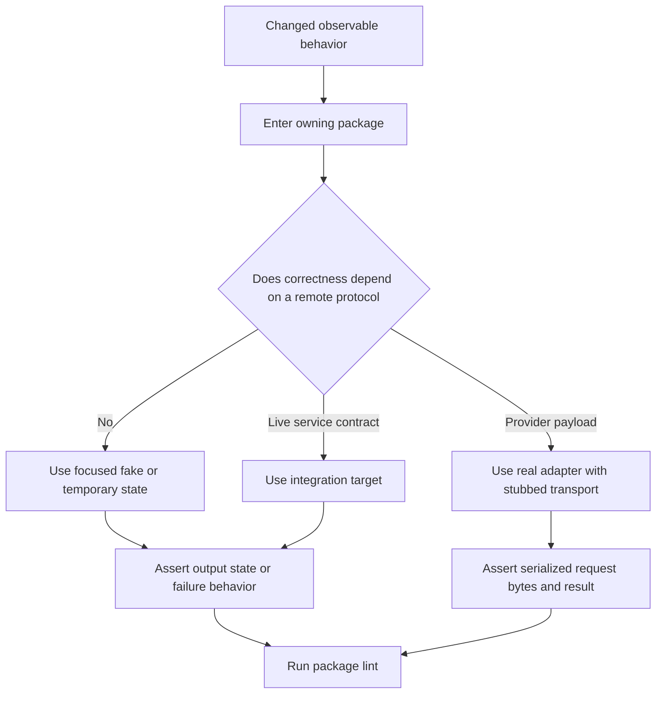

# Testing Guide

Start at the package that owns the observable boundary and run the smallest deterministic test that reaches it. Packages in `libs/` are independently versioned units with their own `pyproject.toml`, Makefile, and README, so synchronize and test from that package rather than from a repository-level environment. See [Development](../operations/development.md), the [source map](../architecture/source-map.md), [Subagents and Skills](../concepts/subagents-skills.md), and [Talon scheduling](../concepts/talon-scheduling.md).

## Baseline test discipline and commands

Network-free tests belong in `tests/unit_tests/`; tests for actual network contracts belong in `tests/integration_tests/`. Pytest's asyncio mode is automatic, unaccepted warnings fail the suite, and regressions should assert a user-visible result, persisted state, or emitted provider payload rather than an incidental internal call sequence.

```bash
cd libs/deepagents
uv sync --all-groups
make test TEST_FILE=tests/unit_tests/backends/test_sandbox_backend.py
make test TEST_FILE=tests/unit_tests/middleware/test_skill_tools_payload.py
make lint

cd ../code
uv sync --group test
make test TEST_FILE=tests/unit_tests/test_cost_breakdown.py
make test TEST_FILE=tests/unit_tests/test_app.py
make lint

cd ../talon
uv sync --group test
make test TEST_FILE=tests/cron/test_jobs.py
make test TEST_FILE=tests/test_host.py
make test TEST_FILE=tests/unit_tests/test_cron_pinned_skills.py
make lint
```

The SDK and dcode `make test` targets run pytest in parallel with non-Unix sockets disabled, Unix sockets allowed, benchmarks disabled, and coverage enabled; their separate integration targets use a 30-second timeout. Talon's target runs its WhatsApp bridge tests before Python tests, disables sockets except Unix sockets, and applies a 10-second timeout. Use `TEST_FILE` for a file and `PYTEST_EXTRA` for focused pytest options.

For dcode snapshot changes, use `make update-snapshots`, not an ad hoc pytest invocation. It is a separate socket-restricted smoke-snapshot target with `--update-snapshots`. `make lint` also verifies the command catalog and process working-directory policy.

## Select the regression

| Changed boundary | Start here | Prove at the boundary |
| --- | --- | --- |
| SDK-derived remote sandbox file operation, parser, command quoting, transfer path, capture offload, or sync/async parity | `libs/deepagents/tests/unit_tests/backends/test_sandbox_backend.py` | Use `MockSandbox`, a concrete `BaseSandbox` implementation with in-memory uploads/downloads. Assert the returned result and generated server-side command or file transfer, including malformed responses and backend failures. |
| SDK skill-selected tool disclosure or provider request placement | `libs/deepagents/tests/unit_tests/middleware/test_skill_tools_payload.py` | Use the real provider model adapter but stub only its HTTP transport. Inspect the serialized Anthropic or OpenAI request bytes, as well as the resulting tool gate. |
| dcode token/cost formatting or cost modal presentation | `libs/code/tests/unit_tests/test_cost_breakdown.py` | Call `format_cost_breakdown_table` with an empty or deliberately partial breakdown; assert copyable Markdown preserves tiny costs, completeness notices, unavailable fields, and suppression when historical detail is incomplete. |
| dcode Textual startup, resume, modal, or queue sequencing | `libs/code/tests/unit_tests/test_app.py` | Mount `DeepAgentsApp` with `run_test()`, events, and controlled fakes; use the real Textual message path when responsiveness is the contract. |
| Talon cron record lifecycle, scope, schedule parsing, persistence, or pinned-skill record | `libs/talon/tests/cron/test_jobs.py` | Use a temporary `CronJobStore`; assert persisted job state and access boundaries, not wall-clock sleeps or a live channel. |
| Talon host component lifecycle, incoming-turn replacement, authorization, approvals, media, or scheduled delivery | `libs/talon/tests/test_host.py` | Compose `TalonHost` with recording channels, schedulers, and agents. Drive `receive_message()` and observe requests and replies. |
| Talon scheduled-only skill injection | `libs/talon/tests/unit_tests/test_cron_pinned_skills.py` | Use a recording fake chat model and an on-disk temporary `SKILL.md`; compare a `trigger: "cron"` request with an ordinary request carrying the same metadata. |
| Dependency-minimum selection, manifest rewrite, scope narrowing, lock closure, or updater workflow | `.github/scripts/tests/checks/test_raise_langchain_minimums.py` | Build a temporary manifest/repository and stub package-index inputs; exercise the transformation and failure polarity without PyPI or GitHub. |
| CI gate, lockfile, ripgrep-install, trusted-base, or inherited-CI diagnostic workflow behavior | `.github/scripts/tests/workflows/test_ci_workflow.py` and `.github/scripts/tests/workflows/test_inherited_ci_diagnostics.py` | Parse workflow YAML for declarative contracts, but execute safety-critical shell or JavaScript snippets against stubbed commands/APIs. |



*Choose the double at the external meaning boundary. A real provider class plus a fake transport tests serialization without making a provider-network call.*

## SDK sandbox backend: test the derived protocol contract

`BaseSandbox` turns a provider's `execute`, upload, and download primitives into filesystem operations. Its focused tests intentionally use `MockSandbox`, not a real sandbox provider: that fake records commands and maintains a byte store, allowing tests to validate host-to-sandbox protocol behavior deterministically. Use it for read pagination and parse errors, `ls`/`grep`/`glob` formats, base64-safe command interpolation, upload-based writes, and the distinction between inline and temporary-file edits.

When changing execution output capture, test both synchronous and asynchronous entry points. A backend execution failure or a child command failure must remain visible rather than becoming a successful offloaded response. When changing large writes or edits, assert that the payload is transferred through `upload_files` and does not appear in a command that could exceed process argument limits. These are SDK transport semantics, not Talon sandbox-routing tests; route Talon host-versus-sandbox policy changes to its own sandbox tests.

## SDK skills: use real adapters, fake only the wire

Skill tool disclosure is provider-format-sensitive, so a generic fake model is not sufficient for the payload suite. The tests construct actual `ChatAnthropic`, `ChatOpenAI`, Azure, Codex, and Bedrock-family adapters and replace only their HTTP transport with a recording stub. This exercises the code that turns message history and tool definitions into the bytes each provider receives without credentials or network access.

A successful skill-file read can disclose selected tools for a later model request. For inline-capable providers, assert placement rather than merely tool presence: Anthropic receives a `tool_addition` system block and OpenAI Responses receives a developer `additional_tools` item after the complete tool-result batch. The already-sent prefix, top-level tools, and system prompt stay stable on later requests. Tests also cover compaction re-anchoring, fallback formatting for the model actually called, and providers that cannot use inline tools.

Keep the execution gate in the same regression when changing disclosure. The persisted `_skill_tools_disclosed` record represents what the model was shown, while a fresh resolver lookup determines whether that tool remains executable. Root-level schema combinators are withheld from Anthropic because its API rejects them, whereas the OpenAI payload may carry them. Run both sync and async parametrizations; the suite deliberately covers `invoke` and `ainvoke`.

## dcode: presentation and real Textual lifecycle

The cost-breakdown unit tests deliberately test the formatter directly because its contract is copyable Markdown, not provider accounting. They verify that very small amounts use a readable scientific representation, incomplete category values are marked `partial`, directionless/unattributed total cost is explained, and unpriceable requests are disclosed. A zero-cost breakdown can show unavailable category details, but a missing breakdown—or one whose historical detail is incomplete—renders no table.

The interactive modal owns presentation behavior around that string: it avoids duplicate cost screens, refreshes while open, sanitizes control characters before rendering or copying, supports `c` to copy and Escape to close, and leaves a failed refresh non-fatal. For changes to app sequencing rather than table formatting, retain the app-level approach: `run_test()` plus explicit events and pilot actions, not sleeps. Resume tests require history hydration to be idempotent across repeated `ServerReady` events, preserve the resuming indication until history restoration finishes, and prevent initial submission if resumed-model adoption fails. Modal-command tests submit through the real `ChatInput.Submitted` message pump so Escape and queue blocking are observed end to end.

## Talon: cron records, scheduled skill scope, and host orchestration

Cron tests use a temporary store because they protect durable scheduling semantics. A claimed one-shot is disabled before it runs; a recurring job advances before execution and disables after reaching its repeat cap. The store persists with owner-only directory and file modes. Management is scoped to the current conversation, while channel threads that share a parent channel can share jobs; unrelated channels, providers, or scopes cannot list, edit, or remove another job.

Schedule tests should inject `now` and use fixed time zones. This covers supported schedule grammar, local-time behavior across daylight-saving changes, one-shot disabling, late interval phase retention, corrupted-store recovery, and cache coherence after external writes. For pinned skills, assert deduplication and persistence on create/edit and clearing with `skills=[]`; do not require installed skill files at record-creation time.

Scheduled skill payloads have an additional runtime boundary. The cron-pinned-skills test creates a real temporary `SKILL.md` and runs `DeepAgentRuntime` with a recording fake model. The skill body reaches the request only when metadata includes both `pinned_skills` and `trigger: "cron"`; the same pinned list on an ordinary turn must not inject instructions. This is the right test for trigger gating, not a provider payload test.

Host tests use recording channels, scheduler, and agent fakes to exercise orchestration without real chat services. They verify component start/stop, replacement of a blocked conversation by a later message with interruption recovery, channel-bound authorization callbacks, tool-approval routing, outbound media handling, and scheduled-result delivery. Preserve this division: a host test checks which channel input becomes an `AgentRequest` and which result becomes a reply; runtime and SDK tests own graph and provider serialization behavior.

## CI and dependency-floor workflows: execute the dangerous fragments

The dependency updater is a constrained manifest transformation, not a live package-index test. Its tests inject available versions and temporary manifests to ensure a new floor stays within upper and compatible-release bounds, that literal quoted requirements are rewritten without corrupting neighbors or comments, and that extras, markers, and compatible-release precision survive. A changed producer manifest requires locks for its transitive local path dependents unless the explicit skip option is used. Narrowed runs canonicalize requested names and fail rather than reporting success for an unknown or unraiseable request.

CI workflow tests distinguish static wiring from executable behavior. They parse YAML to verify job relationships, lockfile gating, workflow expressions, dispatch options, and trusted-base checkouts. They run ripgrep installation shell bodies against stubbed `sudo`, `timeout`, `dpkg`, `apt-get`, and `rg` commands, which proves that ordinary PR timeouts soften only timeout outcomes while release-sensitive paths stay strict except for the exact bypass label. The inherited-CI diagnostics test similarly executes the JavaScript diagnostic with a stubbed GitHub API: diagnostics escape untrusted job names and preserve failure visibility, but are `continue-on-error`, read-only, and cannot replace the final gate.

## Completion checklist

1. Work in the package that owns the behavior and synchronize its declared groups.
2. Run the closest focused file with `TEST_FILE`; add a regression that observes the public boundary and its failure path.
3. Use temporary files, stores, channels, or ordinary fakes for local behavior; use real provider adapters only when their serialized payload is under test, with a stubbed transport.
4. Use an integration target only when a real network contract is the behavior being changed.
5. Cover both sync and async entry points when the public SDK exposes both.
6. Run the owning package's `make lint`; run workflow tests when YAML, a gate script, or automation transformation changes.
