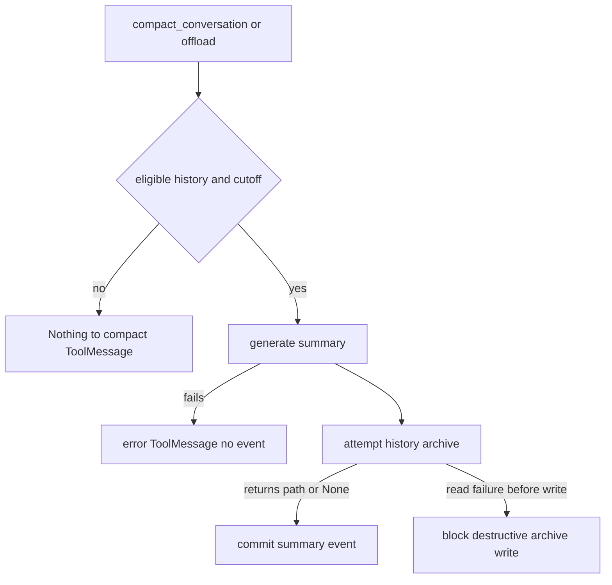
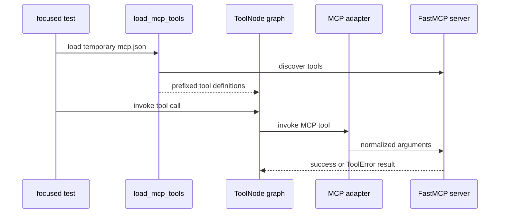

# Testing Guide

Use the test nearest to the package that owns the behavior, then widen only when a boundary is crossed. [Context Management and Offload](../concepts/context-management.md), [Subagents and Skills](../concepts/subagents-skills.md), [Filesystem Tools and Backends](../concepts/tools-filesystem.md), and [Talon Runtime Integration](../integrations/talon.md) explain the runtime contracts these routes protect. For environment setup and linting, see [Development](../operations/development.md); [Quickstart](../quickstart.md) helps route a change to its owner.

Repository testing guidance requires network-free tests in `tests/unit_tests/`, networked tests in `tests/integration_tests/`, observable deterministic behavior rather than incidental implementation interactions, and treats unaccepted pytest warnings as errors.

## Run the owning package target

Use the package Makefile rather than a hand-assembled pytest command. It selects the package test dependency group, coverage, socket policy, timeout, and—in Talon—the Node bridge prerequisite.

```bash
make -C libs/code test TEST_FILE=tests/unit_tests/test_compact_tool.py
make -C libs/code test TEST_FILE=tests/unit_tests/test_output_truncation.py
make -C libs/deepagents test TEST_FILE=tests/unit_tests/middleware/test_compact_tool.py
make -C libs/deepagents test TEST_FILE=tests/unit_tests/backends/test_filesystem_backend.py
make -C libs/deepagents test TEST_FILE=tests/unit_tests/test_subagents.py
make -C libs/talon test TEST_FILE=tests/unit_tests/test_mcp_adapter.py
```

`libs/code` and `libs/deepagents` default to `tests/unit_tests/`, run pytest with xdist, and disable sockets except Unix sockets; their integration targets use `tests/integration_tests/` with a 30-second timeout. Talon runs `test_bridge` before pytest and then disables sockets except Unix sockets with a 10-second timeout. The focused Talon adapter suite nevertheless exercises an in-process FastMCP server and a local stdio child process—do not substitute a real remote MCP server.

## Compaction: distinguish an event, an error, and a protected archive

There are two related seams. The SDK's `SummarizationToolMiddleware` owns the `compact_conversation` tool and its summary event. dcode's `CLICompactionMiddleware` adds runtime model selection, hooks, and server-owned archive handling. Test the visible state transition, not private helper calls.



*Focused tests separate a successful in-context compaction with no archive path from a failed compaction that must not update summarization state.*

For `libs/deepagents/tests/unit_tests/middleware/test_compact_tool.py`, use fake models and a mock backend to cover both synchronous and asynchronous paths:

- A request below the admission threshold or with no removable prefix returns the correlated “Nothing to compact” result. It does not fabricate a summary event.
- A successful update records a cutoff in raw-state coordinates, summary message, and optional history path. On a second compaction, verify cutoff arithmetic against the prior event rather than only the first-call case.
- A summary-generation error, or an offload exception that escapes the helper, returns an error-status `ToolMessage` and leaves `_summarization_event` untouched. In contrast, an offload helper that returns `None` after a generated summary still permits the summary event with `file_path=None`.

At the dcode seam in `libs/code/tests/unit_tests/test_compact_tool.py`, add a regression when a runtime override, hook cwd, forced `/offload`, or archive safety behavior changes. The compaction budget must follow the selected runtime model and its effective context/output limits without mutating the original request. Planning a forced compaction may create a summary but must defer archive mutation until the checkpoint reservation permits it. A failed archive read must fail closed: a download error other than `file_not_found` prevents a truncating `write` or `edit`; a missing archive remains a valid first-write case. Test sync and async guards when changing both protocol paths.

## Truncated replies: classify first, then protect state and delegation

`libs/code/tests/unit_tests/test_output_truncation.py` is the focused route for provider completion metadata and user-visible error behavior. Build `AIMessage` instances with provider-shaped metadata rather than calling the classifier directly through implementation details. Cover OpenAI Responses and Chat Completions, Anthropic, Google, and Bedrock stop-reason fields, including normal completions that must pass through.

An empty or reasoning-only truncated reply becomes `ModelOutputTruncatedError`; its message identifies the model and reason, and its recovery hint depends on whether the failure is output budget, context window, content filtering, or a likely upstream zero-usage failure. A truncated malformed tool call must say that the call was interrupted rather than that a reply was absent. Preserve serialization and copying behavior because the error crosses the remote event stream.

The graph-level regression is more important than a unit assertion alone: place `EmptyTruncatedReplyMiddleware` outside retry middleware, stream an error through the local mock transport, and assert one model attempt, no assistant checkpoint message, and an `ErrorMessage` in the TUI. For a subagent, a partial truncated reply is returned to the parent as a successful tool result with a cut-off notice; an empty truncated reply is a correlated error tool result. In both cases, the parent can continue its turn. Test both `fork` and `isolated` modes and sync/async invocation when altering this boundary.

## Filesystem: test the path and result contract with `tmp_path`

Use `libs/deepagents/tests/unit_tests/backends/test_filesystem_backend.py` for backend semantics. Construct a `FilesystemBackend` over `tmp_path`; use `virtual_mode=True` when model-facing paths should be rooted at `/`, and normal mode when callers must see host paths. Do not rely on the repository checkout, process cwd, or a live sandbox.

High-value observable cases are:

- `ls` is one directory level, has deterministic ordering, and accepts equivalent trailing-slash directory paths. `glob` with no path is rooted at the configured backend root; bare patterns do not surface leading-dot files, while explicit dot patterns do.
- Virtual paths reject traversal. Batch upload/download reports per-item errors and can retain valid sibling results; downloading a directory and an absent file has distinct errors.
- Text reads expose pagination metadata (`total_lines`, source-line range, and `next_offset`). Past-EOF offsets report the file length; negative offsets clamp to the start; empty files and nonpositive text limits use their documented empty-result behavior. Binary reads remain binary and video-size checks happen before loading an oversized payload.
- `grep` is literal, not regex. Exercise both ripgrep and the Python fallback where relevant; fallback search scoped to one file must not leak matching siblings. A symlink may remain visible in returned paths, but results reached through a symlink escaping the backend root must be filtered.

The suite deliberately skips real-ripgrep cases on ordinary machines without `rg`, but fails if CI declared `DEEPAGENTS_RIPGREP_EXPECTED=1`. Keep that distinction: it protects the real-binary containment contract without making local development require the binary.

## Subagents: verify result shaping and state isolation

Run `libs/deepagents/tests/unit_tests/test_subagents.py` when changing `create_deep_agent`, declarative `SubAgent` construction, or task-state merging. A remote async specification exposes `start_async_task` and `check_async_task` in addition to `task`; a synchronous child uses only `task`. Invoke a scripted parent and child graph, then assert that the parent receives each child's final message as a `ToolMessage` correlated to its task call—not the child's full transcript.

For parallel work, map results by `tool_call_id` rather than completion order. The safety boundary is state ownership: sibling and child-local private fields must not flow to another child or back to the parent, and a parent's private schema field must not enter the child. Public state that is intentionally propagated remains a separate assertion. Exercise `fork` and `isolated` modes when a change can affect isolation, and confirm that child-local todos and rubric changes do not overwrite parent state.

## Talon MCP adapter: test a real adapter without network access

`libs/talon/tests/unit_tests/test_mcp_adapter.py` uses FastMCP's in-process transport, an actual graph `ToolNode`, and a local stdio script. It is the integration route for a change spanning discovery, provider conversion, middleware, graph invocation, authorization context, elicitation, or client lifecycle.



*The test route validates Talon's real MCP adaptation and graph integration while keeping the transport local.*

Use this suite to preserve these contracts:

- Discovery prefixes a server tool (for example `remote_search`), the graph preserves its name and `tool_call_id`, optional empty-string arguments are omitted so the server default applies, and a server `ToolError` becomes an error tool result. The authorization invocation context is clear after either outcome.
- Provider conversion must retain open-object and optional nested object/null input schemas without mutating the loaded MCP or local tool definitions. Test both OpenAI Responses and non-Responses binding paths, then invoke values such as `{}`, `null`, and zero-valued nested fields to prove arguments arrive unchanged when meaningful.
- Reloading tools must not invalidate an in-flight invocation. MCP elicitation creates its own interrupt, is resumed with cancellation rather than tool approval, and malformed elicitation data raises validation failure. A stdio server process must exit after discovery and after each invocation, so repeat calls verify no process leak.

## Completion checklist

1. Start with the command and test module above that owns the changed observable contract; use fakes, `tmp_path`, mock transports, or a local subprocess rather than a network service.
2. For compaction, assert event state, correlated tool status, and whether archive mutation is permitted—not merely a summarizer invocation.
3. For truncation and subagents, assert parent continuation, checkpoint/TUI outcome, tool-call correlation, and private-state boundaries across sync/async and relevant execution modes.
4. For filesystem and MCP changes, test containment, schema/result fidelity, and lifecycle cleanup at the actual adapter boundary.
5. Run the owning package's `make lint` after focused tests pass; do not silence a new pytest warning without an accepted, narrowly scoped reason.
