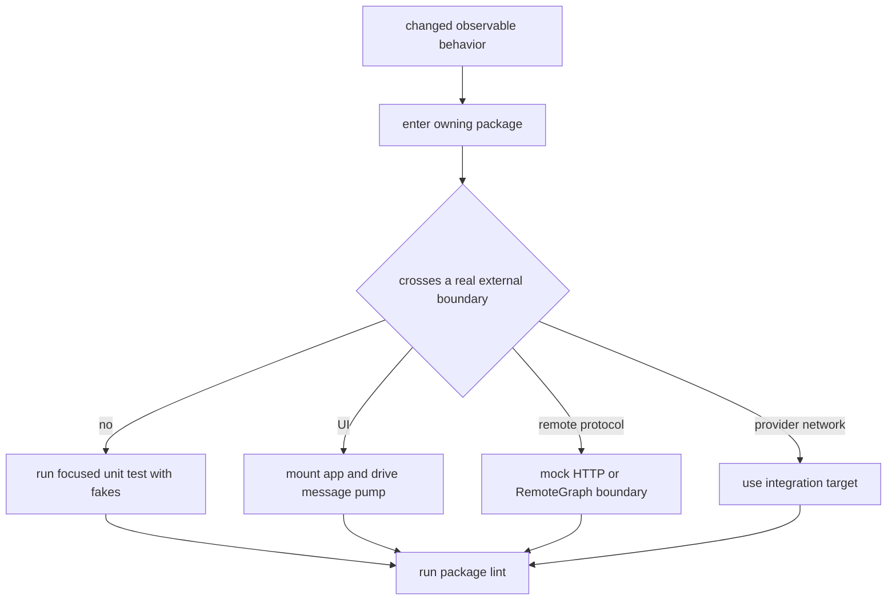
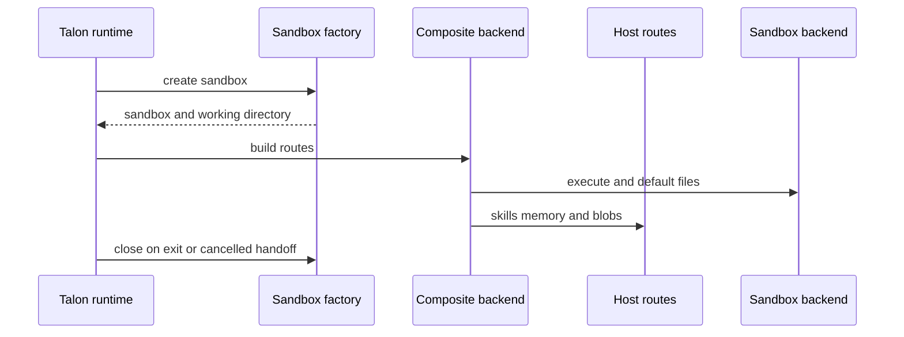

# Testing Guide

Run the smallest hermetic test that reaches the observable boundary you changed, from the package that owns it. Packages under `libs/` are independently versioned and own their environments and Makefiles; install and validate from that package rather than a repository-level virtual environment. Start from the nearby regression test, use a fake model, temporary filesystem, mock transport, or fake provider, and assert an externally meaningful state, payload, or rendered result—not an incidental call sequence. See [Development](../operations/development.md), [Permissions and HITL](../concepts/permissions-hitl.md), [ACP](../integrations/acp.md), and [Talon](../integrations/talon.md).

## Test layer and commands

Network-free tests belong in `tests/unit_tests/`; reserve `tests/integration_tests/` for actual network contracts. Pytest asyncio mode is automatic, warnings not explicitly accepted fail the suite, and tests should be deterministic. dcode and the core SDK use parallel pytest for their normal unit targets, disable sockets other than Unix sockets, disable benchmarks, and collect coverage; their integration targets are separate parallel runs with a 30-second timeout. ACP and Talon also run their package pytest targets with sockets disabled except Unix sockets and a 10-second test timeout; Talon runs its WhatsApp bridge unit tests before Python tests.

```bash
cd libs/deepagents
uv sync --all-groups
make test TEST_FILE=tests/unit_tests/test_permissions.py
make lint

cd ../acp
uv sync --group test
make test TEST_FILE=tests/unit_tests/test_execute_permissions.py
make lint

cd ../code
uv sync --group test
make test TEST_FILE=tests/unit_tests/test_model_config.py
make lint

cd ../talon
uv sync --group test
make test TEST_FILE=tests/unit_tests/test_sandbox.py
make lint
```

Use `TEST_FILE` to select a file and `PYTEST_EXTRA` for focused pytest options. Use `make coverage` when the coverage report itself is needed. In dcode, `make lint` additionally checks the generated command catalog and the process working-directory policy. `make update-snapshots` is deliberately separate and runs socket-restricted smoke snapshots with `--update-snapshots`; review the resulting artifact diff. `COMMANDS.md` is generated from the slash-command registry, so command changes require `make commands-catalog` followed by `make commands-catalog-check`.

## Select the focused regression

| Changed boundary | First focused test | What the test must prove |
| --- | --- | --- |
| Filesystem read/write policy, recursive deletion, or filesystem HITL | `libs/deepagents/tests/unit_tests/test_permissions.py` | Use a temporary or in-memory backend; assert first-match policy for exact paths, conservative all-or-nothing protection for recursive deletion, and that bulk operations cannot bypass an interrupt rule. |
| Filesystem virtual paths, binary/video reads, or search containment | `libs/deepagents/tests/unit_tests/backends/test_filesystem_backend.py` | Assert virtual-root semantics, traversal and escaping-symlink protection, literal search behavior, and bounded media reads; use real `rg` only where its contract is essential. |
| ACP execute approval reuse | `libs/acp/tests/unit_tests/test_execute_permissions.py` | Drive an `execute` interrupt through `AgentServerACP`; exact command arguments and session context—not shell parsing or prefixes—must define an always-allow grant. |
| ACP local context after compaction | `libs/acp/tests/unit_tests/test_local_context.py` | Mock backend execution and inspect model requests; preserve the initial system prompt, append only changed escaped snapshots, and record failed refreshes so they do not loop. |
| dcode model allowlist, credential, cache, or configuration policy | `libs/code/tests/unit_tests/test_model_config.py` | Isolate environment and state paths, clear module caches, and test parsed policy plus the failure message or safe credential-routing outcome. |
| Talon inbound/outbound media boundaries | `libs/talon/tests/test_media.py` and `libs/talon/tests/unit_tests/test_media_blobs.py` | Use temporary files and a recording fake model; prove size/type bounds, markdown parsing, root containment including symlinks, and blob persistence rather than base64 checkpoint storage. |
| Talon sandbox lifecycle and host routing | `libs/talon/tests/unit_tests/test_sandbox.py` | Substitute the factory with a context-managed fake sandbox; assert fail-closed startup, cleanup on normal exit and cancellation, and the host-only route boundary. |
| Deep Agents synchronous delegation, fork/isolated state, or concurrent children | `libs/deepagents/tests/unit_tests/test_subagents.py` | A parent receives final child results as tool messages, while parent-only and private sibling state does not leak; exercise both `invoke` and `ainvoke` for async-sensitive behavior. |
| Remote asynchronous subagent lifecycle or forked context | `libs/deepagents/tests/unit_tests/test_async_subagents.py` | Mock the LangGraph client or use `httpx.MockTransport`; assert task state and request input, including `fork` context snapshots rather than only the task-tool implementation. |
| Binary tool-result persistence or rehydration | `libs/deepagents/tests/unit_tests/middleware/test_blob_offload.py` | Confirm only eligible results are replaced by content-addressed references, persistence failures preserve inline payloads, and malformed or tampered references become a safe text notice. |
| dcode TUI connection/startup/modal ordering | `libs/code/tests/unit_tests/test_app.py` | Mount `DeepAgentsApp` with `run_test()`, controlled events, and fake workers; assert ordering and liveness through the real message pump. |
| dcode headless output, HITL, or server-launch plumbing | `libs/code/tests/unit_tests/test_non_interactive.py` | Mock server startup and stream chunks; assert stdout/stderr behavior, permission decisions, and forwarded launch configuration. |
| dcode remote graph translation or conflict recovery | `libs/code/tests/unit_tests/test_remote_client.py` | Use `httpx.MockTransport` or a fake `RemoteGraph`; inspect the actual request and converted stream/state result. |
| dcode server-side pinned skills and trust | `libs/code/tests/unit_tests/skills/test_pinned_skills.py` | Use a temporary skill tree, filesystem backend, and in-memory checkpoint; test the trust interrupt and persisted snapshot across turns and process restart. |
| dcode sandbox ownership or provider failure | `libs/code/tests/unit_tests/test_sandbox_factory.py` | Mock registry/provider boundaries; prove cleanup ownership, error preservation, dependency guidance, and provider-specific lifecycle behavior. |
| Scheduled dependency-minimum automation | `.github/scripts/tests/checks/test_raise_langchain_minimums.py` | Exercise manifest planning and workflow helpers in a temporary repository; preserve satisfiable constraints, lockfile scope, and workflow validity. |



*Choose the test double at the boundary where the behavior becomes externally meaningful; only use integration coverage when that boundary is genuinely remote.*

## Filesystem permissions and HITL

`FilesystemMiddleware` enforces `deny` rules and filters denied results; graph assembly converts `interrupt` rules into `HumanInTheLoopMiddleware` configuration. Keep those responsibilities separate in regressions: test the middleware result for a deny, but test the synthesized `when` predicate for an approval boundary. Rule order is significant for ordinary exact-path access: the first matching rule wins. Validate permission declarations too: paths need a leading slash, must not contain traversal (including Windows separators), and do not support `~`.

Deletion has a deliberately stricter boundary. A recursive delete is refused without changing anything when any write-deny glob overlaps the target subtree, whether the pattern names an ancestor or a descendant; report all overlapping patterns. A confirmed leaf can instead use normal first-match precedence. Cover sync and async paths when touching this shared logic, including flat backends where a key can coexist with descendants.

For `ls`, `glob`, `grep`, and `delete`, the path is a bulk scope. An omitted path and current-directory aliases are conservatively treated as the root, and a glob's absolute pattern is gated independently because it can redirect a search away from its nominal `path`. Include a protected subtree and a benign sibling in the fixture; tests should show that `path="."`, pathless searches, absolute patterns, and `..`-containing relative patterns cannot avoid HITL, while disjoint paths do not prompt.

Filesystem backend tests should use `FilesystemBackend(root_dir=..., virtual_mode=True)` when asserting virtual path behavior. The default glob search stays within the backend root, bare glob patterns do not include dotfiles, and explicit dot patterns do. Test path traversal and escaping symlinks at the externally visible result boundary. For ripgrep-specific regressions, call the module helper that skips locally when `rg` is absent but fails when CI declared it required; do not replace a real-binary containment test with a mocked subprocess test. Video extensions are binary and are rejected before an oversized file is read.

## ACP approvals and local context

For ACP command approval, build a checkpointed fake agent, connect an `AsyncMock` client, seed a session CWD, and feed a `StateSnapshot` interrupt to `_handle_interrupts`. An `approve_always` grant is reusable only for the same session and a key consisting of the full serializable execute arguments plus session context (CWD, mode, and model). Therefore whitespace, shell syntax, a changed timeout/CWD/environment, a changed session, or a changed session context must prompt again; dictionary key order must not. Invalid, missing-context, cancelled, erroring, one-shot, and unknown decisions must never create a reusable grant, and forgetting a session must discard it. Verify that the review receives the complete command in both title and raw input, not a shortened display value.

`LocalContextMiddleware` runs its detection script once initially and puts that snapshot in the system prompt. After a new summarization cutoff it re-runs the script, records the cutoff even if execution fails, and appends an internal `lc_source: "local_context"` human message only when a fingerprint differs from the prior context. The message escapes detected text and labels it untrusted; the stable system prompt is retained for prompt caching. Test a changed, unchanged, and failed refresh, then exercise repeated compaction through a real checkpointed agent to ensure only one current snapshot reaches each model request.

## dcode model configuration

Model configuration tests have global caches and read environment, config, credential-store, and platform paths. Use the autouse cache-clearing fixture, `tmp_path` state/config paths, and `monkeypatch`/`patch.dict` to make precedence and platform tests deterministic. Test policy before model construction when that is the public configuration boundary: an explicit empty `models.allowed` is a deny-all; parsed entries are canonical ordered exact `provider:model` specs or `provider:*` wildcards with duplicates removed. Reject malformed entries, whitespace and misplaced wildcards, and bare Bedrock IDs, which otherwise cannot match the canonical `bedrock:<id>` form. If a bare model name can be inferred, assert that canonicalization still applies the allowlist and that errors preserve the user's input and source context.

Credential tests must prove safe routing rather than merely environment mutation. Stored provider keys take precedence over ordinary environment keys, while a prefixed override can suppress the store. Applying a stored personal key without a base URL must clear inherited gateway URL aliases—and provider-specific gateway headers where applicable—so credentials are not sent to the wrong endpoint. A configured explicit endpoint can retain the headers it requires. Corrupt stored credentials should fall back to valid environment resolution rather than preventing status checks.

## Talon media, blobs, and sandboxing

Talon media tests cover two distinct trust boundaries. Inbound text may inline only readable documents within `MAX_TEXT_DOCUMENT_BYTES`; images become standard base64 content blocks only when they are valid image media and within the inbound size limit; video uses a textual attachment notice. Build model content with temporary files rather than channel clients. For outbound markdown references, ignore references inside inline or fenced code, accept only supported image/video file types, and, when a root is supplied, require a relative regular file inside that root after strict resolution. Reject URLs, home expansion, Windows/absolute paths, traversal, unavailable files, and symlink escapes.

The runtime's filesystem middleware offloads inbound image payloads. Use a recording fake model, an `InMemorySaver`, and a temporary assistant directory to assert the checkpoint does not contain image base64, the SHA-256 blob exists under `artifacts/blobs`, and the model request is hydrated with the image. This proves storage and request lifecycle without a real provider.

Sandbox mode is fail closed: an unset setting yields no session, but a configured sandbox that cannot start raises `SandboxStartupError` rather than executing on the host. Patch `create_sandbox` and its working-directory resolver. Test cleanup on context exit and cancellation during `asyncio.to_thread` startup; the handoff closes an owned sandbox even if cancellation races with successful creation. The composite backend sends execution and ordinary files to the sandbox, but routes only the assistant `skills/`, `memory/`, and `/blobs/` namespaces to host-backed filesystems. Assert attempts to escape a host route do not create host state, and that blob uploads stay host-side so media survives sandbox recreation.



*Sandbox tests verify routing and ownership at the composite boundary, not a provider implementation.*

## Deep Agents: delegation, async tasks, and blobs

For ordinary subagents, construct a parent fake model that emits `task` calls and child fake models with controlled final messages. A child result is returned to the parent as a `ToolMessage`; parallel calls must retain one result per tool-call ID. Test state isolation independently: private parent fields must not reach a child, sibling private fields must not cross over, and a child changing its rubric must not overwrite the parent's rubric in either `fork` or `isolated` mode.

Async subagents are a remote lifecycle seam. Configuration rejects modes other than `isolated` and `fork`; the middleware exposes start, check, update, cancel, and list tools and stores tracked tasks in `async_tasks`. Mock thread creation and run APIs. For a fork, assert the request contains the summarized or unsummarized message snapshot plus the delegation prompt, excludes tool artifacts, and does not mutate parent state while the remote request is built. For isolated work, assert that only the task description is sent. Offloaded media must be rehydrated for the child request and re-offloaded under its backend without retaining `_blob_payloads` in checkpoint state.

Binary offload tests should use `FilesystemBackend` and a known base64 payload. Eligible `read_file` output is replaced in persisted messages by a digest reference and rehydrated before a model call. Test `Command` results because every message in its update must be processed. A digest that does not match stored bytes, a malformed reference, or missing blob must never be read as arbitrary filesystem content; it is rendered as the missing-blob text. If upload raises, the payload remains inline so model input is not silently lost.

## dcode app, headless, remote, skills, and sandbox lifecycle

`DeepAgentsApp` lifecycle regressions need `run_test()`, `asyncio.Event` coordination, and pilot key events rather than sleeps. Startup hydration is idempotent across later `ServerReady` events; a resumed status remains visible until history restoration completes; restored history mounts before startup output; and a failure to adopt the resumed model prevents an initial prompt from being submitted. Modal command regressions must submit through the real `ChatInput` message path: an open preference modal must receive Escape and block queued work until its continuation starts.

Headless tests mock `start_server_and_get_agent` and drive `run_non_interactive()` with synthetic stream chunks. Test shell HITL policy with explicit allowlists, not a real shell. In quiet mode, agent text is the only stdout payload and diagnostics are suppressed; with `stream=False`, output is buffered, whereas stream mode writes text incrementally. Launch plumbing must forward sandbox type, snapshot name, profile overrides, and filesystem-tool allowlists; permission hooks override the headless auto-approve bypass while retaining the approval-mode context.

Remote-client tests must inspect the HTTP boundary. Top-level tracing tags survive configuration preparation. When workspace context is sent, incompatible configurable data is removed; a local thread ownership lease is sent as a header without discarding caller headers. Convert remote chunks and serialized interrupts into client types. Side accounting is best effort: failures must not discard primary stream, state, or cached cost. A state-write `409` triggers interruption of active running and pending runs and one retry; a second conflict still raises.

Skill pinning is a server-side trust boundary. Build a temporary skill root with `PluginSkillsMiddleware`, a real `FilesystemBackend`, and `InMemorySaver`. A symlinked skill outside allowed roots produces a trust interrupt; approval must be persisted before pinning. A successful pin is a stable human-message snapshot across later edits, request-only `pinned_skills` is cleared, failed pins do not poison later continuations, and a restarted server rescans skill metadata without losing checkpoint history.

Sandbox factory tests isolate the registry and provider. A setup failure deletes only a newly owned sandbox, never an attached `sandbox_id`; if cleanup fails, preserve the setup exception and report cleanup separately. Missing optional providers give install guidance, and unsupported or reattached snapshot configurations reject before provider creation.

## Dependency-floor automation

The scheduled dependency updater is a manifest and workflow transformation, so use its focused test module rather than live package indexes or GitHub. A selected release must choose the newest version compatible with its existing upper or compatible-release bound; exact pins, upper-bound-only requirements, package self-dependencies, and local workspace sources are not raised. Rewriting must change only quoted dependency literals, preserve extras, markers, and compatible-release precision, and fail if an advertised replacement is not present.

When a manifest changes, calculate stale lock directories including transitive local path dependents unless explicitly skipped. Narrowed dependency selection canonicalizes names and fails closed for unknown names or requirements with no raiseable lower bound. The workflow checks also guard GitHub Actions expression functions, dispatch options synchronized with release labels, and refresh ancestry so an existing automated PR contains only regenerated dependency and lockfile changes.

## Completion checklist

1. Run the closest focused unit file from the owning package.
2. Assert the externally meaningful invariant and its failure, denial, or cleanup path.
3. For shared sync/async behavior, cover both entry points where exposed.
4. Mount the TUI or mock the HTTP, sandbox-factory, or model boundary only when the contract needs it.
5. Run the owning package's `make lint`; use an integration target only for a genuine network contract.
6. Regenerate snapshots or `COMMANDS.md` only with their Makefile targets, then review generated diffs.
