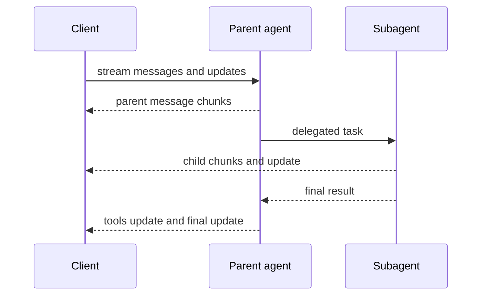
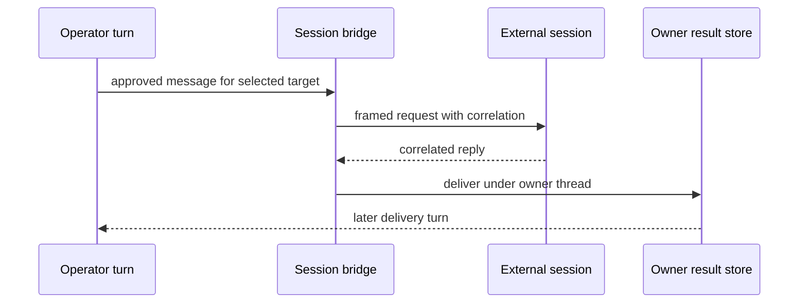

# Testing Guide

Run the smallest route that proves the change at its public boundary. Unit tests must be network-free, deterministic, and observe returned messages, persisted state, channel output, or protocol frames instead of private call order. Use fake models, temporary directories, in-process FastMCP transports, mock HTTP transports, and synchronization events; do not use developer credentials or a live provider. Unaccepted pytest warnings fail the suite.

Package Makefiles are the command authority. From each package root, synchronize its declared groups as needed, then pass the exact test file through `TEST_FILE`:

```bash
# SDK streaming
cd libs/deepagents
make test TEST_FILE=tests/unit_tests/test_end_to_end.py
make test TEST_FILE=tests/unit_tests/test_subagents.py

# Talon runtime, model, diagnostics, MCP, research, and session bridges
cd ../talon
make test TEST_FILE=tests/unit_tests/test_help.py
make test TEST_FILE=tests/unit_tests/test_claude_sessions.py
make test TEST_FILE=tests/unit_tests/test_codex_sessions.py
make test TEST_FILE=tests/unit_tests/test_dcode_sessions.py
make test TEST_FILE=tests/unit_tests/test_context_doctor.py
make test TEST_FILE=tests/unit_tests/test_mcp_adapter.py
make test TEST_FILE=tests/unit_tests/test_model_selection.py
make test TEST_FILE=tests/unit_tests/test_research_subagents.py

# QuickJS production-shaped interpreter and PTC bridge
cd ../partners/quickjs
make test TEST_FILE=tests/unit_tests/test_end_to_end.py

# Repository automation routes run from the repository root
uv run pytest .github/scripts/tests/release/test_build_release_notes.py
uv run pytest .github/scripts/tests/workflows/test_workflow_secret_scoping.py
```

The Deep Agents Makefile runs pytest with xdist, disabled sockets except Unix sockets, disabled benchmarks, and coverage. Talon's target runs the WhatsApp bridge suite before pytest, then applies the same socket restriction, a ten-second timeout, and coverage. QuickJS disables non-Unix sockets and collects coverage. The last two routes are repository-level Python tests rather than package-owned Make targets.

## Choose the boundary

| Change | Focused route | Observable invariant |
| --- | --- | --- |
| Stream metadata or subagent stream visibility | `libs/deepagents/tests/unit_tests/test_end_to_end.py`, `test_subagents.py` | Main and child chunks retain their identity and caller metadata; child completion returns through the parent tool update. |
| Help command concurrency or pending interactive reply | `libs/talon/tests/unit_tests/test_help.py` | `/help` does not invoke or interrupt the agent and does not consume an approval or authorization reply. |
| Model selection or context-window behavior | `libs/talon/tests/unit_tests/test_model_selection.py` | Only operator-selected, currently available credentialed models apply on later turns; the selected model's own context budget and summarizer govern the request. |
| Context inspection | `libs/talon/tests/unit_tests/test_context_doctor.py` | Diagnostics are read-only, scoped to the requested thread, redact content and paths, and reflect current configured sources and tools. |
| MCP adapter, schema conversion, elicitation, reload, or failures | `libs/talon/tests/unit_tests/test_mcp_adapter.py` | The adapter preserves call identity and schemas, adapts protocol failure into tool output, clears authorization context, and does not require network access. |
| Research subagent tools, MCP authorization, or background delegation | `libs/talon/tests/unit_tests/test_research_subagents.py` | A child begins fresh with explicit tools; authorization metadata survives while background work has no interactive handler and MCP errors are sanitized. |
| Claude, Codex, or dcode bridge | `libs/talon/tests/unit_tests/test_claude_sessions.py`, `test_codex_sessions.py`, `test_dcode_sessions.py` | External-session messages remain operator-gated, owner-correlated, bounded, and framed as untrusted data; cancellation prevents late delivery. |
| QuickJS interpreter, PTC, or tool-stream behavior | `libs/partners/quickjs/tests/unit_tests/test_end_to_end.py` | Sync and async interpreter paths can await host tools, preserve meaningful native values and per-call IDs, and expose nested tool events without polluting graph messages. |
| Release-note history or version-section extraction | `.github/scripts/tests/release/test_build_release_notes.py` | Synthetic Git histories make predecessor selection, release bounds, exact changelog extraction, escaping, and size limits deterministic. |
| Workflow credential exposure or trusted publishing | `.github/scripts/tests/workflows/test_workflow_secret_scoping.py` | Secrets are scoped to the selected package/job/environment and the OpenWiki update gains its write token only after generation. |

## SDK streaming: assert the public event shape

Use the Deep Agents routes when changing graph streaming, metadata propagation, or the parent/child boundary. The main-agent test streams `messages` and `updates` with caller-supplied tags and metadata and asserts that streamed model metadata contains the LangChain integration marker plus those values. The subagent test uses a streaming fake parent and child with `subgraphs=True`; it expects chunks and completed updates for both named agents, inherited tags on child chunks, the child final message in its subgraph update, and that same result returned in the parent `tools` update.

Do not replace this with assertions about middleware ordering. The compatibility contract is what a stream consumer can identify and render: namespace, mode, agent identity, metadata, and the completed delegated result.



*The streaming regression route checks both subgraph visibility and the parent-facing completion path.*

## Talon command, model, and context boundaries

`/help` is a host command, not an agent turn. Test case variants and a stalled channel send to ensure it can be slow without blocking active conversation work; it must neither invoke the agent nor consume a pending approval or OAuth callback reply. Include `/stop` in the race test because help must not change stop semantics.

Model selection is global state for subsequent conversations, not a mid-flight mutation. The host accepts a switch only from an operator, rejects unknown input without echoing it, persists a selected model through `/new` and restart, and clears selection when `default` is chosen. The runtime builds a selected available model once and falls back to its default for unavailable selections. When a selected model has a different context limit, test the actual model input: a larger selection may receive larger history; a smaller selection must be summarized or rejected before oversized input reaches it. The selected-model summarizer follows the selected model but subagents retain their startup summarizer.

The context doctor is an audit only. Test a fresh thread and a populated thread separately: it counts configured prompt, memory, skill index, tools, effective post-compaction conversation, and provider usage without exposing private body text or filesystem paths. It must not write a checkpoint, must report only the requested thread, and must reflect memory/tool reload changes. The channel command must follow a reset thread without interrupting an active task and must turn internal diagnostic failure into a non-sensitive response.

## Talon MCP and research boundaries

`test_mcp_adapter.py` is the adapter regression seam: it replaces connection creation with `FastMCPTransport` over an in-process server. For a tool change, assert the prefixed tool name, original `tool_call_id`, result status, defaulted optional parameters, and user-facing failure text. Keep schema tests at the provider boundary: open object arguments and optional nested objects must survive conversion and invocation without mutating the remote schema. Also cover lifecycle edges—an in-flight tool remains callable across reload, malformed elicitation interrupts are rejected, cancellation resumes the protocol with cancelled responses, and stdio discovery/invocation processes exit.

Research subagents deliberately do not inherit parent history or memory. Their tool inventory is explicitly selected from the agent definition or dynamic request; privileged shell, conversation, delegation, and reload tools remain unavailable unless explicitly exposed. For MCP delegation, exercise inline and background modes. The invocation and attempt metadata remain bound to the MCP call, but background work has no interactive authorization handler; MCP protocol details are reduced to safe error text and authorization context is cleared afterward.

## Session bridges: verify correlation before delivery

Claude, Codex, and dcode adapters are operator-session integrations, not ordinary subagent tools. Their tools are disabled by default, unavailable in nested subagents, and approval-gated. Their test fixtures use private temporary Unix sockets, stand-in protocol clients, and a `BackgroundSubagents` owner store to test the real boundary without a real external session.



*Only a verified, correlated external reply is eligible for the originating conversation's later delivery turn.*

For Claude, verify private owned socket discovery, rejection of symlinks/shared directories and unsolicited frames, one-session-at-a-time ownership, escaped relay content, rate limiting, and dropped replies after cancellation. Codex tests reject malformed IDs, limit message bytes, require a request marker while ignoring unrelated completed turns, keep user text inside its command option, and discard a reply that arrives as its owner is cancelled. dcode tests require a prompt-only frame with the receipt correlation ID; a rejected or mismatched acknowledgement is failure, while discovery excludes symlinks, dead PIDs, shared directories, unlisted targets, and nested callers.

## QuickJS end-to-end behavior

Use the QuickJS end-to-end route for `CodeInterpreterMiddleware` behavior that crosses the JavaScript/Python bridge. It reproduces a production-shaped `tools.*` evaluation on both sync and async paths, including synchronous and asynchronous host tools. Assert result frames rather than executor internals: Python lists, integers, dictionaries, nested non-native values, and `None` must become usable JavaScript values; failures must surface as tool-visible errors.

Streaming PTC calls use the native tool event stream. Assert the outer `eval` and inner host call each get a distinct tool-call ID, progress deltas are associated with the inner call, both calls finish, and graph state contains only the outer `eval` tool message. Also preserve isolation: sharing a middleware object or thread ID across independently constructed agents must not leak interpreter globals.

## Release notes and workflow secret scope

The Python release-note builder suite creates and commits to disposable Git repositories. Keep tests synthetic rather than consulting checkout history: version and prerelease recognition must agree with `release.yml`; exact version headers must not match a version in a compare URL or a longer version; git logs are package-scoped, bounded by the release commit, HTML-escaped, and constrained by count and byte limits. Predecessor tags must be reachable and ordered by release precedence; a Git query failure must produce a warning rather than silently becoming an initial release.

The workflow secret-scoping route parses workflow YAML as a static security contract. It requires GitHub App client IDs to come from repository variables and private keys from secrets, package-specific integration credentials to be conditional on the selected matrix package, and trusted publishing jobs to use only `id-token: write` within the `release` environment. It also verifies that OpenWiki uses read-only workflow permissions, disables persisted checkout credentials, runs OpenWiki before minting its dedicated App token, then confines that token to the update PR and expected merge head/base.

## Before finishing

1. Run the route for the changed boundary and its paired lifecycle route if the change crosses owner, cancellation, reload, or persistence behavior.
2. Keep fixtures hermetic: use `tmp_path`, fake models, in-process transports, mock HTTP, and events; close sockets, servers, processes, and runtimes in `finally`.
3. Add failure and cancellation cases whenever a result can be delivered after the initiating turn ends.
4. Assert outputs, stream events, serialized state, and protocol frames—not incidental implementation interaction.
5. Run the owning package's `make lint` after focused tests pass.
