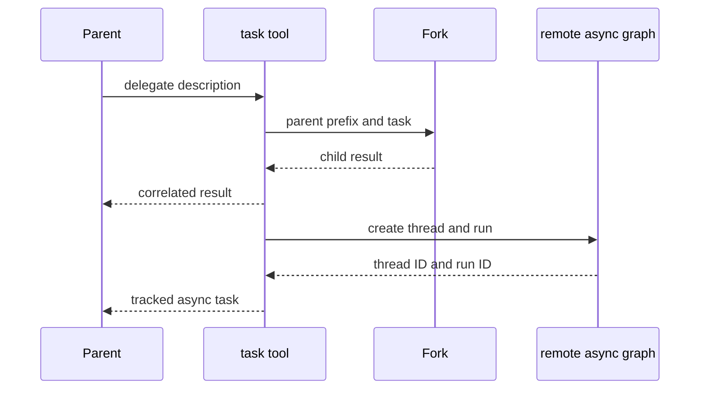

# Testing Guide

Run the narrowest owning suite from the package being changed. Tests in this monorepo are intended to protect observable behavior rather than internal call order: unit tests are network-free, integration tests are networked, async tests use automatic asyncio mode, and unaccepted warnings fail the suite. Start with [Development](../operations/development.md) for setup and [SDK Construction and Execution](../architecture/sdk-construction-execution.md) for the graph boundary.

## Focused routes

Work inside the changed package, install dependencies explicitly, and let that package's `Makefile` supply the ordinary test invocation. `make test TEST_FILE=…` is the normal focused-file route; use direct `uv run --group test pytest …` only for a one-off node or parametrization. Finish a behavior-changing package change with its lint target.

```bash
# Core SDK: graph, delegation, and StoreBackend
cd libs/deepagents
uv sync --all-groups
make test TEST_FILE=tests/unit_tests/middleware/test_fork_payload.py
make test TEST_FILE=tests/unit_tests/middleware/test_subagent_middleware_init.py
make test TEST_FILE=tests/unit_tests/test_async_subagents.py
make test TEST_FILE=tests/unit_tests/backends/test_store_backend.py
make lint

# dcode headless/client behavior
cd ../code
uv sync --all-groups
make test TEST_FILE=tests/unit_tests/test_agent.py
make test TEST_FILE=tests/unit_tests/test_non_interactive.py
make lint

# Talon archive behavior
cd ../talon
uv sync --all-groups
make test TEST_FILE=tests/unit_tests/test_archive.py
make test TEST_FILE=tests/unit_tests/test_store_archive.py
make lint

# Modal adapter
cd ../partners/modal
uv sync --all-groups
make test TEST_FILE=tests/unit_tests/test_sandbox.py
make lint

# Release scripts run from the repository root
cd ../../..
uv run --group test pytest .github/scripts/tests/release/test_check_wheel_dep_freshness.py
uv run --group test pytest .github/scripts/tests/release/test_release_notes.py
```

Deep Agents and dcode unit targets run pytest with xdist, coverage, and sockets disabled except Unix sockets. Talon runs its WhatsApp bridge Node tests before its Python suite and gives Python tests a 10-second timeout. The Modal unit target disables network sockets but does not add coverage itself. Keep a test in `tests/unit_tests/` if it is deterministic and network-free; put a genuinely networked check in `tests/integration_tests/`.

## SDK delegation: test the payload boundary

A forked subagent continues the parent context rather than acting as a fresh isolated worker. The highest-value regression test invokes a real parent graph using provider HTTP stubs or fake chat models, then inspects the child request—not an implementation helper alone.



*Fork delegation preserves a parent context prefix, while remote async delegation creates a separately tracked run.*

### Synchronous forks

Use `middleware/test_fork_payload.py` when changing provider serialization, prompt composition, history transfer, cache controls, or tools. Test both Anthropic and OpenAI shapes where serialization is relevant. The child request must retain the parent system/tools prefix and inherited history, remove the in-flight `task` call, and put fork-specific instructions beside the delegated task rather than in the system prefix. This is the cache-reuse invariant: parent and fork prefixes—including tool ordering and cache-control placement—must remain equivalent.

Use `middleware/test_subagent_middleware_init.py` for construction and policy checks:

- A fork may inherit parent memory and dynamic prompt middleware, but duplicate same-name prompt middleware must replace rather than append a second prompt mutation.
- A fork cannot configure independent skills and refuses recursive `task` delegation. The refusal is a tool result so the child and parent can continue.
- An isolated child remains independent: it can retain its own skills middleware and does not receive the parent memory middleware.
- Dynamic response schemas are compiled for declarative subagents; a compiled runnable cannot be retrofitted with that response schema.

When changing a shared sync/async path, cover both `invoke` and `ainvoke`. Keep the test at the parent graph boundary so it detects history duplication, dangling tool calls, prompt-prefix drift, or an incorrect correlated result.

### Remote async subagents

`test_async_subagents.py` owns remote delegation, task bookkeeping, and context transfer. `AsyncSubAgentMiddleware` exposes five tools—start, check, update, cancel, and list—and stores task records keyed by child thread ID. A launch creates the remote thread and run, returns a `Command` with a correlated tool message, and merges the task state without discarding other tasks. Test duplicate agent names and invalid modes at initialization, default `x-auth-scheme` behavior, and custom-header preservation when changing configuration.

For an isolated launch, the remote input is only a user task. For a fork launch, it is a snapshot of the eligible parent message history plus a final task message; it excludes private state and message artifacts. Test summary cutoffs, removal of the spawning call, and snapshot immutability if changing payload construction. Media is a special boundary: offloaded parent media must be rehydrated for a fork request, then re-offloaded under the child backend. It must not leak transient blob payload state into a checkpoint or reload media for unrelated/isolated post-approval tools.

## StoreBackend: persistence and isolation

`StoreBackend` adapts LangGraph `BaseStore` into the filesystem backend contract. It is persistent and cross-thread, but only within the caller-selected namespace. Test a real `InMemoryStore` for CRUD, path listing, literal grep, glob, pagination metadata, and both sync and async upload/download routes.

The namespace factory is the security and tenancy boundary. Its tuple must be nonempty and use safe component characters; distinct namespaces must not see each other's files. A backend with no explicit store obtains one from graph execution. Conversely, an explicit store can be used outside a graph only when the namespace factory does not read runtime data; a runtime-dependent factory must fail with the actionable outside-graph error rather than an `AttributeError`.

Persistence compatibility matters more than a happy-path write:

- UTF-8 uploads stay textual, while NUL-containing or non-UTF-8 bytes are base64 so a JSON-backed store can round-trip them byte for byte. Binary data must not be returned by grep or consume its match limit.
- Existing legacy `list[str]` content reads as newline-joined text without a destructive read; write or edit migrates it to current string-plus-encoding form while retaining creation metadata. Invalid legacy list elements raise rather than silently coercing data.
- Text reads use shared slicing semantics, including clamped negative offsets and empty non-positive limits. Binary/media reads bypass text slicing. Listings report UTF-8 byte size.
- Filesystem middleware's large-result interception persists the full result at `/large_tool_results/<tool_call_id>` and gives the model a pointer rather than an oversized tool message.

## dcode headless execution

The dcode tests protect CLI-agent construction and non-interactive execution separately. In `test_agent.py`, use fake models and patched paths to verify backend routing: local conversation-history archive writes are redirected to stable user data, while large tool results remain on the real filesystem under the advertised artifacts path. A resumed fallback archive path must stay resolvable even if a later session has a different artifacts root.

The same file also tests process-level safeguards. Runtime model metadata is restored between tests; an unavailable provider while resolving retry ownership defers startup instead of aborting it; and the asynchronous approval-mode Store reader uses `aget` on an event loop rather than forbidden synchronous Store access.

`test_non_interactive.py` owns the headless loop's user-visible policy. Assert shell approval decisions for absent allow lists, allow-listed commands and pipelines, dangerous syntax, and the explicit allow-all mode. Test output accounting with both message and custom usage deliveries so one model request is counted once. For server launch plumbing, test that `run_non_interactive` forwards its owned sandbox ID, `sandbox_type`, and profile overrides. Do not turn these into live provider or sandbox tests.

## Talon archives: scoped, paginated, recoverable history

Talon's archive is persistent chat history and retrieval, not a prompt cache. `ArchiveScope` is host-supplied channel/chat identity; conversation tools obtain it from a trusted callback instead of model arguments. Tests must prove that a chat can search its sessions—including sessions before `/new`—without retrieving another channel or chat's history.

Archive entries are bounded chunks (`CHUNK_SIZE` is 4000), cursor-paginated, and role/time-filterable. A test for a long transcript should page until exhaustion and reconstruct the exact content. Validate pagination bounds, reject a foreign-session cursor, require timezone-aware windows, and preserve the scan-limit continuation signal rather than silently claiming a complete search. Search responses expose semantic/indexing/pagination/scan status so callers can distinguish a complete miss from incomplete coverage.

Use both in-memory and SQLite storage where the contract supports both. The important lifecycle cases are:

- Checkpoint compaction may remove a message from active graph state without losing its originally archived transcript; repeated checkpoints do not duplicate it. Revisions retain distinct text but identical repeats do not.
- Reset/clear removes checkpoints, pending writes, and archive entries for the selected scope, including reset-derived sessions and subagent namespaces, while leaving another channel untouched. It cancels an active turn before deletion.
- Archive metadata writes and deletions are journaled/recoverable. A partial write or deletion can be retried after reopening; a session being deleted cannot be appended to and resurrected. Cancellation waits for a started metadata write before releasing the archive lock.
- Vector indexing is asynchronous: append must not wait for inference, retrieval reports pending coverage, and a failed vector deletion must eventually recover without exposing deleted history. A missing vector store makes deletion fail rather than leaving a silently inconsistent archive.

`test_store_archive.py` additionally guards compatibility and resource bounds: legacy Slack thread scopes may be read through their parent scope only under the defined compatibility rule, metadata and vector namespaces separate assistants, traversal detects corrupt ordering links, and scan budgets bound store reads while releasing locks for subsequent writes.

## Modal sandbox error semantics

`ModalSandbox` maps selected Modal filesystem exceptions to backend protocol errors on a per-file basis. Missing paths and not-a-directory map to `file_not_found`; permissions map to `permission_denied`; directory targets map to `is_directory`. Batch upload/download must continue after one mapped failure and retain the successful response for later items. Do not broaden the mapping casually: an unmapped error such as `SandboxFilesystemFileTooLargeError` must propagate, preserving diagnostics and preventing an unsupported failure from being misreported as a missing file. Also cover the absolute-path `invalid_path` precondition when changing file routing.

## Release automation

Run the two release test shims after changing wheel validation, release metadata, workflow YAML, JavaScript helpers, or release-please wiring.

`test_check_wheel_dep_freshness.py` treats built-wheel `METADATA` as authoritative for name, version, Python requirement, extras, and dependency requirements. The checker compares each applicable dependency constraint with published PyPI metadata over supported CPython/platform/extra marker environments. It rejects direct URLs, no matching release, or a published Python-support gap across the wheel's declared range. A sibling package whose current `requires-python` is newer than the latest eligible published sibling is a hard release-order failure—not a warning; release that sibling first. The tests also preserve safe GitHub command output escaping.

`test_release_notes.py` runs the native Node tests and inspects release workflows as security-sensitive configuration. Keep the curated-notes required check attached to the validated release PR head and component-agnostic across the release-please registry. Trusted helper paths must exist. Privileged draft/apply jobs must be gated by validation, use the release-bot environment and short-lived app token with narrow job permissions, and must not check out or shell-push untrusted release-branch content. Refresh/check cleanup must close interrupted in-progress checks without overwriting a completed validation result.

## Completion checklist

1. Run the owning focused test file(s) from the package and `make lint` after code changes.
2. For fork/delegation work, assert the serialized parent/child boundary, not just middleware construction; run both sync and async coverage when shared.
3. For persistence work, cover scope isolation, pagination and legacy data, plus failure/recovery behavior—not only CRUD.
4. For dcode and sandbox work, use fakes/mocks at provider and sandbox boundaries and preserve error classification.
5. For release changes, run both Python shims; they intentionally execute the Node release-note tests and validate workflow guardrails.
