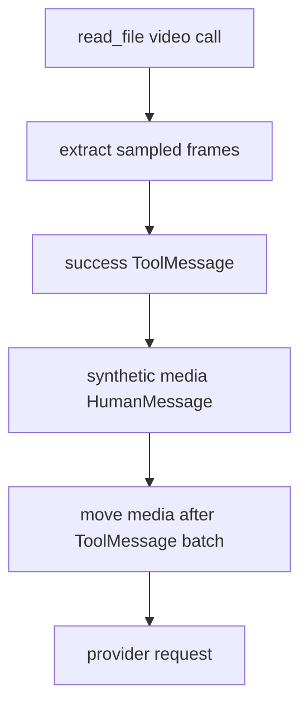

# Testing Guide

Start at the package and boundary that own the changed behavior, then widen only when the change crosses that boundary. Put network-free tests in `tests/unit_tests/` and networked tests in `tests/integration_tests/`; assert deterministic, observable behavior rather than helper calls or incidental implementation details. Unaccepted pytest warnings fail the suite. See [Profiles and Models](../concepts/profiles-models.md), [Filesystem Tools](../concepts/tools-filesystem.md), [Sandbox Partners](../integrations/sandbox-partners.md), and [Development](../operations/development.md) for the corresponding runtime and contributor contracts.

## Run the owning target

Use a package Makefile target so its dependency group, coverage, parallelism, socket policy, and timeout stay aligned with CI.

```bash
make -C libs/deepagents test TEST_FILE=tests/unit_tests/middleware/test_filesystem_video.py
make -C libs/deepagents test TEST_FILE=tests/unit_tests/test_nemotron_ultra_profile.py
make -C libs/partners/quickjs test TEST_FILE=tests/unit_tests/test_shutdown.py
make -C libs/deepagents test TEST_FILE=tests/unit_tests/middleware/test_compaction_recovery.py
make -C libs/deepagents test TEST_FILE=tests/unit_tests/middleware/test_summarization_middleware.py
make -C libs/deepagents test TEST_FILE=tests/unit_tests/test_subagent_refusal.py
python -m pytest .github/scripts/tests/workflows/test_ci_workflow.py
make -C libs hygiene
```

`libs/deepagents` defaults to `tests/unit_tests/`, uses xdist, and disables sockets except Unix sockets; its integration target selects `tests/integration_tests/` with a 30-second timeout. QuickJS likewise disables sockets for its unit target and has a separate 30-second integration target. `libs/code` shares the Deep Agents unit/integration policy, while Talon runs its Node bridge tests before socket-disabled pytest with a 10-second timeout. Run the focused route first, then its package lint target before widening to the package suite.

`libs/Makefile` owns shared changed-file hygiene: by default it compares `origin/main` with `HEAD` and runs the explicit `check-yaml`, `check-toml`, `end-of-file-fixer`, `trailing-whitespace`, `fix-smartquotes`, and `fix-spaces` hooks. Supply `HYGIENE_FROM`, `HYGIENE_TO`, or `HYGIENE_ARGS` when the caller has an explicit range or file list; do not reproduce the hook list in a workflow. The scheduled OpenWiki workflow stages only generated documentation paths and invokes this target with its staged file list, retrying once so hook fixes can be staged.

## Video `read_file`: frames and message ordering

Use `test_filesystem_video.py` when changing video classification, frame extraction, synthetic media messages, or model-request preparation. The tests replace the extractor and backend locally, so they exercise routing and message contracts without PyAV, a provider, or network access.



*Video frames are attached after every tool result from the same assistant tool-call batch.*

Preserve these observable invariants:

- With video dependencies enabled, a video read decodes the backend payload and calls the frame extractor with `offset` and `limit` interpreted as seconds at the fixed sampling rate. A successful result is a `Command` containing a success `ToolMessage` followed by a marked `HumanMessage` carrying the frame blocks, path, and tool-call notification metadata. The model-facing OpenAI conversion must not contain a raw video block.
- The sync and async read paths have the same frame-extraction contract. Invalid base64, an input payload beyond the cap, a non-positive `limit`, and expected `VideoExtractionError` failures are returned as error tool messages without calling or leaking an unexpected extractor; unexpected programming errors remain visible.
- Without the optional video dependencies, preserve generic multimedia behavior and hide video-specific tool guidance. In particular, the enabled-only `.mkv` treatment must not silently alter the fallback file block.
- A video attachment is non-tool content. When `read_file` and another tool are parallel calls, every `ToolMessage` must precede the attachment in both `wrap_model_call` and `awrap_model_call`; otherwise providers that require a complete tool-result batch reject the request. Assert this provider-visible order, not merely the helper invocation.

## Nemotron 3 Ultra profile adaptation

Use `test_nemotron_ultra_profile.py` for changes to the Nemotron profile, rather than a provider integration test. The profile is registered for specific NVIDIA, Baseten, Fireworks, OpenRouter, Nebius, and Together model specifications—not provider-wide—and supplies a prompt suffix, a `read_file` description override, and ordered adaptation middleware.

The focused fixtures protect the compatibility seam: the tool-call shim maps a filesystem `path` argument to `file_path`, supplies the profile read default, and replaces empty tool content with a placeholder without deleting an existing file after a failed write. They also test text-form and JSON shell tool-call repairs only when the corresponding tool is exposed, ChatNVIDIA tool metadata compatibility, reasoning-tag cleanup, rate-limit retry, progress budgets, and policy/final-answer guards. Keep these tests local fake requests and messages: their purpose is deterministic adaptation, not provider availability.

### Read-page continuation

`ReadFileContinuationNoticeMiddleware` tells the model to page only when a successful `read_file` response contains exactly at least the requested number of source lines. It derives the count from the bounded status-header area when present, or from real numbered source rows; wrapped continuation rows and header-shaped file content must not inflate the count. A size-truncated window must not receive a continuation offset that skips dropped content.

When changing producer formatting or this middleware, assert all of the following:

- An exact-limit page states the original offset and recommends `offset + limit`; the shim's default limit and the continuation message must agree.
- A partial page, error result, or truncated output has no continuation hint.
- Status-header recognition is anchored to valid header rows. A matching string in file body content is data, not metadata.
- Gutter parsing counts primary source rows using the current two-space separator or legacy tab, but not wrapped `N.M` fragments. Include a round-trip from `format_content_with_line_numbers` so producer and consumer cannot drift.

## QuickJS interpreter lifecycle

Use `libs/partners/quickjs/tests/unit_tests/test_shutdown.py` for cleanup changes. `CodeInterpreterMiddleware` gives each LangGraph thread a private registry slot containing a worker, runtime, and REPL. At normal `after_agent` completion it snapshots thread-mode state when applicable and evicts the slot; non-thread modes evict without a snapshot. The registry closes and removes the slot, while call mode resets a REPL after each evaluation.

The shutdown regression suite builds a local Deep Agent with a fake model, opens an interpreter through `eval`, then tests normal completion, `interrupt()`, and a failing tool in a subprocess. Each process must exit cleanly, proving cleanup still works when `after_agent` is skipped or execution unwinds through interruption/error. Its garbage-collection case deletes the agent and middleware, forces `gc.collect()`, and requires QuickJS worker threads opened by that case to disappear. Preserve all five lifecycle exits—completion, interruption, error, GC, and process exit—rather than relying on a remote interpreter or a timing-only assertion.

## Context compaction and overflow recovery

`SummarizationMiddleware` reduces the model-facing request while retaining raw conversation state and records a `_summarization_event` only when it has actually summarized history. `test_summarization_middleware.py` is the focused route for normal and chained event semantics; `test_compaction_recovery.py` protects limit calculation and retry behavior. Use its deterministic counter, fake model, and mock backend rather than a provider.

When modifying cutoff, budgets, clipping, or recovery, preserve these regression cases in synchronous and asynchronous invocation:

- Chained summaries use raw-state coordinates: each event records a cutoff index and cutoff message ID. The next compaction resolves the prior boundary by ID when earlier messages disappeared, but falls back to the stored index for legacy or stale IDs.
- A request must fit the effective input budget before reaching the model. Include system text, tool schemas, and reserved output tokens; an irreducible request raises `ContextOverflowError` without a provider call, and an unknown agent limit must not borrow the summarizer's limit.
- A classified provider context-limit failure or `ContextOverflowError` gets one smaller retry. A second overflow is terminal; an unrelated bad request propagates untouched. Recovery must not resend identical input when no cutoff can reduce it.
- Large-result regressions belong in `test_end_to_end.py`: oversized `read_file` results become smaller offset-guided content while source files remain intact; oversized `ls` and arbitrary-tool results are offloaded under `/large_tool_results/` and replaced with pointers.

The manual `compact_conversation` seam has separate state rules. An ineligible or zero-cutoff request is a correlated no-op tool result. Successful compaction records raw-state cutoff arithmetic, summary content, and an optional archive path. Summary or escaping-offload errors return an error `ToolMessage` without changing the event. dcode tests additionally protect selected-model budget calculation, deferred archive mutation, and fail-closed archive reads.

## Delegation, filesystem, and adapter boundaries

Keep these package-owned routes when work touches their contracts:

- `libs/deepagents/tests/unit_tests/backends/test_filesystem_backend.py` uses `tmp_path` for virtual-root traversal rejection, root-scoped globbing and dotfile behavior, deterministic listing, paginated text reads, literal grep in ripgrep and Python fallback paths, and symlink containment. If CI promised ripgrep, absence fails rather than skips.
- `libs/deepagents/tests/unit_tests/test_subagents.py` verifies that remote async specifications expose `start_async_task` and `check_async_task` with `task`, while synchronous children expose `task`; final child output and parallel results are correlated by task-call ID. Private state stays isolated while intentionally public state can propagate. Test parallel results by ID, not completion order.
- `libs/deepagents/tests/unit_tests/test_subagent_refusal.py` distinguishes the main-agent refusal exception/fallback policy from the delegated-task boundary, where refusal becomes a parent-visible notice and the parent continues. Cover provider-shaped and raised refusals, structured-output and declarative children, and sync and async paths.
- `libs/talon/tests/unit_tests/test_mcp_adapter.py` uses an in-process FastMCP server and local stdio process to validate prefixed calls, argument normalization, schema preservation, result/error correlation, authorization cleanup, elicitation/approval, reload during invocation, and child-process cleanup without a remote service.
- `libs/code/tests/unit_tests/test_output_truncation.py` separates stop-reason classification from graph behavior: an empty truncation is a serialized model error without an assistant checkpoint, while subagent partial and empty truncations are correlated parent tool results that allow the parent to continue in fork and isolated modes.

## CI and shared hygiene contracts

`.github/scripts/tests/workflows/test_ci_workflow.py` loads workflow YAML, normalizes the YAML 1.1 `on` key, evaluates the GitHub Actions conditions used by the tested workflow, and executes high-risk shell bodies against stub binaries. Use it when editing CI, reusable workflows, or their gate scripts.

The reusable `check_lockfiles.yml` workflow has read-only contents permission, a five-minute Ubuntu job, credential-less checkout, and cache-disabled uv setup. It runs the all-package lockfile checker, then—except on push—delegates changed-file hygiene to `make -C libs hygiene`. Its tests use stubbed `python3` and `make`: a lockfile failure prevents hygiene from running, while either validation failure fails the job. The final CI gate must unconditionally consume the reusable lockfile job and fail for every result other than success.

## Completion checklist

1. Run the smallest owning route with fake models, mock backends, `tmp_path`, stub binaries, or a subprocess; avoid network services when the unit suite demonstrates the contract.
2. For filesystem media, assert tool-result correlation, attachment metadata, fallback/error behavior, and provider-visible batch order in sync and async paths.
3. For profile changes, assert repaired inputs and output semantics against fake messages, especially pagination offsets and producer/consumer formatting boundaries.
4. For interpreter changes, exercise completion, interruption, tool error, GC, and process exit; assert released workers or clean subprocess exit rather than implementation calls.
5. For context and delegation changes, assert request reduction, retry count, persisted state, parent-visible results, and terminal failure semantics.
6. For workflow changes, execute shell and gate behavior under controlled failures; preserve the Makefile-owned local command and run the relevant lint target.
