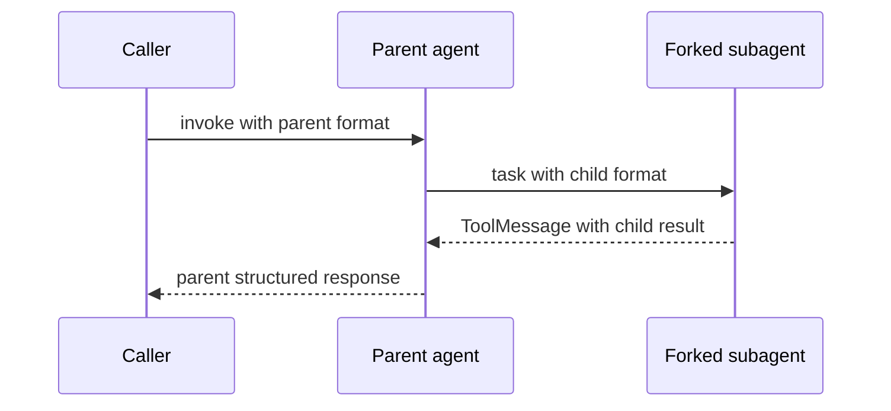

# Testing Guide

Run the smallest route that proves the changed public boundary. Unit tests are network-free, deterministic, and should observe returned messages, persisted state, channel output, protocol frames, or workflow exit status—not private call ordering. Use fake models, temporary directories, in-process transports, mock HTTP, and synchronization events; do not use credentials or a live provider. Unaccepted pytest warnings fail the suite.

From the owning package, pass an exact path through `TEST_FILE`:

```bash
# Deep Agents: streaming and forked response formats
cd libs/deepagents
make test TEST_FILE=tests/unit_tests/middleware/test_fork_response_format.py
make test TEST_FILE=tests/unit_tests/test_end_to_end.py
make test TEST_FILE=tests/unit_tests/test_subagents.py

# dcode cost accounting
cd ../code
make test TEST_FILE=tests/unit_tests/test_cost_breakdown.py
make test TEST_FILE=tests/unit_tests/test_cost_tracking.py

# Talon media, effort, commands, integrations, and session bridges
cd ../talon
make test TEST_FILE=tests/test_media.py
make test TEST_FILE=tests/unit_tests/test_effort.py
make test TEST_FILE=tests/unit_tests/test_help.py
make test TEST_FILE=tests/unit_tests/test_mcp_adapter.py
make test TEST_FILE=tests/unit_tests/test_research_subagents.py

# CI workflow contracts run from the repository root
cd ../..
uv run pytest .github/scripts/tests/workflows/test_ci_workflow.py
```

The Deep Agents and dcode test targets use xdist, coverage, disabled non-Unix sockets, and disabled benchmarks; Talon also runs its WhatsApp bridge tests and applies a ten-second pytest timeout. `TEST_FILE` is therefore the safe focused-test entrypoint rather than an ad hoc pytest invocation.

## Select the regression seam

| Change | Focused route | Observable invariant |
| --- | --- | --- |
| Forked subagent structured output | `libs/deepagents/tests/unit_tests/middleware/test_fork_response_format.py` | Parent and child provider requests carry only their respective response strategy; the child result reaches the parent as the delegated `ToolMessage`. |
| Stream metadata or delegated completion | `libs/deepagents/tests/unit_tests/test_end_to_end.py`, `test_subagents.py` | Named parent/child events retain caller metadata, and the child completion is returned through the parent tools update. |
| Cost display or persistence | `libs/code/tests/unit_tests/test_cost_breakdown.py`, `test_cost_tracking.py` | Unpriced usage remains visible without inflating priced rows; lifecycle settlement neither loses retriable spend nor double-counts committed spend. |
| Inbound/outbound media | `libs/talon/tests/test_media.py` | Documents are notices, images are bounded model blocks, and outbound paths resolve beneath their trusted root. |
| `/effort` or provider payload mapping | `libs/talon/tests/unit_tests/test_effort.py` | Only an operator can persist a supported per-model choice, and each turn receives its own provider-compatible settings. |
| CI gate, path selection, cancellation, or ripgrep diagnostics | `.github/scripts/tests/workflows/test_ci_workflow.py` | Execute the gate or shell body with controlled environment and stubbed binaries; assert exit status, annotations, artifacts, and fail-closed behavior. |
| MCP, research, or background delegation | `libs/talon/tests/unit_tests/test_mcp_adapter.py`, `test_research_subagents.py` | Identity and authorization lifetime are preserved while untrusted protocol failures and unavailable interaction paths are safely contained. |
| External session bridge | `libs/talon/tests/unit_tests/test_claude_sessions.py`, `test_codex_sessions.py`, `test_dcode_sessions.py` | Delivery remains approval-gated, owner-correlated, escaped, and cancellation-safe. |

## Forked subagent response formats

A `mode="fork"` subagent continues the parent conversation but does **not** inherit the parent `response_format`. That separation prevents a parent-only structured-output contract from silently changing the fork's provider request. Give the fork its own `response_format` when it must return a schema; its structured result is JSON-serialized into the task tool's `ToolMessage`, while the parent still produces its own `structured_response`.

The regression test parameterizes sync and async execution across no format, `ToolStrategy`, and `ProviderStrategy`. It compares the actual provider request bodies: a matching tool strategy may share tool definitions and tool choice; a provider strategy controls the provider `output_config`; a distinct or omitted child strategy must not accidentally reuse either. Test the delegated content as well as request shape—otherwise a correctly configured child can still be lost at the parent boundary.

A caller may set `SUBAGENT_RESPONSE_FORMAT_CONFIG_KEY` in runnable configuration. That dynamic format overrides the fork specification, so test both a schema matching the parent and one that differs. This is an extension point: additions to response-format propagation must preserve the precedence `dynamic configuration → fork specification → no inherited parent format`.



*The test checks two independent provider-format boundaries and the message that joins them.*

## dcode cost accounting: preserve uncertainty

Cost tracking is an accounting boundary, not merely a total. A request without catalog pricing still contributes reported input, output, cache, and reasoning tokens, request count, and completeness information, but its tokens must not be merged into a priced category or presented as priced spend. The cost-breakdown table consequently shows explicit **Unpriced** rows and a partial total when mixed history contains priced and unpriced requests. Legacy breakdowns that predate the split must render conservatively as including unpriced tokens rather than inventing a precise allocation.

Test display formatting at the copyable-table boundary: fully priced totals show 100%, sub-display values avoid scientific notation, unavailable values remain unavailable, and incomplete historical detail suppresses a misleading table. A category may have tokens but no category-price detail; retain that partial marker even when its numeric display is zero.

The tracking suite covers the state lifecycle. Records drained for an operation are prepared before persistence: `rollback()` restores them so a retry can account for the request, while `commit()` settles them so a later drain cannot double charge. A pre-upgrade checkpoint with a legacy total retains `historical_complete=False` as new usage is recorded and streamed. Test message, recorder, and operation paths, because all must produce the same truthful breakdown.

## Talon media: data, bounds, and model content

Inbound documents and generic files are not read into the user prompt. Talon appends a JSON-serialized absolute path notice directing the agent to `read_file` or `execute`, explicitly labels both path and attachment as untrusted data, and avoids filesystem reads while constructing that notice. This preserves large and binary attachments without turning their contents into prompt injection. Availability failures deliberately return a generic attachment notice that omits transport error details.

Only image media becomes a model content block. The builder passes text plus base64 image blocks for recognized image MIME types, skips missing or oversized images, and leaves documents—even documents mixed into an image message—as path notices. Tests patch `Path` methods to prove that document notices do not stat or read sandbox paths.

Outbound/local media must go through `resolve_bounded_media_path(path, root)`. It rejects URI schemes, home expansion, parent traversal, unavailable or non-regular files, and symlink-resolved escapes; only a canonical regular file beneath the trusted root is accepted. Add containment tests whenever a channel adds a new source of media paths.

## Talon effort controls

`/effort` is operator-only state scoped to the selected model. A valid change is captured on each submitted turn, saved per model in the effort-state file, and restored after restart; choosing `default` removes the selected model's override. Persistence failures must leave the earlier in-memory selection intact, and the state file is mode `0600`. Invalid values and unauthorized requests must neither invoke the agent nor create state.

`effort_levels()` is an allowlist, including documented fallbacks for models whose profile metadata omits effort capability. `effort_settings()` translates only an allowed level into provider-native parameters: for example, DeepSeek combines thinking control with `reasoning_effort`, Qwen uses a thinking budget, GLM uses native thinking modes, and ordinary compatible models use `reasoning_effort`. Test actual request payloads for each adapter rather than only the helper return value.

The runtime stores turn settings in `ACTIVE_EFFORT`, a context variable. Concurrent invocations must receive their own settings, preserve unrelated model settings when merged, and reset the context after the call so an effort selection cannot leak into the next turn.

## CI gate diagnostics: execute the decision boundary

Workflow tests are static where YAML structure is the contract, but execute shell and JavaScript when a conditional can silently reverse a gate. The CI-success test runs the real gate script with synthetic `needs` and selection JSON. It requires selected checks to succeed and treats absent, unknown, skipped, failed, or cancelled required results as failures. The narrow Talon PR waiver applies only when Talon source is unchanged; invalid scope values fail closed and waived failures remain visible through the advisory job.

Cancellation is not automatically green: a cancelled push may pass only when a GitHub lookup proves the branch head advanced beyond the run SHA. A failed lookup, manual cancellation, timeout, same SHA, PR, or merge queue remains strict. Path-gated release-options work may skip only for an unchanged PR; pushes and merge queues require its result.

For ripgrep installation, test the actual `_test.yml` script against stubbed `sudo`, `timeout`, `rg`, installer, and `gh` binaries. Ordinary SDK PRs soften only timeout exit statuses and record a marker artifact when `rg` is unavailable. Release-sensitive and non-PR runs are strict unless an exact live `ci:skip-ripgrep` label resolves the bypass; lookup failures fail closed. The post-CI comment workflow runs without checking out PR code despite its write permission, consumes only a successful/failed run's artifact, and uses the run head SHA to avoid stale diagnostics.

## Other high-value boundaries

Deep Agents streaming tests require caller tags and metadata on main-agent message chunks. With subgraphs enabled they require identifiable parent and child chunks and updates, the child final message in its subgraph update, and that result in the parent tools update. Assert consumer-visible namespace, mode, identity, metadata, and completion—not middleware order.

Talon research-subagent tests require a fresh child context without parent history or memory, explicit tool selection, and preserved MCP authorization metadata. Background MCP delegation has no interactive authorization handler and sanitizes protocol errors. MCP adapter tests use an in-process FastMCP transport and require prefixed names, tool-call IDs, optional defaults, result status, cleared authorization context, open/nested schema preservation, and usability of in-flight tools across reload.

Claude, Codex, and dcode session bridges are disabled by default, unavailable to nested subagents, and approval-gated. Test private verified targets, owner-correlated replies, escaped untrusted relay content, and dropped late replies after cancellation. `/help` must bypass agent invocation, preserve active work and pending interactive replies, and allow conversation progress while its own response is stalled. Model selection remains operator-only, persists an available choice across reset/restart, clears at `default`, and applies the selected model's context budget and summarizer while subagents retain the startup summarizer.

Context doctor is a read-only requested-thread diagnostic: it counts configured and effective context without private content or paths, reflects reloads, and returns a non-sensitive channel error on failure. QuickJS tests cover sync/async host-tool awaiting, Python-to-JavaScript value conversion, correlated nested PTC stream events without inner graph messages, and global isolation across constructed agents. Release-note tests use synthetic Git repositories to prove extraction, release-bounded package history, escaping and bounds, and warnings on predecessor-query failure. Workflow secret-scoping tests retain package-conditional integration credentials, release-environment trusted publishing with only `id-token: write`, and delayed constrained OpenWiki write-token use.

## Before finishing

1. Run the focused route and its paired persistence, reload, cancellation, or owner-delivery route when the change crosses that lifecycle boundary.
2. Keep fixtures hermetic and close sockets, processes, servers, and runtimes in `finally`.
3. Assert successful, rejected, unavailable, and late/cancelled outcomes whenever state or a result can outlive its initiating turn.
4. Run the owning package's `make lint` after focused tests pass.
