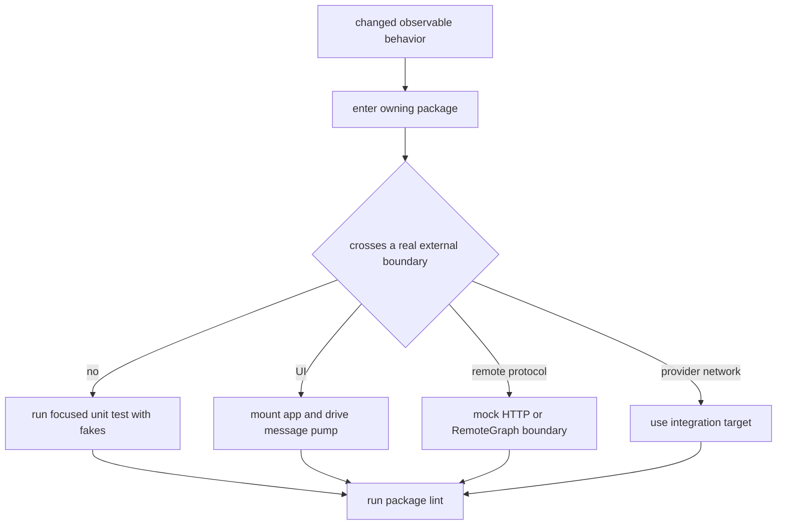
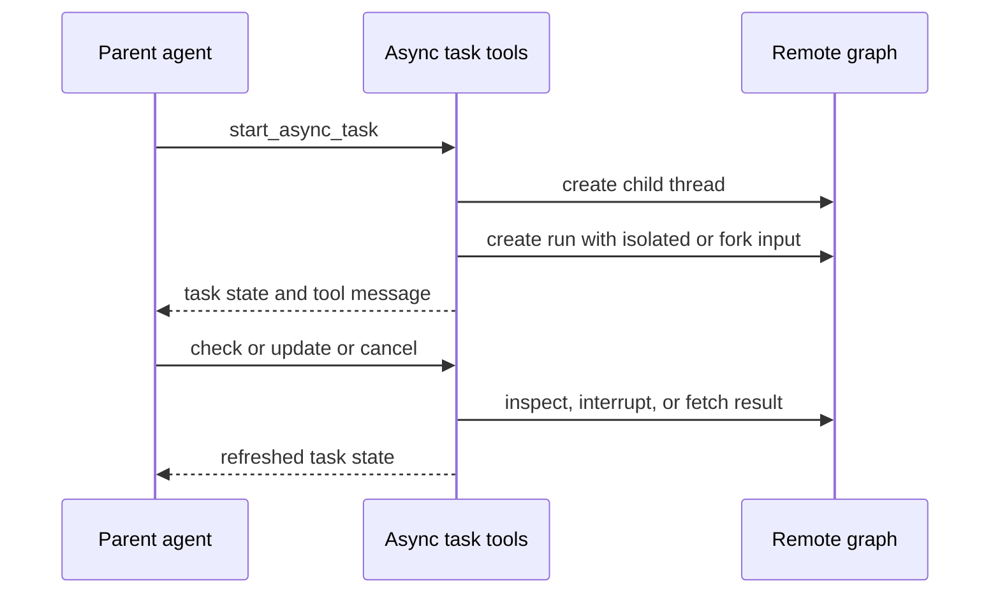

# Testing Guide

Run the smallest hermetic test that reaches the observable boundary you changed, from the package that owns it. Packages under `libs/` are independently versioned and own their environments and Makefiles; install and validate from that package rather than a repository-level virtual environment. Start from the nearby regression test, use a fake model, temporary filesystem, or mock transport, and assert state, outbound payload, or rendered behavior—not an incidental internal call sequence. See [Development](../operations/development.md), [Code Agent](../architecture/code-agent.md), [Runtime behavior](../architecture/runtime-behavior.md), [Subagents and skills](../concepts/subagents-skills.md), and [Sandbox partners](../integrations/sandbox-partners.md).

## Test layer and commands

Network-free tests belong in `tests/unit_tests/`; reserve `tests/integration_tests/` for actual network contracts. Pytest asyncio mode is automatic, warnings not explicitly accepted fail the suite, and tests should be deterministic. Both core packages use parallel pytest for their normal unit targets, disable sockets other than Unix sockets, disable benchmarks, and collect coverage. The integration targets are separate parallel runs with a 30-second timeout.

```bash
cd libs/deepagents
uv sync --all-groups
make test TEST_FILE=tests/unit_tests/test_async_subagents.py
make lint

cd ../code
uv sync --group test
make test TEST_FILE=tests/unit_tests/test_non_interactive.py
make lint
```

Use `TEST_FILE` to select a file and `PYTEST_EXTRA` for focused pytest options. Use `make coverage` when the coverage report itself is needed. In dcode, `make lint` additionally checks the generated command catalog and the process working-directory policy. `make update-snapshots` is deliberately separate and runs socket-restricted smoke snapshots with `--update-snapshots`; review the resulting artifact diff. `COMMANDS.md` is generated from the slash-command registry, so command changes require `make commands-catalog` followed by `make commands-catalog-check`.

## Select the focused regression

| Changed boundary | First focused test | What the test must prove |
| --- | --- | --- |
| Deep Agents synchronous delegation, fork/isolated state, or concurrent children | `libs/deepagents/tests/unit_tests/test_subagents.py` | A parent receives final child results as tool messages, while parent-only and private sibling state does not leak; exercise both `invoke` and `ainvoke` for async-sensitive behavior. |
| Remote asynchronous subagent lifecycle or forked context | `libs/deepagents/tests/unit_tests/test_async_subagents.py` | Mock the LangGraph client or use `httpx.MockTransport`; assert task state and request input, including `fork` context snapshots rather than only the task-tool implementation. |
| Binary tool-result persistence or rehydration | `libs/deepagents/tests/unit_tests/middleware/test_blob_offload.py` | Confirm only eligible results are replaced by content-addressed references, persistence failures preserve inline payloads, and malformed or tampered references become a safe text notice. |
| dcode TUI connection/startup/modal ordering | `libs/code/tests/unit_tests/test_app.py` | Mount `DeepAgentsApp` with `run_test()`, controlled events, and fake workers; assert ordering and liveness through the real message pump. |
| dcode headless output, HITL, or server-launch plumbing | `libs/code/tests/unit_tests/test_non_interactive.py` | Mock server startup and stream chunks; assert stdout/stderr behavior, permission decisions, and forwarded launch configuration. |
| dcode remote graph translation or conflict recovery | `libs/code/tests/unit_tests/test_remote_client.py` | Use `httpx.MockTransport` or a fake `RemoteGraph`; inspect the actual request and converted stream/state result. |
| dcode server-side pinned skills and trust | `libs/code/tests/unit_tests/skills/test_pinned_skills.py` | Use a temporary skill tree, filesystem backend, and in-memory checkpoint; test the trust interrupt and persisted snapshot across turns and process restart. |
| dcode sandbox ownership or provider failure | `libs/code/tests/unit_tests/test_sandbox_factory.py` | Mock registry/provider boundaries; prove cleanup ownership, error preservation, dependency guidance, and provider-specific lifecycle behavior. |
| Scheduled dependency-minimum automation | `.github/scripts/tests/checks/test_raise_langchain_minimums.py` | Exercise manifest planning and workflow helpers in a temporary repository; preserve satisfiable constraints, lockfile scope, and workflow validity. |



*Choose the test double at the boundary where the behavior becomes externally meaningful; only use integration coverage when that boundary is genuinely remote.*

## Deep Agents: delegation, async tasks, and blobs

For ordinary subagents, construct a parent fake model that emits `task` calls and child fake models with controlled final messages. A child result is returned to the parent as a `ToolMessage`; parallel calls must retain one result per tool-call ID. Test state isolation independently: private parent fields must not reach a child, sibling private fields must not cross over, and a child changing its rubric must not overwrite the parent's rubric in either `fork` or `isolated` mode.

Async subagents are a remote lifecycle seam. Configuration rejects modes other than `isolated` and `fork`; the middleware exposes start, check, update, cancel, and list tools and stores tracked tasks in `async_tasks`. Mock thread creation and run APIs. For a fork, assert the request contains the summarized or unsummarized message snapshot plus the delegation prompt, excludes tool artifacts, and does not mutate parent state while the remote request is built. For isolated work, assert that only the task description is sent. Exercise sync and coroutine variants when changing shared tool behavior.



*The async-task test boundary is the parent state plus the remote request and response, not a live server.*

Binary offload tests should use `FilesystemBackend` and a known base64 payload. Eligible `read_file` output is replaced in persisted messages by a digest reference and rehydrated before a model call. Test `Command` results because every message in its update must be processed. A digest that does not match stored bytes, a malformed reference, or missing blob must never be read as arbitrary filesystem content; it is rendered as the missing-blob text. If upload raises, the payload remains inline so model input is not silently lost.

## dcode app, headless, and remote boundaries

`DeepAgentsApp` lifecycle regressions need `run_test()`, `asyncio.Event` coordination, and pilot key events rather than sleeps. Startup hydration is idempotent across later `ServerReady` events; a resumed status remains visible until history restoration completes; restored history mounts before startup output; and a failure to adopt the resumed model prevents an initial prompt from being submitted. Modal command regressions must submit through the real `ChatInput` message path: an open preference modal must receive Escape and block queued work until its continuation starts.

Headless tests mock `start_server_and_get_agent` and drive `run_non_interactive()` with synthetic stream chunks. Test shell HITL policy with explicit allowlists, not a real shell. In quiet mode, agent text is the only stdout payload and diagnostics are suppressed; with `stream=False`, output is buffered, whereas stream mode writes text incrementally. Launch plumbing must forward sandbox type, snapshot name, profile overrides, and filesystem-tool allowlists; permission hooks override the headless auto-approve bypass while retaining the approval-mode context.

Remote-client tests must inspect the HTTP boundary. Top-level tracing tags survive configuration preparation. When workspace context is sent, incompatible configurable data is removed; a local thread ownership lease is sent as a header without discarding caller headers. Convert remote chunks and serialized interrupts into client types. Side accounting is best effort: failures must not discard primary stream, state, or cached cost. A state-write `409` triggers interruption of active running and pending runs and one retry; a second conflict still raises.

## Skills and sandbox lifecycle

dcode skill pinning is a server-side trust boundary, not only a YAML parsing exercise. Build a temporary skill root with `PluginSkillsMiddleware`, a real `FilesystemBackend`, and `InMemorySaver`. A symlinked skill outside the allowed roots produces a trust interrupt; approval must be persisted before pinning and denial or an unsaved approval fails. A successful pin is a human message with `lc_source: "pinned_skill"`, its body survives later edits, and request-only `pinned_skills` is cleared from the result. A failed pin must not poison a later ordinary or goal continuation. New server processes rescan skill metadata while preserving checkpointed conversation history, so test cached versus restarted process behavior explicitly.

Sandbox factory tests isolate the registry and provider. A setup-script failure, read error, or interruption must abort entry; delete only a sandbox created by the context, never an attached `sandbox_id`. If cleanup itself fails, retain the original setup exception and report cleanup failure separately. Test provider-specific constraints at the factory boundary: optional provider modules produce install guidance, snapshot names are rejected for unsupported providers or reattachment, and readiness failures clean up newly created resources without exposing SDK secrets. Verify dependency probing separately so missing optional modules fail early with actionable guidance.

## Dependency-floor automation

The scheduled dependency updater is a manifest and workflow transformation, so use its focused test module rather than live package indexes or GitHub. A selected release must choose the newest version compatible with its existing upper or compatible-release bound; exact pins, upper-bound-only requirements, package self-dependencies, and local workspace sources are not raised. Rewriting must change only quoted dependency literals, preserve extras, markers, and compatible-release precision, and fail if an advertised replacement is not present.

When a manifest changes, calculate stale lock directories including transitive local path dependents unless explicitly skipped. Narrowed dependency selection canonicalizes names and fails closed for unknown names or requirements with no raiseable lower bound. The workflow checks also guard GitHub Actions expression functions, dispatch options synchronized with release labels, and refresh ancestry so an existing automated PR contains only regenerated dependency and lockfile changes.

## Completion checklist

1. Run the closest focused unit file from the owning package.
2. Assert the externally meaningful invariant and its failure or cleanup path.
3. For async behavior, run both sync and async entry points where the implementation exposes both.
4. Mount the TUI or mock the HTTP/provider boundary only when the contract needs it.
5. Run the owning package's `make lint`; use the integration target only for a genuine network contract.
6. Regenerate snapshots or `COMMANDS.md` only with their Makefile targets, then review generated diffs.
