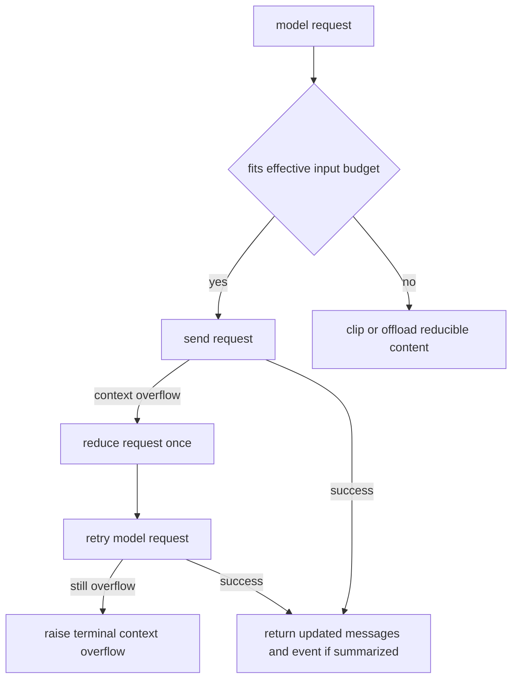

# Testing Guide

Start at the package and boundary that own the changed behavior, then widen only when the change crosses that boundary. Tests are network-free in `tests/unit_tests/` and networked in `tests/integration_tests/`; write deterministic assertions about observable behavior rather than helper calls or incidental ordering. Unaccepted pytest warnings fail the suite. See [Context Management](../concepts/context-management.md), [Subagents and Skills](../concepts/subagents-skills.md), [Runtime Behavior](../architecture/runtime-behavior.md), and [Development](../operations/development.md) for the corresponding runtime and contributor contracts.

## Run the owning target

Use a package Makefile target so the dependency group, coverage, parallelism, socket policy, and timeout stay aligned with CI.

```bash
make -C libs/deepagents test TEST_FILE=tests/unit_tests/middleware/test_compaction_recovery.py
make -C libs/deepagents test TEST_FILE=tests/unit_tests/middleware/test_summarization_middleware.py
make -C libs/deepagents test TEST_FILE=tests/unit_tests/test_end_to_end.py
make -C libs/deepagents test TEST_FILE=tests/unit_tests/test_subagent_refusal.py
python -m pytest .github/scripts/tests/workflows/test_ci_workflow.py
make -C libs hygiene
```

`libs/code` and `libs/deepagents` default to unit tests, use xdist, and disable network sockets except Unix sockets. Their integration targets select `tests/integration_tests/` and apply a 30-second timeout. Talon first runs its Node bridge tests, then runs pytest with sockets disabled and a 10-second timeout. Run the focused route first and the package lint target before widening to the package suite.

## Context compaction and overflow recovery

`SummarizationMiddleware` reduces the model-facing request while retaining raw conversation state and records a `_summarization_event` only when it has actually summarized history. `test_summarization_middleware.py` is the focused route for normal and chained event semantics; `test_compaction_recovery.py` protects the limit calculation and retry path. Use its deterministic counter, fake model, and mock backend rather than a provider.



*The recovery route distinguishes a reduced retry from resending an unchanged request and makes repeated overflow terminal.*

When modifying cutoff, budgets, clipping, or recovery, preserve these regression cases in both synchronous and asynchronous invocation:

- Chained summaries use raw-state coordinates: each event records a cutoff index and cutoff message ID. The next compaction resolves the prior boundary by message ID when earlier messages have disappeared, but falls back to the stored index for legacy or stale IDs. Verify that each new archive contains only the newly evicted range and that the retained suffix starts at the recorded boundary.
- A request must fit the effective input budget before it reaches the model. Include system text, tool schemas, and reserved output tokens in cases where those inputs leave no reducible message budget; such a request raises `ContextOverflowError` without calling the provider. An unknown agent limit must not borrow the summarizer model's limit.
- A provider-shaped context-limit failure and `ContextOverflowError` get one smaller retry. A second overflow becomes a terminal `ContextOverflowError` that retains the original provider error as its cause. An unrelated 400-style bad request must propagate untouched and must not offload or retry.
- When no summary cutoff is available, recovery must either reduce the request through clipping or stop after the first failure; it must never resend identical input. A successful no-cutoff recovery persists clipped replacement messages, keeps tool-call/result pairing, and does not invent `_summarization_event` state.
- Large tool-result regressions belong in `test_end_to_end.py`: `read_file` results are replaced with a smaller, offset-guided representation while original files remain intact; generic `ls` and user-tool results are offloaded under `/large_tool_results/` and replaced with pointers. Assert final agent completion and persisted backend state, not a private clip helper.

The manual `compact_conversation` seam has separate state rules. An ineligible or zero-cutoff request is a correlated no-op tool result. Successful compaction records raw-state cutoff arithmetic, summary content, and an optional archive path. Summary or escaping-offload errors return an error `ToolMessage` without changing the summarization event. dcode compaction tests additionally protect selected-model budget calculation, deferred archive mutation, and fail-closed archive reads.

## Refusals: main-agent exception, delegated task result

`create_deep_agent` places `ModelRefusalMiddleware` at the main stack tail, so a caller's `ModelFallbackMiddleware` can handle refusal first. Thus the default top-level behavior is a `ModelRefusalError`; a harness profile can explicitly exclude that middleware. This is intentionally different from the task boundary: `SubAgentMiddleware` catches refusal and structured-output validation errors caused by a refusal, formats a notice with available category and explanation, and returns it to the parent as the task result. The parent can continue its turn.

Use `libs/deepagents/tests/unit_tests/test_subagent_refusal.py` for changes in either policy or result formatting. Parameterize sync and async execution and cover:

- Anthropic refusal blocks with category and explanation, bare refusal metadata, and OpenAI refusal content; test both a raw refused response and a child that raises through `ModelRefusalMiddleware`.
- A structured-output child refusal, declarative and compiled subagents, and the async final-content formatting path.
- Plain dictionary messages, which are not treated as a refusal, and a refusal error without a structured block, whose error message supplies the explanation.
- The parent transcript: the `task` result is the notice and the parent produces its scripted final answer. Do not assert that a subagent exception escaped the parent.

## CI and lockfile workflow contracts

`.github/scripts/tests/workflows/test_ci_workflow.py` is deliberately more than YAML grepping. It loads workflow YAML, normalizes the YAML 1.1 `on` key, evaluates the subset of GitHub Actions conditions used by ripgrep installation, and executes high-risk shell bodies against stub binaries. Use it when editing `ci.yml`, `_test.yml`, `release.yml`, `ripgrep_timeout_comment.yml`, or the reusable lockfile workflow.

The `check_lockfiles.yml` reusable workflow has read-only contents permission, a five-minute Ubuntu job, a credential-less checkout, and cache-disabled uv setup. It runs the all-package lockfile checker, then—except on push—runs the same changed-file hygiene target available locally as `make -C libs hygiene`. Its tests execute the concatenated workflow commands with stubbed `python3` and `make`: a lockfile failure prevents hygiene from running, while either validation failure fails the job.

For CI changes, test behavior rather than string presence:

- Confirm the main CI job invokes `./.github/workflows/check_lockfiles.yml` unconditionally and includes `check-lockfiles` in the final success gate. Exercise the gate for each inherited result so the lockfile check cannot silently stop blocking merges.
- Keep lockfile checking wired to `check_lockfiles_pre_commit.py`; `libs/Makefile` owns the package enumeration and `uv lock --check` loop. Keep hygiene hook selection centralized in that Makefile rather than duplicating it in workflow YAML.
- For conditional or privileged paths, run the real `run:` body with stubs. The ripgrep tests prove strict and soft branches are mutually exclusive, timeout/bypass polarity is correct, and only a usable install promises `DEEPAGENTS_RIPGREP_EXPECTED=1` to filesystem tests. The CI gate test also ensures a pull-request gate script is preferred from a credential-less trusted base checkout rather than executed from PR-authored code.

## Other established focused boundaries

Keep these routes when work touches their contracts:

- `libs/deepagents/tests/unit_tests/backends/test_filesystem_backend.py` uses `tmp_path` to test virtual-root traversal rejection, root-scoped globbing and dotfile behavior, deterministic listing, paginated text reads, literal grep in ripgrep and Python fallback paths, and containment through symlinks. If CI promised ripgrep, its absence fails rather than skips.
- `libs/deepagents/tests/unit_tests/test_subagents.py` verifies that async remote specifications expose async task tools while synchronous children expose `task`, that final child output is correlated by task call ID, and that private state stays isolated while explicitly public state can propagate. Test parallel results by ID, not completion order.
- `libs/talon/tests/unit_tests/test_mcp_adapter.py` uses an in-process FastMCP server and a local stdio process to validate tool prefixing, argument normalization, schema preservation, error correlation, authorization cleanup, elicitation/approval behavior, reload during invocation, and child-process cleanup without a remote service.
- `libs/code/tests/unit_tests/test_output_truncation.py` separates provider stop-reason classification from graph behavior: empty truncation becomes a serialized model error without an assistant checkpoint, while subagent partial and empty truncations become correlated parent tool results and allow the parent to continue in fork and isolated modes.

## Completion checklist

1. Run the smallest owner route with fake models, mock backends, `tmp_path`, or stub binaries; avoid network services.
2. For context changes, assert send/retry count, request reduction, tool-pair integrity, event persistence or intentional absence, and terminal failure semantics in sync and async paths.
3. For delegated failures, assert the parent-visible task result and continuation, separately from the main-agent exception or fallback policy.
4. For workflow changes, execute shell and gate behavior under controlled failures; preserve the local command that CI delegates to.
5. Run the relevant package lint and do not suppress a warning without a narrowly scoped, accepted reason.
