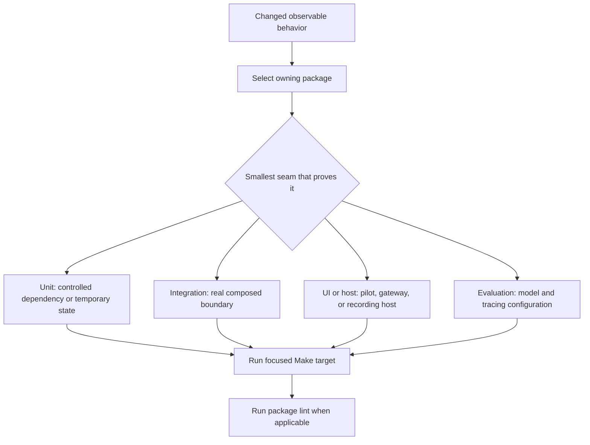

# Testing Guide

Test the observable contract at the package boundary that changed, using the owning package's environment and `Makefile`. The usual fast path is a network-free unit test; move to an integration test only when the behavior requires a composed process, persistence, protocol, host, or UI boundary. Start with [Development](../operations/development.md), use [Run evals](../workflows/run-evals.md) for model evaluations, and consult [CI labeling](../operations/ci-labeling.md) for CI operations.

## Select the test seam



*Choose the narrowest deterministic seam that can demonstrate the changed contract.*

- **Unit tests** protect behavior with controlled collaborators: in-memory stores, temporary files, fake SDK clients, recording gateways, fake models, and event barriers. Assert returned values, persisted state, emitted payloads, rendered output, or user-visible errors—not an implementation's call order.
- **Integration tests** prove a boundary that cannot be faithfully replaced in-process: a subprocess and its import-time configuration, a CLI/server exchange, durable state, or a host/channel composition. Keep the external surface local and deterministic where possible.
- **UI, protocol, and host tests** should drive the public event or command boundary and use recording transports or a stub agent. Do not require a live Discord, provider, or other developer service to prove routing, authorization, or reply behavior.
- **Evaluations** are deliberately different from ordinary unit tests: they run a selected model and require tracing credentials. Use the eval command surface rather than treating them as a default local regression suite.

Repository guidance requires deterministic tests of changed observable behavior. Network-free tests belong in `tests/unit_tests/`; tests that actually need a networked or composed boundary belong in `tests/integration_tests/`. Pytest's asyncio mode is automatic, so do not add `@pytest.mark.asyncio` merely to run an async test.

## Run the owning target

Synchronize in the package you changed, then ask its Makefile for available targets when the following examples do not fit:

```bash
make -C libs/deepagents help
make -C libs/deepagents test TEST_FILE=tests/unit_tests/<focused_test>.py
make -C libs/deepagents integration_tests TEST_FILE=tests/integration_tests/<focused_test>.py

make -C libs/code test TEST_FILE=tests/unit_tests/<focused_test>.py
make -C libs/code integration_tests TEST_FILE=tests/integration_tests/<focused_test>.py

make -C libs/acp test TEST_FILE=tests/<focused_test>.py
make -C libs/talon test TEST_FILE=tests/<focused_test>.py
make -C libs/evals test TEST_FILE=tests/unit_tests/<focused_test>.py
```

`deepagents` and `code` default `make test` to `tests/unit_tests/`, run pytest in parallel, disable sockets except Unix sockets, and collect coverage. Their `integration_tests` targets select `tests/integration_tests/` and apply a 30-second timeout; use these when the test is genuinely integration coverage. Both accept additional pytest arguments through `PYTEST_EXTRA`; `coverage` emits terminal and XML coverage reports.

`acp` defaults to `tests/`, disables sockets except Unix sockets, applies a 10-second timeout, and accepts `TEST_FILE`, `COV_ARGS`, and `PYTEST_EXTRA`. `talon` first runs its Node WhatsApp bridge tests, then Python pytest over `tests/` with the same socket restriction and a 10-second timeout. `evals` similarly defaults to network-restricted `tests/unit_tests`, while its explicit evaluation targets are separate.

After a code change, run the owning package's `make lint` as well. The package lint targets include formatting checks and type checking; `libs/code` additionally checks its command catalog and process working-directory rules. At repository scope, `make -C libs lint` iterates library packages and `make -C libs lock-check` verifies all lockfiles.

## Focused regression patterns

| Change boundary | Preferred test location and seam |
| --- | --- |
| Deep Agents SDK behavior, backend, middleware, or agent contract | `libs/deepagents/tests/unit_tests/`; use the smallest controlled backend/client fixture that exposes the public result. Use `tests/integration_tests/` for a real composed boundary. |
| dcode CLI, workspace, session, sandbox, or Textual behavior | `libs/code/tests/unit_tests/`; isolate profile/configuration and filesystem state with temporary paths. Use a UI pilot only when rendering or interaction is the behavior. |
| ACP agent or protocol behavior | `libs/acp/tests/` or `tests/unit_tests/`; exercise the protocol-facing behavior through a controlled model or command fixture. |
| Talon runtime, channel, cron, host, or bridge behavior | `libs/talon/tests/`, including `channels/`, `cron/`, and `unit_tests/`; inject a recording channel/gateway or fake model and coordinate concurrency with events. The Make target also covers the WhatsApp bridge's Node tests. |
| Evaluation harness, report, dataset, or catalog behavior | `libs/evals/tests/unit_tests/` for local harness behavior. Use eval CLI/Make targets only for intentional model-backed evaluation runs. |
| Resuming dcode through the real CLI and local server | `libs/code/tests/integration_tests/test_headless_resume.py`; use its isolated subprocess profile pattern. |

For a shared interface implemented by more than one backend or transport, add or update the regression at the shared contract and exercise each relevant implementation. Do not let an implementation-specific mock define behavior the public interface does not promise. When the interface has synchronous and asynchronous public entry points, cover both where the change can affect both.

### dcode subprocess resume is integration coverage

`test_headless_resume.py` uses fresh CLI and helper subprocesses with a temporary `HOME` and `DEEPAGENTS_HOME`. This isolation is necessary because dcode captures profile paths and its sessions database at import time. The test uses a deterministic model and local server boundary, proving persisted-thread resume behavior without reading a developer profile. Follow this pattern for process-owned configuration or persistence; prefer an in-process unit seam when it can prove the contract.

## Determinism, isolation, and warnings

Avoid live services, developer profiles, ambient configuration, and timing sleeps in ordinary regressions. Own the filesystem and environment with temporary paths and fixtures; use a fake client, model, gateway, or clock when that isolates the changed contract. For concurrent behavior, coordinate with events or barriers so the test controls the interleaving.

All packages treat unaccepted pytest warnings as errors. Fix an actionable warning before adding a filter. If a warning is genuinely expected, scope it to the individual test with `@pytest.mark.filterwarnings`; package-level entries are reviewed exceptions. Prefer `default::` over `ignore::` for thread and unraisable-exception warnings so pytest still reports the problem.

A maintainer can apply `ci:allow-warnings` to a pull request and rerun a reusable test job. The workflow reads current PR labels from the GitHub API and adds `-W default`, so a later label addition is visible to a rerun. This escape hatch applies only to pull-request jobs that call `_test.yml`; push and merge-queue runs remain strict. It does not alter the direct QuickJS SDK smoke job.

## CI correspondence

CI detects changed packages on pull requests. Editable SDK dependencies cause an SDK change to select dependent packages too; pushes to `main` run the package jobs regardless of filters. Each selected package calls `.github/workflows/_test.yml`, which first validates that its JSON version list and extra matrix legs contain string values, then runs matrix legs with `fail-fast: false`.

The current package test matrix is:

| Package | Python versions |
| --- | --- |
| `deepagents` | 3.11, 3.12, 3.13, and 3.14 on Ubuntu; 3.13 on Windows |
| `code` | 3.14 on Ubuntu |
| `talon` | 3.14 on Ubuntu |
| `evals` | 3.14 on Ubuntu |
| `acp` | 3.11, 3.12, 3.13, and 3.14 on Ubuntu |

On non-Windows runners, the reusable workflow runs `make test COV_ARGS= PYTEST_EXTRA="-q ..."`. On Windows it invokes pytest directly because `make test` reaches a POSIX-shell backend; sandbox tests are not enabled in that path. CI also checks that the working tree remains clean after tests.

The workflow is a useful parity guide, not a reason to run every package locally for a focused change. Run the changed package's focused target and lint first; use its full target before submitting changes that can affect broad behavior.

## Benchmarks

Benchmark invocation belongs to the owning Makefile. `libs/deepagents` and `libs/code` provide `benchmark` for plain `pytest-benchmark`, `bench` for CodSpeed wall-time instrumentation, and `bench-memory` for CodSpeed memory-marked tests. The repository-level `make -C libs bench-all` runs `bench` for deepagents and code.

```bash
make -C libs/deepagents benchmark
make -C libs/deepagents bench
make -C libs/code bench-memory
make -C libs bench-all
```

The reusable CodSpeed workflow installs the test group, runs `make bench`, and runs `make bench-memory` only when its `has-memory-benchmarks` input is true. The nightly workflow is manually dispatchable as well as scheduled daily, and currently invokes that reusable workflow for deepagents and code. Benchmark thresholds and results are managed in CodSpeed rather than encoded in these Makefiles.

## Evaluations

Use model-backed evaluations intentionally. `make -C libs/evals evals MODEL=<id>` requires `MODEL` and runs `tests/evals` with `LANGSMITH_TEST_SUITE=deepagents-evals`; `evals-trials` additionally requires `TRIALS` and delegates aggregation to `scripts/run_trials.py`. The `deepagents-evals` CLI is the canonical interface for running, repeating, aggregating, listing, and cataloging evaluations.

Evaluation execution requires `LANGSMITH_TRACING=true`, `LANGSMITH_API_KEY`, and provider credentials appropriate to the selected model. Treat these as operational runs, not network-free unit tests. For Harbor-based terminal benchmarks, stage checked-out local dependencies first with `make -C libs/evals stage-harbor-local-deps`, then choose the target for the intended sandbox provider.

## Completion checklist

1. Identify the owning package and changed observable contract.
2. Add the narrowest deterministic regression; use temporary state and controlled collaborators by default.
3. Place it in `unit_tests` unless a real process, persistence, protocol, UI/host, or networked boundary makes integration coverage necessary.
4. Cover all affected implementations of a shared interface and both sync/async public paths where applicable.
5. Run the focused package Make target and `make lint`; run a full package target when the change has broad impact.
6. Keep warnings actionable and strict—do not rely on the PR warning bypass as a fix.
