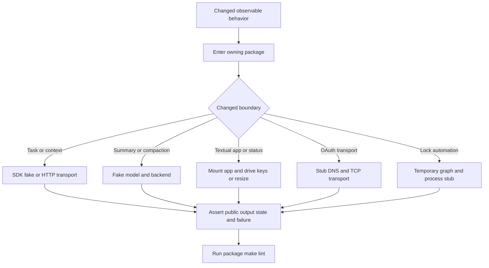

# Testing Guide

Start in the package that owns the observable boundary. `libs/` is a monorepo of independently versioned packages: each package owns its `pyproject.toml`, `Makefile`, and environment. Synchronize and run its Makefile targets from that package; use `make help` when a target is uncertain. Network-free regressions belong in `tests/unit_tests/`, networked contracts in `tests/integration_tests/`, and warnings fail the suite unless explicitly accepted. Tests should prove an observable result, state transition, rendered UI, or serialized request—not an internal call order.

See [Development](../operations/development.md), the [source map](../architecture/source-map.md), [context management](../concepts/context-management.md), and [Subagents and Skills](../concepts/subagents-skills.md) for the surrounding ownership model.

## Run focused tests locally

```bash
cd libs/deepagents
uv sync --all-groups
make test TEST_FILE=tests/unit_tests/test_async_subagents.py
make test TEST_FILE=tests/unit_tests/middleware/test_summarization_factory.py
make test TEST_FILE=tests/unit_tests/middleware/test_compact_tool.py
make lint

cd ../code
uv sync --group test
make test TEST_FILE=tests/unit_tests/test_app.py
make test TEST_FILE=tests/unit_tests/tui/widgets/test_status.py
make lint

cd ../talon
uv sync --group test
make test TEST_FILE=tests/unit_tests/test_oauth_transport.py
make lint
```

For `deepagents` and `code`, `make test` uses parallel pytest, disables non-Unix sockets, allows Unix sockets, disables benchmarks, and enables coverage. Their `integration_test` targets allow the integration path and use a 30-second timeout. Talon's `make test` first runs its WhatsApp bridge tests, then runs Python tests with non-Unix sockets disabled and a 10-second timeout. `TEST_FILE` selects a focused file and `PYTEST_EXTRA` adds pytest options. Use `make update-snapshots` only for deliberate smoke-snapshot changes.

## Select the regression

| Changed boundary | Start here | Deterministic seam and assertion |
| --- | --- | --- |
| Async task tools, remote run status, forked input, or forwarded context | `libs/deepagents/tests/unit_tests/test_async_subagents.py` | Stub the SDK client or use `httpx.MockTransport`; assert returned `Command`, tracked task state, and the child run payload in both sync and async forms where exposed. |
| Summary defaults or supported customization | `libs/deepagents/tests/unit_tests/middleware/test_summarization_factory.py` | Use a fake chat model with and without profile limits; assert selected policy and rendered prompt behavior. |
| `compact_conversation`, event application, offload, or errors | `libs/deepagents/tests/unit_tests/middleware/test_compact_tool.py` | Use fake model/backend and inspect the `Command`, event, and tool message. Include failure paths. |
| Textual approval notice or app-level approval transition | `libs/code/tests/unit_tests/test_app.py` | Mount `DeepAgentsApp` with `run_test()`, send real keys with the pilot, and observe screen, acknowledgement, and mode. |
| Status bar resize, glyph, tooltip, or click behavior | `libs/code/tests/unit_tests/tui/widgets/test_status.py` | Mount the minimal `StatusBarApp`, resize or click via Textual, and assert rendered/visible behavior rather than widget internals. |
| OAuth request transport and SSRF/TLS behavior | `libs/talon/tests/unit_tests/test_oauth_transport.py` | Replace DNS resolution and the HTTP core TCP connection; assert pinned peer address, TLS hostname verification, request headers, and rejection. |
| Lock refresh closure or command failure | `.github/scripts/tests/checks/test_refresh_lockfiles.py` | Build a temporary local-path dependency graph and stub `subprocess.run`; assert deterministic commands and fail-fast behavior. |



*The routing flow chooses the owner and deterministic boundary for the changed behavior.*

## Async subagents: lifecycle, snapshot, and context boundaries

`AsyncSubAgentMiddleware` exposes the start, check, update, cancel, and list task interface. Its regression suite treats `async_tasks` as the durable parent-side view of a remote child: launch records child thread/run identity and a running status; checks refresh nonterminal state; update starts a replacement run; and cancellation becomes terminal. Test tool-visible errors for unknown tasks and client failures as well as successful `Command` updates.

A remote run can report success while its thread is interrupted for a question or approval. In that case, checking must report `waiting` and expose the interrupt payload rather than a final result. If another actor resumes it, a later check follows the active run. Cancelling a waiting task remains terminal and must not issue a needless remote cancel request. Cover synchronous and asynchronous client entry points where both are public.

Forked and isolated launches intentionally have different data ownership. An isolated child receives just the delegated request. A fork receives a snapshot of relevant parent history plus that request; summary state affects the snapshot. The HTTP transport test mutates parent state while the thread is created to show that the sent input is a snapshot, not a mutable alias. Fork tests also rehydrate offloaded media into usable child input and verify that the child offloads it into its own backend while the parent retains blob references.

Context follows an equally narrow boundary. A subagent running on the parent deployment receives serializable parent context and records a parent assistant reference in its new thread metadata. A context that contains only the parent reference is not forwarded, and a child launched on another server receives the parent reference but not parent context. Keep these assertions at the outgoing run payload rather than relying on middleware implementation details.

## Summarization and compaction: state only after success

Use the factory suite for policy selection. With `max_input_tokens` in the primary chat model profile, `create_summarization_middleware` selects fractional trigger and retention defaults. Without a profile, it selects fixed token/message fallbacks. Its summary prompt, trim threshold, token counter, and summarizer are keyword-only; a string model name is rejected. A supplied callable or chat model supplies the summary, while capacity thresholds remain based on the primary model. The rendered default prompt must preserve media references so later agent work can read them.

Use the compact-tool suite for execution semantics. `SummarizationToolMiddleware` registers exactly one `compact_conversation` tool. A successful operation produces a `Command` with a summary event, a cumulative cutoff, summary message, optional history path, and a user-facing tool message. Applying a valid event yields the summary plus the retained suffix; malformed events safely fall back to raw messages.

Distinguish a backend declining offload from an exception: no returned path can still yield a successful summary, but a summary-generation error or an offload exception returns an error tool message and must not install `_summarization_event`. Test equivalent sync and async behavior.

## dcode Textual UI: drive the event loop

For app behavior, mount `DeepAgentsApp` with `run_test()` and use pilot input rather than sleeps or direct calls. The first Auto-mode enablement is a two-step contract: the notice appears before the mode changes; Enter records the acknowledgement and activates Auto; Escape records nothing and preserves Manual; and later enables skip an already acknowledged notice. The notice test also ensures that a separate classifier model is named and distinguished from the code-writing model.

Status-bar tests use a small app that mounts the real `StatusBar`. They protect user-visible layout behavior: a long working directory has an untruncated plain tooltip, condenses while retaining its tail at constrained width, recomputes when the terminal grows, and disappears below its width threshold. The branch remains visible on resize and truncates with the configured Unicode or ASCII ellipsis. Reset the process-global glyph cache around tests that change charset configuration.

## Talon OAuth transport: validate host identity and destination

Talon's OAuth client uses a dedicated HTTPS-only SSRF-safe transport, does not follow redirects, disables environment trust, applies a short timeout, and identifies requests with either `DEEPAGENTS_TALON_MCP_USER_AGENT` or `deepagents-talon/<version>`. Its transport normalizes an SNI hostname supplied as bytes before handing the request to HTTPX.

The focused transport test replaces DNS with a known public address and intercepts TCP. It proves the connection goes to that resolved address while TLS SNI and HTTP `Host` retain the requested hostname; TLS must require certificate verification and hostname checking. Parameterize direct-client and SDK-provider requests so the provider cannot bypass this transport. A mixed public/private DNS answer must raise `SSRFBlockedError`, preventing a hostname from being used to reach a private address.

## Lockfile refresh automation

Lock refresh begins with changed manifests and discovers their transitive consumers through local `[tool.uv.sources]` path dependencies. The result is sorted in repository-path order. For each directory, the script invokes `uv lock --directory <directory> --python <package-version>` from the repository root, prints its `uv.lock` path, and uses `check=True`; a failing first command raises and stops later refreshes. The focused test uses a temporary graph and a stubbed process runner to make all of those ordering and failure assertions deterministic.

## Completion checklist

1. Work in the owning package, run `uv sync` for its declared group(s), and use its Makefile.
2. Add the narrowest deterministic regression that observes a public state, payload, rendered UI, or error result.
3. Use fakes, temporary stores, or stubbed transport/process boundaries; do not use sleeps, a live provider, or incidental call-order assertions.
4. Exercise sync and async forms when the boundary exposes both.
5. Run the focused `make test TEST_FILE=...` and the package's `make lint`.
