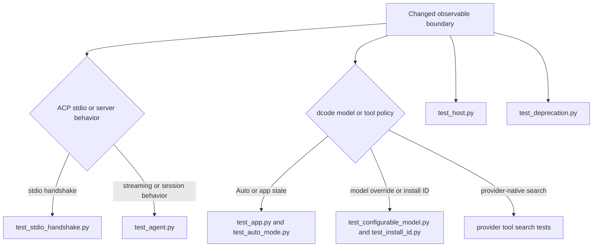
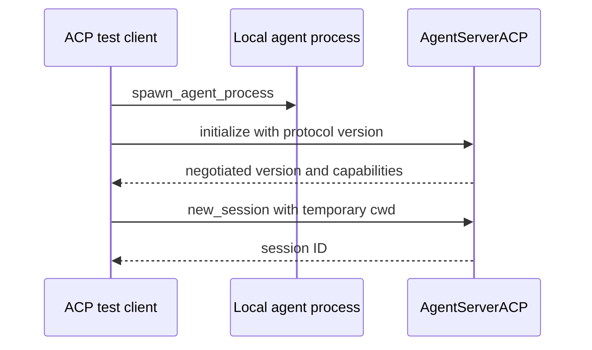
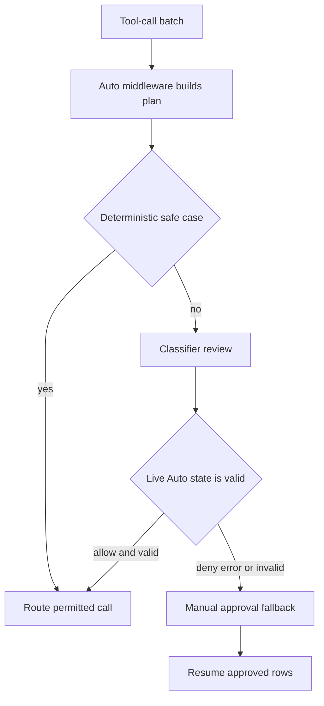

# Testing Guide

Use the narrowest package target that crosses the changed observable boundary. These routes intentionally use fake models, temporary state, mock transports, and recording channel or process doubles rather than provider credentials or live services. See [Development](../operations/development.md), [ACP integration](../integrations/acp.md), [Profiles and models](../concepts/profiles-models.md), and [SDK construction and execution](../architecture/sdk-construction-execution.md) for the surrounding runtime contracts.

## Run the owning route

Each package owns its environment and `Makefile`. Synchronize the package first, then use `TEST_FILE`; the unit targets disable network sockets other than Unix sockets. `libs/code` and `libs/deepagents` also run xdist and suppress benchmarks; Talon runs the WhatsApp bridge tests before its Python suite and applies a ten-second test timeout.

```bash
# ACP protocol boundary
cd libs/acp
uv sync --all-groups
make test TEST_FILE=tests/test_stdio_handshake.py
make test TEST_FILE=tests/test_agent.py

# dcode configuration, Auto policy, and native tool search
cd ../code
uv sync --all-groups
make test TEST_FILE=tests/unit_tests/test_app.py
make test TEST_FILE=tests/unit_tests/test_auto_mode.py
make test TEST_FILE=tests/unit_tests/test_configurable_model.py
make test TEST_FILE=tests/unit_tests/test_install_id.py
make test TEST_FILE=tests/unit_tests/test_provider_tool_search.py
make test TEST_FILE=tests/unit_tests/test_provider_tool_search_extra.py

# Talon host lifecycle and SDK compatibility adapter
cd ../talon
uv sync --all-groups
make test TEST_FILE=tests/test_host.py
cd ../deepagents
uv sync --all-groups
make test TEST_FILE=tests/unit_tests/_api/test_deprecation.py
```

Do not replace these with an integration test merely because the production path talks to another process or provider. The ACP handshake is the deliberate exception: it spawns a local Python subprocess, still has no external dependency, and catches drift in the installed `agent-client-protocol` API.

## Select tests by boundary

| Changed contract | Focused route | Assert externally observable results |
| --- | --- | --- |
| ACP client/server setup or stdio runner | `libs/acp/tests/test_stdio_handshake.py` | Protocol version, advertised capabilities, and a usable session without building the agent during handshake |
| ACP streaming, cancellation, replay, or permissions | `libs/acp/tests/test_agent.py` | Ordered client updates, session isolation, replayed visible state, and permission requests |
| dcode startup, restart, configuration refresh, or Auto UI | `libs/code/tests/unit_tests/test_app.py` | Responsive UI, queued input ordering, persisted mode/model decisions, and safe fallback |
| Auto classifier and authorization policy | `libs/code/tests/unit_tests/test_auto_mode.py` | Fail-closed routing, bounded/redacted classifier input, lifecycle events, and current live mode |
| Per-request model override or cache identity | `libs/code/tests/unit_tests/test_configurable_model.py` | Effective model/configuration sent to the handler and only valid checkpoint state afterward |
| Anonymous install identity | `libs/code/tests/unit_tests/test_install_id.py` | Stable valid ID, corrupt-file replacement, and process-local fallback when persistence fails |
| Provider-native deferred MCP-tool search | `libs/code/tests/unit_tests/test_provider_tool_search.py`, `test_provider_tool_search_extra.py` | Serialized provider payload, approval/resume behavior, stream replay, and eager fallback for unsupported requests |
| Talon host messaging, authorization, lifecycle, or delivery | `libs/talon/tests/test_host.py` | Channel-scoped authority, cancellation/recovery, safe user replies, and cleanup |
| SDK deprecation compatibility | `libs/deepagents/tests/unit_tests/_api/test_deprecation.py` | Warning category/text/callsite, filter isolation under concurrency, suppression, and dedupe reset |



*Choose the test at the boundary users or integrations observe; add a neighboring route only when the change crosses that boundary.*

## ACP: preserve the wire handshake and session boundaries

The stdio test launches `run_agent(AgentServerACP(...))` in a real local interpreter through `spawn_agent_process`, initializes with `PROTOCOL_VERSION`, and opens a session. Its agent factory raises if called, so it specifically proves that negotiation and session creation do not eagerly construct the agent. Keep this test process-based when changing imports, runner wiring, initialization, or stdio transport; an in-process mock cannot detect SDK namespace or process-entrypoint drift.



*The handshake route validates the installed ACP client and a real stdio server process before any agent construction.*

Use `test_agent.py` for semantic server changes. Its fake client records session updates and permission requests while fake graphs/models control streaming and checkpoints. Preserve ordering where it is a client contract: visible reasoning remains in content-block order, whitespace reasoning deltas are not discarded, content precedes tool calls, local-context messages are hidden, and cancellation for one session cannot stop another session. For persistent-session changes, use `MemorySaver` plus a restarted server to exercise replay and rejection of foreign or mismatched-workspace sessions.

## dcode: configuration, model state, and Auto mode

`test_app.py` is the UI and lifecycle boundary. Use `DeepAgentsApp.run_test()` plus `AsyncMock`, `MagicMock`, events, and temporary config/state paths to test startup and restart races without a server. Important assertions are that startup is idempotent across `ServerReady`, deferred initial input is submitted only after readiness, a failed configuration refresh returns queued prompts to the input, and a reload/restart does not let a prompt reach the old agent. For the `/auto model` flow, validate the selected classifier spec before persisting it, preserve the existing selection on cancellation, and represent an explicit clear as inheritance rather than an empty model.

`ConfigurableModelMiddleware` is the request-to-checkpoint boundary. Test both synchronous and asynchronous calls when changing override behavior. A successful known-model call records the resolved model identity and request-time/cache identity; a failed call must not return a checkpoint update, and an unknown model must not leave a timestamp without its corresponding identity. Use a fixed install ID fixture and patched model construction/config loading so cache keys and effective provider parameters are deterministic.

`get_install_id()` is intentionally small but operationally important: a fresh writable state directory receives a persisted 32-character lowercase hex value, a new process reads it back, a malformed file is replaced, and an unwritable path still yields a stable ID for that process. Test the filesystem contract with `tmp_path`, not a real user state directory.

### Auto authorization control flow

Auto is not a blanket bypass: the classifier prepares a decision plan for gated tool calls, and routing must consult the live approval-mode state when the calls are resumed. Missing, malformed, mismatched, or unreadable control state falls back to manual review. Classifier failure, construction timeout, context overflow that cannot be reduced, or unavailable configured classifier likewise must not authorize work.



*Auto authorization is a live, fail-closed decision path rather than a static UI preference.*

In `test_auto_mode.py`, drive the middleware with a structured fake classifier and in-memory store. Assert only trusted user-prompt metadata enters classification, classifier conversation history is bounded, review lifecycle events use opaque IDs, and completion occurs for cancellation and errors as well as success. Cover policy-specific short circuits separately from model judgment: trusted compaction and read-only MCP behavior, workspace and symlink escape checks, temporary artifact provenance, destructive actions, and forged routing data must not accidentally expand authority. Use events to switch modes while a model call is in flight and verify that routing follows the latest valid state.

## Provider-native tool search: verify serialized behavior

`MCPProviderToolSearchMiddleware` alters a provider request, not a tool object globally. Test it with `httpx.MockTransport` and fake API keys: eligible provider/model/endpoint combinations serialize MCP tools as deferred and append the native search tool; core tools remain eager. Unsupported models, endpoints, or APIs must retain the original eager tool list, and a profile override cannot enable a chat-completions request.

The end-to-end graph fixture is the high-value route: it receives a provider tool-search call/output, pauses at human approval before executing the discovered MCP tool, then resumes and includes search output in subsequent request history—even after rebuilding a graph over the same checkpoint. Also test a model switch from eligible to unsupported and back, and strip provider-specific search blocks when replaying history to a different provider. The supplementary tests cover Anthropic serialization, OpenAI streaming aggregation/replay, async transport, gateway endpoints, and interpreter prompts that must not expose deferred tool schemas.

## Talon host: test channel-scoped lifecycle, not a chat provider

`TalonHost` coordinates agent, scheduler, and channels. Use `RecordingChannel`, a stub agent, and a temporary `TalonConfig`; assert each successfully started component is stopped, including partial startup failures. Test a real host turn only through `receive_message()` and recorded channel output, not by reaching a messaging provider.

Authorization and approval replies are capability boundaries. A pending authorization callback must match the initiating channel, conversation, operator, and expected callback endpoint before it reaches the agent; unsolicited or mismatched callbacks do not become model input. Logs and user-visible errors must not disclose callback query secrets or upstream exception detail. Likewise, tool-approval replies/reactions remain bound to the original sender and prompt.

For concurrency, use an agent blocked on an `asyncio.Event`. A new message interrupts the active turn and proceeds in the same conversation; host stop cancels active work; cancellation-resistant work has a bounded recovery path. Keep tests for scheduled runs and background results distinct: a scheduled job must not overlap itself, and a superseded or cancelled undelivered turn requeues background results while a delivered or deliberately suppressed result does not.

## SDK deprecation adapter: preserve compatibility at the warning boundary

The SDK adapter wraps LangChain deprecation utilities. Test emitted warning behavior rather than the wrapper's internals: the default and explicit `stacklevel` identify the user callsite, pending and normal cases retain their expected categories, and message formatting preserves alternatives and errors. The concurrency test is essential: while one thread emits an adapter warning, unrelated warning filters and handlers in another thread must keep their original behavior.

Decorated functions and properties dedupe warnings in-process. `reset_deprecation_dedupe()` must re-arm recognized decorated targets, including a property descriptor, while silently skipping ordinary objects; the suppression context manager must silence both normal and pending emissions. If a new SDK deprecation is added, update the test fixture's reset-target inventory so xdist ordering cannot turn warning dedupe into a flake.

## Completion checklist

1. Run the focused route for the boundary you changed, plus its paired route if data crosses between them.
2. Use temporary directories, in-memory stores/checkpointers, local subprocesses, mock transports, and synchronization events; do not read developer configuration or contact a provider.
3. Assert a wire payload, state transition, user-visible outcome, permission decision, or cleanup result—not private call order.
4. Include failure and cancellation cases when the changed code authorizes work, persists state, owns a process/task, or crosses a provider/channel boundary.
5. Run `make lint` in each package changed after focused tests pass.
