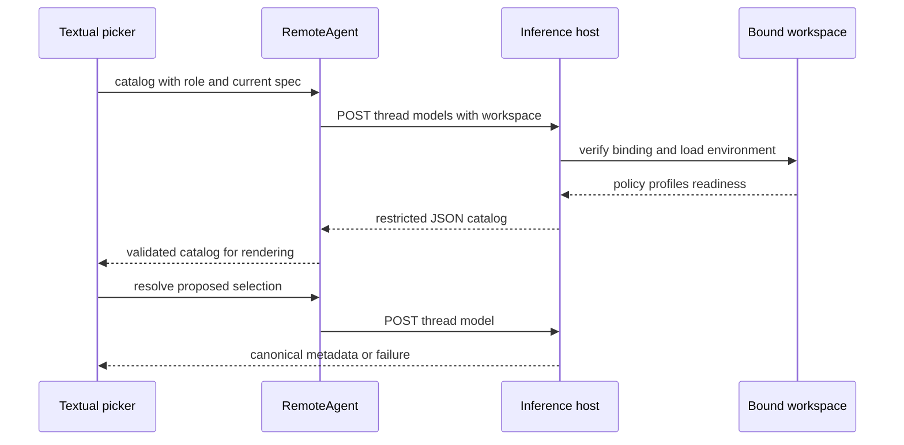

# Testing Guide

Use this page for changes to dcode model discovery, the inference-host metadata boundary, or the `/model`-family selector. The tests protect a distributed contract: the Textual client renders and collects a choice, while the server workspace owns provider packages, credentials, policy, and canonical resolution. Do not replace these tests with live provider calls or assertions about incidental helper call order. For the design, see [Code agent architecture](../architecture/code-agent.md) and [Profiles and models](../concepts/profiles-models.md); for package setup, see [Development and release operations](../operations/development.md) and [Quickstart](../quickstart.md).

## Run the focused routes

Work from `libs/code`. Synchronize the package environment before testing. The package `test` target runs pytest with xdist, coverage, benchmark suppression, and network sockets disabled except Unix sockets; use it rather than a bare pytest invocation for the normal focused path. Package guidance places deterministic, network-free coverage in `tests/unit_tests/`, enables asyncio automatically, and treats unaccepted warnings as errors.

```bash
cd libs/code
uv sync --all-groups

# Catalog serialization, remote-host behavior, defaults, and metadata endpoints
make test TEST_FILE=tests/unit_tests/test_model_catalog.py
make test TEST_FILE=tests/unit_tests/test_model_metadata.py

# Textual interaction, filtering, setup prompts, and selector presentation
make test TEST_FILE=tests/unit_tests/tui/widgets/test_model_selector.py

# Finish a behavior-changing package change
make lint
```

Run `test_model_catalog.py` when changing catalog models, client/host handoff, setup routing, default scopes, or stale-selection handling. Run `test_model_metadata.py` when changing request validation, workspace/environment resolution, endpoint failures, model switching, or role-specific metadata. Run `tui/widgets/test_model_selector.py` for keyboard and mouse interaction, searching, rendering, provider readiness, modal routing, and selector-local persistence UX. Usually run all three when an API payload, selection lifecycle, or default-saving behavior crosses the client/server boundary.

## Test the inference host, not the client environment

A connected picker must obtain its catalog from the inference host. `RemoteAgent.aget_model_catalog()` binds the request to the current thread workspace, posts the role, recommendations, and active spec, waits at most 60 seconds, and validates the response as `ModelCatalog`. The server endpoint validates the compact request before it obtains the bound workspace, restores the workspace model environment, and runs discovery in a worker thread. Main catalog requests receive workspace profile overrides; auxiliary requests do not.



*Discovery and proposed-model validation run in the workspace that will execute inference; the Textual client only receives validated presentation data.*

Build a hermetic host fixture instead of depending on installed integrations, actual credentials, a local config file, or a network. The `model_api_client` fixture in `test_model_metadata.py` wires a real `RemoteAgent` to the real endpoint functions through mocked in-process HTTP. Its runtime fixture supplies a bound workspace, a server environment, and profile overrides. At the UI edge, pass an `AsyncMock` `catalog_loader` and `resolve_model` into `ModelSelectorScreen`; patch local `ModelConfig.load`, `load_model_catalog`, provider discovery, or readiness to fail if a remote picker tries to consult them.

The essential assertions are:

- A remote catalog drives highlighting, display-profile search, and selection even when all local provider access is forbidden.
- Server discovery uses the saved workspace environment and filters profile extensions to the scalar fields the UI may render. It applies main profile overrides only for `purpose="main"`.
- The strict catalog model rejects incoherent readiness and endpoint handlers reject malformed catalog or metadata requests with `422` before model construction.
- Workspace conflicts remain `409`; unavailable runtime environment or unexpected discovery/resolution failure becomes `503`. The client should surface a host failure rather than quietly falling back to local discovery.

### Catalog boundary fixtures and invariants

`load_model_catalog()` is the host-side unit under test. It collects available model specs, configured profiles, enabled providers, allow-list presentation data, and the active spec. It retains allowed, enabled recommendations and the current selection when ordinary profile discovery omitted them, but does not surface disabled providers or disallowed recommendations. A provider failure is isolated and logged so another provider can still populate the picker.

Treat `ModelCatalog`, `CatalogProfile`, and `CatalogProvider` as a security boundary, not as general configuration serializers. Tests should verify that profiles keep only allowed scalar display fields and their override provenance; provider records may expose readiness state/source, environment-variable name, detail, labels, and a missing-package extra, but never credential values, constructor kwargs, or arbitrary profile/config extensions. A configured custom provider with no discovered models must still be present in provider readiness so a typed custom spec can lead to the appropriate setup prompt.

## Selector flow: filter first, policy before setup

`ModelSelectorScreen` mounts its shell and focuses `#model-filter` before asynchronous data loading. It keeps text typed during loading, applies it after catalog arrival, and returns without updating if the modal has been dismissed. A load failure produces a retryable connection notification and does not cause remote mode to read client-local provider data.

The normal view starts with recommended models. A nonempty search spans the full installed list; recent and current choices remain available in the recommended view, while onboarding stays curated. Search matches raw specs plus friendly model and provider labels. Test selection by driving a real `textual.pilot` session—typing into the filter and pressing Enter—not only by calling action methods, because focus, priority bindings, dismissal, and the modal stack are observable behavior.

There are two different no-result cases:

- Enter selects the highlighted row when one exists; filter text is not substituted for that row.
- With no row, an explicitly host-recognized `provider:model` is checked against `models.allowed` **before** installation or credential setup. A rejected spec leaves the selector open, does not set `pending_install_extra`, and names the policy and permitted choices. This prevents an install/auth path from bypassing admission.

A colon alone does not prove the prefix is a provider: model identifiers can contain colons. In server-backed mode, bare names and ambiguous or unrecognized prefixes are dismissed for inference-host resolution, rather than canonicalized or rejected from client-local knowledge. Test both a host-known blocked spec and ambiguous identifiers such as Bedrock-style IDs so this distinction cannot regress.

After an allowed explicit selection, missing package metadata opens `InstallProviderConfirmScreen`; missing credentials open `AuthPromptScreen`. Codex is different: it opens a confirmation gate before its ChatGPT OAuth screen, not the generic API-key prompt. Cancelling setup returns to the selector and refreshes its readiness display; confirming an installation records the pending extra and returns the original selection for the app to install and switch.

## Defaults: validate asynchronously and persist the right preference

A session choice, a default, and the currently running model are separate state transitions. `Ctrl+S` uses the screen's explicit `DefaultModelScope`; `MAIN_MODEL_DEFAULT_SCOPE`, classifier scope, and summarization scope have distinct load/save/clear functions. This is a guard against an auxiliary picker overwriting `[models].default`.

For a new default, the selector validates the captured spec asynchronously through `resolve_model` before writing. With a remote agent, that resolution runs on the server and returns canonical metadata; before the server connects, dcode only makes a local identity/policy check and does not construct a model. Tests must establish all of the following observable contracts:

- Keyboard navigation and Escape remain responsive while server resolution or synchronous file persistence is blocked. Use events to hold an async resolver or a thread-backed persistence function, then drive `textual.pilot` with a timeout.
- Repeated `Ctrl+S` while work is pending does not start overlapping writes. A resolution error or save failure leaves the stored marker unchanged and reports an actionable failure.
- If the selector is dismissed, a cancelled-but-late resolver result cannot save a default, mutate its default marker, or notify a no-longer-current screen.
- A successful validation saves the canonical returned `provider:model`, not the user alias. It must not switch the active session model merely to validate the preference.
- An install-required provider cannot be newly persisted, because it cannot work at a later launch; an already-stored unavailable value can still be cleared, which is the recovery path.
- A summary or classifier scope changes only its own key. At application level, a newer choice or clear operation must win over an older asynchronous selection that completes late.

## Metadata and active-state failure tests

`test_model_metadata.py` verifies the adjacent proposed-resolution endpoint and app state transitions. Keep endpoint payloads deliberately small and malformed cases explicit: unknown keys, non-string specs, invalid purpose values, auxiliary `extra_kwargs`, and invalid types should be rejected before `create_model()` is called. A server-side resolution is a proposal, not a switch: it constructs only enough to return model name, provider, context limit, unsupported modalities, and structured-output capability.

For a failed runtime switch, seed a complete existing state—selected override, parameter override, model name/provider, capability metadata, and switching flag—then make remote resolution fail. Assert every prior value is retained, no local construction occurs, recent-model storage is untouched, and the switching indicator is cleared. Conversely, test that a bare request adopts the provider returned by the server, not a provider guessed by the client.

Apply the same boundary to auxiliary model commands. Summary, auto-classifier, goal, and rubric choices resolve in the server environment without main profile overrides and update their own role-specific state, leaving the main model and its runtime metadata intact. A failed auxiliary resolution must leave all existing auxiliary selections and persistence bookkeeping unchanged.

## Completion checklist

1. Sync `libs/code`, run the narrowest owning test file, then `make lint`.
2. Use in-process endpoint wiring, temporary paths, patched provider discovery, fake catalogs, and `textual.pilot`; do not require a provider account, network, or developer config.
3. For catalog changes, assert workspace-environment authority, strict presentation-only payloads, main-versus-auxiliary profile behavior, and `409`/`422`/`503` failure distinctions.
4. For selector changes, exercise the real focused filter/modal path and preserve policy rejection before install/auth, typed-spec ambiguity deferral, and readiness-specific prompt routing.
5. For persistence or async changes, block the resolver/writer and prove responsiveness, canonical validation before write, scope isolation, and immunity to dismissed or stale results.
