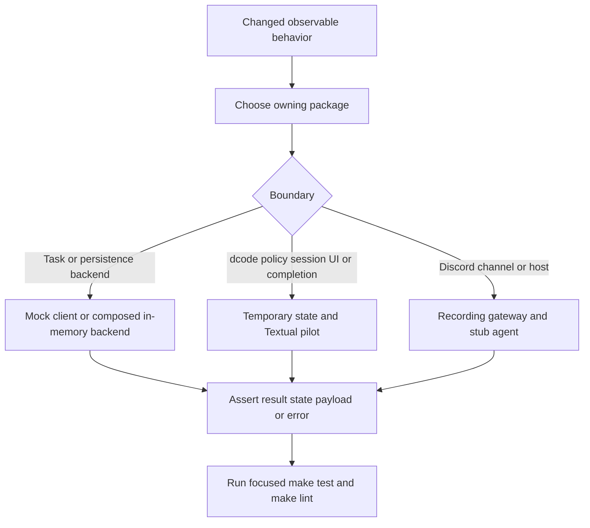

# Testing Guide

Test from the package that owns the changed observable boundary. `libs/` packages have independent environments and `Makefile`s: synchronize in the package, then use its target (or `make help`). Put network-free tests in `tests/unit_tests/`; reserve `tests/integration_tests/` for a composed boundary that requires it. Pytest asyncio mode is automatic and unaccepted warnings fail the suite. Prefer controlled clients, gateways, filesystems, events, and UI pilots to live services, sleeps, or assertions about incidental internal call order.

See [Development](../operations/development.md), [Backends](../concepts/backends.md), [Subagents and Skills](../concepts/subagents-skills.md), [Talon channel admission](../concepts/talon-channel-admission.md), and [Run a dcode session](../workflows/run-dcode-session.md) for runtime context.

## Run the owning package target

```bash
cd libs/deepagents
uv sync --all-groups
make test TEST_FILE=tests/unit_tests/test_async_subagents.py
make test TEST_FILE=tests/unit_tests/backends/test_composite_backend.py
make test TEST_FILE=tests/unit_tests/backends/test_context_hub_backend.py
make lint

cd ../code
uv sync --group test
make test TEST_FILE=tests/unit_tests/test_interpreter_workspace_policy.py
make test TEST_FILE=tests/unit_tests/test_sandbox_factory.py
make test TEST_FILE=tests/unit_tests/test_threads_resume.py
make test TEST_FILE=tests/unit_tests/tui/widgets/test_autocomplete.py
make lint

cd ../talon
uv sync --group test
make test TEST_FILE=tests/channels/test_discord.py
make test TEST_FILE=tests/integration_tests/test_discord_host.py
make lint
```

`deepagents` and `code` unit targets run socket-restricted parallel pytest with coverage; their integration targets select `tests/integration_tests/` and have a 30-second timeout. Talon's target runs its WhatsApp bridge tests before socket-restricted Python pytest with a 10-second timeout. Pass extra pytest options in `PYTEST_EXTRA`.

## Route the regression to its observable seam

| Changed boundary | Focused test file | Deterministic seam and observable result |
| --- | --- | --- |
| Async child lifecycle, fork snapshot, or forwarded context | `libs/deepagents/tests/unit_tests/test_async_subagents.py` | Substitute sync and async SDK clients; assert task `Command` state and outbound child payload. |
| Composite routing, merged search, or sandbox execution delegation | `libs/deepagents/tests/unit_tests/backends/test_composite_backend.py` | Compose in-memory or temporary backends; assert public paths, merged results, truncation/error propagation, and execution result. |
| Context Hub reads, batching, conflict recovery, or local visibility | `libs/deepagents/tests/unit_tests/backends/test_context_hub_backend.py` | Mock `langsmith.Client` and gate concurrent work with events; assert backend results, commit payloads, and cache-visible content. |
| Interpreter permissions while binding or resuming a workspace | `libs/code/tests/unit_tests/test_interpreter_workspace_policy.py` | Use a temporary policy and session DB; assert effective policy preservation or `WorkspaceConflictError`. |
| Sandbox lifecycle/provider configuration | `libs/code/tests/unit_tests/test_sandbox_factory.py` | Construct a registry without entry-point discovery; assert cleanup ownership and user-facing failures. |
| `/threads` and cross-agent resume behavior | `libs/code/tests/unit_tests/test_threads_resume.py` | Mock the checkpoint/session store and UI seams; assert target choice, user messages, cancellation, and relaunch fallback. |
| dcode configuration/UI or completion | `libs/code/tests/unit_tests/test_app.py`, `tui/widgets/test_autocomplete.py` | Redirect configuration to `tmp_path`; mount only when rendering matters; use a mock view and throwaway Git repository. |
| Discord channel admission and interactions | `libs/talon/tests/channels/test_discord.py` | Deliver events through a recording gateway; assert routing, context, interaction response, and outbound behavior. |
| Discord-to-host composition | `libs/talon/tests/integration_tests/test_discord_host.py` | Start `TalonHost` with a stub gateway and minimal runtime; assert commands, authorization, history scope, and replies. |



*Regression routing maps each changed boundary to an isolated observable seam.*

## Deepagents: asynchronous delegation and composite persistence

Async-subagent tests require the five-tool task interface to preserve tracked task state across launch, live status checks, interrupting updates, cancellation, and sync or async client entry points; a waiting child exposes its interrupt payload, and cancellation while waiting remains terminal without a remote cancel call.

Forked async-subagent launch tests serialize a snapshot of parent context, including summarized history and rehydrated offloaded media, while isolated launches send only the delegated request; the coverage runs both synchronous and asynchronous invocations. Async-subagent context forwarding is deployment-scoped: a child on the parent deployment receives serializable parent context and parent-assistant metadata, but a parent-reference-only context and children on another server do not receive that context.

For `CompositeBackend`, build actual temporary filesystem and in-memory store backends rather than testing route-selection internals. A route owns its prefix, while root list/search/glob combines the default and routed spaces with composite paths. Focus regressions on path isolation and on the result contract: merged search truncation is preserved, a backend error is surfaced rather than converted into partial success, and command execution delegates only to a sandbox-capable default backend.

`ContextHubBackend` tests model persistence with a mocked LangSmith client: reads cache the pulled tree, treat a 404 as an empty repository, surface Hub API failures as structured errors, and use the pulled commit hash as the parent for a subsequent write. Gate fake pushes with events rather than sleeping. ContextHubBackend mutation tests require the batching window to be anchored to the first mutation, coalesce concurrent mixed mutations into one commit, expose pending changes to read/list/search/download operations, and serialize a dependent edit behind its in-flight commit. ContextHubBackend failure and conflict regressions require failed in-flight batches to reject queued waiters and recover later, while a conflict reloads authoritative state, replays valid changes, and rejects a queued edit whose precondition became stale.

## dcode: process state, workspace policy, sandboxes, and session UI

The dcode unit `conftest.py` creates a synthetic `DEEPAGENTS_HOME` before imports and uses autouse fixtures to restore environment and dotenv state, isolate user configuration, and disable Ollama discovery so unit tests do not depend on a developer profile or local service. Use these fixtures and `tmp_path`; do not read a developer profile, dotenv file, managed configuration, or local service in a unit test.

Interpreter workspace-policy regressions should bind the same temporary thread more than once. The safe implicit/default policy and an explicit safe policy may resume each other; managed policy overrides invocation values. Unknown historical permission, changed effective allowlist, acknowledgement changes, or other workspace-policy drift must fail with `WorkspaceConflictError`. The unsafe `all` policy still requires explicit acknowledgement, and runtime validation resolves the effective bound policy rather than silently adopting a changed environment.

Sandbox-factory tests construct registries without entry-point discovery and require cleanup only for newly owned sandboxes on setup or context failure, while preserving caller-supplied sandboxes and converting missing provider dependencies or incompatible provider options into explicit errors. Bind both environment lookup seams when the factory reads configuration so the test cannot accidentally use a different active environment.

For `/threads`, test parsing and session-store outcomes rather than widget internals. `/resume` delegates to the same handler; invalid flags or too many arguments show usage without resuming. A requested existing thread retains its owning assistant, a missing identifier can suggest close matches, and database failures become user-visible retry errors. Bare resume prefers a valid `previous_thread_id`; cross-agent resume must leave the current session unchanged when cancelled and give remote sessions an actionable `dcode -r <thread>` relaunch instruction instead of attempting a local server switch.

dcode cache-expiry tests require the expiring notice to be emitted only in the 1-to-60-second window, suppressed during cache reconciliation, deduplicated until the thread or expiry changes, and non-disruptive to an editable draft or message processing in a mounted app. dcode scrollbar regressions isolate config in a temporary TOML file and require environment precedence with safe fallback for invalid data, preservation of unrelated UI keys, visible layout updates in a mounted app, and hidden scrollbars in ASCII mode even when the preference is enabled.

dcode autocomplete tests require thread completion to turn a standalone `@@` query into a durable thread token, file discovery to preserve tracked files when an optional untracked scan fails and to fall back without Git, and nested-cwd completion to be scoped to that subtree without prefix leakage. Use a temporary repository with local identity, and assert candidates and the inserted replacement range.

## Talon Discord: channel admission before host composition

Discord channel tests use a recording gateway to verify admission and routing: self-authored messages are dropped, exposure controls operator and allowlisted access, and an admitted top-level guild mention opens a thread while thread-creation failure falls back to the channel. Discord thread-context tests require post-admission context to omit OAuth callback content, remain bounded to recent messages, be represented to the host as data rather than instructions, and allowlisted parent channels to admit their threads.

Discord interaction tests require authorized slash commands to be deferred and dispatched as their typed equivalent with replies sent through the interaction, while unauthorized, unknown, or contextless commands are rejected without dispatch and handler failures receive one generic response. Test long interaction replies through the recorder so Discord-limit chunking is observable without Discord.

Use the host integration file only when channel conversion must compose with real host behavior. Discord host integration tests verify that slash commands reach real host semantics: `/new` starts a fresh conversation and answers the interaction, `/stop` and `/help` return host responses, and unauthorized interactions do not reach the agent. Discord host integration tests verify that public Discord threads can share a parent history archive for discovery without sharing each thread's agent-state messages, and that resetting public parent history coordinates sibling work before new turns proceed.

## Completion checklist

1. Work in the owning package and use its `uv sync` and `Makefile` target.
2. Keep a regression network-free unless the composed integration boundary requires otherwise.
3. Isolate environment, filesystem, clock, SDK, gateway, and process boundaries; gate concurrency with events, not sleeps.
4. Assert a public result, persisted data, outbound payload, rendered UI, or user-visible error—not an incidental internal call sequence.
5. Cover both sync and async entry points when the public boundary exposes both, then run the focused target and `make lint`.
