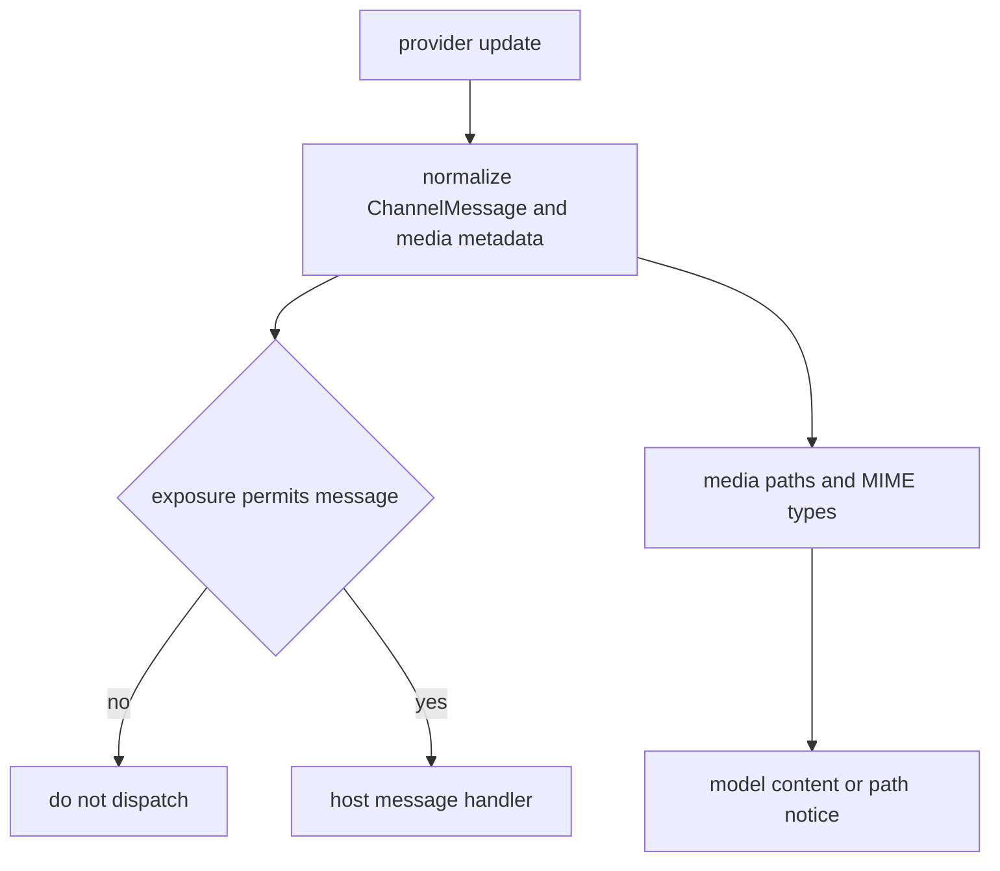

# Testing Guide

Use a focused Talon test when a change crosses an observable boundary: whether a channel admits a message, what attachment metadata reaches the agent, which model a new turn uses, which MCP status is reported, or whether a backend file reaches the initiating chat. Prefer fake transports, temporary directories, fake models, and in-process MCP adapters. Assert delivered messages, metadata, persisted state, status values, and files—not private helper order.

Run Talon's package route from `libs/talon`:

```bash
cd libs/talon
make test TEST_FILE=tests/channels/test_base.py
```

`make test TEST_FILE=...` is the supported focused route. Its `test` target first runs the WhatsApp bridge JavaScript tests, then runs pytest with xdist, non-Unix sockets disabled, Unix sockets allowed, a ten-second timeout, and coverage. A direct pytest invocation does not retain those package constraints.

## Focused routes

| Change boundary | Focused route | What to observe |
| --- | --- | --- |
| Shared admission policy or normalized media metadata | `make test TEST_FILE=tests/channels/test_base.py` | The permitted sender/conversation is dispatched; a rejected one is not. Media metadata retains provider presence and applies `voice_path` only to voice. |
| Telegram admission, polling, or upload behavior | `make test TEST_FILE=tests/channels/test_telegram.py` | Allowed updates acquire stable channel metadata; group input, untrusted senders, and unsupported exposure paths do not reach the handler. Upload method and size/type rejection remain channel-visible behavior. |
| WhatsApp bridge admission or media normalization | `make test TEST_FILE=tests/channels/test_whatsapp.py` | Only permitted/self-chat input is dispatched, reply context is normalized, voice is recognized from PTT or audio MIME type, and failed/oversized media is represented without pretending it arrived. |
| Model command, restart, unavailable choice, or context budget | `make test TEST_FILE=tests/unit_tests/test_model_selection.py` | The operator-visible selection applies to later turns, persists or clears correctly, and falls back to the startup model when an old choice cannot be built. |
| MCP reload, discovery, OAuth status, or partial failure | `make test TEST_FILE=tests/test_mcp.py` and `make test TEST_FILE=tests/test_host.py` | Reload is reported without model invocation; server status and authentication capability are safe and stable; a failed replacement does not displace working runtime tools. |
| Discord attachment ingestion | `make test TEST_FILE=tests/unit_tests/test_discord_attachments.py` | Downloads are local paths rather than remote URLs, images precede documents, and one failed/oversized attachment does not discard valid peers. |
| `send_file` or channel staging | `make test TEST_FILE=tests/unit_tests/test_file_sending.py` | Backend bytes, recipient filename, caption, size limits, staged media type, cleanup, and sanitized failures reach the correct boundary. |
| Prompt media construction and outbound path containment | `make test TEST_FILE=tests/test_media.py` | Documents become untrusted path notices, only safe bounded images become model blocks, and paths cannot escape the outbound root. |

## Channel admission and media normalization

Channel exposure is the first admission boundary. The default `self` mode permits configured operator identities and a channel's explicit `from_self` signal; `allowlist` permits configured conversations or matching mention patterns; `open` permits any message. Enabling `open` is deliberately configuration-gated: Telegram and WhatsApp require the literal acknowledgement `allow-arbitrary-senders`. Test the policy through dispatched (or dropped) `ChannelMessage` values rather than the policy's internal branching.

Provider rules narrow the shared policy. Telegram records provider, chat, message, and chat-type metadata for admitted input, but drops group/supergroup messages and does not infer that a private-chat sender is the bot. Its polling tests also cover channel posts and reactions: senderless or anonymous reactions, and reactions denied by exposure, are dropped while the update offset still advances. WhatsApp accepts a self-originated message only when the bridge provides a real boolean self marker and identifies it as a self chat; it must not dispatch the bot's outbound messages to other chats. Its reply context is normalized to `resolved`, `lookup_failed`, or `not_reply`, while logs record presence/status rather than quoted identifiers.



*Inbound tests establish that normalization precedes a visible admission-or-drop outcome and supplies only the accepted message's metadata to the host.*

When adding a channel, normalize to the shared metadata boundary rather than making the host interpret provider-specific payloads. `message_with_media_paths` preserves a provider's `has_media` indication even if no local path was retained, records paths and aligned MIME types when present, and attaches `voice_path` only for voice. Test a missing, failed, or oversize download separately from a message with no attachment: the former must remain observable as unavailable media, not become a false claim that the user supplied nothing.

Discord attachment coverage is the representative multi-attachment route. It expects image media first, preserves documents as local paths rather than CDN URLs, and lets a successful attachment survive another attachment's failed download or size rejection. Unknown MIME types remain documents, and attachments from a sender that fails channel admission are not downloaded or dispatched. These assertions keep untrusted remote attachment locations and document contents outside the prompt boundary.

## Model selection: persisted choice and safe fallback

`/model` is a host command, not an arbitrary provider selector. Anyone may inspect the catalog, but only an operator can change the all-chat selection; an unknown request is rejected without echoing it or invoking the agent. A successful selection is used by subsequent turns—including new conversations—rather than retroactively changing an in-progress turn. The selected value survives `/new` and host restart; `/model default` removes the stored override.

The runtime only builds models that exactly match Talon's credentialed discovered catalog. It caches a valid selected model after first use. If persisted state names a model that is no longer available, the host can flag that condition in the listing and the runtime must answer with the startup model instead of attempting to build the stale selection. Test this as a response/model outcome, not as cache implementation detail.

A selected model also owns the main agent's context budget and summarizer. Regression tests must cover both directions: a larger selected model may receive context beyond the startup model's limit, while a smaller selection is not sent a context sized for the larger startup model. Main-agent summarization follows and caches the selected model; subagents retain the startup summarizer.

## MCP reload, status, and authorization

Treat reload as a user-facing lifecycle operation with two entry points. The `/mcp-reload` host command must reload without invoking the agent and report success, unavailable support, or a generic failure that directs the operator to logs without exposing the underlying error. Separately, the MCP reload tool may schedule a refresh even with no current configuration; callers see `scheduled` and availability only after a successful reload. The runtime replacement is transactional: a reload that builds a valid replacement changes the active tools/graph, while a failed replacement leaves the prior working tools and graph intact.

MCP status is a safe diagnostic boundary. A configured OAuth server with no usable token is `unauthenticated`, has no loaded tools, and advertises that it can authenticate. Connection failure is `error` with no tools and a status response that does not disclose transport detail. A wrapped authorization failure is likewise represented as an authentication requirement rather than aborting startup; an unrelated server failure must not prevent another configured server from loading. Keep status-tool schemas stable as a server moves between authenticated and unauthenticated states.

Authentication tests should exercise the externally visible lifecycle: an explicit reauthentication request bypasses stored credentials; a completed authorization schedules refresh even if later cleanup reports a non-cancellation error; cancellation still propagates while retaining the need to refresh credentials. The host callback boundary additionally requires the pending authorization's channel, conversation, matching endpoint, and operator identity before forwarding a callback, and prevents callback secrets from appearing in channel output or logs.

## Backend-to-channel file delivery

`send_file` reads through the agent backend, so the same tool can deliver a local-workspace or remote-sandbox file. It is scoped to the current turn's initiating chat and is unavailable to a subagent or a run with no channel file handler. Test the recipient-visible result: successful sends carry the backend bytes, a safe display filename, and an optional caption; unreadable and oversized files are never handed to the channel; channel failure returns a generic tool message rather than a transport error.

Before channel upload, Talon creates a fresh `0700` directory under the configured staging root and writes one `0600` file without following symlinks. The staging directory is removed after both success and failure. The staged file's classification determines whether the channel receives an image, video, or document, so test name/type preservation as well as cleanup. Filename coverage should include separators, dot-only names, control/format characters, Unicode, and long names: recipient display must remain one bounded path component without unnecessarily destroying useful names.

## Media safety companion route

Inbound documents and generic files are represented in prompt text as escaped absolute path notices marked as untrusted data; their contents are not read during prompt construction. Recognized images alone may become base64 model content blocks, subject to the applicable bounded read. Outbound channel media is validated as a regular file of the expected type and size beneath its configured root; traversal, URI, home-expansion, missing-file, and symlink escape cases must fail before an adapter upload.

## Before finishing

1. Run the narrow `make test TEST_FILE=...` route above, and pair it with the persistence/reload route when a change crosses that lifecycle boundary.
2. Use fakes for channel transports and MCP servers; do not require a bot token, bridge session, credentials, or live provider.
3. Include admitted and denied/unavailable outcomes when changing security, normalization, or failure handling.
4. Run `make lint` in `libs/talon` after focused tests pass.
