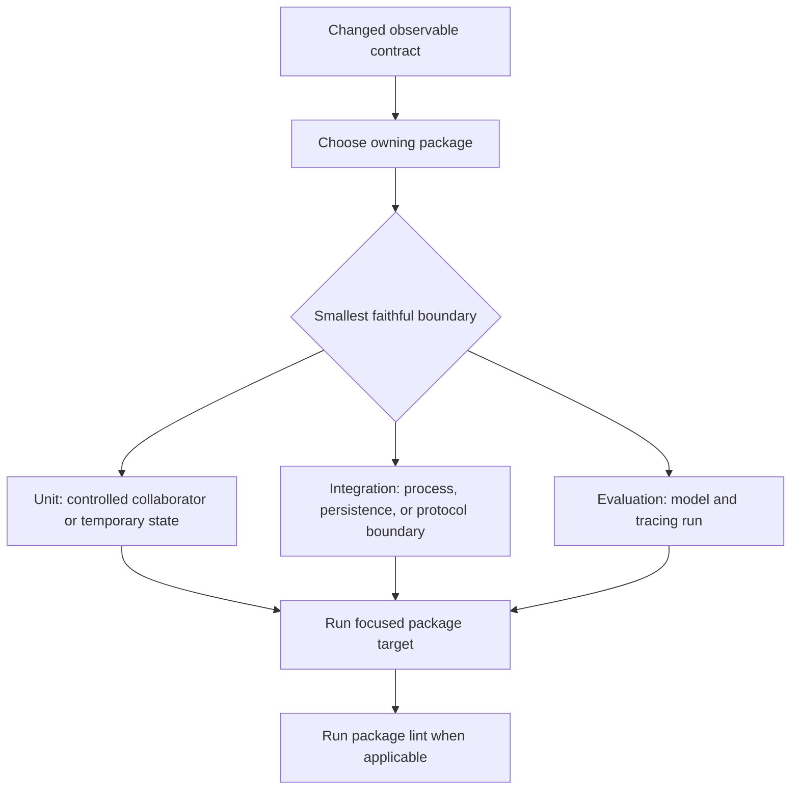
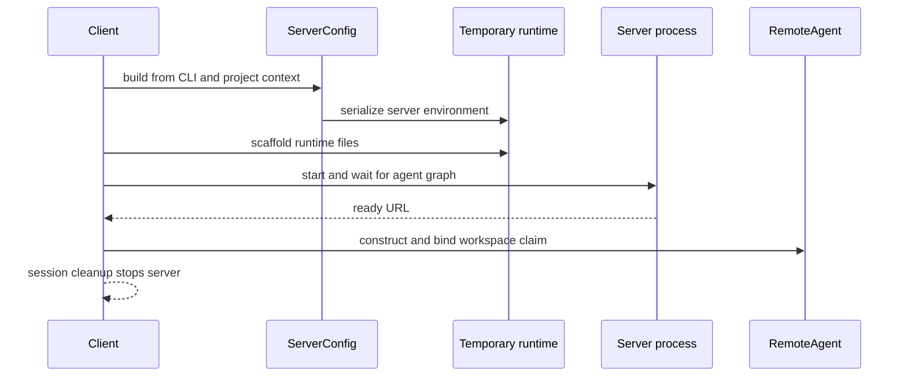

# Testing Guide

Test the observable contract at the owning package boundary. Start with the smallest deterministic seam: use controlled state, a fake model, a recording transport, or an in-memory protocol server before introducing a real process. Move a test to integration coverage when the behavior depends on a subprocess, durable state, a server/CLI boundary, or a real networked service. See [Development](../operations/development.md), [Build a Deep Agent](../workflows/build-a-deep-agent.md), and [Run a dcode session](../workflows/run-dcode-session.md) for the corresponding development and operational flows.

## Choose the seam



*Use the narrowest deterministic test that proves the changed contract.*

Repository conventions require coverage that protects meaningful, observable behavior rather than internal call order. Network-free tests go in `tests/unit_tests/`; networked tests go in `tests/integration_tests/`. Pytest runs async tests with `asyncio_mode = "auto"`, so do not add `@pytest.mark.asyncio` just to execute an async test.

- **Unit tests** should own their filesystem and environment through fixtures and temporary paths. Prefer fake models, in-memory servers, controlled clocks, event barriers, or recording clients to live services and timing sleeps.
- **Integration tests** are for a boundary that cannot be simulated faithfully: CLI-to-server startup, import-time configuration, session persistence, or a locally composed protocol process. Keep their external surface local and deterministic.
- **Model-backed evaluations** are not a default regression suite. They intentionally require a model and tracing credentials; keep local harness behavior in unit tests and run model evaluations explicitly.

## Run the owning target

Run commands from the package directory, or use `make -C` from the repository root. `TEST_FILE` narrows the package target and `PYTEST_EXTRA` appends pytest switches where the target supports it.

```bash
make -C libs/deepagents test TEST_FILE=tests/unit_tests/test_graph.py
make -C libs/deepagents integration_tests TEST_FILE=tests/integration_tests/<focused_test>.py

make -C libs/code test TEST_FILE=tests/unit_tests/test_server_manager.py
make -C libs/code test TEST_FILE=tests/unit_tests/test_mcp_tools.py
make -C libs/code integration_tests TEST_FILE=tests/integration_tests/<focused_test>.py

make -C libs/acp test TEST_FILE=tests/<focused_test>.py
make -C libs/talon test TEST_FILE=tests/<focused_test>.py
make -C libs/evals test TEST_FILE=tests/unit_tests/<focused_test>.py
```

`deepagents` and `code` default `make test` to parallel, coverage-enabled unit tests with network sockets disabled except Unix sockets. Their `integration_tests` targets select `tests/integration_tests/` and apply a 30-second timeout. Use `coverage` when an XML report is needed; use `update-snapshots` only for the package's smoke snapshots.

`acp` and `talon` run their package `tests/` with the same socket restriction and a 10-second timeout; Talon's `test` target runs the Node WhatsApp bridge tests first. `evals` has a socket-restricted unit target but separates model-backed targets. After a code change, run the owning `make lint`; the dcode lint target also checks the generated command catalog and process working-directory rules. At library scope, `make -C libs lint` iterates library packages and `make -C libs lock-check` validates lockfiles.

## Representative package coverage

### Deep Agents graph assembly

For a change to `create_deep_agent`, keep the regression in `libs/deepagents/tests/unit_tests/test_graph.py` unless it needs a real external boundary. This test module exercises graph assembly with `GenericFakeChatModel`, targeted constructor patches, and a type-compatible subagent middleware recorder. That lets a test inspect the compiled graph or the middleware passed to `create_agent` without compiling unrelated subagent graphs.

Focus graph tests on externally meaningful assembly rules:

- Harness profiles select model-specific prompts, tool-description overrides, default or explicit subagents, and middleware. An explicit `general-purpose` replacement overrides the default; disabling the default removes the `task` tool only when no synchronous subagent remains.
- Profile exclusions must not remove protected filesystem or subagent scaffolding. Test both the accepted extension point and the failure behavior for invalid, ambiguous, or unmatched exclusions rather than asserting incidental construction order.
- Test prompt-caching behavior at the provider boundary. Optional Bedrock or Fireworks middleware may be absent, but unrelated import errors must still propagate; Anthropic request mutation should apply only to Anthropic models.
- Preserve public graph metadata and compatibility behavior, including editable-install version metadata and explicit deprecation warnings, with fake models and captured warnings.

### dcode server lifecycle and configuration

dcode is a client/server application, but most startup behavior remains unit-testable. `start_server_and_get_agent` builds one `ServerConfig`, serializes it into `DEEPAGENTS_CODE_SERVER_*` environment variables, scaffolds a temporary LangGraph runtime, starts the server, waits for the `agent` graph, and binds the resulting `RemoteAgent` to a workspace. `server_session` owns the complementary cleanup.



*The dcode startup test seam verifies configuration transfer, runtime scaffolding, readiness, binding, and cleanup without launching a real server.*

Use `libs/code/tests/unit_tests/test_server_manager.py` and `test_server_config.py` for this boundary. Important regressions include the following:

- Round-trip `ServerConfig` through the environment and reject malformed filesystem allowlists. An explicit allowlist must include `read_file`; invalid JSON shapes, empty lists, and unknown forms fail closed rather than becoming unrestricted access.
- Normalize a relative explicit MCP path against the captured project context before it crosses into the subprocess. Project-scoped MCP, extension, and sandbox policy remains server-resolved rather than accepted in a managed client's workspace claim.
- Verify generated runtime behavior: a source checkout produces a local package dependency, while installed distributions use a versioned dependency; the generated server registers only the `agent` graph and authenticated offload app.
- Exercise cancellation and failure cleanup. Startup must reap a server that was never handed to the caller, run blocking `stop()` off the UI event loop, and retain the full shutdown grace when a sandbox may require graceful cleanup.

For the real CLI/server/persistence boundary, use `libs/code/tests/integration_tests/test_headless_resume.py`. It launches fresh helper and CLI subprocesses with a temporary `HOME` and `DEEPAGENTS_HOME`, because profile paths and the sessions database are captured at import time. This proves persisted-thread resume without reading or writing a developer profile.

### dcode MCP, cost, and UI behavior

Keep MCP config, loading, and error behavior in `libs/code/tests/unit_tests/test_mcp_tools.py`. The module creates real in-memory FastMCP servers and lets the production loader construct real transports before routing them to those in-memory backends. This preserves client/session/schema behavior while avoiding a subprocess or live socket.

Test configuration precedence and its security boundaries, not just JSON parsing: user, project, explicit, and plugin sources may resolve different working directories; untrusted project configuration must not win; OAuth is valid only for remote HTTP servers and cannot coexist with a static authorization header. A malformed explicit `--mcp-config` is a fatal, parent-side preflight error, while discovered user and project configurations load leniently so a single bad server is reported without hiding other servers. Test cleanup for every stateful `MCPSessionManager` created by the case.

For cost tracking, use the cost test module's isolated `_SessionCostRecorder` context fixture instead of production global recorder state. Exercise usage metadata, model/provider identity, thread-scoped draining, emitted session/model events, and pricing-override precedence through the public estimation or middleware seam. This prevents a test's callbacks from leaking pending records into another test.

For Textual-facing changes, use the targeted UI test or pilot seam only if rendering, focus, key handling, or user-visible interaction is the contract. Keep command parsing, configuration, cost formatting, and agent orchestration in ordinary unit tests when they can be proven without a screen. Never require a provider account, developer profile, or live MCP endpoint for these regressions.

## Warnings, isolation, and network boundaries

All packages treat unaccepted pytest warnings as errors. Fix an actionable warning before adding a filter. If a warning is genuinely expected, scope it to the individual test with `@pytest.mark.filterwarnings`; package-level entries are reviewed exceptions. Prefer `default::` rather than `ignore::` for thread and unraisable-exception warnings so pytest still reports the problem.

The `ci:allow-warnings` label is a pull-request-only escape hatch for reusable test jobs. `_test.yml` queries live PR labels and, only when it finds the exact label, supplies `-W default`; this matters because reruns reuse an old event payload. Label API failures fail closed to warnings-as-errors. Push and merge-group runs remain strict, as does the direct QuickJS smoke path.

## CI and workflow-policy tests

CI filters package jobs on pull requests and includes editable SDK dependents: an SDK change selects dcode, ACP, Talon, evals, and relevant partner tests. Pushes run package jobs unconditionally. The reusable test workflow validates matrix input types, runs all matrix legs with `fail-fast: false`, and invokes pytest directly on Windows because the package Make target uses a POSIX shell backend. Current jobs cover deepagents on Python 3.11–3.14 plus Windows 3.13, dcode/Talon/evals on Python 3.14, and ACP on Python 3.11–3.14.

Treat `.github/scripts/tests/` as executable policy coverage, not as a file-format smoke test:

- `checks/test_raise_langchain_minimums.py` tests dependency-floor planning against compatible upper bounds, preserves extras/markers and quoted manifest literals, identifies transitive stale lock directories, checks narrowing failures, and executes the shallow-branch refresh shell path. It also checks that workflow dispatch package choices match release labels and that GitHub expressions use only supported functions.
- `release/test_release_please_workflow.py` loads release workflow YAML and evaluates job `if:` expressions against success, skipped, failed, cancelled, and missing-output states. It protects dispatch-before-maintenance ordering, fail-closed release and lockfile gates, declared `needs`, job-scoped release serialization, and complete package detection/dispatch wiring.
- `workflows/test_ci_workflow.py` combines static workflow assertions with execution of workflow shell snippets against stubbed commands. It protects trusted-base CI gate execution, lockfile gating, mutually exclusive ripgrep install policy, exact label bypass behavior, and the separation of a write-capable `workflow_run` commenter from PR-authored checkout code.

When changing a workflow condition, do not only assert that a clause appears in YAML. Add a truth table or execute the actual shell body with stubs so a changed boolean operator, skipped dependency, or unsafe fallback cannot leave CI green while silently disabling a gate.

## Benchmarks and evaluations

Benchmark invocation belongs to package Makefiles. `libs/deepagents` and `libs/code` provide `benchmark`, CodSpeed `bench`, and CodSpeed memory `bench-memory`; `make -C libs bench-all` runs `bench` for those two packages. The reusable CodSpeed workflow runs `make bench` and runs `make bench-memory` only when its memory input is enabled; the scheduled and manually dispatchable nightly sweep currently covers deepagents and dcode.

```bash
make -C libs/deepagents benchmark
make -C libs/code bench-memory
make -C libs bench-all

make -C libs/evals evals MODEL=<id>
make -C libs/evals evals-trials MODEL=<id> TRIALS=<n>
```

`evals` requires `MODEL`; `evals-trials` additionally requires `TRIALS` and delegates repeated-run aggregation to `scripts/run_trials.py`. The `deepagents-evals` CLI is the canonical interface for run, trials, aggregate, radar, catalog, model-groups, and list operations. Model-backed runs require `LANGSMITH_TRACING=true`, `LANGSMITH_API_KEY`, and matching provider credentials. For Harbor, stage local checkouts with `make -C libs/evals stage-harbor-local-deps` before starting the target for the desired sandbox provider.

## Completion checklist

1. Identify the package and observable contract that changed.
2. Add the narrowest deterministic test; own filesystem, environment, global recorder, and session state.
3. Use `unit_tests` unless the contract requires a process, durable session, server/CLI, or real network boundary.
4. For graph or server assembly, assert user-visible configuration and failure invariants rather than private call order.
5. Run the focused package target and `make lint`; run the full target for broad changes.
6. For workflow changes, test boolean outcomes and shell behavior, including failure and skipped states.
7. Keep warnings strict and treat label-based bypasses as temporary operational escapes, not fixes.
