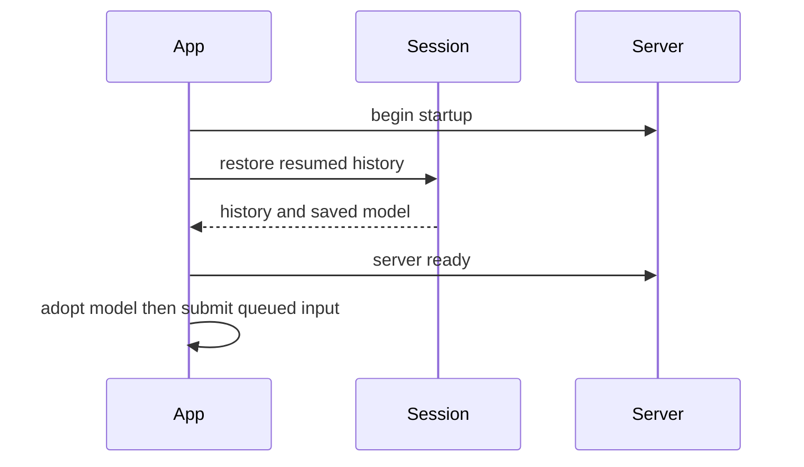

# Testing Guide

Put a network-free regression in the owning package's `tests/unit_tests/` tree; reserve `tests/integration_tests/` for a real network boundary. Test an observable contract—persisted state, visible message, wire payload, filesystem result, or safe failure—not helper ordering. Packages use automatic asyncio handling, so do not add `@pytest.mark.asyncio`; unaccepted pytest warnings fail the suite. See [Development](../operations/development.md), [MCP](../integrations/mcp.md), [Plugins](../concepts/plugins.md), and [trace attribution](../concepts/trace-attribution.md).

## Run the narrow package target

Use the owning Makefile so the dependency group, coverage, socket policy, timeout, and package hooks match CI.

```bash
make -C libs/code test TEST_FILE=tests/unit_tests/test_app.py
make -C libs/code test TEST_FILE=tests/unit_tests/test_config.py
make -C libs/code test TEST_FILE=tests/unit_tests/test_headless_resume.py
make -C libs/code test TEST_FILE=tests/unit_tests/test_mcp_auth.py
make -C libs/code test TEST_FILE=tests/unit_tests/plugins/test_plugin_updates.py
make -C libs/code test TEST_FILE=tests/unit_tests/hooks/test_engine.py
make -C libs/code test TEST_FILE=tests/unit_tests/test_git_trace_integration.py
make -C libs/code test TEST_FILE=tests/unit_tests/test_turn_trace.py
make -C libs/partners/quickjs test TEST_FILE=tests/unit_tests/smoke_tests/test_system_prompt.py
make -C libs/partners/quickjs update_snapshots
make -C libs/talon test TEST_FILE=tests/test_runtime.py
```

`libs/code` defaults to `tests/unit_tests/`, uses xdist, and disables sockets except Unix sockets; its integration target selects `tests/integration_tests/` with a 30-second timeout. QuickJS also defaults to unit tests with sockets disabled, while Talon's target runs its WhatsApp bridge tests before socket-disabled pytest with a 10-second timeout. Run `make lint` in the changed package after focused tests pass.

## Startup, reload, and resume: test ordering at the UI boundary

`DeepAgentsApp` has asynchronous startup, history restoration, model adoption, and queue draining. A regression test should use Textual's local test harness and controlled server/session doubles, then assert what the user can observe: an initial prompt remains queued until `ServerReady`; restored history arrives before a startup command; a resumed model is adopted before the first submission; and failure to adopt it blocks that submission. On reconnect, ensure history is not loaded again and queued work drains only when the session is usable.



*The startup tests protect user-visible ordering rather than implementation task scheduling.*

Use `test_config.py` for configuration transitions that cross process and environment boundaries. In particular, a project-directory switch must refresh managed `.env` values while retaining shell-supplied values, and reloading must restore the user's LangSmith environment over an in-process agent override. Exercise malformed carrier data as a safe refusal: report it without replacing it with a newly trusted value.

For `dcode -r`, isolate the session store in `test_headless_resume.py`. A valid target supplies its saved agent and cwd; missing IDs offer similar IDs, policy-blocked threads fail, and a different or missing original cwd reports a conflict. The launch model prefers the checkpoint's valid stored model, then the configured default, and raises when neither exists. This is the focused seam for [running a dcode session](../workflows/run-dcode-session.md), not the TUI.

## Plugins: discovery is not installation

Use a temporary marketplace and state/config directories in `test_plugin_updates.py`. A discovered remote version is recorded as available and announced once, but it must not change the installed version. A refresh failure preserves that saved update and does not re-notify it; an opt-in manifest can install the update. Test the command/UI boundary too: `plugin update --check` reports availability, the actual update requests `/reload`, and the manager exposes the update action. These tests make [plugin](../concepts/plugins.md) update checks safe despite intermittently unavailable marketplaces.

## MCP OAuth: test local persistence and hostile input

`FileTokenStorage` is a security boundary. Test tokens and OAuth client metadata together through its async API using a fake home, never a real credential file. The intended invariants are server isolation—including same server names at different URLs—private `0600` files on POSIX, absolute expiry recorded when tokens are accepted, and per-file synchronization that preserves independent concurrent mutations without serializing unrelated servers. Reject path-like or otherwise unsafe server names; a corrupt file must fail with remediation guidance rather than silently becoming empty.

Use local `httpx`/`httpx2` fixtures for challenge, metadata, refresh, and login failures. Preserve the public header resolver's interpolation behavior and input immutability. Do not use a real OAuth endpoint in the unit suite. See [MCP integration](../integrations/mcp.md) for the user-facing configuration boundary.

## Hooks: assert the wire contract and reduction policy

A hook snapshot selects handlers by event and supported matcher. `test_engine.py` projects domain events into the command-hook wire input: it carries a session ID and event-specific fields such as prompts, tool IDs, notification type, failure details, compact trigger, or subagent identity. Add coverage by constructing a `HookInvocation`, serializing with the wire adapter, and asserting the external payload—not a private projection helper sequence.

The command runner and reducer are the decision boundary. Cover exit/error and timeout behavior with local commands, then assert the reduced permission or block result. The reducer applies results in configuration order even when commands finish in another order; permission precedence is deny, then ask, then allow. A captured snapshot must remain the one used for an in-flight invocation. For a graph-level transport or resume change, use the dedicated hook server-lifecycle tests: assert that the stable invocation identity permits the intended response and that malformed or mismatched resumes fail safely.

## Git attribution and turn traces: backfill metadata, not runs

Use real temporary Git repositories, fake models, `InMemorySaver`, and a recording `LangChainTracer` in `test_git_trace_integration.py`. The integration assertion is retrospective attribution: after an approved tool changes repository/branch, the turn's root, model, tool, and nested runs receive observed `ls_git_repo` and `ls_git_branch`; caller-supplied `git_*` metadata and unrelated metadata remain intact. A later turn must not inherit observed attribution. Probe or telemetry failures are optional-observability failures: agent output and tool work still complete.

`test_turn_trace.py` supplies the lower-level regression seam. A captured trace spans interrupted/resumed graph roots and updates completed runs without resending inputs, outputs, errors, events, tags, or attachments; live runs are not ended. Updates preserve trace destination and timing, including replica destinations, and only traces with enabled tracing plus a turn scope are captured.

## QuickJS prompt snapshots

QuickJS smoke tests render a real `create_deep_agent` graph with `CodeInterpreterMiddleware` and a deterministic fake model, then snapshot the first system message. Keep the matrix representative: no tools, mixed PTC tools, each `thread`, `turn`, and `call` persistence mode, no timeout, and nested tool schemas. The no-timeout case also has a semantic assertion that timeout language is absent; retain such assertions because snapshots are drift detectors, not the behavioral specification.

When prompt text intentionally changes, review the captured text and semantic expectations first, then update only this suite:

```bash
make -C libs/partners/quickjs update_snapshots
```

Normal execution compares committed snapshots; a missing one is created only to fail and request a rerun. The suite exists to catch SDK prompt drift even when QuickJS itself is unchanged.

## Talon runtime assembly

`DeepAgentRuntime` is the Talon assembly boundary. In `tests/test_runtime.py`, replace `create_deep_agent` with a recording graph and assert assembled inputs and behavior: backend/checkpointer ownership, assistant instructions, skills and memory paths, built-in and custom tools, and local plus declarative async subagents. Refreshing tools affects a subsequent graph; MCP reload is transactional, so a failed replacement leaves the prior graph and tool set in service. Bind an authorization handler only for the active invocation and verify it is cleared afterward.

Use the same seam for lifecycle safety: repeated conversation IDs retain their thread; a recovery repairs a dangling tool call before an interruption marker; and a graph stays stable while approval is outstanding. These tests should exercise runtime-visible state and messages, not the internal construction order. For partner and sandbox changes, also consult [sandbox partners](../integrations/sandbox-partners.md).

## Completion checklist

1. Select the package and narrowest test file above; use a fake model, temporary directory, mock transport, or recording tracer.
2. Assert ordering at the startup/resume boundary, durable state at the plugin/OAuth boundary, and serialization at the hook/trace boundary.
3. Preserve failure semantics: failed observation does not break an agent turn; failed graph replacement does not replace the working graph; corrupt credential state does not silently reset.
4. Review QuickJS prompt semantics before regenerating snapshots.
5. Avoid sleeps, provider calls, real credentials, and internal-call-order assertions; then run the owning `make lint`.
