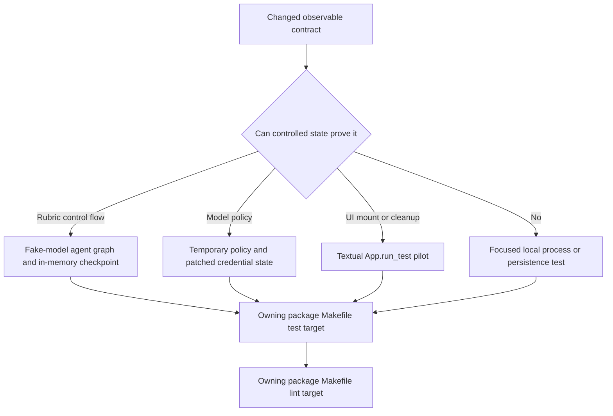
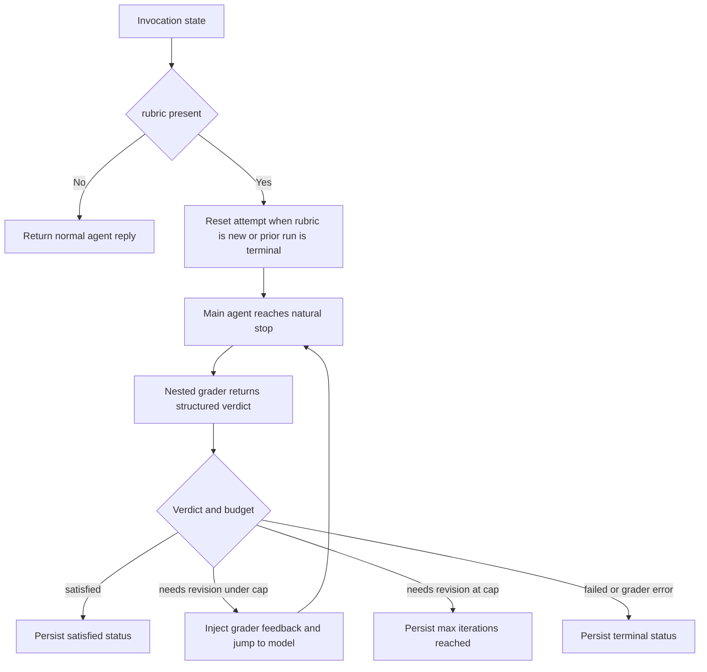

# Testing Guide

Choose the narrowest test that proves an observable contract. Network-free tests belong in `tests/unit_tests/`; tests with a real network boundary belong in `tests/integration_tests/`. Avoid implementation-only assertions and timing sleeps: use fake models, controlled configuration, or an actual Textual pilot when mounting and asynchronous cleanup are the behavior under test. Pytest warnings are errors unless a package has explicitly allowlisted one. See [Development](../operations/development.md), the [middleware catalog](../concepts/middleware-catalog.md), [profiles and models](../concepts/profiles-models.md), and [SDK construction and execution](../architecture/sdk-construction-execution.md) for the corresponding runtime concepts.

## Run the owning package command

A package's `Makefile` is the command authority. Run the focused file through its package target rather than copying pytest flags: this preserves each package's socket policy, parallelism, timeout, coverage configuration, and required companion checks.

```bash
make -C libs/deepagents test TEST_FILE=tests/unit_tests/middleware/test_rubric_middleware.py
make -C libs/deepagents test TEST_FILE=tests/unit_tests/test_end_to_end.py PYTEST_EXTRA='-k RubricMiddleware'
make -C libs/code test TEST_FILE=tests/unit_tests/test_config.py PYTEST_EXTRA='-k DefaultModelSpecAllowlist'
make -C libs/code test TEST_FILE=tests/unit_tests/test_model_config.py PYTEST_EXTRA='-k ModelAllowlist'
make -C libs/code test TEST_FILE=tests/unit_tests/tui/widgets/test_messages.py PYTEST_EXTRA='-k LazyToolGroupExpansion'
```

`libs/deepagents` and `libs/code` run their unit targets with xdist and socket access disabled other than Unix sockets; each accepts `TEST_FILE` and `PYTEST_EXTRA`. Their integration aliases switch to `tests/integration_tests/` and apply a 30-second timeout. `libs/evals` has a socket-disabled `test` target, while its `evals` target is deliberately model-backed and requires `MODEL`. `libs/talon` runs its bridge tests before pytest and applies a 10-second test timeout. Therefore, do not use a model-backed eval merely to validate the deterministic controls described here.

## Select the seam



*Route rubric loops, policy resolution, and mounted-widget lifecycle to deterministic seams; cross a process or provider boundary only when that boundary is itself the contract.*

## Rubric completion: hook tests plus fake-model graph tests

`RubricMiddleware` is inert unless invocation state includes `rubric`. `before_agent` starts a new grading attempt when the rubric changes or the prior attempt has a terminal status, resetting the iteration budget and minting a run identifier. At natural agent completion, `after_agent` or `aafter_agent` grades the transcript. A `needs_revision` result injects a grader-sourced `HumanMessage` and jumps back to `model`; a satisfied or terminal result falls through. Grader infrastructure errors are recorded as `grader_error`, whereas `GraphBubbleUp`, cancellation, and `KeyboardInterrupt` remain control flow and propagate.



*The revision loop is bounded by `max_iterations`; callers inspect rubric state, callbacks, or stream events to distinguish a non-satisfied terminal outcome from a successful one.*

Use two complementary test levels:

- **Direct middleware tests** in `libs/deepagents/tests/unit_tests/middleware/test_rubric_middleware.py` stub `_grade` and `_agrade`. They are the fast seam for constructor validation, new-versus-sticky rubric state, sync/async parity, emitted events, feedback injection, iteration-cap conversion, error distinctions, and propagation of cancellation or interrupts. Stub `_invoke_grader`, rather than `_grade`, when testing the one-retry criterion-coverage guard.
- **End-to-end unit tests** in `libs/deepagents/tests/unit_tests/test_end_to_end.py` instantiate `create_deep_agent` with scripted `FixedGenericFakeChatModel` instances for both the main agent and the structured-output grader. Use `InMemorySaver` and `agent.get_state(config).values` to assert private rubric fields, since those fields are not agent I/O. This proves the graph wiring: first-pass success adds no revision message, a revision verdict produces a tagged feedback turn and reruns the main model, and repeated revisions terminate exactly at the cap.

The grader freezes the first nonempty per-criterion list for the current run. Later responses that cover fewer entries are retried once with a correction; an unsubstantiated `satisfied` verdict is downgraded to `needs_revision`, so it cannot terminate the run. The fake-model end-to-end scenario for undercounted criteria is the focused regression test for that cross-hook invariant; it also proves recovery when a later full verdict satisfies the frozen checklist. Use direct hooks for payload, retry, and failure variants that do not require a real compiled graph.

## dcode model policy: test resolution and authorization separately

dcode's model policy is a configuration boundary, not a provider-call test. `ModelConfig` parses exact `provider:model` entries and provider-wide `provider:*` entries; an explicit empty allowlist denies all models. Policy checks operate on a canonical resolved specification when provider inference is needed, so a bare model name can be allowed only after it resolves to an allowed provider-qualified model. Rejection errors retain the declaration source and permitted models, and can add the subagent declaration context.

The default-model resolver adds a separate operational decision: it must not select a stored default outside the active allowlist, and it distinguishes a deny-all policy from the case where allowed providers all lack credentials. Test this route in `TestDefaultModelSpecAllowlist` in `libs/code/tests/unit_tests/test_config.py` by pinning `ModelConfig.load` and provider auth status—no provider client is required. Use `TestModelAllowlist` in `libs/code/tests/unit_tests/test_model_config.py` for policy grammar, wildcard restrictions, canonicalization, matching, and diagnostic wording.

Keep these boundaries distinct:

- A malformed or ambiguous allowlist entry is a parser/policy test.
- A bare name must be canonicalized before policy comparison; canonicalization is not an authorization bypass.
- Default selection must skip a disallowed stored default and choose an allowed credentialed candidate, or raise the specific no-allowed-credentials error.
- Provider initialization, credentials, profiles, retry parameters, and provider-specific kwargs belong to the focused `test_config.py` cases that exercise `create_model`; patch `init_chat_model` and credential predicates so they remain network-free.

This separation makes authorization changes deterministic and protects policy semantics from external provider availability.

## Textual lazy tool details: lifecycle is the test boundary

`LazyToolGroupSummary` keeps completed `MessageData` while collapsed and builds detail widgets only on expansion. The header and detail container mount immediately, but details remain hidden until a toggle. Expansion mounts up to eight rows per batch and yields to the event loop between batches; collapse snapshots a `ToolCallMessage`'s disclosure state before removing children. A successful transition updates `_expanded`, the header, and emits `ExpansionChanged`.

A transition is intentionally fail-safe. On cancellation during expansion, mounted partial children are removed and the cancellation propagates. On an ordinary builder or mounting failure, the group removes partial children, stays unexpanded, logs the failure, and posts a warning notification. Collapse failures keep the detail container visible rather than falsely claiming that details disappeared. `_transitioning` is cleared in all cases, preventing a failed task from permanently disabling later input.

Test this in `TestLazyToolGroupExpansion.test_batched_expansion` in `libs/code/tests/unit_tests/tui/widgets/test_messages.py`. It uses a minimal real `App` and `run_test`, a controlled detail builder, and an observer task—not a sleep-based race—to prove that a 32-row expansion yields after partial work. Parameterize normal completion, a builder exception, and `asyncio.CancelledError`; after either interrupted path, assert no mounted children, no cached detail widgets, no expanded state, and a cleared transition flag. On the successful path, collapse and re-expand to verify children are discarded and recreated.

Use this Textual pilot because attachment, mounting, and cancellation cleanup are UI lifecycle contracts. For pure summary formatting or `MessageData` transformations, prefer an ordinary unit test without an app.

## Completion checklist

1. Identify the changed observable contract and run the focused test file through the owning package Makefile.
2. For rubric changes, keep direct-hook tests for local semantics and use fake-model `create_deep_agent` coverage for loop wiring and persisted private state.
3. For model policy, control `ModelConfig`, credential status, and model construction; do not call a real provider to prove allowlist behavior.
4. For lazy tool details, use `App.run_test` only when widget mounting, event-loop yielding, cancellation, failure cleanup, or re-expansion is at issue.
5. Assert externally meaningful state, messages, events, and cleanup—not incidental internal call ordering.
6. Run the owning package's `make lint` after behavior and focused tests pass.
