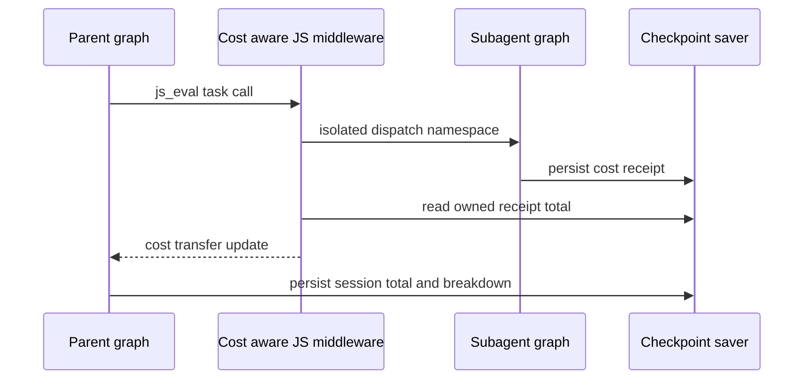
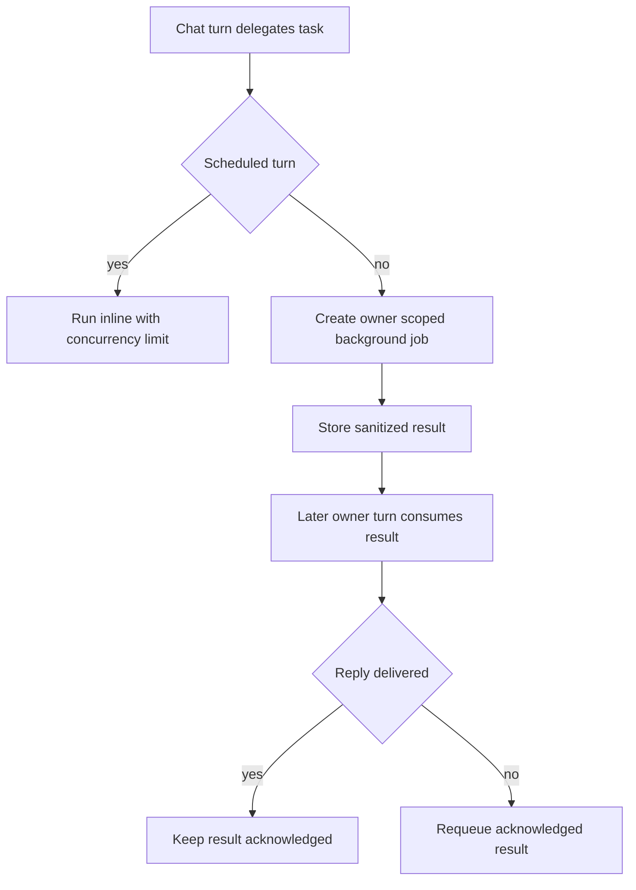

# Testing Guide

Run the smallest package-owned route that exercises the behavior a caller observes. These unit tests use fake models, temporary files, in-memory or temporary SQLite checkpointers, in-process MCP servers, mock transports, and synchronization events; they must not require a provider credential or a live service. Warnings are errors unless a test narrowly permits a reviewed warning.

Start in the owning package, synchronize dependencies, and pass the nearest file via `TEST_FILE`:

```bash
# dcode: configuration, MCP, and JavaScript cost behavior
cd libs/code
uv sync --all-groups
make test TEST_FILE=tests/unit_tests/test_config.py
make test TEST_FILE=tests/unit_tests/test_config_manifest.py
make test TEST_FILE=tests/unit_tests/test_local_context.py
make test TEST_FILE=tests/unit_tests/test_model_config.py
make test TEST_FILE=tests/unit_tests/test_mcp_tools.py
make test TEST_FILE=tests/unit_tests/test_js_cost_sync.py
make test TEST_FILE=tests/unit_tests/test_js_cost_tracking.py

# Release-note JavaScript helper: run from the repository root
cd ../..
node --test .github/scripts/tests/release/release-notes.test.js

# SDK message/checkpoint and delegation semantics
cd libs/deepagents
uv sync --all-groups
make test TEST_FILE=tests/unit_tests/test_messages_reducer.py
make test TEST_FILE=tests/unit_tests/test_subagents.py

# ACP protocol adaptation and permission caching
cd ../acp
uv sync --all-groups
make test TEST_FILE=tests/test_agent.py
make test TEST_FILE=tests/unit_tests/test_execute_permissions.py

# Talon lifecycle and detached-work ownership
cd ../talon
uv sync --all-groups
make test TEST_FILE=tests/test_runtime.py
make test TEST_FILE=tests/test_mcp_auth.py
make test TEST_FILE=tests/unit_tests/test_background.py
make test TEST_FILE=tests/unit_tests/test_claude_sessions.py
make test TEST_FILE=tests/unit_tests/test_codex_sessions.py
make test TEST_FILE=tests/unit_tests/test_dcode_sessions.py
make test TEST_FILE=tests/unit_tests/test_research_subagents.py

# QuickJS snapshots and cleanup lifecycle
cd ../partners/quickjs
uv sync --all-groups
make test TEST_FILE=tests/unit_tests/test_snapshot_persistence.py
make test TEST_FILE=tests/unit_tests/test_slot_cleanup.py

# Harbor LangGraph adapter
cd ../../evals
uv sync --all-groups
make test TEST_FILE=tests/unit_tests/test_harbor_langgraph_agent.py
```

The package Makefiles are the command authority. dcode runs pytest with xdist, disabled sockets except Unix sockets, disabled benchmarks, and coverage. Talon runs its Node WhatsApp-bridge suite before pytest with the same socket restriction, a ten-second timeout, and coverage. ACP also disables sockets except Unix sockets, has a ten-second timeout, and collects coverage. QuickJS and evals disable sockets except Unix sockets; QuickJS includes coverage. See [State persistence](../concepts/state-persistence.md), [MCP](../integrations/mcp.md), [Sandbox partners](../integrations/sandbox-partners.md), [Development](../operations/development.md), and [Run evals](../workflows/run-evals.md).

## Choose the boundary

| Change | Focused route | Observable invariant |
| --- | --- | --- |
| Workspace dotenv, configuration manifest, credential, model policy, or configuration handoff | `libs/code/tests/unit_tests/test_config.py`, `test_config_manifest.py`, `test_model_config.py` | The manifest remains the scalar configuration authority; resolution, provenance, CLI flags, and redaction cannot drift from runtime behavior. |
| Local environment detection or context refresh | `libs/code/tests/unit_tests/test_local_context.py` | Local context is private graph state; refreshes append a safe, changed snapshot at a valid summarization boundary and forks reuse a parent snapshot. |
| MCP discovery, subprocess working directory, transport, or failure isolation | `libs/code/tests/unit_tests/test_mcp_tools.py` | Config source determines the server working directory; a test never reads the real profile or contacts a remote server. |
| Release-note bot command, curation, or apply gate | `.github/scripts/tests/release/release-notes.test.js`, `test_build_release_notes.py` | Only an authorized release PR and bot-authenticated metadata can move a curated section into the matching changelog. |
| JS interpreter execution or subagent cost transfer | `libs/code/tests/unit_tests/test_js_cost_sync.py`, `test_js_cost_tracking.py` | Tool-message semantics hold synchronously and receipts remain durable without double charge. |
| Core checkpoint message IDs or synchronous/async delegation | `libs/deepagents/tests/unit_tests/test_messages_reducer.py`, `test_subagents.py` | Messages retain stable IDs and a parent receives only each child's final result with isolated child state. |
| ACP streaming, replay, cancellation, or execute approval | `libs/acp/tests/test_agent.py`, `tests/unit_tests/test_execute_permissions.py` | Clients see ordered public blocks, only the intended session is cancelled, and reusable execute permission is exact and session-scoped. |
| Talon graph construction, tool reload, environment, or recovery | `libs/talon/tests/test_runtime.py` | A replacement graph is atomic, conversation identity survives turns, and shells receive no credentials. |
| Talon fresh research subagents or delegated MCP tools | `libs/talon/tests/unit_tests/test_research_subagents.py` | A child starts with fresh context and only its explicitly selected tools; MCP authorization and sanitized errors remain bounded at that boundary. |
| Talon MCP OAuth | `libs/talon/tests/test_mcp_auth.py` | Tokens and client registrations persist privately by server URL, callbacks and discovery are validated, and mocked transport prevents network egress. |
| Talon operator-session bridge | `libs/talon/tests/unit_tests/test_claude_sessions.py`, `test_codex_sessions.py`, `test_dcode_sessions.py` | Session bridges are disabled by default and require operator approval; they admit only verified targets, correlate replies to the owner conversation, and frame untrusted text. |
| Detached subagents, cancellation, or delivery recovery | `libs/talon/tests/unit_tests/test_background.py` | Jobs and results remain conversation-owned and are consumed only after successful delivery. |
| QuickJS cross-turn state or leaked context | `libs/partners/quickjs/tests/unit_tests/test_snapshot_persistence.py`, `test_slot_cleanup.py` | Only a valid saved thread snapshot persists; stale contexts cannot become state. |
| Harbor graph configuration, skills, MCP, shell isolation, or web search | `libs/evals/tests/unit_tests/test_harbor_langgraph_agent.py` | The adapter constructs a constrained local graph without credential/tracing egress. |

## dcode configuration, MCP, and model policy

Use `test_config.py` for process environment, global/project dotenv files, workspace preview, or server-handoff changes. Keep `os.environ` outside the `use_environment()` binding: bindings copy their input, are immutable, and restore the process environment after an exception. Two workspaces should build two `.env` files under `tmp_path` and verify construction-time consumers—credentials, config options, and MCP interpolation—resolve their own snapshot without process mutation.

Precedence and interpolation are security boundaries: shell values win over project and global dotenv values, while a project value must not interpolate into trusted global dotenv input. Use `test_model_config.py` for exact allowlist parsing (including an explicit empty deny-all), canonical provider-wide wildcards, and stored credentials. A stored personal key with no base URL must clear inherited gateway URL and applicable headers so it cannot be sent to a stale endpoint.

Use `test_mcp_tools.py` rather than a live MCP endpoint. Its `FakeMCPServer` routes real FastMCP client/session/schema handling through an in-process transport while retaining the constructed transport for assertions. When changing config-source or `cwd` behavior, make a temporary project and server that reads a relative file: project and explicit configs use the session directory, user/plugin configs use the backend directory, and an explicit server `cwd` wins. Redirect profile paths and `Path.home()` to `tmp_path`, and clean a stateful `MCPSessionManager` in `finally`.

### Manifest and local-context regressions

Use `test_config_manifest.py` when adding a scalar setting or changing its source, validation, or display behavior. It checks that advertised CLI flags and provider credential environment variables are represented by the manifest, that bounded values fall through rejected sources safely, and that `dcode config` reports the effective value and provenance. Secret-flagged options must disclose only configured state in both single-setting and aggregate JSON/text output. Reuse the shared resolver helper rather than rebuilding precedence in a test.

Use `test_local_context.py` for startup detection, summarization refresh, or fork behavior. The local-context fields are private state and must not enter public graph output or tracing. A project `.env` may provide a model credential but must not make detection source `BASH_ENV`; changed context is escaped and appended after a valid summarization cutoff, while malformed cutoffs do no work. Exercise sync and async backends separately, and assert that a fork on the same thread reuses its parent snapshot instead of running a second detection.

## JavaScript costs: assert durable receipts

`CostAwareCodeInterpreterMiddleware` leaves synchronous tool execution untouched. The sync matrix covers `invoke` and `stream`, `thread`, `turn`, and `call` modes, plus `js_eval` and an unrelated ordinary tool. Assert one successful `ToolMessage`, the original call ID, and observable content—not middleware call order.

The asynchronous route composes a parent agent, `SubAgentMiddleware`, `CostTrackingMiddleware`, a cost-aware interpreter, and an in-memory or SQLite saver. Give fake model responses deterministic usage/pricing and assert persisted `_session_cost_usd` and its breakdown after invocation, interruption, rebuild, and resume. For SQLite, close and reopen the saver around a reconstructed graph; that proves persistence rather than process-local retention.



*Cost transfers from a child receipt only after the JavaScript dispatch has settled.*

Cover a completed sibling alongside interruption, failure, cancellation, replay, and parallel calls. Those cases protect occurrence identity, avoid double charging, and ensure graph-control exceptions propagate rather than being turned into ordinary tool failures.

## Release-note tooling

Release-note tests are repository automation tests, not a package `make test` target. Run the narrow native route from the repository root with `node --test .github/scripts/tests/release/release-notes.test.js`; use `test_build_release_notes.py` when changing the Python builder's Git history, version, changelog, contributor, output, or workflow-facing behavior. Its synthetic repositories make Git failures, ancestry, tag selection, and output-size limits deterministic rather than consulting a checkout's actual release state.

The Node route protects the curation transaction. A command must identify the exact managed release branch/title pair; manual commands require write access and a ready PR, bot comments cannot trigger it, and instructions are sanitized before they enter a structured override. Applying a draft verifies the generated section/fingerprint and current branch state, changes only the target version section, records immutable applied metadata, and uses non-force ref updates. Add concurrency or stale-head cases when a change crosses those validation-to-publication steps.

## SDK messages, subagents, and ACP

For checkpoint/message changes, `test_messages_reducer.py` builds a minimal graph with `InMemorySaver`. It checks that `get_state()` returns non-`None`, stable IDs for object and dict-form messages, across sync and async resumed turns; it also covers replay when the messages checkpoint blob is `None` and `REMOVE_ALL_MESSAGES` resets prior/batched writes. This is the nearest regression route for serialization and reducer behavior.

For delegation changes, `test_subagents.py` verifies that remote definitions expose `start_async_task` and `check_async_task`, while local definitions remain behind `task`. A synchronous child returns its final AI message as the parent `ToolMessage`, not its transcript. Parallel children must keep distinct call IDs/results, and forked or isolated children must neither inherit nor overwrite a parent rubric; use that route whenever adding shared or private state.

ACP tests use a fake connected client and a memory checkpointer. Public prompt streaming preserves text/reasoning block order and whitespace, suppresses local-context messages, puts content before tool calls, and restricts cancellation to the selected session. A restarted server can replay persisted public history, reasoning, and completed tool calls, but must reject a session it did not create or a request with a different `cwd`.

Execute permissions are an authorization cache, not a command-type allowlist: only an identical command and canonical arguments in the same session context can reuse approval. Any argument, `cwd`, mode, model, or session change requires a new review; only the explicit always-allow choice is reusable, and forgetting a session discards it.

## Talon runtime and background-worker boundaries

`DeepAgentRuntime` owns a graph and request-scoped configuration. Use recording graphs and patched construction to verify refresh/reload transactionality: a failed replacement leaves the prior graph and tools active. Assert a conversation uses the same `thread_id` across turns and an authorization handler is bound only during that request. The local shell backend is also a security boundary: provider, tracing, MCP, cloud, and OAuth credentials must be absent, while its path is hardened.

`BackgroundSubagents` holds in-memory jobs keyed by owner conversation. Use events to make lifecycle edges deterministic: wait for worker start, trigger cancellation or delivery, then await the worker. A different conversation cannot inspect, cancel, or consume a job; capacity is global to configured copies and cancellation frees it.



*Chat delegation is detached, whereas scheduled delegation runs inline because no later conversational turn exists to deliver a result.*

Results are acknowledged only after a successful consuming turn. Failed or cancelled turns leave them available; a host can requeue precisely the acknowledged IDs if delivery is undone. Test sanitized failure/timeout results and that a worker inherits relevant caller context but not the authorization handler.

### Fresh research subagents, operator sessions, and MCP OAuth

`test_research_subagents.py` is the boundary test for Talon's local agent definitions and dynamic tool selection. A delegated child receives its task rather than parent history or memory, begins with a fresh context, and cannot obtain shell, delegation, reload, or conversation tools unless explicitly permitted. Test both inline and background delegation: background MCP calls retain invocation/attempt metadata but deliberately have no interactive authorization handler; protocol errors are reduced to safe tool output.

The Claude, Codex, and dcode session suites are separate adapters for an operator's existing sessions, not general subagent tools. They are off by default, unavailable to nested subagents, and require approval even if normal policy would disable it. Use real Unix-domain sockets or fake protocol clients in temporary private directories. Assert target discovery rejects shared directories, symlinks, dead or malformed sessions, replies correlate to the owning conversation, cancellation drops late replies, and relayed content remains inside one escaped untrusted-data fence.

`test_mcp_auth.py` keeps OAuth deterministic by replacing HTTP transports and DNS behavior. It covers private token/client storage permissions, URL-bound storage identity, persisted expiry and refresh after restart, safe callback extraction, discovery/device flow, and login errors that do not reveal credential-file contents. Preserve the mocked network seam: OAuth behavior may be exercised, but no test should contact a real authorization or MCP server.

## QuickJS snapshots and cleanup

QuickJS slots are per LangGraph thread. In `thread` mode, `after_agent` snapshots REPL state and the next turn restores it; `turn` mode resets it and `call` mode isolates each eval. Run both `invoke` and `ainvoke`. Snapshot tests cover ordinary values, top-level-await bindings, and transformed top-level `const`/`let` declarations; they also prove a model-only turn allocates neither a runtime nor worker and does not disturb a signed snapshot across an agent rebuild.

Use `test_slot_cleanup.py` for lifecycle paths that skip `after_agent`. After failure or cancellation, the next invocation must close a leaked live context and restore the last checkpointed snapshot. A `Command(resume=...)` instead continues the live context because it does not re-enter `before_agent`; time travel or a fork to an older snapshot must discard a mismatched warm context. Assert the next JavaScript result and context replacement.

## Harbor adapter and evaluation separation

The Harbor unit route tests the adapter without Harbor or an external model. Patch model/agent factories, search, and MCP adapters; use in-process `FastMCP`; disable LangSmith tracing before tool invocation. `make_graph` must build headless local dcode using a bounded ASCII-safe, collision-resistant assistant ID, scrub shell-visible model/tracing credentials during construction, restore the parent environment, and populate runtime model identity.

The bare and tau3 routes cover extension boundaries: the bare graph validates an absolute non-traversing `skills_dir`, uses `inherit_env=False`, and attaches task-provided HTTP MCP tools. Tau3 maps streamable HTTP but rejects dataset-provided stdio MCP servers. Web search is absent without `TAVILY_API_KEY`; with it, tests clamp result count and output length, avoid tracing egress, and require upstream failure to return tool output rather than end an evaluation.

Do **not** treat `make evals MODEL=<id>` or the `run-*` Harbor targets as hermetic tests. They are credentialed and potentially paid workflows: `make evals` requires `MODEL`, and Harbor targets stage local dependencies and inject model/tracing provider environment. Run those only when validating evaluation behavior, following [Run evals](../workflows/run-evals.md), after the focused network-restricted unit route passes.

## Before finishing

1. Run the focused route and its paired persistence/handoff route when a change crosses a state or ownership boundary.
2. Use `tmp_path`, fake models, in-process adapters, mock transports, or temporary SQLite; never a developer credential or live service.
3. Add failure, cancellation, and rebuild/resume coverage whenever state, credentials, a worker, a receipt, or a snapshot has an owner.
4. Assert replies, serialized/checkpoint state, a sanitized environment, or provider payloads rather than private implementation order.
5. Run `make lint` in each changed package after focused tests pass.
