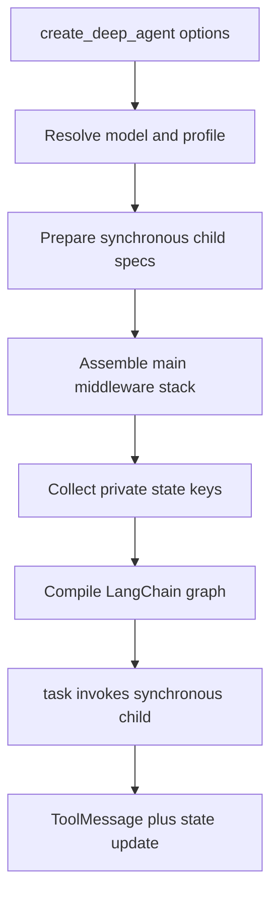

# Testing Guide

Run the narrowest owning suite from the package being changed. For SDK assembly and delegation changes, keep tests behavioral: compile and invoke a graph with scripted models and an `InMemorySaver` where the contract crosses a graph, task, state, or checkpoint boundary. Do not replace focused graph and delegation tests with a broad smoke-test recommendation. See [SDK Middleware Assembly](../architecture/middleware-stack.md), [SDK Construction and Execution](../architecture/sdk-construction-execution.md), and [Subagents and Skills](../concepts/subagents-skills.md) for the runtime model; see [Development](../operations/development.md) for repository setup.

## Focused routes

Work inside the owning package, install its dependencies, and use its Makefile route. Deep Agents' unit target runs pytest with xdist, coverage, and sockets disabled except Unix sockets; its integration target is separate and uses a 30-second timeout. Warnings are errors under package pytest configuration, so fix a new warning rather than adding a broad filter.

```bash
cd libs/deepagents
uv sync --all-groups
make test TEST_FILE=tests/unit_tests/test_graph.py
make test TEST_FILE=tests/unit_tests/test_subagents.py
make test TEST_FILE=tests/unit_tests/test_subagent_refusal.py
make test TEST_FILE=tests/unit_tests/middleware/test_subagent_middleware_init.py
make lint

cd ../..
uv run --group test pytest .github/scripts/tests/checks/test_raise_langchain_minimums.py
```

Use a direct `uv run --group test pytest …` command only to isolate a test or parametrization. Keep the final focused route at the same boundary as the change: construction policy belongs in `test_graph.py`; invocation, state projection, streaming, and checkpoint artifacts belong in `test_subagents.py`; fork initialization belongs in `middleware/test_subagent_middleware_init.py`; refusal conversion belongs in `test_subagent_refusal.py`.

## Graph assembly: assert the compiled contract

`create_deep_agent` is an assembly boundary: it resolves a model and harness profile, selects a backend, partitions synchronous and async subagent specifications, assembles middleware, and delegates graph compilation to LangChain. Its returned graph adds Deep Agents version/integration metadata. Tests should inspect the compiled graph or capture the `create_agent` call only when the assertion is specifically about wiring—not merely that construction succeeds.



*Graph tests protect assembly policy; subagent tests protect the observable task round trip.*

When editing profiles, tools, middleware, backend binding, or state schemas, preserve these assertions:

- Metadata retains `ls_integration="deepagents"` and reports the editable-install form of the Deep Agents version when applicable. Exact model profile candidates take precedence while provider defaults still supply inherited fields.
- Tool-description overrides copy supported dictionaries and `BaseTool` instances rather than mutating caller-owned objects. Backend-consuming middleware is bound to the selected backend, including at the declarative-child boundary.
- The default `general-purpose` child supplies synchronous `task` support unless disabled by its profile or overridden by an explicit child; disabling it does not remove `task` when another synchronous child exists. Remote async specifications take the independent async middleware path.
- The main and eligible declarative child stacks receive provider prompt-caching middleware. Missing optional Bedrock or Fireworks support is omitted, but an unrelated import failure must propagate. Test the main stack and automatic or explicit child stack together when changing caching placement.
- Required filesystem and subagent scaffolding cannot be excluded. Custom middleware replaces same-name stack members in place or is inserted at the core/tail extension point; exclusions are re-applied so caller middleware cannot restore a forbidden member.
- A custom `state_schema` reaches the main graph and declarative child compilation. Public fields may be shared as configured, while `PrivateStateAttr` fields—including those introduced by replacement task middleware—must be collected and withheld from child inputs and updates.

## Synchronous task delegation: state, fork, and results

`SubAgentMiddleware` exposes local `SubAgent` and `CompiledSubAgent` specifications through `task`. A normal child receives a new task message, returns one correlated `ToolMessage`, and may return safe, changed public state. Test a real parent task call for changes to projection, not only the helper that formats the tool.

### Isolation and result projection

The parent/child boundary deliberately excludes messages, todos, structured output, skill bookkeeping, rubric state, and private middleware fields. This prevents inherited values from being added again and prevents concurrent children from conflicting over state that has no reducer. The result uses a structured response when present; otherwise it selects the last non-empty AI response. The task schema must reject invented arguments rather than silently dropping task instructions.

Parallel-child tests should demonstrate both independent correlated results and preservation of the parent state. Add sync and async coverage when changing shared dispatch code.

### Fork mode and prompt-cache invariants

A declarative `mode="fork"` child is not an isolated worker. It rebuilds the effective parent context, removes the in-flight spawning tool call, receives fork instructions with the delegated task, and preserves the parent system-prompt prefix so provider prompt caches can be reused. Its custom prompt-producing middleware and tool order must continue to produce the same request prefix as the parent; repeated same-name middleware must replace rather than duplicate prompt changes.

A fork cannot define independent skills and must refuse recursive `task`/`atask` delegation. Test that inherited history appears once in the child request but does not leak as parent stream output unless the caller requests subgraphs. Test declarative and compiled forks separately when changing state transfer: declarative forks can receive their compatible private channels, while opaque compiled runnables receive only the safe projected state.

### Refusals and checkpoint artifacts

A child model refusal is a task result, not a failure of the parent graph. Cover both a refusal content block and `ModelRefusalError`, ordinary and structured child output, and both `invoke` and `ainvoke`; the returned notice may include the provider category or explanation and tells the parent that retrying unchanged input is unlikely to help. This differs from the main graph: by default its refusal middleware raises, a fallback middleware can handle the refusal first, and a profile can exclude the default refusal middleware.

When a child checkpoint exists, the correlated `ToolMessage.artifact["checkpoint_ns"]` must identify the namespace that actually contains the child history under the parent thread. Exercise ordinary, nested, retry, `checkpointer=True`, `checkpointer=False`, and non-graph runnable paths if changing execution or streaming. In particular, a graph retried by task middleware must point to the completed run; a runnable wrapped with `.with_retry()` is an explicit limitation because it must use `invoke` for retry semantics and the artifact can point to the initial namespace while the completed attempt uses a suffixed namespace.

## Dependency minimum-floor updater seam

`.github/scripts/checks/raise_langchain_minimums.py` is a focused automation boundary, not part of the Deep Agents package suite. Use `test_raise_langchain_minimums.py` when changing requirement selection, manifest rewriting, resolution checking, workflow CLI plumbing, or lockfile selection.

The updater examines dependencies, optional dependencies, and dependency groups for in-scope LangChain/LangGraph/LangSmith/Deep Agents requirements with `>=` or `~=` floors. It selects the latest stable, non-yanked release that remains in the existing requirement range, preserves upper bounds, extras, and markers, and leaves exact pins alone. Versioned local path sources remain publishable requirements but cap their floor at the local checkout version; unreadable local sources are skipped.

Test seam priorities are failure semantics and non-destructive edits:

- `~=` rewrites preserve the original compatible-release ceiling; rewrites must be anchored to quoted manifest literals so a prefix requirement or a comment is not corrupted.
- A narrowed `--dependencies` request is PEP 503-normalized and exact after normalization. Unknown, workspace-only, or unraiseable requested names fail closed rather than reporting success; an already-current raiseable floor is a successful no-op.
- PyPI fetch failures, malformed rewrite plans, tool failures during resolution, and an unresolvable baseline do not become an "up to date" result. With `--check-resolution`, jointly compatible bumps are accepted, incompatible dependency-wide bumps are reported as skipped, and all temporary manifest changes are restored before the final write.
- Lock selection includes reverse path dependents unless `--skip-dependent-locks` is set. The CLI test must continue to cover parsing, branch naming, `GITHUB_OUTPUT` wiring, and forwarding of `--check-resolution` and dependent-lock options.

## Completion checklist

1. Run the owning focused file or files, then `make lint` in `libs/deepagents` for SDK changes.
2. For graph assembly, assert compiled metadata, effective middleware order/exclusions, child selection, caching, and schema/private-state wiring relevant to the edit.
3. For synchronous delegation, invoke a parent graph and assert correlated tool result, projected state, fork behavior, and sync/async parity where shared code changed.
4. For refusal or persistence changes, assert parent continuation after child refusal and inspect the actual checkpointer entry named by the task artifact.
5. For dependency updater changes, run its standalone script test file and keep fail-closed, range-preserving behavior covered.
