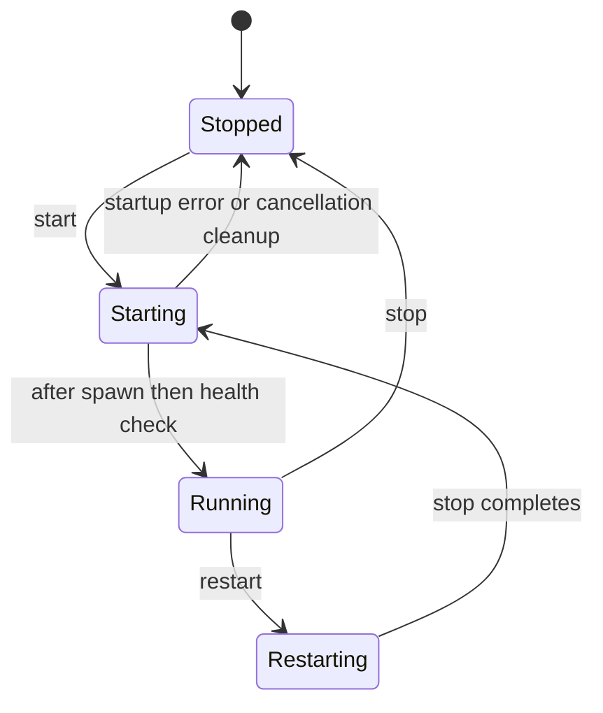
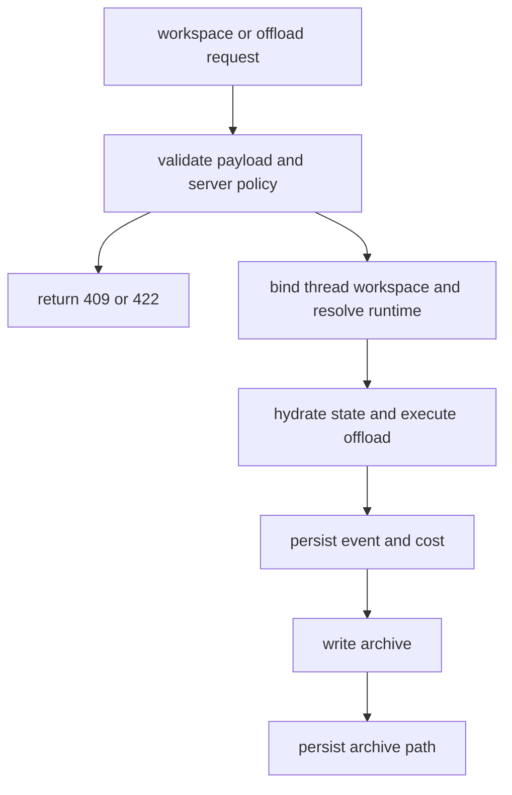

# Testing Guide

Run the narrowest owning suite through its package target before expanding scope. These tests deliberately replace external processes, HTTP transports, filesystems, models, and channels with controlled fakes: the value is in checking ordering, authority, cleanup, and failure semantics at the boundary rather than merely exercising an implementation branch. See [Development](../operations/development.md), [CI Labeling](../operations/ci-labeling.md), and [Talon Scheduling](../concepts/talon-scheduling.md) for contributor and runtime context.

## Focused routes

```bash
make -C libs/code test TEST_FILE=tests/unit_tests/test_server.py
make -C libs/code test TEST_FILE=tests/unit_tests/test_offload_api.py
make -C libs/deepagents test TEST_FILE=tests/unit_tests/test_permissions.py
make -C libs/deepagents test TEST_FILE=tests/unit_tests/middleware/test_subagent_middleware_init.py
make -C libs/talon test TEST_FILE=tests/test_runtime.py
make -C libs/talon test TEST_FILE=tests/unit_tests/test_background.py
node --test .github/scripts/tests/release/draft-release-notes.test.js
uv run --group test pytest .github/scripts/tests/workflows/test_ci_workflow.py
```

`libs/code` runs unit tests with xdist, coverage, and sockets disabled except Unix sockets; `TEST_FILE` defaults to `tests/unit_tests/`. Its integration target changes the selection to `tests/integration_tests/` and applies a 30-second timeout. The Deep Agents target has the same unit-test default and socket restriction. The Talon target runs the WhatsApp bridge's Node tests before socket-disabled pytest with a 10-second timeout. Use the package `lint` target after the focused route so formatting and type checks use the package's configured toolchain.

## dcode server startup: test a lifecycle, not a successful spawn

Use `libs/code/tests/unit_tests/test_server.py` for launch, readiness, restart, or staged-environment changes. It replaces sockets, processes, log files, and `httpx` so the suite can force races and failures without starting `langgraph dev`.



*The server tests require the startup hook to finish before readiness and require unsuccessful startup to clean up into the stopped state.*

Cover the contract that the caller can observe:

- Port `0` obtains an ephemeral local port. A requested free port remains selected; a busy requested port is replaced with a free one.
- Readiness probes `/assistants/agent/graph`, which forces graph resolution rather than only proving that an HTTP listener exists. Startup markers and structured credential/package recovery details must survive health, transport, timeout, and early-exit paths; malformed details fall back to the original error.
- `after_spawn` runs after process creation but before the health check. Cancellation, including cancellation inside that hook, must reap the process and clear process, log, and owned configuration state. A teardown error is logged and cannot replace the startup error.
- A missing runtime `langgraph.json` invokes the optional scaffold hook; both a missing result and scaffold I/O failure are clear startup failures. Restart repeats that recovery if the runtime directory was purged after a prior successful boot.
- Restart must wait for cancellation-safe teardown, serialize with terminal stop, and exclude overlapping restart tasks. Test the specific interleaving whenever this coordination changes.

## dcode offload: workspace authority and durable commit ordering

`libs/code/tests/unit_tests/test_offload_api.py` is the server-owned HTTP boundary for workspace binding and `/offload`. Use ASGI transport and mocked thread/runtime clients so that status codes, state writes, and archive ordering are asserted without a remote server.

A workspace request is not an authority-escalation mechanism. The server resolves the launch root and project policy, binds that policy to the thread, and builds or reuses the corresponding runtime. A client may retain session policy such as `auto_approve`, but cannot claim project MCP, sandbox, or extension settings; policy/fingerprint conflicts are `409`, unknown request fields and malformed policy are `422`, and a preflight-only request must not bind a thread, build a runtime, or create/update a thread. Runtime workspace conflicts must happen before thread creation, and a `SystemExit` from runtime construction is contained as `503` rather than taking down the handler.

Treat client model parameters as untrusted transport input. The request parser removes endpoint, proxy, transport, and custom-header keys before the server can make credentialed provider calls, while warning only with the removed key names—not values.



*The offload suite checks that a durable checkpoint reservation precedes archive mutation and that the archive link is persisted only after the write succeeds.*

For normal compaction, hydrate persisted summary messages, preserve trusted checkpoint model context, commit the summarization event and cost without rewriting `messages`, then write and link the archive. For handoff, the source thread keeps its conversation un-compacted and commits only cost while the result can carry a separate archive. Include archive-write/link failure and cancellation cases: an unavailable link restores the append, and cancellation waits for checkpoint/archive settlement rather than exposing a half-committed operation.

## Deep Agents: permission geometry and subagent context

### Filesystem permissions

Use `libs/deepagents/tests/unit_tests/test_permissions.py` for `FilesystemPermission`, filesystem-tool interception, path routing, or delete behavior. Rules are ordered: normal exact-path read/write/edit resolution is first matching rule wins. Paths must begin with `/`; traversal components are rejected after slash normalization, so Windows-style separators cannot bypass `..` validation. `interrupt` is a distinct outcome rather than a deny.

Deletion has intentionally stricter geometry. A recursive directory delete is refused when *any* deny-write pattern overlaps the target subtree, whether the deny is an ancestor, descendant, literal path, or relevant glob; it reports matching patterns and removes nothing. A confirmed leaf file can use the ordinary first-match ordering, but a directory—including an empty one—or a flat-backend key with descendants remains conservative. Exercise sync and async tools and both filesystem and flat/store backends when changing this logic.

Human-in-the-loop interrupt predicates must be scope-aware. Read rules register `ls`, `read_file`, `glob`, and `grep`; write rules register `write_file`, `edit_file`, and `delete`. Pathless/bulk requests, current-directory aliases, ancestor paths, ambiguous relative glob escapes, and absolute glob patterns that can reach a protected subtree must prompt rather than slipping through a benign `path` argument.

### Subagent modes

Use `libs/deepagents/tests/unit_tests/middleware/test_subagent_middleware_init.py` for `SubAgentMiddleware`, task-tool schemas, or inherited context changes. Middleware initialization exposes a `task` tool and requires at least one uniquely named, valid spec. Declarative workers require `model` and `tools`; dynamic response schemas can compile a declarative variant but are rejected for already compiled runnables.

An isolated subagent starts with its task and its own configuration. A `fork` is beta and instead inherits the parent conversation/system-prompt prefix and relevant parent middleware so it can reuse that context; its own system prompt is appended to the delegated task. Forks reject skills, strip the spawning task call and stale summarization/session/structured-response state, avoid duplicated dynamic prompt updates, and refuse recursive delegation. Keep the mode distinction explicit in tests: it is the security and context boundary.

## Talon runtime and background delegation

Use `libs/talon/tests/test_runtime.py` for runtime construction, tool reload, environment hardening, and interrupts. `DeepAgentRuntime.start()` composes the backend, checkpointer, assistant prompt, skills/memory locations, cron tools, configured tools, and resolved local plus async subagents. Tool refresh takes effect between turns with the current authorization handler scoped to the invocation; MCP reload is transactional, retaining the old graph and tool set if replacement graph construction fails.

The default shell backend is a security boundary. Tests assert that provider, LangSmith, OAuth, MCP, and cloud credentials are removed from execution, dangerous loader variables are cleared, and a safe `PATH` is substituted while ordinary locale/home values can remain. Configuration tests also cover OpenAI base URL only for OpenAI models, positive context-size and recursion-limit parsing, default recursion limit, and activity logging that does not reveal the conversation id.

An interrupted turn is recoverable rather than a silent reset: recovery writes an exact human interruption marker after the latest checkpoint and first repairs dangling tool calls. Tool approval resumes the same graph that emitted the interrupt; graph replacement while an approval is pending must not redirect that resume. Cron jobs record the current request origin and preserve a sender identity across nested scheduled jobs.

`test_background.py` covers delivery, ownership, capacity, cancellation, and scheduled behavior. A chat delegation gets an isolated child thread and does not block later main turns. On completion, the host dispatches its result into the owning conversation; acknowledge only after the model consumes it, and requeue only the IDs associated with an undelivered reply. `/stop` and `/new` cancel only the requesting conversation's children, and cancellation discards that conversation's pending completed results.

The global background limit comes from `DEEPAGENTS_TALON_MAX_BACKGROUND_TASKS` (default four) and rejects zero, negative, fractional, and non-numeric values. Capacity is shared across conversations; inspection and cancellation are owner-scoped. Workers preserve caller context needed for history and cron origin but clear the authorization handler, report generic failure or timeout text without tool arguments, and retain a finished result when cancellation arrives too late.

Scheduled turns use a different contract. They execute delegated work inline rather than creating background jobs or consuming chat capacity, may fan out concurrently behind a separate inline ceiling, and return tool errors for timeout/failure rather than letting an exception restart the graph. Scheduled remote `start_async_task` streams the remote result inline because its task ID cannot be resolved by that turn.

## Workflow and release scripts: execute safety-critical shell paths

The workflow suite is deliberately more than YAML string matching. `test_ci_workflow.py` parses workflow files, evaluates the relevant Actions condition subset, and runs install and label-step shell bodies against stubbed `sudo`, `timeout`, `rg`, installer, and `gh` binaries. Preserve its key invariants: exactly one strict/soft ripgrep installation route for applicable Deep Agents/Linux events; ordinary PRs soften only timeout exits; release and non-PR routes remain strict except for an exact bypass label; and a usable `rg` is promised to tests even after a nominal installer failure.

CI gates and PR comments must operate on trusted code. The suite verifies that the CI gate and curated-apply detector prefer a credential-less base-ref checkout rather than PR-authored scripts, that named `needs` results feed the final gate, and that the post-CI comment workflow does not check out untrusted code while holding comment-write permission. Test artifact naming, fork lookup, head-SHA concurrency, and release-PR classification together because they form one producer-to-comment path.

`draft-release-notes.test.js` is the focused Node suite for model-backed release-note drafting. It locks provider/model selection, fixed provider endpoints, structured-output wire schemas, canonical category rendering, PR-link-only output, and exact changelog PR coverage. The fail-closed cases matter as much as happy paths: unsupported Responses-API-only OpenAI models and missing keys fail before a request; non-normal completion, malformed/invalid JSON, non-PR links, commit hashes, multiline entries, dropped PRs, network/provider failures, and missing output all prevent writing a draft. Provider errors are bounded but retain useful provider, model, status, timeout, and token-budget context.

## Completion checklist

1. Run the focused owning command and its package `lint` target.
2. For startup work, test port choice, graph readiness, diagnostics, cancellation cleanup, rescaffolding, and restart races.
3. For offload work, test server-owned policy, untrusted transport stripping, preflight side-effect freedom, and checkpoint/archive ordering.
4. For filesystem work, test both normal rule precedence and conservative recursive-delete/interrupt geometry.
5. For subagents, state whether the intended behavior is isolated or forked and cover the inherited-state boundary.
6. For Talon, cover graph replacement transactionality, shell-environment secrecy, interrupt recovery, and owner-scoped background delivery.
7. For CI or release changes, execute the shell/Node behavior with stubs; static workflow assertions alone are insufficient.
