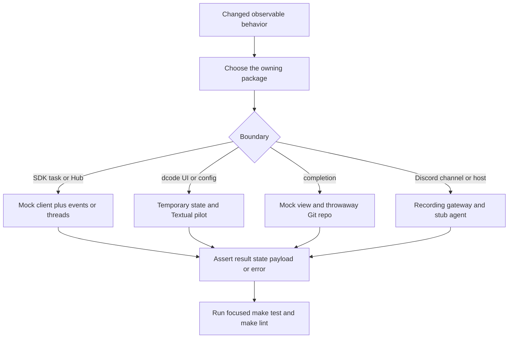

# Testing Guide

Test from the package that owns the changed observable boundary. `libs/` contains independently versioned packages, each with its own environment and `Makefile`; synchronize dependencies in that package and use `make help` if a target is unclear. Network-free coverage belongs in `tests/unit_tests/`; tests that need a networked contract belong in `tests/integration_tests/`. Pytest asyncio mode is automatic, and unaccepted warnings fail the suite. Prefer a fake SDK, gateway, filesystem, clock, or process boundary over live services, sleeps, or assertions about incidental call order.

See [Development](../operations/development.md), [Backends](../concepts/backends.md), [Subagents and Skills](../concepts/subagents-skills.md), [Talon channel admission](../concepts/talon-channel-admission.md), and [Run a dcode session](../workflows/run-dcode-session.md) for the surrounding runtime behavior.

## Run the owning package's test target

```bash
cd libs/deepagents
uv sync --all-groups
make test TEST_FILE=tests/unit_tests/test_async_subagents.py
make test TEST_FILE=tests/unit_tests/backends/test_context_hub_backend.py
make lint

cd ../code
uv sync --group test
make test TEST_FILE=tests/unit_tests/test_cache_expiry.py
make test TEST_FILE=tests/unit_tests/test_sandbox_factory.py
make test TEST_FILE=tests/unit_tests/tui/widgets/test_autocomplete.py
make lint

cd ../talon
uv sync --group test
make test TEST_FILE=tests/channels/test_discord.py
make test TEST_FILE=tests/integration_tests/test_discord_host.py
make lint
```

`deepagents` and `code` unit targets run parallel pytest with non-Unix sockets disabled, Unix sockets allowed, benchmarks disabled, and coverage enabled. Their integration target selects `tests/integration_tests/` and permits the integration path with a 30-second timeout. Talon's target first runs its WhatsApp bridge tests, then runs Python pytest with non-Unix sockets disabled and a 10-second timeout; its default `TEST_FILE` is `tests/`, so a focused integration file can be selected with the same target. Pass additional pytest options in `PYTEST_EXTRA`.

## Route a regression to its observable seam

| Changed boundary | Focused test file | Deterministic seam and result to assert |
| --- | --- | --- |
| Async child launch, status, update, cancellation, forked state, or forwarded context | `libs/deepagents/tests/unit_tests/test_async_subagents.py` | Substitute sync or async SDK clients; assert tool `Command` state and outgoing child payload. |
| Context Hub reads, commits, batching, conflict recovery, or local visibility | `libs/deepagents/tests/unit_tests/backends/test_context_hub_backend.py` | Use a mocked `langsmith.Client`, events, and a thread pool; assert returned backend results, committed payloads, and cache-visible content. |
| dcode cache-expiry notice, banner, handoff, or queue behavior | `libs/code/tests/unit_tests/test_cache_expiry.py` | Mount `DeepAgentsApp` with `run_test()`, control time and remote state, and observe notifications, widgets, and resulting thread state. |
| dcode sandbox lifecycle or provider configuration | `libs/code/tests/unit_tests/test_sandbox_factory.py` | Construct a registry without entry-point discovery and fake the provider; assert cleanup ownership and user-facing dependency/configuration failures. |
| dcode configuration or UI preference behavior | `libs/code/tests/unit_tests/test_app.py` | Redirect `DEFAULT_CONFIG_PATH` to `tmp_path`, mount the app when rendering matters, and assert persisted TOML plus visible UI state. |
| Slash, file, or thread completion | `libs/code/tests/unit_tests/tui/widgets/test_autocomplete.py` | Use a mock completion view and throwaway Git repository; assert displayed candidates and inserted token/range. |
| Discord gateway/channel behavior | `libs/talon/tests/channels/test_discord.py` | Deliver events through a recording gateway; assert admission, conversation routing, interaction responses, and outbound behavior. |
| Discord-to-host behavior | `libs/talon/tests/integration_tests/test_discord_host.py` | Start `TalonHost` with a stub gateway and small agent/runtime; assert host commands, history scope, authorization, and replies. |



*Regression routing maps each changed boundary to an isolated, observable test seam.*

## SDK async subagents: task lifecycle and forwarding

`AsyncSubAgentMiddleware` exposes a five-tool task interface: start, check, update, cancel, and list. Treat `async_tasks` as the parent-visible task record, rather than inspecting middleware internals. A focused launch/check/update/cancel regression should verify task identity, run identity, status, and tool-visible `Command` or error results for the corresponding synchronous and asynchronous client entry point.

A completed remote run can have an interrupted child thread. Checking it must expose `waiting` and its interrupt payload rather than invent a final result. Cancelling a waiting task is terminal without a remote cancel request. These are observable lifecycle semantics; use a fake client state to establish them, not a live deployment.

Fork and isolated modes have intentionally different input ownership. Isolated launch sends only the delegated request. Fork launch serializes a parent snapshot, including summarized history and rehydrated offloaded media, so tests should examine the outbound request while changing parent state to prove the child received a snapshot. Parent context also crosses only a deployment-local boundary: serializable context and parent-assistant metadata accompany a child on the same deployment, while parent-reference-only context and cross-server children do not receive that context.

## Context Hub: persistence is concurrent and locally readable

`ContextHubBackend` is tested with a mocked LangSmith client, never a Hub service. Reads lazily populate a cached tree: a missing remote repository is an empty tree, a Hub API failure becomes a structured backend error, and unexpected runtime errors remain visible. Writes use the pulled commit hash as `parent_commit`; a returned URL without a usable hash triggers an authoritative reload before subsequent work can depend on the new parent.

The mutation queue is the critical persistence seam. Its coalescing deadline is anchored to the first mutation, so concurrent writes—and mixed write, edit, delete, and upload operations—can form one commit. The speculative overlay must make accepted pending or in-flight mutations visible through read, list, grep, glob, and download before the commit finishes. A dependent edit waits for the first commit instead of issuing concurrent commits, then uses that commit as its parent.

Exercise failures and conflicts deliberately. A failed in-flight commit rejects queued waiters, invalidates stale cache state, and permits a later burst to recover. On conflict, the backend reloads authoritative state and replays valid changes; a queued edit whose old text no longer exists fails rather than overwriting remote content. Do not use timing sleeps: gate fake client calls with events and release the batch explicitly.

## dcode: isolate process state before testing app behavior

The dcode unit `conftest.py` establishes a synthetic `DEEPAGENTS_HOME` before imports can freeze paths. Its autouse fixtures restore environment variables and dotenv-loader maps, remove credentials and user configuration that could cause tracing or onboarding side effects, and disable automatic Ollama discovery. Use those fixtures and `tmp_path`; do not read a developer profile, dotenv file, managed configuration, or local service as part of a unit test.

### Cache expiry and handoff

The cache-expiry suite separates a non-disruptive notification from an expiry handoff. Control `cache_expires_at`, reconciliation state, and hook outcomes, then assert the visible toast/notification and that duplicate checks do not duplicate it. A pending cache reconciliation suppresses the expiring notice; changing thread or expiry re-arms it. In a mounted app, a timer notification must leave the draft editable and must not unexpectedly process a prompt or start a handoff.

For expiry, assert the rendered banner and its disappearance when a later cache use refreshes the deadline. Use a real graph/checkpoint only where the regression concerns handoff preservation: the suite checks that the source configuration and state are copied to the new thread without mutating the source, and that failures clean up the owned thread reservation.

### Application configuration and sandboxes

Configuration tests redirect `deepagents_code.model_config.DEFAULT_CONFIG_PATH` to a temporary file. Test precedence and recovery at the public helper or command: missing or malformed config falls back safely, valid environment values override persisted settings, invalid or empty environment values fall back, saves preserve unrelated `[ui]` keys, and filesystem write failures return a structured error rather than escaping. When a preference changes layout, mount `DeepAgentsApp` and assert the rendered widget or notification; reset global glyph caches around tests that alter the charset.

Sandbox-factory tests build `SandboxRegistry(..., include_entry_points=False)` and bind both environment lookup seams so resolution is deterministic. Their high-value invariant is ownership: setup failure, setup-file failure, interruption, and context-body failure delete a newly created sandbox, but never delete a caller-supplied sandbox ID. Test optional provider imports, credentials, provider-specific snapshot restrictions, and backend exception translation as user-facing errors without importing or calling real provider SDKs.

### Completion behavior

Autocomplete tests keep the controller boundary narrow. Thread completion recognizes a standalone `@@` reference, searches durable thread metadata, renders a human label, and inserts `@@(thread:<id>)` into the exact replacement range. File completion obtains tracked then untracked Git files, preserves tracked priority, excludes ignored paths, and retains a successful tracked listing if the optional untracked pass fails. If Git is unavailable it uses a dotpath-excluding glob fallback.

For a nested working directory, suggestions are scoped to that subtree and made relative to it; a sibling that merely shares a string prefix must not leak in, and a cwd outside the project fails closed. Use a temporary repository with a local identity rather than an existing checkout. Keep Git diagnostics locale-stable and sanitize failure output before asserting diagnostics.

## Talon Discord: test channel admission separately from host composition

Channel tests use a recording gateway that stores callbacks and delivers synthetic inbound messages, reactions, connection changes, and interactions. They should cover lifecycle status separately from admission. A self-authored message never re-enters the host; `SELF` accepts its configured operator, while allowlist behavior can admit a user or a configured guild channel. Guild messages normally require a mention, whereas DMs do not. A permitted top-level guild mention opens a Discord thread and routes the conversation/reply there; thread creation failure falls back to the channel.

Thread context is untrusted input. Tests establish that context is fetched only after admission, filters unsafe OAuth-callback material, keeps bounded recent content, and is wrapped by the host as context rather than instructions. An allowlisted parent channel admits its threads for both messages and slash interactions.

Slash interactions must obey the same admission model as typed commands. For an authorized command, the channel defers before dispatching and represents it as its typed text equivalent with matching metadata; its reply is sent to the interaction follow-up and split at the Discord text limit. Unauthorized, unknown, or contextless interactions are rejected without dispatch/defer. Handler failure still answers the interaction once with a generic failure response.

The integration file starts a real `TalonHost` around a stub gateway and minimal agent/runtime. Use it when a change spans channel conversion and host semantics: `/new` must advance the conversation identity and answer the interaction, `/stop` reports absent work, `/help` returns host commands, and an unauthorized interaction never reaches the agent. Public Discord threads may share the parent history archive for discovery without injecting one thread's messages into another thread's agent state; reset of that public history applies to the parent scope and blocks concurrent sibling turns until reset completes.

## Completion checklist

1. Work in the owning package and use its `uv sync` and `Makefile` target.
2. Place a network-free regression in `unit_tests`; use `integration_tests` only for the composed boundary it needs.
3. Isolate environment, filesystem, time, SDK, gateway, and process boundaries; do not use live providers or sleeps.
4. Assert a public result, persisted data, outbound payload, rendered UI, or user-visible error—not an incidental sequence of internal calls.
5. Cover both sync and async entry points where the boundary exposes both, then run the focused `make test TEST_FILE=...` and `make lint`.
