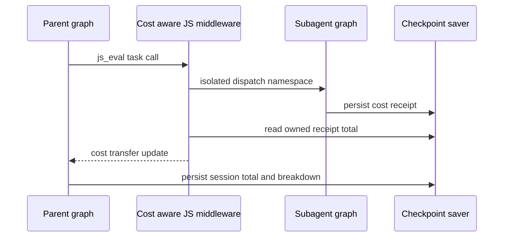
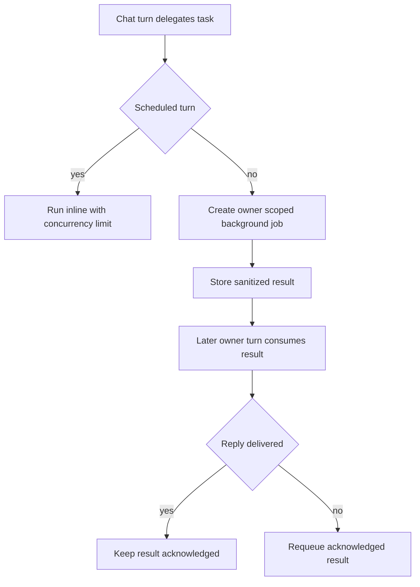

# Testing Guide

Run the smallest package-owned test file that proves the behavior a caller observes. These routes use temporary files, fake models, in-memory or temporary SQLite checkpointers, mock transports, and synchronization events; they must not require a provider credential or a live service. Pytest warnings are errors unless the test deliberately and narrowly accepts a known warning.

Start in the owning package, synchronize dependencies, then pass the path through `TEST_FILE`:

```bash
# dcode: configuration/model policy and JavaScript cost behavior
cd libs/code
uv sync --all-groups
make test TEST_FILE=tests/unit_tests/test_config.py
make test TEST_FILE=tests/unit_tests/test_model_config.py
make test TEST_FILE=tests/unit_tests/test_js_cost_sync.py
make test TEST_FILE=tests/unit_tests/test_js_cost_tracking.py

# Talon: runtime and detached-work ownership
cd ../talon
uv sync --all-groups
make test TEST_FILE=tests/test_runtime.py
make test TEST_FILE=tests/unit_tests/test_background.py

# QuickJS: snapshot and cleanup lifecycle
cd ../partners/quickjs
uv sync --all-groups
make test TEST_FILE=tests/unit_tests/test_snapshot_persistence.py
make test TEST_FILE=tests/unit_tests/test_slot_cleanup.py

# Harbor adapter
cd ../../evals
uv sync --all-groups
make test TEST_FILE=tests/unit_tests/test_harbor_langgraph_agent.py
```

`libs/code` runs pytest with xdist, disabled sockets except Unix sockets, disabled benchmarks, and coverage. Talon also runs its Node WhatsApp-bridge tests and applies a ten-second pytest timeout. The QuickJS and evals unit targets disable sockets except Unix sockets; QuickJS includes coverage. See [Profiles and models](../concepts/profiles-models.md), [Cost and sessions](../operations/cost-and-sessions.md), [Sandbox partners](../integrations/sandbox-partners.md), and [Run evals](../workflows/run-evals.md) for the corresponding runtime and operational context.

## Choose the boundary

| Change | Focused route | Observable invariant |
| --- | --- | --- |
| dcode dotenv reload, workspace environment, or LangSmith handoff | `libs/code/tests/unit_tests/test_config.py` | Reload uses an isolated workspace snapshot, preserves shell precedence and user LangSmith values, and records safe provenance rather than values. |
| Model allowlist, credentials, endpoint, cache, or local configuration | `libs/code/tests/unit_tests/test_model_config.py` | Model policy is canonical and fail-closed; credentials and endpoint state do not accidentally send a personal key through a stale gateway. |
| JS interpreter tool execution | `libs/code/tests/unit_tests/test_js_cost_sync.py` | Sync invocation and streaming produce the same successful tool message for JavaScript and ordinary tools. |
| JS subagent dispatch and session cost | `libs/code/tests/unit_tests/test_js_cost_tracking.py` | Cost receipts survive checkpoint/rebuild/cancellation and sibling dispatches without double counting or losing completed work. |
| Talon graph construction, turn execution, environment, or tool reload | `libs/talon/tests/test_runtime.py` | The runtime keeps conversation identity and approvals scoped while replacing only successfully constructed graphs. |
| Detached subagents, scheduled work, cancellation, or delivery recovery | `libs/talon/tests/unit_tests/test_background.py` | Jobs remain owner-scoped, scheduled calls run inline, and only results from an undelivered successful turn are requeued. |
| QuickJS cross-turn state or leaked interpreter context | `libs/partners/quickjs/tests/unit_tests/test_snapshot_persistence.py`, `test_slot_cleanup.py` | A valid thread snapshot restores state; failed/cancelled stale contexts are closed and cannot become persistence. |
| Harbor graph configuration, model defaults, shell isolation, skills, or MCP tools | `libs/evals/tests/unit_tests/test_harbor_langgraph_agent.py` | The adapter builds the intended local graph with constrained configuration and does not leak credentials to its shell backend. |

## dcode configuration and model policy

Use `test_config.py` when a change affects the boundary between process environment, global/project dotenv files, a workspace preview, or a server handoff. Keep the process environment outside the `use_environment()` binding: the test suite asserts that bindings copy their input, are immutable, and restore `os.environ` even when the context exits with an error. For two workspaces, construct two `.env` files under `tmp_path` and verify each construction-time consumer resolves its own snapshot without mutating the process environment.

The precedence and trust tests are security-relevant. Shell values win over project and global dotenv values; a project value must not interpolate into the trusted global dotenv file; denied project keys are neither injected nor attributed. Test provenance through the `/config get` rendering: it may name the source file but must not echo a dotenv assignment containing a value. For LangSmith reload changes, preserve the launch/user environment through the server environment handoff, remove the carrier variable from the resulting shell environment, and refuse to rewrite an unreadable carrier into a trusted form.

`test_model_config.py` is the persistence and policy boundary for model configuration. Test exact allowlist parsing—including the explicit empty deny-all case and provider-wide `provider:*` entries—and canonicalize an inferable bare model before policy preflight without turning inference into a bypass. Redirect state and config paths to `tmp_path`, and clear module caches before and after a test. When credential resolution changes, exercise stored, canonical environment, and `DEEPAGENTS_CODE_` override forms. In particular, applying a stored personal credential with no base URL must remove inherited gateway URLs (and applicable custom headers) so a key cannot be routed to an unintended endpoint.

## JavaScript cost accounting: test durable receipts, not implementation calls

`CostAwareCodeInterpreterMiddleware` leaves synchronous tool execution untouched; the sync matrix covers `invoke` and `stream`, all three persistence modes, and both its `js_eval` tool and an unrelated ordinary tool. The expected assertion is a successful `ToolMessage` with the original tool-call ID and the observable result, not how the middleware chose the handler.

The asynchronous cost route composes a parent agent, `SubAgentMiddleware`, `CostTrackingMiddleware`, the cost-aware interpreter, and an in-memory or SQLite saver. It gives every model response deterministic usage/pricing, then asserts persisted `_session_cost_usd` and the complete breakdown after invocation, interruption, rebuild, and resume. Use it for any change that affects a receipt, checkpoint namespace, or ownership transfer.



*Cost moves from a child receipt to the parent checkpoint only after the JavaScript dispatch settles.*

Cover error and cancellation cases deliberately: a completed child's cost remains durable when a sibling interrupts, fails, or is cancelled; replay does not charge it again; identical parallel calls must still have distinct occurrence identities; and graph-control exceptions continue to propagate rather than being converted into a normal subagent failure. For SQLite tests, close and reopen the saver around the reconstructed graph. This proves persistence rather than merely retaining process-local state.

## Talon runtime and background-worker boundaries

`DeepAgentRuntime` owns a graph plus request-scoped configuration. `test_runtime.py` uses recording graphs and patched agent construction to verify tool refresh and configuration replacement transactionally: after a replacement graph fails to build, the previously working graph and tool set remain active. Use a recording graph to assert that a conversation maps repeatedly to the same `thread_id`, that the authorization handler is installed only for the invocation, and that an approval resume reaches the graph that issued the interrupt even if tools are refreshed while approval waits.

The runtime's local shell backend is a security boundary. Test a command against a supplied environment, not the host environment: provider, tracing, MCP, cloud, and OAuth secrets must be absent, while the path is hardened and selected safe values remain. When changing model setup, assert provider-specific initialization parameters and invalid environment settings at construction/startup. Runtime recovery must repair a dangling tool call before writing the interruption marker, so subsequent graph history remains valid.

`BackgroundSubagents` holds in-memory job records keyed by their owning conversation. Use events to make lifecycle edges deterministic: wait until a worker starts, trigger the relevant cancellation or delivery path, then await its task. A caller from another conversation cannot cancel or consume the job. Capacity is global to configured copies, and cancelling a job frees capacity.



*Chat delegation is detached; scheduled delegation is inline because there is no later conversational turn for delivery.*

The background tests also protect failure semantics: worker failures and timeouts return distinct sanitized summaries without call arguments or encrypted reasoning; a result is acknowledged only after a successful turn that consumed it; an interrupted/failed turn leaves it available for retry; and repeated failures eventually mark an undelivered result as dropped. Scheduled delegation is different by design: it runs to completion inline, fan-out is bounded by a semaphore rather than refused, and its tool set/instructions do not promise later delivery. A worker inherits appropriate caller context but must not inherit the authorization handler.

## QuickJS snapshot and cleanup lifecycle

QuickJS slots are per LangGraph thread. In `thread` mode, `after_agent` snapshots the REPL state and the next turn restores it; `turn` mode resets state between turns and `call` mode isolates each eval. Test both `invoke` and `ainvoke`. The persistence route proves ordinary values, top-level-await bindings, and transformed top-level `const`/`let` declarations remain readable where the selected mode promises they will. It also proves lazy allocation: a model-only turn does not create a runtime or worker, and a signed snapshot survives model-only turns and an agent rebuild until an eval actually needs restoration.

Use `test_slot_cleanup.py` for lifecycle failures that skip `after_agent`. After a failed or cancelled run, the next invocation must close the leaked live context and restore the last checkpointed snapshot; otherwise uncheckpointed JavaScript state could incorrectly survive. In contrast, a `Command(resume=...)` continues the live context because it does not re-enter `before_agent`. A warm context may be reused only when it matches the requested snapshot; time travel or a fork to an older snapshot must discard it. Assert the next JavaScript result and slot/context replacement, not only internal cleanup calls.

## Harbor LangGraph adapter

The Harbor route tests the adapter as an integration boundary without running Harbor or an external model. Patch `init_chat_model`, agent factories, search, and MCP adapters, and use `FastMCP` only in-process. Disable LangSmith tracing in tests that invoke a tool so a developer's environment cannot create egress.

`make_graph` builds headless local dcode with Harbor's configured model and working directory. Its assistant ID must be ASCII-safe, bounded, and collision-resistant after normalization; it uses a UUID fallback when no usable session ID exists. The adapter temporarily scrubs model/tracing credentials while constructing the shell-backed agent, then restores the parent process environment. It also populates dcode's process-level model identity from the model spec/profile, so the test fixture must snapshot and restore that singleton.

Use the bare and tau3 routes for extension boundaries. The bare graph uses a local shell backend with `inherit_env=False`, accepts only an absolute `skills_dir` without `..`, and can attach task-provided HTTP MCP tools. Tau3 maps streamable HTTP to HTTP connections but rejects dataset-provided stdio servers, which would execute a local command. Model-default tests must preserve explicit caller values while applying the adapter defaults only to their intended provider/model combinations. The web-search route must be absent without `TAVILY_API_KEY`, clamp result count and rendered size when enabled, and report search failure as tool output rather than ending a long-running evaluation.

## Before finishing

1. Run the focused route and the paired route when the change crosses a persistence or handoff boundary.
2. Use `tmp_path`, fake models, in-process adapters, mock transports, or local temporary SQLite files; never depend on a developer's credentials or services.
3. Add failure, cancellation, and rebuild/resume coverage whenever state, a task, a worker, a credential, or a snapshot has an owner.
4. Assert a reply, serialized state, checkpoint value, sanitized environment, or provider payload rather than private call order.
5. Run `make lint` in each package changed after the focused tests pass.
