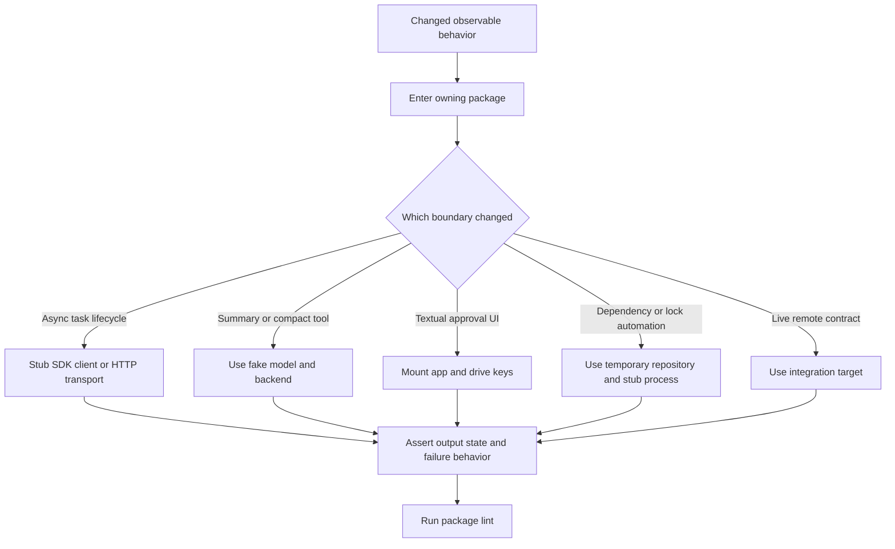

# Testing Guide

Start at the package that owns the observable boundary and run the smallest deterministic test that reaches it. Packages in `libs/` are independently versioned units with their own `pyproject.toml`, Makefile, and README, so synchronize and test from that package rather than from a repository-level environment. See [Development](../operations/development.md), the [source map](../architecture/source-map.md), [Subagents and Skills](../concepts/subagents-skills.md), and [context management](../concepts/context-management.md).

## Baseline test discipline and commands

Network-free tests belong in `tests/unit_tests/`; tests for actual network contracts belong in `tests/integration_tests/`. Pytest's asyncio mode is automatic, unaccepted warnings fail the suite, and a regression should assert a user-visible result, persisted state, or emitted provider payload—not an incidental internal call sequence.

```bash
cd libs/deepagents
uv sync --all-groups
make test TEST_FILE=tests/unit_tests/test_async_subagents.py
make test TEST_FILE=tests/unit_tests/test_end_to_end.py
make test TEST_FILE=tests/unit_tests/middleware/test_summarization_factory.py
make test TEST_FILE=tests/unit_tests/middleware/test_compact_tool.py
make lint

cd ../code
uv sync --group test
make test TEST_FILE=tests/unit_tests/test_app.py
make lint

cd ../talon
uv sync --group test
make test TEST_FILE=tests/cron/test_jobs.py
make test TEST_FILE=tests/test_host.py
make lint
```

The SDK and dcode `make test` targets run pytest in parallel with non-Unix sockets disabled, Unix sockets allowed, benchmarks disabled, and coverage enabled; their separate integration targets use a 30-second timeout. Talon's target runs its WhatsApp bridge tests before Python tests, disables sockets except Unix sockets, and applies a 10-second timeout. Use `TEST_FILE` for a file and `PYTEST_EXTRA` for focused pytest options.

For SDK or dcode smoke snapshot changes, use `make update-snapshots`, not an ad hoc pytest invocation. It is a separate socket-restricted smoke-snapshot target with `--update-snapshots`. dcode's `make lint` also verifies the command catalog and process working-directory policy.

## Select the regression

| Changed boundary | Start here | Prove at the boundary |
| --- | --- | --- |
| Async remote-subagent tool catalog, task lifecycle, headers, status, interruption, or forked context | `libs/deepagents/tests/unit_tests/test_async_subagents.py` | Stub the LangGraph SDK client or HTTP transport and assert the returned `Command`, tracked task state, and serialized child input. Cover sync and async paths where both exist. |
| An agent-level start/check/update/cancel conversation | `libs/deepagents/tests/unit_tests/test_end_to_end.py` | Script a fake model through real `create_deep_agent` middleware and assert its tool messages and final `async_tasks` state. |
| Summary defaults, custom summarizer, media-aware prompt, or public factory signature | `libs/deepagents/tests/unit_tests/middleware/test_summarization_factory.py` | Construct a fake model with or without profile limits, then assert factory-selected policy and observable summary behavior. |
| `compact_conversation` tool result, state event, offload, or failure semantics | `libs/deepagents/tests/unit_tests/middleware/test_compact_tool.py` | Drive its tool runtime with a fake backend/model and inspect the `Command`, summary event, and tool message—not private helper call order. |
| Async tool prompt wording or exposed JSON schema | `libs/deepagents/tests/unit_tests/smoke_tests/snapshots/system_prompt_with_sync_and_async_subagents_tools.json` | Update the smoke snapshot only after intentionally changing the generated tool contract; do not use it as the sole lifecycle test. |
| dcode Textual startup, resume, modal, queue sequencing, or approval-mode notice | `libs/code/tests/unit_tests/test_app.py` | Mount `DeepAgentsApp` with `run_test()`, drive real key events, and assert the visible screen, notification, and safe mode transition. |
| SDK-derived remote sandbox file operation or capture offload | `libs/deepagents/tests/unit_tests/backends/test_sandbox_backend.py` | Use `MockSandbox`; assert results, errors, commands, and file transfer without a sandbox provider. |
| SDK skill-selected tool disclosure or provider request placement | `libs/deepagents/tests/unit_tests/middleware/test_skill_tools_payload.py` | Use the real provider adapter with only HTTP transport stubbed and inspect the serialized request. |
| Talon cron lifecycle or conversation scope | `libs/talon/tests/cron/test_jobs.py` | Use a temporary `CronJobStore`; assert durable state and access boundaries, not wall-clock sleeps or a live channel. |
| Talon host lifecycle or replacement of a blocked turn | `libs/talon/tests/test_host.py` | Compose recording agent, channel, and scheduler fakes; drive input and observe requests and replies. |
| Dependency-floor selection or manifest rewrite | `.github/scripts/tests/checks/test_raise_langchain_minimums.py` | Build a temporary manifest/repository and stub package-index inputs. |
| Lockfile refresh dependency closure or command failure | `.github/scripts/tests/checks/test_refresh_lockfiles.py` | Build a temporary path-dependency graph and stub `subprocess.run`; assert the exact affected lock targets and fail-fast behavior. |



*This selection flow distinguishes deterministic unit seams from an intentionally live integration contract.*

## Async subagents: test state transitions and context ownership

`AsyncSubAgentMiddleware` exposes five tools: start, check, update, cancel, and list. The focused suite protects the task record carried in `async_tasks`, including the `thread_id`, active `run_id`, status, and timestamps. Test a launch through the client boundary: it creates a child thread and run, returns a `Command` that records a running task, and emits the corresponding tool response. A check refreshes a nonterminal remote status and returns output for success; list similarly refreshes live tasks, whereas already terminal tasks do not need another SDK status lookup.

An update retains the task identity but starts a replacement run with the remote interrupt strategy. Cancellation changes the tracked state to `cancelled` and calls the remote cancel endpoint for the active run; unknown tasks and client errors are returned as tool-visible errors. The agent-level end-to-end test is the companion regression when the concern is that a scripted model can start and then cancel a real middleware task in one graph execution.

Forking is a different contract from ordinary isolated delegation. The launch-context tests use `httpx.MockTransport` and verify that an isolated child receives only the requested description, while a fork receives the appropriate parent-history snapshot plus the request. They also cover a summary event, mutable parent inputs, media rehydration after approval, and sync/async invocations. Preserve that boundary: the parent keeps its offloaded blob references, while a forked child receives usable media and offloads it into its own backend state.

A remote child may finish its run while its thread is interrupted for a question or approval. The check tool reports that condition as `waiting` with the interrupt payload rather than claiming a final result. If some other actor resumes the child, a later check follows the current run; cancellation while waiting remains cancelled and does not make an unnecessary remote cancel call. The generated-tool smoke snapshot complements these behavioral tests by pinning the model-facing instructions and schemas, including stale-status guidance and the accepted status filter values.

## Summarization factories and the compact-tool contract

Use the factory suite when changing configuration selection. With a model profile that reports `max_input_tokens`, `create_summarization_middleware` chooses fractional trigger and retention defaults. Without a profile, it uses fixed token/message fallbacks. Its optional summary prompt, trimming threshold, token counter, and summarizer are keyword-only controls; a string model name is rejected because the factory requires a chat-model object. A supplied callable or model summarizer owns the summary generation, while thresholds still derive from the main model.

Use the compact-tool suite when changing execution semantics. `SummarizationToolMiddleware` exposes one `compact_conversation` tool. On a useful compaction it returns a `Command` containing a summary event with the cumulative cutoff, summary message, and optional backend history path; the user-facing tool message reports what was summarized. A prior event changes the stored cutoff arithmetic, and applying a valid event presents the summary followed by the retained message suffix. Malformed events fall back safely to raw messages.

The failure distinction matters: a backend that simply declines to offload can still yield a summary with no path, but an offload exception or summary-generation failure returns an error tool message and must not install a summarization event. Cover sync and async paths. The default summary prompt explicitly preserves media references so the agent can later read them; test rendered prompt text rather than duplicating its template implementation.

## dcode: test approval notices through the Textual message loop

For Textual changes, use `DeepAgentsApp.run_test()` and `pilot` input rather than sleeps or direct implementation calls. The first successful switch to Auto is a deliberate two-step UI contract: while the first-run notice is visible, the active mode remains Manual; Enter confirms, records the local acknowledgement, and then activates Auto. Escape cancels without recording the acknowledgement or changing the existing mode. Subsequent enables skip the notice after it has been recorded.

The notice itself must make the security boundary clear: Auto may approve routine gated actions, but it is not a sandbox and the agent still acts on the local machine. When a separate classifier model reviews actions, the displayed body names it and distinguishes it from the code-writing model. At startup, a sandbox makes Auto unavailable and dcode downgrades to Manual; the app surfaces an explanatory warning rather than silently losing the remembered setting.

Keep neighboring app contracts in the same test file: resumed history hydration is idempotent over repeated server-ready events, retains the resuming state until restoration completes, orders restored history before startup output, and blocks initial submission when resumed-model adoption fails. Modal-command tests submit through the real `ChatInput.Submitted` path so Escape responsiveness and queue blocking are observable end to end.

## Other focused package boundaries

Sandbox backend tests use a concrete in-memory `MockSandbox` to check derived read, search, write, and edit operations without a provider. Capture-offload regressions cover sync and async entry points and preserve backend or child-command failure rather than converting it to successful output.

Skill payload tests use real Anthropic, OpenAI, Azure, Codex, and Bedrock-family adapters while stubbing only HTTP transport. They therefore assert the provider request rather than a generic fake model. For inline-capable providers, keep the placement assertion: tool definitions are disclosed after the triggering tool-result batch, without rewriting prior request prefixes, top-level tools, or system content.

Talon cron tests protect durable scheduling and conversation scope: one-shot jobs advance and disable before execution; recurring jobs advance before execution and stop at their repeat cap; unrelated origins cannot manage another conversation's jobs, while threads sharing a parent channel can. Host tests use recording components to verify lifecycle and that a later message replaces a blocked turn, recovers the conversation, and delivers only the successor reply. Cron-pinned skills reach the model prompt only on a turn marked `trigger: "cron"`.

## Dependency and lockfile automation

The dependency-floor updater is a constrained manifest transformation, not a live package-index test. Its tests require compatible selection to remain within upper and compatible-release bounds, quoted literal rewriting to preserve extras and markers, transitive stale-lock discovery, and failure—not green success—for unknown or unraiseable narrowed requests.

Lockfile-refresh tests focus on the graph boundary after a manifest change. Starting with a changed package, refresh discovers every transitive local path consumer, prints the affected `uv.lock` paths in deterministic order, and invokes `uv lock --directory` with the package's required Python version. If one refresh command fails, it propagates the failure and stops rather than attempting later lockfiles. This is distinct from the pre-commit lock checker, which verifies applicable existing locks with `uv lock --check`.

CI workflow tests follow the same principle: parse YAML for declarative wiring but execute safety-critical shell or JavaScript bodies against stubbed commands/APIs. This preserves strict release behavior, timeout-softened ordinary PR behavior, and inherited-CI diagnostics that are escaped, read-only, `continue-on-error`, and not a replacement for the final gate.

## Completion checklist

1. Work in the owning package and synchronize its declared groups.
2. Run the closest focused file with `TEST_FILE`; add a regression that observes the public boundary and failure path.
3. Use temporary files, stores, clients, transports, or ordinary fakes for local behavior; use a real provider adapter only when serialized provider payload is under test.
4. Cover sync and async entry points when the public boundary exposes both.
5. Update a smoke snapshot only for an intended generated-contract change, alongside behavioral coverage.
6. Run the owning package's `make lint`; run workflow or automation tests when their scripts change.
