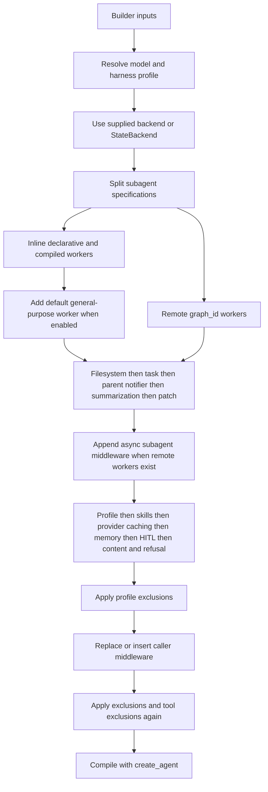

# Build a Deep Agent

`create_deep_agent` is the SDK assembly entry point. It resolves the model and harness profile, selects a backend, turns subagent specifications into model-visible tools, assembles middleware, and returns a configured LangGraph graph. Treat the builder as an integration boundary: `tools=`, `middleware=`, `subagents=`, permissions, backend selection, and profile behavior compose into one graph rather than configuring isolated features.

See [SDK construction and execution](/openwiki/architecture/sdk-construction-execution.md) for the execution boundary, [SDK Middleware Assembly](/openwiki/architecture/middleware-stack.md) for middleware roles, [subagents and skills](/openwiki/concepts/subagents-skills.md) for delegation concepts, [backends](/openwiki/concepts/backends.md) for storage choices, and the [testing guide](/openwiki/testing/testing-guide.md) for repository-wide test guidance.

## 1. Choose the model and storage boundary

Pass a `provider:model` string or an initialized `BaseChatModel`. The builder resolves an explicit model before choosing its `HarnessProfile`; a pre-initialized model preserves provider-specific configuration. In particular, `openai:` strings use the Responses API by default. Initialize the model yourself to select Chat Completions or to configure Responses retention. Do not rely on `model=None`: its Claude fallback is deprecated and will be removed in `deepagents==1.0.0`.

The resolved model selects the active profile. A profile can supply prompt fragments, tool-description overrides, extra middleware, tool exclusions, middleware exclusions, and the default general-purpose worker. The authored system prompt is assembled in `USER -> BASE -> SUFFIX` order. Supplying a `SystemMessage` preserves its existing content blocks, including cache-control markers, and appends profile prompt text as a new block.

Choose the backend as both the filesystem implementation and persistence boundary. When `backend` is omitted, the builder creates `StateBackend()`. It stores files in the graph's `files` state, which persists in a checkpointed conversation thread but not across threads, and it may only be used inside LangGraph execution. Seed files through invocation input rather than calling that backend directly.

```python
from deepagents import create_deep_agent
from deepagents.backends import StateBackend

agent = create_deep_agent(
    model="openai:gpt-5.5",
    backend=StateBackend(),
    tools=[my_application_tool],
    system_prompt="You are a careful research assistant.",
)

result = agent.invoke(
    {
        "messages": [{"role": "user", "content": "Investigate this task."}],
        "files": {},
    }
)
```

`tools=` is additive: it does not remove filesystem tools, `execute`, or `task` when synchronous subagents exist. Use profile `excluded_tools` to hide a built-in from the model, or replace `FilesystemMiddleware` with one configured with `tools=[...]` to change the filesystem suite. `execute` requires a backend implementing `SandboxBackendProtocol`; otherwise it returns a tool error.

## 2. Assemble the graph in its actual order



*This construction flow shows the main-stack assembly order; caller middleware is merged only after the initial tail has been constructed and filtered.*

The main core is `FilesystemMiddleware`, optional `SubAgentMiddleware`, `_ParentNotifierMiddleware`, summarization, and `PatchToolCallsMiddleware`; `AsyncSubAgentMiddleware` follows only when remote specifications exist. The tail is profile extras, optional skills, provider cache middleware, optional memory, optional human approval, unsupported-content handling, and refusal handling. The builder forwards `checkpointer`, `store`, `context_schema`, `response_format`, `cache`, `name`, `debug`, and the state schema to LangChain `create_agent`, then configures the graph with recursion limit 9,999.

Caller middleware is merged by `.name`, not simply appended. A matching name replaces its assembled member in place. A new middleware is inserted after the complete core—including async-subagent middleware when present—and before profile extras, skills, caching, memory, HITL, unsupported-content, and refusal handling. This placement is part of the extension contract: caller fallback middleware runs before the default refusal handler, and ordinary caller middleware runs before skills disclosure and cache breakpoints.

A profile's `excluded_middleware` is subtractive both before and after the caller merge. Class entries use exact type and string entries exact middleware name. Protected filesystem/task scaffolding, private names, unmatched exclusions, and ambiguous name collisions fail fast. Tool exclusions run last, so custom middleware cannot restore an excluded tool.

### Keep provider cache behavior in the assembled stack

`append_prompt_caching_middleware` always appends an `AnthropicPromptCachingMiddleware`-named lazy stand-in. It imports and delegates to the real Anthropic middleware only for an Anthropic request; other request models pass through unchanged, including when a session switches models. This keeps importing `deepagents` from loading the Anthropic SDK while retaining name-based replacement and exclusion behavior.

When installed, `langchain-aws` contributes `BedrockPromptCachingMiddleware` and `langchain-fireworks` contributes `FireworksPromptCachingMiddleware`; each is configured to ignore unsupported models. The helper caches optional class lookup, including absence, but creates a fresh middleware instance for each assembled stack. Consequently, cache middleware is appended separately to the main graph and each declarative/default synchronous subagent stack. If a custom or profile middleware changes the system prompt or tools, keep it before cache middleware and verify cache-sensitive ordering in `test_graph.py`.

The main graph appends `ModelRefusalMiddleware` after caller middleware. A parent refusal therefore raises by default, but a caller-supplied `ModelFallbackMiddleware` can recover first. Excluding the refusal middleware leaves the provider refusal response in the result.

## 3. Design the delegation and result boundary

`subagents=` supports three execution models:

- `SubAgent` is a declarative synchronous worker rebuilt by the harness and called through `task`.
- `CompiledSubAgent` is an already-built runnable, also exposed through `task`.
- `AsyncSubAgent` has `graph_id`; it is routed to `AsyncSubAgentMiddleware`, runs as a background task, and exposes the async task controls rather than joining the synchronous `task` tool.

If no synchronous worker named `general-purpose` is supplied, the active profile supplies one unless it disables it. Set `GeneralPurposeSubagentProfile(enabled=False)` and provide no synchronous workers to remove `task`; remote async workers do not affect that decision. Declarative workers inherit parent tools when their `tools` key is absent, and inherit `permissions` and `interrupt_on` unless their specification supplies replacements. Compiled and remote workers own their own graph schema and approval configuration.

Use default isolated mode when a worker should receive only the delegated description. Experimental `mode="fork"` gives a declarative worker the parent's effective, summarized conversation plus the task. The fork retains the parent's system prompt and rebuilds inherited prompt-producing middleware; its own `system_prompt` is placed in the task message to preserve the reusable prefix. Forks inherit parent skills rather than declaring separate `skills`, and a fork's `task` call is refused to prevent recursive delegation. A fork is context sharing, not an authorization shortcut.

The `task` boundary deliberately returns a narrow result to the parent:

1. It strips messages, todos, structured responses, skills/rubric state, and middleware-private state from normal child input and returned updates. Unchanged values are also suppressed to avoid duplicate reducer updates during parallel calls.
2. A child result must contain `messages`. If it has `structured_response`, the boundary JSON-serializes it into the parent `ToolMessage`; otherwise it selects the last non-empty `AIMessage` text, skipping trailing empty messages. The child response object itself does not become parent `structured_response`.
3. Declarative and compiled child model refusals become a task-result notice with available category or explanation, rather than failing the parent invocation. Non-refusal exceptions still propagate.
4. For checkpointed compiled graphs, the returned `ToolMessage` artifact carries the child checkpoint namespace when one was saved; the model does not see that artifact.

When extending state, prefer `state_schema` on the owning middleware. A graph-wide custom schema must derive from `DeepAgentState` to preserve the `messages` `DeltaChannel` reducer. Declarative workers can receive it; precompiled and remote workers do not inherit it. If parallel `task` calls update the same custom field, define a reducer or the graph can fail with `InvalidUpdateError`.

## 4. Make filesystem policy and approval explicit

Use `FilesystemPermission` rules for filesystem tools, not as a general sandbox policy. Rules are ordered: the first matching read/write rule produces `allow`, `deny`, or `interrupt`, while no match allows the call. Patterns must be absolute and reject traversal components. `FilesystemMiddleware` enforces rules for its built-in tools, including a resolved symlink target on real-filesystem backends; direct backend calls are outside this enforcement.

`interrupt` rules are translated into path-aware `HumanInTheLoopMiddleware` predicates. Supplying `interrupt_on` also installs HITL, and explicit entries win over generated permission entries for the same tool. Configure a checkpointer when an approval must survive interruption and resume. Keep these separate:

- the backend determines storage and whether shell execution is available;
- permissions gate filesystem middleware tools; and
- HITL pauses selected tool calls for review.

Recursive deletion is intentionally more conservative than ordinary first-match operations: if a directory deletion could overlap a denied write subtree, it is refused without deleting anything. Permission-generated bulk approval predicates likewise require review for pathless calls, current-directory aliases, protected-subtree overlap, absolute globs, and relative globs that climb from their nominal path.

```python
from deepagents.middleware.filesystem import FilesystemPermission

permissions = [
    FilesystemPermission(operations=["read", "write"], paths=["/workspace/**"], mode="allow"),
    FilesystemPermission(operations=["read", "write"], paths=["/secrets/**"], mode="interrupt"),
    FilesystemPermission(operations=["write"], paths=["/**"], mode="deny"),
]

agent = create_deep_agent(
    model=model,
    backend=backend,
    permissions=permissions,
    interrupt_on={"execute": True},
    checkpointer=checkpointer,
)
```

## 5. Run the focused validations

Start with the owning suites rather than a broad smoke test.

| Change | Focused test | Assert the important branch |
|---|---|---|
| Builder inputs, profile selection, exact stack order, middleware replacement/exclusion, or provider cache wiring | `tests/unit_tests/test_graph.py` | core-to-tail placement, new versus matching middleware name, cache middleware before no later prompt mutation, and unavailable optional providers |
| Synchronous task routing, returned state, structured task results, parallel state isolation, or checkpoint result artifacts | `tests/unit_tests/test_subagents.py` | final text versus JSON `structured_response`, private-state stripping, duplicate-update suppression, and separate `ToolMessage` results |
| Isolated/fork input semantics, fork cache-prefix behavior, or recursion refusal | `tests/unit_tests/middleware/test_subagent_middleware_init.py` | description-only isolation versus inherited fork prefix, fork instruction placement, matching tool order, and refused nested `task` |
| Child or parent model refusal behavior | `tests/unit_tests/test_subagent_refusal.py` | child refusal becomes a task result while parent refusal raises, falls back, or remains in result according to stack configuration |
| Filesystem matching, resolved paths, recursive delete, or permission-generated HITL | `tests/unit_tests/test_permissions.py` | first-match normal operations, conservative recursive delete, and bulk-search approval geometry |

Run focused tests from the package. `make test` uses the `test` dependency group, parallel pytest, coverage, and socket restrictions; `make lint` runs Ruff formatting/lint checks and `ty`.

```bash
cd libs/deepagents
uv sync --all-groups
make test TEST_FILE=tests/unit_tests/test_graph.py
make test TEST_FILE=tests/unit_tests/test_subagents.py
make test TEST_FILE=tests/unit_tests/middleware/test_subagent_middleware_init.py
make test TEST_FILE=tests/unit_tests/test_subagent_refusal.py
make test TEST_FILE=tests/unit_tests/test_permissions.py
make lint
```

## Safe-change checklist

1. Specify the model and backend explicitly; document provider settings and intended file lifetime.
2. Inspect the final middleware order, not only the `middleware=` argument. Preserve required filesystem/task scaffolding and place prompt-mutating middleware before caching.
3. Decide whether a worker is isolated, forked, precompiled, or remote; then test that context, state, approval, and schema ownership match the choice.
4. Test task-result extraction explicitly: JSON structured output, final text fallback, refusal notice, and state keys that must not cross the boundary.
5. Treat permissions, HITL, and sandbox execution as separate defenses. Cover recursive-delete and bulk-search geometry whenever permission code changes.
6. Run the focused construction and subagent suites, then lint.
