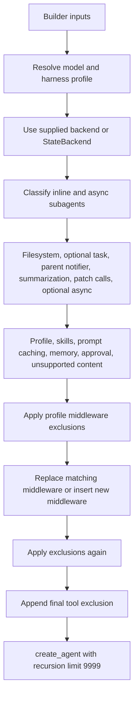
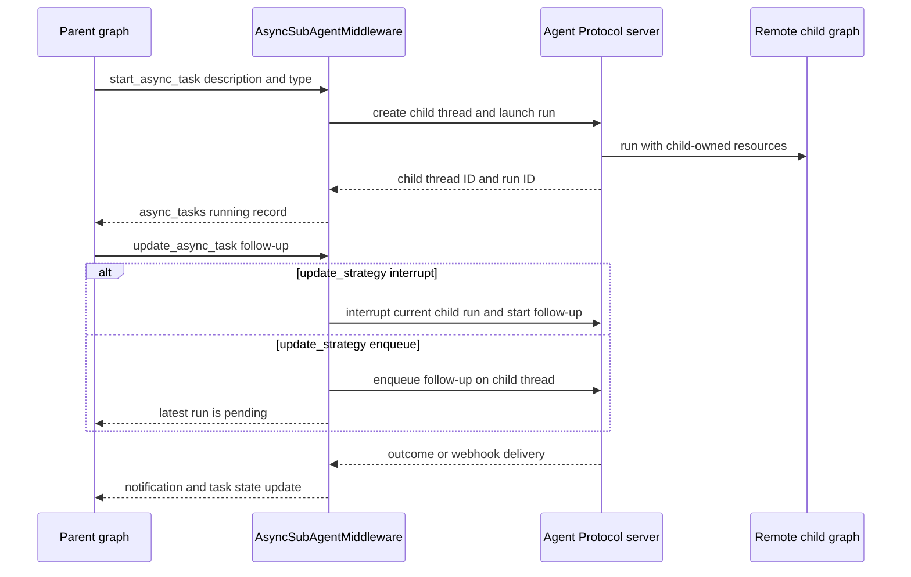

# Build and Customize a Deep Agent

`create_deep_agent` is the public assembly boundary for the Deep Agents harness. It resolves a model and harness profile, constructs middleware around LangChain `create_agent`, and returns a compiled LangGraph graph. Filesystem access, delegation, context summarization, skills, asynchronous work, and human approval are middleware, so an option can change both the model-visible and executable tool surface.

See [SDK construction and execution](/openwiki/architecture/sdk-construction-execution.md), [middleware stack](/openwiki/architecture/middleware-stack.md), [context management](/openwiki/concepts/context-management.md), [subagents and skills](/openwiki/concepts/subagents-skills.md), and [permissions and HITL](/openwiki/concepts/permissions-hitl.md) for component contracts.

## 1. Start with explicit model and backend choices

Pass either a `provider:model` string or an initialized `BaseChatModel`. A string is resolved with `init_chat_model`; an instance retains provider-specific settings. For example, initialize an OpenAI model yourself to select Chat Completions instead of the default Responses API, or to set Responses API retention options. Do not rely on `model=None`: it constructs `ChatAnthropic(model_name="claude-sonnet-4-6")` today, but that fallback is deprecated and scheduled for removal in `deepagents==1.0.0`.

Pass an initialized backend instance. Omitting it selects `StateBackend()`, whose files are graph state: they persist in a checkpointed conversation thread but not across threads, and the backend may only run inside LangGraph execution. Seed its files in graph input rather than calling it outside a run.

```python
from deepagents import create_deep_agent
from deepagents.backends import StateBackend

agent = create_deep_agent(
    model="openai:gpt-5.5",
    backend=StateBackend(),
    tools=[my_application_tool],
    system_prompt="You are a careful research assistant.",
)
result = agent.invoke(
    {"messages": [{"role": "user", "content": "Investigate this task."}], "files": {}}
)
```

`tools=` is additive; it does not remove built-in filesystem tools or `task`. A profile can hide a tool name with `excluded_tools`; replacing `FilesystemMiddleware` with one configured with `tools=[...]` changes the filesystem suite itself. The selected profile also contributes prompt parts, description overrides, extra/excluded middleware, tool exclusions, and the default general-purpose-subagent configuration. The authored prompt is `USER -> BASE -> SUFFIX`. For a caller `SystemMessage`, existing content blocks, including cache-control blocks, remain intact and profile text becomes an additional block.

## 2. Understand construction and final ordering before extending it



Caption: Construction classifies subagents, assembles the complete core and tail, applies exclusions around custom middleware, then compiles the LangGraph agent.

The core is `FilesystemMiddleware`; `SubAgentMiddleware` only when synchronous subagents exist; `_ParentNotifierMiddleware`; summarization; `PatchToolCallsMiddleware`; and `AsyncSubAgentMiddleware` when remote/background specs exist. The tail is profile extra middleware, optional `SkillsMiddleware`, provider prompt-caching middleware, optional memory, auto-derived HITL, and `UnsupportedContentMiddleware`.

Custom middleware whose `.name` matches an assembled entry replaces it in place. New middleware is spliced after the last core member—including `_ParentNotifierMiddleware`—and before the profile/skills/caching/memory/HITL tail. Profile exclusions run once on the assembled stack before the custom merge and once after it, so they also remove a matching custom replacement or addition. Class exclusions use exact type (a subclass is retained); string exclusions use an exact `.name`. An exclusion that matches nothing across the applicable main/general-purpose stacks, a private-name exclusion, or one name matching multiple concrete classes fails rather than silently producing a degraded graph. Profile tool exclusion is appended last, so custom middleware cannot restore an excluded name. `FilesystemMiddleware` and `SubAgentMiddleware` are protected scaffolding: a profile cannot exclude them. The compiled graph has a `recursion_limit` of 9,999 for long-horizon tool loops.

A consequence of this placement is that ordinary user middleware runs before skills. It cannot see freshly loaded `skills_metadata` in `before_agent` or `before_model`, nor edit the skills prompt section in `wrap_model_call`. A custom middleware named `SkillsMiddleware` takes that slot instead.

## 3. Configure delegation and preserve state boundaries

`subagents=` accepts three execution models:

- A declarative `SubAgent` is rebuilt by the harness and invoked through `task`.
- A `CompiledSubAgent` is an already-built runnable, also exposed through `task`.
- An `AsyncSubAgent`, identified by `graph_id`, goes to `AsyncSubAgentMiddleware`; it launches work against an Agent Protocol server rather than being handled by `task`.

Unless the caller supplies a synchronous `general-purpose` subagent, the profile adds a default one. Disable it with `GeneralPurposeSubagentProfile(enabled=False)` and supply no synchronous subagents to omit `task`; async subagents do not change that decision. Declarative subagents inherit parent tools when their `tools` key is absent, and inherit permissions and `interrupt_on` unless they provide replacements. Compiled and remote agents are independently configured runnables/graphs, so they do not inherit parent HITL or a custom state schema.

A declarative subagent normally receives only its delegated description. Experimental `mode="fork"` continues the parent’s effective conversation, rebuilds inherited prompt-producing middleware, and appends its own `system_prompt` as an addendum. A fork cannot declare separate `skills`, inherits the parent configuration, and rejects recursive `task` delegation. Use an isolated worker for a deliberately smaller context; use a fork only when the worker needs the parent conversation.

Prefer a middleware `state_schema` for new state. A graph-wide schema must be a `TypedDict` subclass of `DeepAgentState`, retaining its `messages` `DeltaChannel` reducer. The builder merges middleware schemas and passes private field names to the task boundary so ordinary subagents neither receive nor return private state. `checkpointer`, `store`, `context_schema`, `response_format`, `cache`, `name`, and `debug` pass through to `create_agent`; use a checkpointer if an interrupted run must resume.

### Run remote work through the async-task lifecycle

Each `AsyncSubAgent` needs a unique `name`, `description`, and `graph_id`; `url`, `headers`, `webhook`, `notify_parent`, and `update_strategy` are optional. Its `mode` is `isolated` (the default, only the delegated description is sent) or experimental `fork` (a snapshot of the effective parent conversation plus the task is sent). Forking transfers portable message content only: the child retains ownership of its graph, model, prompt, tools, middleware, backend resources, approvals, and checkpoint/thread state. Configure the remote graph itself; do not assume the parent graph's resources exist there. A spec without `url` uses local ASGI transport and therefore requires an async parent entry point such as `ainvoke`; synchronous `invoke` requires a reachable URL.



Caption: The parent tracks remote work by child thread/run identifiers, while the remote child exclusively owns its runtime resources and human-interrupt lifecycle.

The middleware supplies `start_async_task`, `check_async_task`, `update_async_task`, `cancel_async_task`, and `list_async_tasks`. Launch creates a child thread with parent-identifying metadata and stores an `async_tasks` record keyed by that thread/task ID; its reducer merges records so independently launched tasks coexist. The record tracks the newest run, timestamps, and status. A completion, failure, timeout, cancellation, or remote HITL pause is a marked system notification, not user input. `waiting` means the child paused for a human: answer or approve on the **child's** thread, never through the parent.

`update_async_task` starts a new run on the same child thread. The default `update_strategy="interrupt"` stops active work. With `update_strategy="enqueue"`, a follow-up waits behind active work and is recorded as `pending`; the record retains `superseded_run_ids` so an earlier run's notification cannot be mistaken for the latest follow-up's completion. Send at most one queued follow-up per task in one model turn—the middleware rejects later parallel updates because they would otherwise race to overwrite tracking. Cancelling an enqueued task cancels its newest run and any still-active earlier runs. If an enqueued follow-up starts after the child paused for human input, that child request is dropped.

Set `webhook` when the Agent Server should call an application endpoint whenever a child run finishes; the middleware sends it on both launch and follow-up runs. `notify_parent` defaults to `True` and permits a same-deployment child to wake an idle parent with a notification run. Set it to `False` when the application delivers results itself, for example through the webhook. Remote-server children do not receive parent context; same-deployment launches and updates can receive the current parent run context, while queued updates capture it when sent.

The synchronous tools can launch, inspect, update, cancel, and list tasks, but automatic polling and extra model turns occur only on the async path. In `ainvoke`, the middleware checks unfinished tasks before the agent/model step and after a final answer; a new outcome adds a system notification and returns control to the model. Failed or timed-out status checks are logged and deferred. On an Agent Server, an idle eligible parent may instead be awakened by a notification run; a busy parent picks up the update during normal polling, and a parent waiting for approval is deliberately not awakened so its approval is not cancelled.

## 4. Configure compaction without losing operational state

`create_deep_agent` installs model-aware `SummarizationMiddleware` by default. It chooses fraction-based trigger and retention thresholds when the resolved model exposes `max_input_tokens`, otherwise conservative fixed thresholds; it also truncates large old tool-call arguments before full compaction. The raw `messages` state remains intact: the private `_summarization_event` makes model calls see a summary plus the retained tail, while preserving the log for replay, evaluation, and manual compaction.

Evicted history is appended to `/conversation_history/{session_id}.md` through the configured backend before it is replaced, and the summary contains the recovery path. Inline media is offloaded separately and referenced from that markdown. Do not treat this archive as a child runtime resource: a remote child has its own backend and cannot read a parent-local offload path unless the application deliberately exposes it. In a remote fork, the launch serializes portable effective conversation and strips parent-local eviction metadata; it rehydrates offloaded tool media only for that fork snapshot.

To expose deliberate compaction, add `create_summarization_tool_middleware(model, backend)` alongside the builder's automatic middleware. Its `compact_conversation` tool shares `_summarization_event` with automatic compaction but does not compact autonomously; it refuses early calls until reported usage reaches about half the automatic trigger. A failed summary or history-offload operation returns an error tool result without changing the event, while a malformed stored event falls back to raw messages. For providers whose reasoning blocks are bound to replaced history, the summary event records its creation boundary so stale bound reasoning is not sent with the newly summarized conversation.

**Validation guardrails:** test the automatic and manual paths separately; assert that a successful compact updates the event and archive path, that early calls report nothing to compact, and that model/offload failures leave no event. Also test a fork after compaction: its child input must contain the effective summary/tail snapshot, not parent backend file references or shared parent state.

## 5. Add skills as progressive disclosure

Pass `skills=` with POSIX backend paths to install `SkillsMiddleware`, or pass a same-named custom middleware to control its sources, prompt template, or skill tools. Sources may be paths or `(path, label)` pairs. The middleware lists each source through the selected backend, loads child `SKILL.md` metadata, and lets later sources override duplicate names. Metadata is cached per thread in `skills_metadata`; set it to `None` in graph input or with `update_state` to reload. Source failures are retained as state errors, logged, and rendered as untrusted diagnostics in the default skills prompt.

The initial prompt exposes metadata and a `read_file` path, not full instructions. The agent reads the desired `SKILL.md` through filesystem tooling. To force a body into the next model call, set `pinned_skills`; readable named skills are appended as `HumanMessage` snapshots and the pending list is cleared.

```python
from deepagents import create_deep_agent
from deepagents.middleware.skills import SkillsMiddleware

skill_middleware = SkillsMiddleware(
    backend=backend,
    sources=[("/skills/project/", "Project")],
    tools=[create_customer_request],
)
agent = create_deep_agent(
    model=model,
    backend=backend,
    skills=["/skills/project/"],
    middleware=[skill_middleware],  # replaces the default by name
)
```

A skill's `metadata.include_tools` names are not ordinary tool-node registrations. A successful `read_file` of the declaring `SKILL.md`, or a pinned snapshot, is evidence for later disclosure; pre-read and same-turn calls remain invalid. Every model call recomputes visible read evidence, resolves/binds only disclosed tools, and records the gated names privately. Compaction that removes evidence withdraws the tool; malformed or stale checkpoint records grant no authority. Resolver results must be stable within a thread for prompt caching, and async resolvers require an async entry point such as `ainvoke`.

Provider-payload tests additionally verify the placement of disclosure blocks: inline-capable Anthropic models receive `tool_addition` immediately after the complete tool-result batch, while OpenAI Responses receives `additional_tools` at the same point. The disclosure must not split a parallel tool-result batch or precede a queued user turn. Unsupported provider/model forms bind the disclosed tool for as long as the supporting read remains visible instead.

Skills are scoped to their middleware instance. An isolated declarative subagent gets skills only from its own `skills` or matching middleware configuration. A fork mirrors parent prompt-producing middleware, including skills, but starts with its own disclosure record.

## 6. Treat capability, permission, and approval as separate controls

Filesystem operations run through the backend. `execute` works only when it implements `SandboxBackendProtocol`; otherwise its tool returns an error. A state-backed backend adds the `files` state channel, including when a `CompositeBackend` route uses `StateBackend`. Backend selection is therefore both a persistence and shell-capability choice.

Filesystem permissions are ordered, first-match `allow`, `deny`, or `interrupt` rules for ordinary path operations. They are enforced by `FilesystemMiddleware` for built-in filesystem tools, not direct backend calls, and declarative subagents inherit the list unless their own `permissions` replaces it. Permission paths require an absolute form and reject traversal components. The middleware also checks symlink-resolved targets so an alias does not bypass a protected path.

`interrupt` rules become path-aware `HumanInTheLoopMiddleware` predicates; explicit `interrupt_on` entries win for the same tool name. Exact operations evaluate their target. Bulk operations (`ls`, `glob`, `grep`, and recursive `delete`) interrupt when their scope could intersect a protected subtree; missing paths and current-directory aliases are conservatively broad, and `glob` also examines an absolute or climbing pattern that can escape its nominal path. A checkpointer is needed to durably pause and resume approval.

Recursive deletion is stricter than ordinary first-match resolution: it is all-or-nothing and refuses a directory deletion if a deny-write pattern overlaps the target subtree in either direction. A confirmed plain-file delete can use normal first-match behavior. A backend that supports execution rejects filesystem permissions because the policy does not govern shell execution. A `CompositeBackend` is permitted when its default backend is not sandbox-capable, including when a sandbox exists only on a route; scope rules accordingly and configure containment at the tool/backend boundary. Permissions and HITL are therefore not sandboxing.

## 7. Verify the final graph and invocation path

For builder, profile, ordering, exclusion, state-schema, or inheritance changes, begin with `tests/unit_tests/test_graph.py`. Its focused cases inspect the middleware passed to `create_agent` and the compiled tool node: default delegation, prompt assembly, provider-caching and skills placement, same-name replacement, state-schema propagation, and fork behavior. Treat these as construction-invariant regressions, not broad behavioral smoke tests. Cover both sides of the changed branch: default general-purpose enabled/disabled; matching-name replacement versus novel insertion; and exclusions before and after custom middleware. In particular, cover class versus name exclusion, protected scaffolding rejection, no-match failure, and collision failure when changing profile filtering.

For async-subagent changes, run `tests/unit_tests/test_async_subagents.py` for middleware-level state, local/remote-client behavior, fork snapshots, child-owned waiting/approval behavior, notification delivery, and webhooks. Its queued-update cases verify `pending` state, accumulated `superseded_run_ids`, rejection of parallel same-turn follow-ups, non-terminal earlier notifications, and cancellation of queued and earlier active runs. Then run the `TestAsyncSubagentEndToEnd` cases in `tests/unit_tests/test_end_to_end.py`; they use mocked LangGraph SDK clients to exercise the complete graph loop from a model tool call through remote launch or control and the resulting `async_tasks` state, including coexistence of synchronous `task` and all five asynchronous controls.

For compaction changes, run `tests/unit_tests/middleware/test_compact_tool.py` for manual-tool registration, eligibility, successful event/archive updates, cumulative cutoffs, corrupt-event fallback, and no-state-change failure handling. Pair it with `tests/unit_tests/middleware/test_summarization_middleware.py` when changing automatic summaries, offload/media handling, overflow recovery, or reasoning-boundary behavior. For permission changes, run `tests/unit_tests/test_permissions.py`. It covers rule validation and first-match behavior, deny enforcement, recursive-delete containment, sandbox-backend rejection, path-aware interrupt predicates including pathless/current-directory and absolute-glob bypass cases, and symlink-resolved enforcement. For skill tools, run the semantic suite and the provider-payload suite; the latter validates actual Anthropic and OpenAI request placement, not just in-memory model history.

```bash
cd libs/deepagents
uv sync --all-groups
make test TEST_FILE=tests/unit_tests/test_graph.py
make test TEST_FILE=tests/unit_tests/test_async_subagents.py
make test TEST_FILE=tests/unit_tests/middleware/test_compact_tool.py
make test TEST_FILE=tests/unit_tests/middleware/test_summarization_middleware.py
make test TEST_FILE=tests/unit_tests/test_end_to_end.py PYTEST_EXTRA="-k AsyncSubagent"
make test TEST_FILE=tests/unit_tests/test_permissions.py
make test TEST_FILE=tests/unit_tests/middleware/test_skill_tools.py
make test TEST_FILE=tests/unit_tests/middleware/test_skill_tools_payload.py
make test TEST_FILE=tests/unit_tests/middleware/test_skill_tool_resolver.py
make lint
```

## Safe-change checklist

1. Use an explicit model and backend; document provider settings, backend persistence, and shell capability.
2. Inspect the selected profile and final middleware order. `tools=` is not the final model-visible surface.
3. Keep protected filesystem/task scaffolding intact, preserve `DeepAgentState` reduction, and prefer middleware-private state.
4. Choose isolated versus forked subagents deliberately; configure compiled and remote workers independently.
5. For remote workers, use `ainvoke` if no `url` is supplied; retain `async_tasks`; configure the child graph's state, resources, and approvals independently; and test launch, waiting, webhook/notification, control, enqueue, superseded outcomes, and cancellation.
6. For compaction, test automatic and manual paths, eligibility, archive failure, malformed events, reasoning boundaries, and fork snapshots after compaction.
7. For skills, test reload, read/pin-gated disclosure, compaction withdrawal, resolver stability, checkpoint rebuilding, and real provider payloads.
8. Treat filesystem permissions, HITL approval, and backend sandboxing as distinct safeguards; test recursive deletion and symlink paths.
