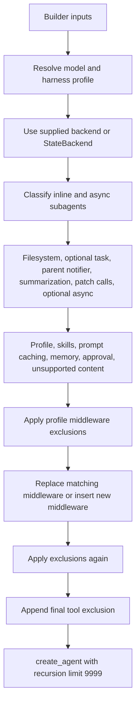
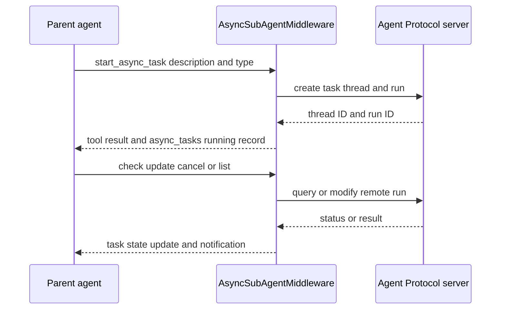

# Build and Customize a Deep Agent

`create_deep_agent` is the public assembly boundary for the Deep Agents harness. It resolves a model and harness profile, constructs middleware around LangChain `create_agent`, and returns a compiled LangGraph graph. Filesystem access, delegation, context summarization, skills, asynchronous work, and human approval are middleware, so an option can change both the model-visible and executable tool surface.

See [SDK construction and execution](/openwiki/architecture/sdk-construction-execution.md), [middleware stack](/openwiki/architecture/middleware-stack.md), [context management](/openwiki/concepts/context-management.md), [subagents and skills](/openwiki/concepts/subagents-skills.md), and [permissions and HITL](/openwiki/concepts/permissions-hitl.md) for component contracts.

## 1. Start with explicit model and backend choices

Pass either a `provider:model` string or an initialized `BaseChatModel`. A string is resolved with `init_chat_model`; an instance retains provider-specific settings. For example, initialize an OpenAI model yourself to select Chat Completions instead of the default Responses API, or to set Responses API retention options. Do not rely on `model=None`: it constructs `ChatAnthropic(model_name="claude-sonnet-4-6")` today, but that fallback is deprecated and scheduled for removal in `deepagents==1.0.0`.

Pass an initialized backend instance. Omitting it selects `StateBackend()`, whose files are graph state: they persist in a checkpointed conversation thread but not across threads, and the backend may only run inside LangGraph execution. Seed its files in graph input rather than calling it outside a run.

```python
from deepagents import create_deep_agent
from deepagents.backends import StateBackend

agent = create_deep_agent(
    model="openai:gpt-6-astra",
    backend=StateBackend(),
    tools=[my_application_tool],
    system_prompt="You are a careful research assistant.",
)
result = agent.invoke(
    {"messages": [{"role": "user", "content": "Investigate this task."}], "files": {}}
)
```

`tools=` is additive; it does not remove built-in filesystem tools or `task`. A profile can hide a tool name with `excluded_tools`; replacing `FilesystemMiddleware` with one configured with `tools=[...]` changes the filesystem suite itself. The selected profile also contributes prompt parts, description overrides, extra/excluded middleware, tool exclusions, and the default general-purpose-subagent configuration. The authored prompt is `USER -> BASE -> SUFFIX`. For a caller `SystemMessage`, existing content blocks, including cache-control blocks, remain intact and profile text becomes an additional block.

## 2. Understand construction and final ordering before extending it



Caption: Construction classifies subagents, assembles the complete core and tail, applies exclusions around custom middleware, then compiles the LangGraph agent.

The core is `FilesystemMiddleware`; `SubAgentMiddleware` only when synchronous subagents exist; `_ParentNotifierMiddleware`; summarization; `PatchToolCallsMiddleware`; and `AsyncSubAgentMiddleware` when remote/background specs exist. The tail is profile extra middleware, optional `SkillsMiddleware`, provider prompt-caching middleware, optional memory, auto-derived HITL, and `UnsupportedContentMiddleware`.

Custom middleware whose `.name` matches an assembled entry replaces it in place. New middleware is spliced after the last core member—including `_ParentNotifierMiddleware`—and before the profile/skills/caching/memory/HITL tail. Profile exclusions are deliberately applied both before and after this merge; unmatched, private-name, or ambiguous exclusions fail rather than silently producing a degraded graph. Profile tool exclusion is appended last, so custom middleware cannot restore an excluded name. `FilesystemMiddleware` and `SubAgentMiddleware` are protected scaffolding: a profile cannot exclude them. The compiled graph has a `recursion_limit` of 9,999 for long-horizon tool loops.

A consequence of this placement is that ordinary user middleware runs before skills. It cannot see freshly loaded `skills_metadata` in `before_agent` or `before_model`, nor edit the skills prompt section in `wrap_model_call`. A custom middleware named `SkillsMiddleware` takes that slot instead.

## 3. Configure delegation and preserve state boundaries

`subagents=` accepts three execution models:

- A declarative `SubAgent` is rebuilt by the harness and invoked through `task`.
- A `CompiledSubAgent` is an already-built runnable, also exposed through `task`.
- An `AsyncSubAgent`, identified by `graph_id`, goes to `AsyncSubAgentMiddleware`; it launches work against an Agent Protocol server rather than being handled by `task`.

Unless the caller supplies a synchronous `general-purpose` subagent, the profile adds a default one. Disable it with `GeneralPurposeSubagentProfile(enabled=False)` and supply no synchronous subagents to omit `task`; async subagents do not change that decision. Declarative subagents inherit parent tools when their `tools` key is absent, and inherit permissions and `interrupt_on` unless they provide replacements. Compiled and remote agents are independently configured runnables/graphs, so they do not inherit parent HITL or a custom state schema.

A declarative subagent normally receives only its delegated description. Experimental `mode="fork"` continues the parent’s effective conversation, rebuilds inherited prompt-producing middleware, and appends its own `system_prompt` as an addendum. A fork cannot declare separate `skills`, inherits the parent configuration, and rejects recursive `task` delegation. Use an isolated worker for a deliberately smaller context; use a fork only when the worker needs the parent conversation.

Prefer a middleware `state_schema` for new state. A graph-wide schema must be a `TypedDict` subclass of `DeepAgentState`, retaining its `messages` `DeltaChannel` reducer. The builder merges middleware schemas and passes private field names to the task boundary so ordinary subagents neither receive nor return private state. `checkpointer`, `store`, `context_schema`, `response_format`, `cache`, `name`, and `debug` pass through to `create_agent`; use a checkpointer if an interrupted run must resume.

### Run remote work through the async-task lifecycle

Each `AsyncSubAgent` needs a unique `name`, `description`, and `graph_id`; `url` and `headers` are optional. Its `mode` is `isolated` (the default, only the delegated description is sent) or experimental `fork` (a snapshot of effective parent conversation plus the task is sent). Forking a remote agent does **not** copy its model, prompt, tools, or middleware: configure the remote graph itself to match if that is required. A spec without `url` uses local ASGI transport and therefore requires an async parent entry point such as `ainvoke`; synchronous `invoke` requires a reachable URL.



Caption: Async delegation returns promptly and persists the remote task record in parent graph state instead of blocking the agent loop.

The middleware supplies `start_async_task`, `check_async_task`, `update_async_task`, `cancel_async_task`, and `list_async_tasks`. Launch stores an `async_tasks` record keyed by task/thread ID with the agent name, current run ID, timestamps, and status; its reducer merges records so independently launched tasks coexist. A completion, failure, timeout, or remote HITL pause is represented as a notification, not user input. A paused remote task is `waiting` and must be answered on its own thread; the parent cannot approve it.

The synchronous tools can launch, inspect, update, cancel, and list tasks, but automatic polling and extra model turns occur only on the async path. In `ainvoke`, the middleware checks unfinished tasks before an agent/model step and after a final answer; a new outcome adds a system notification and returns control to the model. Failed status checks are logged and retried later rather than failing the parent run. On an Agent Server, an idle parent may also be awakened by a notification run; a busy parent picks up the update on its normal checks.

## 4. Add skills as progressive disclosure

Pass `skills=` with POSIX backend paths to install `SkillsMiddleware`, or pass a same-named custom middleware to control its sources, prompt template, or skill tools. Sources may be paths or `(path, label)` pairs. The middleware lists each source through the selected backend, loads child `SKILL.md` metadata, and lets later sources override duplicate names. Metadata is cached per thread in `skills_metadata`; set it to `None` in graph input or with `update_state` to reload. Source failures are retained as state errors, logged, and rendered as untrusted diagnostics in the default skills prompt.

The initial prompt exposes metadata and a `read_file` path, not full instructions. The agent reads the desired `SKILL.md` through filesystem tooling. To force a body into the next model call, set `pinned_skills`; readable named skills are appended as `HumanMessage` snapshots and the pending list is cleared.

```python
from deepagents import create_deep_agent
from deepagents.middleware.skills import SkillsMiddleware

skill_middleware = SkillsMiddleware(
    backend=backend,
    sources=[("/skills/project/", "Project")],
    tools=[create_customer_request],
)
agent = create_deep_agent(
    model=model,
    backend=backend,
    skills=["/skills/project/"],
    middleware=[skill_middleware],  # replaces the default by name
)
```

A skill's `metadata.include_tools` names are not ordinary tool-node registrations. A successful `read_file` of the declaring `SKILL.md`, or a pinned snapshot, is evidence for later disclosure; pre-read and same-turn calls remain invalid. Every model call recomputes visible read evidence, resolves/binds only disclosed tools, and records the gated names privately. Compaction that removes evidence withdraws the tool; malformed or stale checkpoint records grant no authority. Resolver results must be stable within a thread for prompt caching, and async resolvers require an async entry point such as `ainvoke`.

Provider-payload tests additionally verify the placement of disclosure blocks: inline-capable Anthropic models receive `tool_addition` immediately after the complete tool-result batch, while OpenAI Responses receives `additional_tools` at the same point. The disclosure must not split a parallel tool-result batch or precede a queued user turn. Unsupported provider/model forms bind the disclosed tool for as long as the supporting read remains visible instead.

Skills are scoped to their middleware instance. An isolated declarative subagent gets skills only from its own `skills` or matching middleware configuration. A fork mirrors parent prompt-producing middleware, including skills, but starts with its own disclosure record.

## 5. Treat capability, permission, and approval as separate controls

Filesystem operations run through the backend. `execute` works only when it implements `SandboxBackendProtocol`; otherwise its tool returns an error. A state-backed backend adds the `files` state channel, including when a `CompositeBackend` route uses `StateBackend`. Backend selection is therefore both a persistence and shell-capability choice.

Filesystem permissions are ordered, first-match `allow`, `deny`, or `interrupt` rules for ordinary path operations. They are enforced by `FilesystemMiddleware` for built-in filesystem tools, not direct backend calls, and declarative subagents inherit the list unless their own `permissions` replaces it. Permission paths require an absolute form and reject traversal components. The middleware also checks symlink-resolved targets so an alias does not bypass a protected path.

`interrupt` rules become path-aware `HumanInTheLoopMiddleware` predicates; explicit `interrupt_on` entries win for the same tool name. Exact operations evaluate their target. Bulk operations (`ls`, `glob`, `grep`, and recursive `delete`) interrupt when their scope could intersect a protected subtree; missing paths and current-directory aliases are conservatively broad, and `glob` also examines an absolute or climbing pattern that can escape its nominal path. A checkpointer is needed to durably pause and resume approval.

Recursive deletion is stricter than ordinary first-match resolution: it is all-or-nothing and refuses a directory deletion if a deny-write pattern overlaps the target subtree in either direction. A known leaf can use normal first-match behavior. Permissions are unsupported when the backend’s execution default is sandbox-capable, because the filesystem policy does not govern shell execution; configure containment at the tool/backend boundary. Permissions and HITL are therefore not sandboxing.

## 6. Verify the final graph and invocation path

For builder, profile, ordering, or inheritance changes, begin with `tests/unit_tests/test_graph.py`. Its focused cases inspect assembled middleware and the compiled tool node, including default delegation, prompt assembly, provider caching placement, exclusions, skills replacement/placement, and fork behavior. Test both sides of the changed branch: default general-purpose enabled/disabled, matching-name replacement/new insertion, and exclusion after custom middleware.

For async-subagent changes, run `tests/unit_tests/test_async_subagents.py` for middleware-level state, fork, remote-client, and notification behavior, then the `TestAsyncSubagentEndToEnd` cases in `tests/unit_tests/test_end_to_end.py`. The end-to-end tests use mocked LangGraph SDK clients to exercise the full graph loop from a model tool call through remote launch or control and the resulting `async_tasks` state. They also prove synchronous `task` and all five asynchronous controls coexist when both kinds of subagent are configured.

For permission changes, run `tests/unit_tests/test_permissions.py`. It covers rule validation and first-match behavior, deny enforcement, recursive-delete containment, sandbox-backend rejection, path-aware interrupt predicates including pathless/current-directory and absolute-glob bypass cases, and symlink-resolved enforcement. For skill tools, run the semantic suite and the provider-payload suite; the latter validates actual Anthropic and OpenAI request placement, not just in-memory model history.

```bash
cd libs/deepagents
uv run --group test pytest -vvv tests/unit_tests/test_graph.py
uv run --group test pytest -vvv tests/unit_tests/test_async_subagents.py
uv run --group test pytest -vvv tests/unit_tests/test_end_to_end.py -k AsyncSubagent
uv run --group test pytest -vvv tests/unit_tests/test_permissions.py
uv run --group test pytest -vvv tests/unit_tests/middleware/test_skill_tools.py
uv run --group test pytest -vvv tests/unit_tests/middleware/test_skill_tools_payload.py
uv run --group test pytest -vvv tests/unit_tests/middleware/test_skill_tool_resolver.py
```

## Safe-change checklist

1. Use an explicit model and backend; document provider settings, backend persistence, and shell capability.
2. Inspect the selected profile and final middleware order. `tools=` is not the final model-visible surface.
3. Keep protected filesystem/task scaffolding intact, preserve `DeepAgentState` reduction, and prefer middleware-private state.
4. Choose isolated versus forked subagents deliberately; configure compiled and remote workers independently.
5. For remote workers, use `ainvoke` if no `url` is supplied, retain `async_tasks` state, and test launch, control, notification, and a waiting task.
6. For skills, test reload, read/pin-gated disclosure, compaction withdrawal, resolver stability, checkpoint rebuilding, and real provider payloads.
7. Treat filesystem permissions, HITL approval, and backend sandboxing as distinct safeguards; test recursive deletion and symlink paths.
