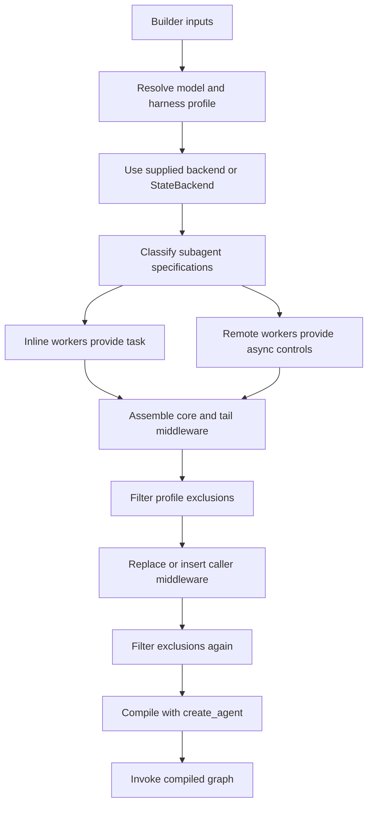

# Build a Deep Agent

`create_deep_agent` is the SDK assembly entry point. It resolves the model and its `HarnessProfile`, selects a backend, constructs the middleware and tool surface, and returns a compiled LangGraph graph. Treat the builder as the integration boundary: `tools=`, `middleware=`, `subagents=`, permissions, and backend selection combine rather than configuring isolated features.

See [SDK construction and execution](/openwiki/architecture/sdk-construction-execution.md) for the execution boundary, [SDK Middleware Assembly](/openwiki/architecture/middleware-stack.md) for the complete stack contract, [subagents and skills](/openwiki/concepts/subagents-skills.md) for delegation concepts, [filesystem tools](/openwiki/concepts/tools-filesystem.md) for backend behavior, and the [testing guide](/openwiki/testing/testing-guide.md) for focused test selection.

## 1. Choose model, profile, and storage deliberately

Pass a `provider:model` string or an initialized `BaseChatModel`. A string is resolved by the SDK; an initialized model preserves provider-specific choices. In particular, `openai:` strings use the Responses API by default. Initialize the model yourself to use Chat Completions or configure Responses retention. Do not rely on `model=None`: its Claude default is deprecated and is scheduled to disappear in `deepagents==1.0.0`.

The resolved model selects the active `HarnessProfile`. The profile can supply prompt fragments, tool-description overrides, extra middleware, tool exclusions, middleware exclusions, and the default general-purpose worker. The authored system prompt is assembled in `USER -> BASE -> SUFFIX` order. Supplying a `SystemMessage` preserves its existing content blocks, including cache-control markers, and appends profile prompt text as a new block.

Choose the backend as both the filesystem implementation and persistence boundary. With no `backend`, the builder creates `StateBackend()`. It stores files in the graph's `files` state, which survives checkpoints within a conversation thread but not across threads, and it can only be called while the graph is executing. Seed files in invocation input rather than calling that backend directly.

```python
from deepagents import create_deep_agent
from deepagents.backends import StateBackend

agent = create_deep_agent(
    model="openai:gpt-5.5",
    backend=StateBackend(),
    tools=[my_application_tool],
    system_prompt="You are a careful research assistant.",
)

result = agent.invoke(
    {
        "messages": [{"role": "user", "content": "Investigate this task."}],
        "files": {},
    }
)
```

`tools=` is additive: it does not remove filesystem tools, `execute`, or `task` when that task tool exists. Use profile `excluded_tools` to hide a built-in from the model, or replace `FilesystemMiddleware` with one configured with `tools=[...]` to change the filesystem suite. `execute` only works with a backend implementing `SandboxBackendProtocol`; otherwise it returns a tool error.

## 2. Inspect the build-to-invocation path



*The builder turns declarative configuration into a model-visible tool surface and a LangGraph invocation path; profile filtering runs on both sides of caller middleware merging.*

The main core starts with `FilesystemMiddleware`, conditionally adds `SubAgentMiddleware`, then adds `_ParentNotifierMiddleware`, summarization, and `PatchToolCallsMiddleware`; `AsyncSubAgentMiddleware` is included for remote specifications. The tail adds profile extras, optional skills and memory, provider caching, optional human approval, unsupported-content handling, and refusal handling. Finally, the builder forwards `checkpointer`, `store`, `context_schema`, `response_format`, `cache`, `name`, `debug`, and the state schema to LangChain `create_agent`, and configures a recursion limit of 9,999.

Caller middleware is merged by `.name`, not simply appended. A matching name replaces its assembled member in place. A new middleware is inserted after the core stack and before the profile-driven tail. This makes placement part of the extension contract: for example, caller fallback middleware runs before the default refusal handler, while ordinary caller middleware runs before `SkillsMiddleware`.

A profile's `excluded_middleware` is subtractive and runs before and after the caller merge. Class entries use exact type and string entries use exact middleware name. Invalid exclusions fail fast: protected filesystem/task scaffolding, private names, ambiguous matching names, and exclusions that match nowhere are rejected. Tool exclusions are appended after custom middleware, so a custom middleware cannot restore an excluded tool.

The main graph appends `ModelRefusalMiddleware` after caller middleware. A parent refusal therefore raises by default, but a caller-supplied `ModelFallbackMiddleware` can recover first. Excluding the refusal middleware allows the provider refusal response to remain in the result.

## 3. Design the delegation boundary

`subagents=` supports three different execution models:

- `SubAgent` is a declarative synchronous worker rebuilt by the harness and called through `task`.
- `CompiledSubAgent` is an already-built runnable, also exposed through `task`.
- `AsyncSubAgent` has `graph_id`; it is routed to `AsyncSubAgentMiddleware` and runs as a background task rather than through `task`.

If the caller does not provide a synchronous worker named `general-purpose`, the active profile normally supplies one. Set `GeneralPurposeSubagentProfile(enabled=False)` and provide no synchronous workers to remove `task`; remote async workers do not affect that decision.

Declarative workers inherit parent tools when their `tools` key is absent, and inherit `permissions` and `interrupt_on` unless their specification supplies replacements. A compiled runnable and a remote graph own their own configuration: compile/configure their state schema and approval behavior independently.

Use the default isolated mode when the worker should receive only the delegated description. Experimental `mode="fork"` gives a declarative worker the effective parent conversation and rebuilds inherited prompt-producing middleware. Its own `system_prompt` is delivered with the delegated task so the inherited prompt prefix remains reusable; it cannot define separate skills and recursive `task` calls are refused. A fork is a context-sharing choice, not an authorization shortcut.

The synchronous task boundary does not propagate every parent field. It strips task-specific, skill, rubric, and middleware-private state, gives isolated workers a new `HumanMessage` containing the description, and returns a `ToolMessage` to the parent. A declarative or compiled child model refusal is normalized to a result notice—including a category or explanation when available—rather than escaping as the parent invocation failure. This lets the parent choose an alternative worker or respond with partial work.

When extending graph state, prefer `state_schema` on the owning middleware. A graph-wide custom schema must derive from `DeepAgentState` to preserve the `messages` `DeltaChannel` reducer. Declarative workers can receive that schema; precompiled and remote workers do not inherit it. If parallel `task` calls update the same custom field, define a reducer or the graph can fail with `InvalidUpdateError`.

## 4. Make filesystem policy and approval explicit

Use `FilesystemPermission` rules for filesystem tools, not as a general sandbox policy. Rules are ordered and the first matching read/write rule produces `allow`, `deny`, or `interrupt`; no matching rule allows the call. Permission patterns must be absolute and reject traversal components. `FilesystemMiddleware` enforces the rules for its built-in tools, including resolved symlink targets on real filesystem backends; direct backend calls do not receive that enforcement.

`interrupt` rules are translated into path-aware `HumanInTheLoopMiddleware` predicates. Supplying `interrupt_on` also installs HITL, and explicit entries win over generated permission entries for the same tool. Configure a checkpointer when an approval must survive interruption and resume. Treat all three controls independently:

- the backend determines storage and whether shell execution is available;
- permissions gate filesystem middleware tools; and
- HITL pauses selected tool calls for review.

Permissions cannot govern shell execution, so `FilesystemMiddleware` rejects permission rules when the backend's default execution path is sandbox-capable. Configure containment at the backend/tool boundary instead.

Read and write operations use ordinary first-match behavior, but recursive `delete` is intentionally conservative. If a directory deletion could overlap any deny-write subtree, it is refused without removing anything, even when an earlier allow matches the root. A confirmed plain-file deletion can use normal first-match resolution. Bulk interrupt predicates similarly fail safely: pathless calls, current-directory aliases, ancestor searches, escaping relative glob patterns, and absolute glob patterns that reach protected content require review rather than bypassing it with a benign `path` argument.

```python
from deepagents.middleware.filesystem import FilesystemPermission

permissions = [
    FilesystemPermission(operations=["read", "write"], paths=["/workspace/**"], mode="allow"),
    FilesystemPermission(operations=["read", "write"], paths=["/secrets/**"], mode="interrupt"),
    FilesystemPermission(operations=["write"], paths=["/**"], mode="deny"),
]

agent = create_deep_agent(
    model=model,
    backend=backend,
    permissions=permissions,
    interrupt_on={"execute": True},
    checkpointer=checkpointer,
)
```

## 5. Test the ownership boundary you changed

Start with focused tests rather than a broad smoke test:

| Change | Focused test | Assert the important branch |
|---|---|---|
| Builder inputs, profile selection, prompt/order, middleware replacement/exclusion, schema propagation | `tests/unit_tests/test_graph.py` | default versus disabled general-purpose worker; matching replacement versus new insertion; exclusion before and after merge |
| `task` results, child state extraction, or refusal handling | `tests/unit_tests/test_subagent_refusal.py` | parent refusal raises or falls back separately from child refusal becoming a tool result |
| Task schema, isolation/fork behavior, or private-state transfer | `tests/unit_tests/middleware/test_subagent_middleware_init.py` | isolated description-only input versus inherited fork context and recursion refusal |
| Filesystem rule matching, resolved paths, delete, or permission-generated HITL | `tests/unit_tests/test_permissions.py` | first-match normal operations, conservative recursive delete, pathless/absolute-glob approval, and sync/async behavior |

Run the owning suite from the package and add `make lint` before submitting a change:

```bash
cd libs/deepagents
uv sync --all-groups
make test TEST_FILE=tests/unit_tests/test_graph.py
make test TEST_FILE=tests/unit_tests/test_subagent_refusal.py
make test TEST_FILE=tests/unit_tests/middleware/test_subagent_middleware_init.py
make test TEST_FILE=tests/unit_tests/test_permissions.py
make lint
```

## Safe-change checklist

1. Specify the model and backend explicitly; document provider settings and the intended file lifetime.
2. Inspect the final middleware order, not just the `middleware=` argument. Preserve required filesystem/task scaffolding.
3. Decide whether a worker is isolated, forked, precompiled, or remote, then test that state and approval ownership matches the choice.
4. Keep private middleware state out of child inputs and provide reducers for parallel child updates.
5. Treat permissions, HITL, and sandbox execution as separate defenses. Cover recursive-delete and bulk-search geometry whenever permission code changes.
6. Run the focused suite for the changed construction or boundary behavior, then lint.
