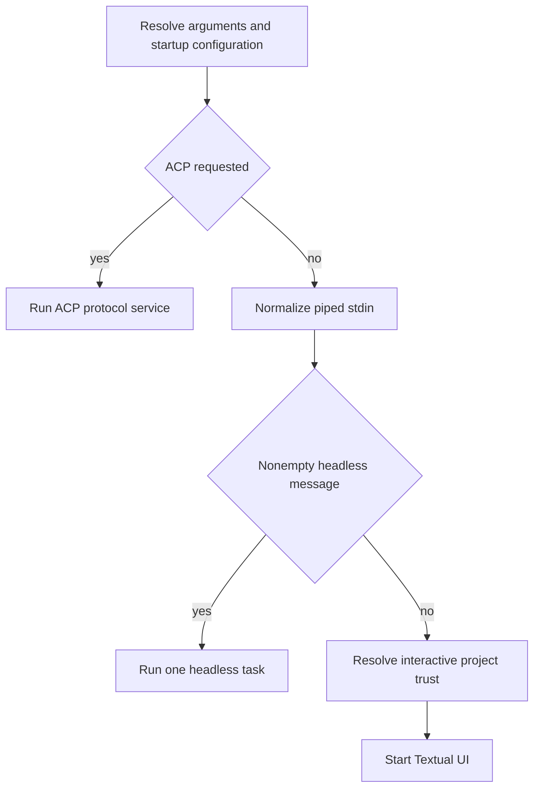
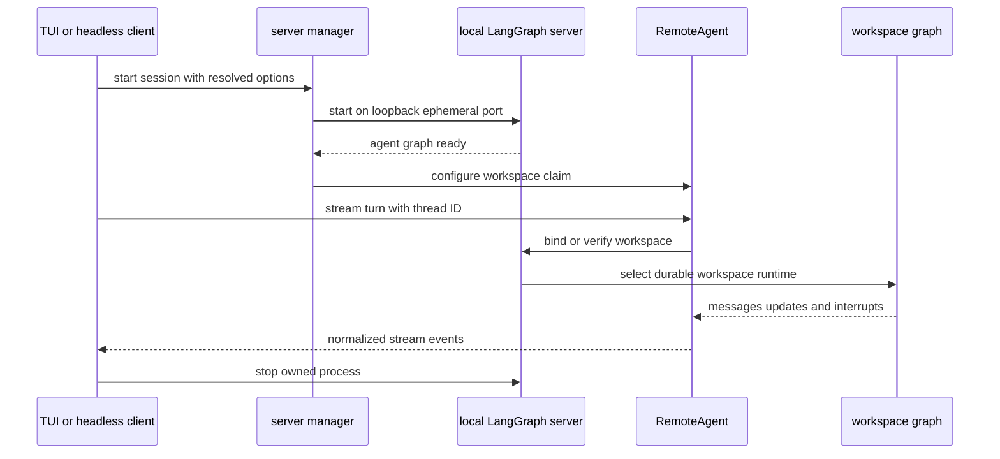
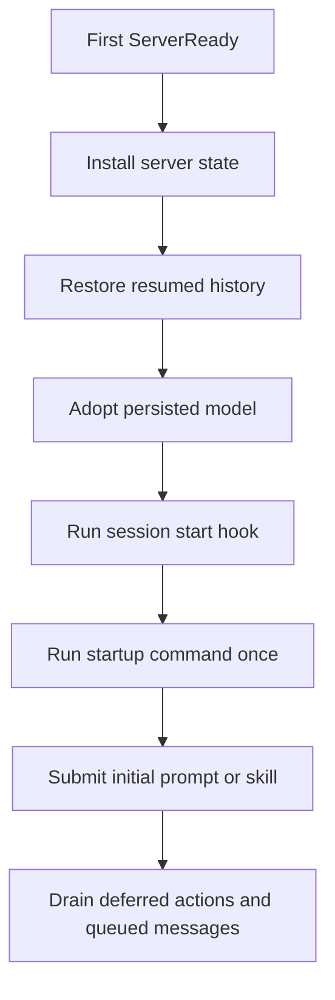

# Run a dcode Session

`dcode` offers three execution surfaces: the interactive Textual UI, one-task headless execution, and an ACP service. Interactive and headless runs start a local LangGraph server and invoke its `agent` graph through `RemoteAgent`; ACP instead constructs and runs an ACP agent server. Configuration determines capabilities, but the server remains the authority for the durable workspace binding and graph runtime. See [code agent architecture](../architecture/code-agent.md), [configuration layering](../concepts/config-layering.md), [state persistence](../concepts/state-persistence.md), [ACP](../integrations/acp.md), [MCP](../integrations/mcp.md), and [security](../operations/security.md).

## Choose a launch surface

```bash
# Interactive UI with an initial prompt
dcode -M anthropic:claude-sonnet-4-5 -m "review this repository"

# One bounded, headless task
dcode -n "run the focused tests" --max-turns 8 --timeout 600

# Send piped context to a headless skill invocation
git diff | dcode --stdin --skill code-review -q

# Start the Agent Client Protocol service
dcode --acp
```

`cli_main` resolves startup settings before it chooses a session surface. ACP is an early branch: it resolves the effective approval mode, rejects unacknowledged YOLO and an Auto-only classifier in other ACP modes, checks the MCP flag combination, and then runs the ACP server. It does **not** first consume stdin. ACP loads persisted sessions, creates an agent graph for each session context, and releases any thread-ownership leases when its protocol loop ends.

All other launches call `apply_stdin_pipe` before the final branch. A nonempty `non_interactive_message` selects `run_non_interactive`; otherwise the root-mode path starts the TUI. Piped input is trimmed and limited to 10 MiB. It is prepended to `-n` or `-m`; without either it becomes a headless task. A detected pipe used with `--skill` can instead seed the interactive initial prompt, while explicit `--stdin` makes that skill invocation headless. This distinction matters to automation: headless-only controls apply to the final message predicate, not merely whether standard input is a TTY.



*Mode selection gives ACP its own early path, while stdin normalization determines whether the remaining launch is headless or interactive.*

In headless mode, `-q` routes console status, errors, tool activity, and the durable `Thread: <id>` notice to stderr, leaving agent response text on stdout. `--no-stream` buffers response text until the turn completes. A top-level `--timeout` exits with 124, and a headless turn or HITL iteration limit also returns 124; Ctrl-C returns 130.

## Resolve trust and executable authority

A project configuration is executable authority rather than display metadata: project MCP may start servers, hooks may run commands, extensions execute Python, and sandbox setup can execute setup code. A sandbox does not itself trust project MCP, hooks, extensions, or credentials in the dcode process.

The interactive path checks project MCP, hook, and extension trust before it mounts the TUI; cancellation stops the launch. Headless project hooks require explicit `--trust-project-hooks`. `--no-mcp` and `--mcp-config` are mutually exclusive, and an explicit MCP config is validated before the local server subprocess is created.

The sandbox default is `none`. A bare `--sandbox` resolves the configured default, then validates the provider and any requested ID or snapshot capability. A managed sandbox setting does not force an invocation that omitted `--sandbox` into a sandbox. Similarly, headless shell access is disabled unless `--shell-allow-list` enables it: a restricted list is enforced by middleware, while `all` allows shell commands without restriction. Filesystem-tool policy is independent: omitted `--allow-fs-tools` and `all` retain the SDK default, whereas a restricted list must contain recognized tools including `read_file`.

Server configuration separates client-claimable session policy from project-resolved fields. When a thread moves to a different or unresolvable project, the server fails closed: it drops project-derived MCP, sandbox setup, launch extensions, and project MCP trust, then re-reads extension trust. Interpreter PTC and its unsafe acknowledgement resolve together; effective values become durable workspace policy, so incompatible permission or acknowledgement changes refuse resume rather than silently escalating authority.

## Start the local server and bind the workspace



*The client owns local-process lifetime, while the server validates the durable workspace binding and selects the graph runtime.*

`start_server_and_get_agent` captures the launch project context, preflights explicit MCP configuration, derives `ServerConfig`, scaffolds a temporary server configuration directory, and starts `ServerProcess` on loopback with port `0`. It waits specifically for the `agent` graph before constructing `RemoteAgent` and configuring its workspace claim. If server start, readiness, or client setup fails—or the task is cancelled—before handoff, its `finally` block stops the server. `server_session` wraps the headless handoff and stops the process on every exit; it also cleans up an MCP session manager if one is present.

`RemoteAgent` does not treat a cwd as enough authority. It requires a configured workspace before it can bind a thread, posts the configured policy and fingerprint to the workspace endpoint, and caches only the server-validated descriptor. A workspace switch updates active cwd and cache only after the request succeeds. For each streamed run, it injects that descriptor in server context, forwards thread ownership headers, delegates SSE negotiation and routing to `RemoteGraph`, and normalizes message dictionaries and interrupts into client-facing events.

The server persists an immutable, canonical workspace binding per thread. It validates absolute, existing directories, fingerprints policy separately from full runtime identity, and requires the context echoed by the client to match the binding. `make_graph` rejects an execution lacking a thread ID or workspace context, obtains that durable binding, and selects the workspace runtime. Access-policy or project-policy drift is rejected; a runtime-only change such as a model change rebuilds the cached graph without replacing the binding.

On POSIX, the server bootstrap also inherits a parent-lifetime pipe. EOF means the launching client disappeared: after dispatch begins, the guard sends `SIGTERM` and eventually `SIGKILL`. The process manager closes pipe descriptors and logs during normal stop, failed launch, and replacement, so ownership does not leave a server accidentally alive.

## Headless execution and resume

A headless run selects its thread before it executes `--startup-cmd`. A new run gets a generated ID. For `-r <id>`, dcode verifies that the thread exists and passes resume-age policy, that its durable cwd is the current usable directory, and—unless the caller explicitly selected an agent—adopts the stored agent. It then reserves the resumed thread before starting the server, preventing concurrent use and a deletion race. Any resume failure returns an error; it never falls back to a new thread.

`--startup-cmd` is deliberately non-fatal and is local output, not model context. It runs before server startup, restores user LangSmith environment values in its shell child, warns on spawn failure, timeout, or nonzero exit, and continues. Cancellation terminates the child process or process group before propagating.

After the local server starts, a resumed headless run reads its persisted state. It adopts the persisted model unless `-M` supplied an override. A model that no longer resolves produces a warning and leaves the launch model active; a workspace conflict remains a resume failure because it identifies a policy mismatch. The run creates a fresh turn identity, establishes hooks and shell/HITL policy, builds stream configuration, and streams the task. A skill is sent as an invocation envelope so the server, not the client, resolves and trust-checks the skill.

The stream requests `messages`, `updates`, and `custom` events, including subgraphs. The client processes output incrementally, handles interrupts/HITL continuation, tracks usage and file operations, and finalizes its request ledger even for an aborted round so replayed chunks do not double-count cost. Model retry is scoped to the model node, avoiding replay of completed tool calls; retry events let clients reconcile partial output.

## Interactive lifecycle

The TUI follows the same server/bootstrap/binding boundary but keeps the process for multiple turns. Its first `ServerReady` serializes session initialization: install server state, restore resumed history when necessary, restore a persisted model when appropriate, run session-start work and `--startup-cmd`, submit an initial prompt or skill, then drain deferred actions and queued input. On the initial resume connection, it latches the resuming indicator through history restoration; reconnects do not repeat one-shot setup.



*Interactive first-connect work is ordered so restoration and one-time initialization finish before user work is drained.*

A workspace bind conflict during model adoption is a workspace failure and blocks restoration. If the model endpoint fails later, the fallback launch model remains active and the UI reports the fallback without surfacing server diagnostic secrets. Interactive startup-command failure is also non-fatal and its output stays local to the app.

## Focused validation

Run focused tests from `libs/code` when changing this workflow:

```bash
make test TEST_FILE=tests/unit_tests/test_non_interactive.py
make test TEST_FILE=tests/unit_tests/test_server_pipe.py
make test TEST_FILE=tests/unit_tests/test_main_args.py
make test TEST_FILE=tests/integration_tests/test_headless_resume.py
make test TEST_FILE=tests/unit_tests/test_remote_client.py
make test TEST_FILE=tests/unit_tests/test_interpreter_workspace_policy.py
make check
```

For launch changes, cover ACP-before-stdin dispatch and the pipe combinations that distinguish an initial interactive prompt from a headless task. For bootstrap changes, test graph readiness, cancellation cleanup, normal context-manager teardown, failed spawn descriptor cleanup, and POSIX owner-pipe EOF. For resume changes, cover missing IDs, age/cwd failures, ownership contention, deletion during startup, model adoption and override, and workspace conflicts. For workspace changes, preserve the core invariant: a client can request a workspace, but the server validates and durably owns the thread binding and access policy.
