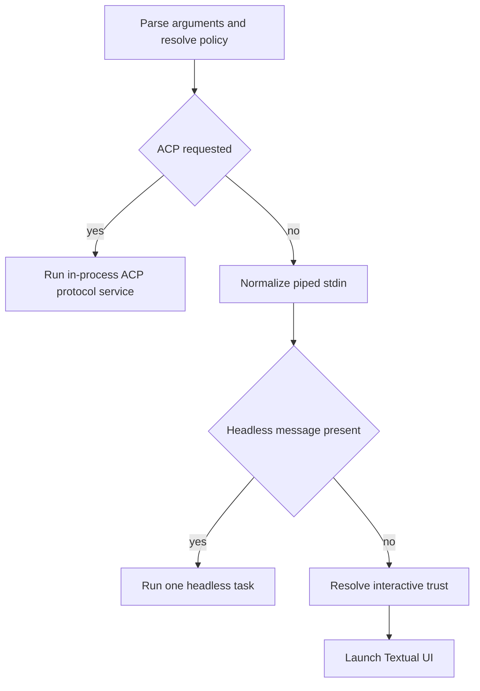
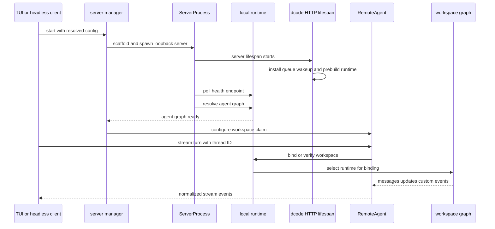
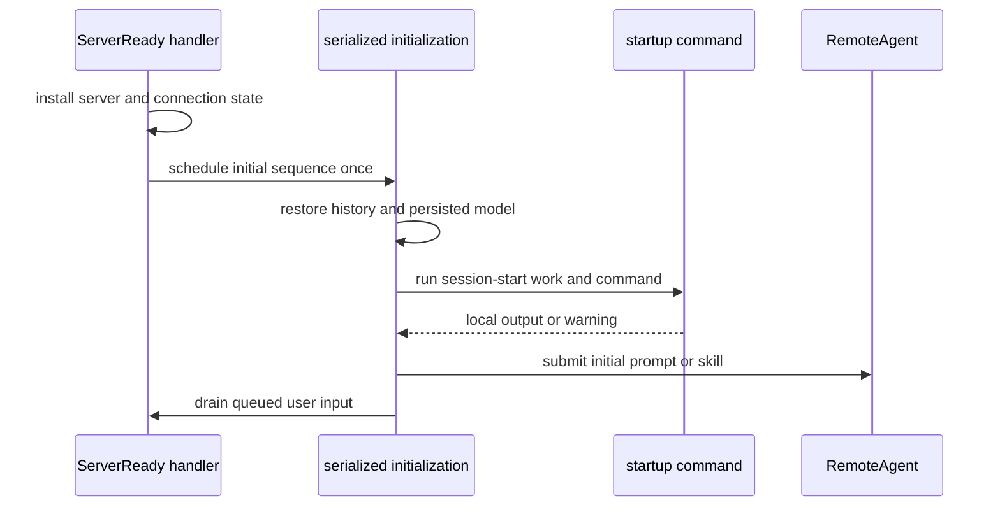
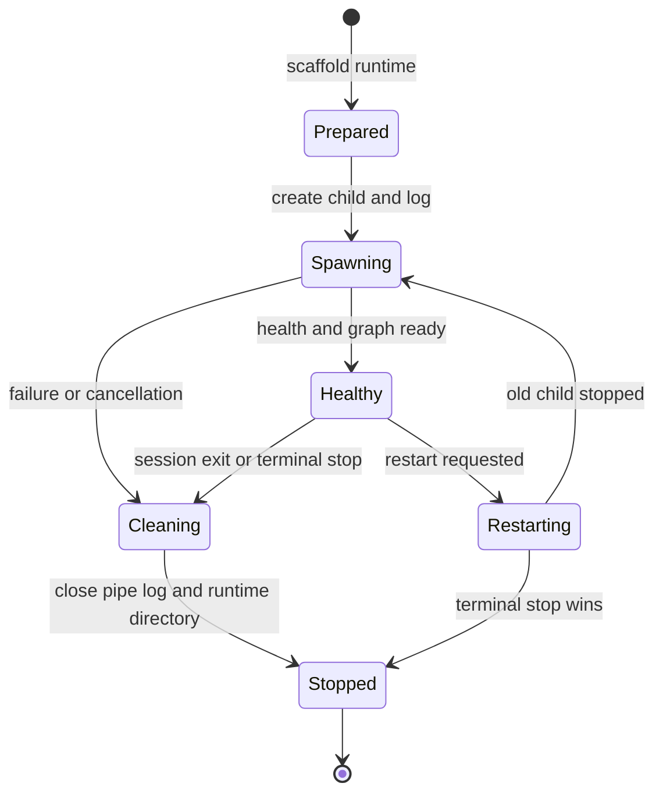

# Run a dcode Session

`dcode` has three distinct session surfaces: the interactive Textual UI, one-task headless execution, and ACP. Interactive and headless clients use a temporary local LangGraph runtime and call its `agent` graph through `RemoteAgent`; ACP runs an in-process protocol server rather than taking that client/server path. The client owns the local process lifetime, while the server validates the durable workspace binding and selects graph runtimes. See [code agent architecture](../architecture/code-agent.md), [configuration layering](../concepts/config-layering.md), [state persistence](../concepts/state-persistence.md), [cost and sessions](../operations/cost-and-sessions.md), and the [testing guide](../testing/testing-guide.md).

## Select a surface and preflight it

```bash
# Interactive UI with an initial prompt
dcode -M anthropic:claude-sonnet-4-5 -m "review this repository"

# One bounded, headless task
dcode -n "run the focused tests" --max-turns 8 --timeout 600

# Send piped context to a headless skill invocation
git diff | dcode --stdin --skill code-review -q

# Start the Agent Client Protocol service
dcode --acp
```

`cli_main` resolves arguments and policy before choosing a root-mode surface. ACP is selected **before** stdin processing; it validates resolved approval mode and ACP-compatible flags, loads sessions for protocol contexts, and releases leases and MCP resources when its protocol loop ends. Outside ACP, `apply_stdin_pipe` finalizes the message: a nonempty `non_interactive_message` runs `run_non_interactive`, and the remaining root-mode path launches Textual.

Piped stdin is limited to 10 MiB and normalized into `-n` or `-m`. Without either it becomes a headless task. An auto-detected skill pipe can seed an interactive initial prompt, but explicit `--stdin` makes it headless. Do not infer the surface merely from whether stdin is a TTY.



*ACP is an early, in-process path. Only the non-ACP path uses stdin normalization to distinguish headless and interactive sessions.*

Project configuration is executable authority: MCP can start processes, hooks run commands, extensions execute Python, and sandbox setup may execute setup code. A sandbox does not grant trust to project MCP, hooks, extensions, or client credentials. Interactive startup resolves project trust before mounting the UI; headless hooks require `--trust-project-hooks`. `--no-mcp` and `--mcp-config` are mutually exclusive, and an explicit MCP file is validated before a server subprocess is created.

The sandbox default is `none`. A bare `--sandbox` resolves the configured default and verifies provider capability, but managed configuration does not add a sandbox to a launch that omitted the flag. Shell and filesystem restrictions are separate: omitted `--allow-fs-tools` and `all` retain the SDK default filesystem middleware; an explicit list is normalized and must contain recognized tools including `read_file`.

Server configuration separates client-claimable session policy from server-resolved project fields. A project change that is different or cannot be resolved fails closed by dropping project-derived MCP, sandbox setup, launch extensions, and project MCP trust, then re-reading extension trust. Effective interpreter PTC and unsafe acknowledgement are durable workspace policy: incompatible historical permissions or acknowledgement values conflict rather than silently expand authority.

## Start, prebuild, and bind the local runtime

`start_server_and_get_agent` captures project context, applies `ServerConfig`, scaffolds an owned temporary runtime directory, and creates a loopback `ServerProcess`. Port `0` resolves to an ephemeral free port; an occupied requested port also falls back to a free port. The generated `langgraph.json` exposes only the built-in `agent` graph; dcode operations are authenticated custom HTTP routes, not sibling graphs.



*Handoff occurs only after health and `agent` graph resolution; the server begins runtime prebuild while the client is polling health.*

`ServerProcess.start()` serializes lifecycle work, spawns the child, runs an optional `after_spawn` gate, then waits for health. `wait_for_graph_ready("agent")` separately requests `/assistants/agent/graph`, exposing lazy factory errors before handoff and reconstructing actionable errors from marked child diagnostics. `PrespawnedServer` lets the TUI spawn before first paint but pauses at that gate; adoption runs the caller gate before health checking, and an unadopted start is cancelled and reaped.

The HTTP lifespan installs a guarded compatibility patch for the in-memory scheduler and starts `get_server_runtime()` in the background. The patch makes a successful `Runs.put` notify a waiting `Runs.next`, preserving the upstream claim/order logic and retaining the 0.5-second poll as fallback; it is a no-op if upstream private API shape differs. Runtime prebuild overlaps health polling, and the first graph request joins the locked cached build. A prebuild failure is logged and retried by the first request rather than making health itself claim readiness of the graph.

During graph construction the server snapshots the workspace environment off the event loop, pins one compatible LangSmith tracing configuration for the process lifetime, and installs an override that keeps untraced LangSmith bookkeeping inline while retaining thread hops for other calls. Workspaces with incompatible tracing settings cannot share the process.

Startup has two cleanup layers. `ServerProcess.start()` reaps a process if cancellation or health failure occurs after spawn. `start_server_and_get_agent` also stops any server that has not been handed off when graph resolution, `RemoteAgent` construction, or workspace setup fails or is cancelled. Stops are offloaded so cancellation does not freeze the UI; abandoned unsandboxed startup has a short grace period, while sandboxed startup retains normal graceful time for server-side sandbox cleanup. `server_session` wraps headless handoff and always stops the server and cleans any client-side MCP manager.

`RemoteAgent` requires an explicitly configured workspace before it can bind a thread. It sends the cwd plus policy claim/fingerprint to the workspace endpoint, caches the server-validated descriptor by thread, and updates active cwd/cache only after a successful switch. For `astream`, it inserts that descriptor into run context, sends thread-ownership headers, delegates SSE mechanics to `RemoteGraph`, and converts messages and interrupts to client events.

The server canonicalizes and persists a workspace binding per thread. `make_graph` requires a nonempty thread ID and workspace context, verifies that durable binding, and selects a cached runtime by binding identity and current runtime fingerprint. Access-policy drift is rejected; runtime-only changes may rebuild the graph. This boundary is important: a client requests a workspace, but the server owns validation and durable policy.

## Execute, persist, resume, and cancel turns

A new headless run creates a thread ID before `--startup-cmd`. For `-r <id>`, headless resume validates existence and resume age, requires durable cwd to equal the current usable directory, optionally adopts the stored agent, and reserves the chosen thread **before** server startup. It never creates a replacement thread after resume failure. The reservation prevents concurrent writers and deletion races; server checkpoint mutations carry an ownership token and reject a stale writer after client exit, release, or token rotation.

`--startup-cmd` remains non-fatal and local rather than model context. Headless execution runs it before thread creation and agent startup, restores user LangSmith values for the child shell, warns on launch failure, timeout, or nonzero exit, and terminates the child before propagating cancellation. A resumed headless task adopts its saved model unless `-M` overrides it; failed model resolution warns and retains the launch model, whereas workspace conflict is a resume failure.

The headless stream requests `messages`, `updates`, and `custom` events with subgraphs, processes output and HITL continuation incrementally, and finalizes its request ledger even on an aborted round so replayed chunks do not double-count usage. Model retry wraps only the model node, so completed tool calls are not replayed; attempt and retry events let clients reconcile partial output. On an interrupt, `RemoteAgent` can best-effort cancel pending/running remote runs before recovery writes; an update-state 409 similarly cancels and waits before one retry.

Interactive sessions retain the server across turns. The first `ServerReady` installs server state and schedules a serialized initialization sequence. On the initial resume connection it latches `_resuming` into `_restoring_resumed_history` before clearing connection state, retaining resuming status through history restoration; reconnects do not re-arm it or repeat initial setup.



*The TUI restores state and completes one-time startup work before initial submission or queued input reaches the agent.*

The TUI runs `--startup-cmd` once after resumed-history restoration and session-start work, before initial submission and queue draining; its output stays local and failure continues the session. A workspace bind conflict while adopting a resumed model prevents restoration. A later model endpoint failure preserves and reports the fallback launch model without exposing server diagnostic secrets.

## Shutdown, restart, and owner death



*Lifecycle work is serialized; failed starts, cancellation, and ordinary exit reach cleanup, and terminal stop cannot be undone by a racing restart.*

On POSIX, the server is a new session/process group and inherits an owner pipe and session-lock descriptors. The bootstrap begins watching before dispatch: EOF before dispatch suppresses launch; EOF after dispatch sends `SIGTERM` to its own process and enforces `SIGKILL` after the grace period. The inherited session lock is non-inheritable in the bootstrap so a grandchild cannot retain an installation-use lock. The parent closes the pipe writer only after explicit teardown finishes its graceful window, and failed spawn/replacement paths close pipe and log resources too.

POSIX shutdown sends `SIGTERM` to the dedicated group, waits for the entire group, then escalates the group to `SIGKILL`; it refuses to signal dcode's own group and falls back to the root process when it cannot establish a dedicated group. Windows uses Ctrl+Break for graceful shutdown, with `terminate()` fallback, but hard escalation can kill only the root handle, so descendants can be orphaned. Signal failures are logged as possible orphan risks.

`stop()` is idempotent and increments a terminal stop generation. Restart shields off-thread blocking cleanup even if cancellation occurs; if terminal stop changes that generation, restart refuses to spawn a replacement. Debug logs are queued for one terminal-safe notification; otherwise logs and owned runtime configuration are removed.

## Focused validation

Run focused checks from `libs/code` when changing this workflow:

```bash
make test TEST_FILE=tests/unit_tests/test_main.py
make test TEST_FILE=tests/unit_tests/test_app.py
make test TEST_FILE=tests/unit_tests/test_server_manager.py
make test TEST_FILE=tests/unit_tests/test_server.py
make test TEST_FILE=tests/unit_tests/test_run_queue_wakeup.py
make test TEST_FILE=tests/unit_tests/test_remote_client.py
make test TEST_FILE=tests/unit_tests/test_non_interactive.py
make test TEST_FILE=tests/integration_tests/test_headless_resume.py
make check
```

For launch changes, cover ACP-before-stdin dispatch and pipes that distinguish an interactive seed prompt from a headless task. For server changes, cover MCP preflight, `after_spawn` gating, health plus graph readiness, cancellation during readiness, and failure cleanup grace for sandboxed and unsandboxed starts. For runtime changes, cover the queue patch's idempotence, upstream-shape fallback, and put-to-waiter wakeup. For ownership and lifecycle changes, cover stale writer rejection, owner-pipe EOF, POSIX group-wide escalation, Windows root-only escalation, restart cancellation, and terminal-stop-versus-restart races.
