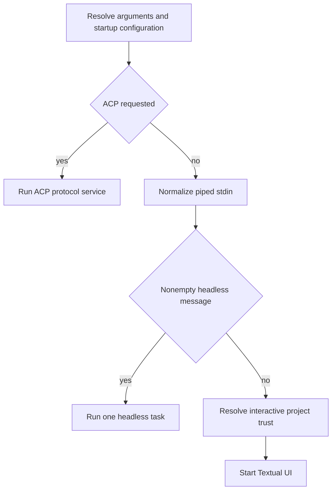
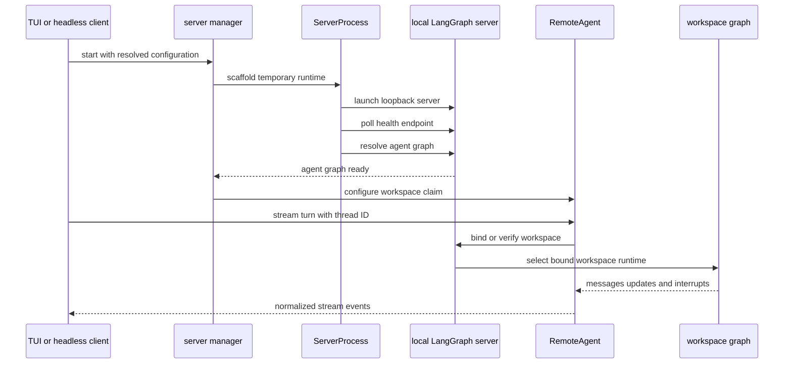
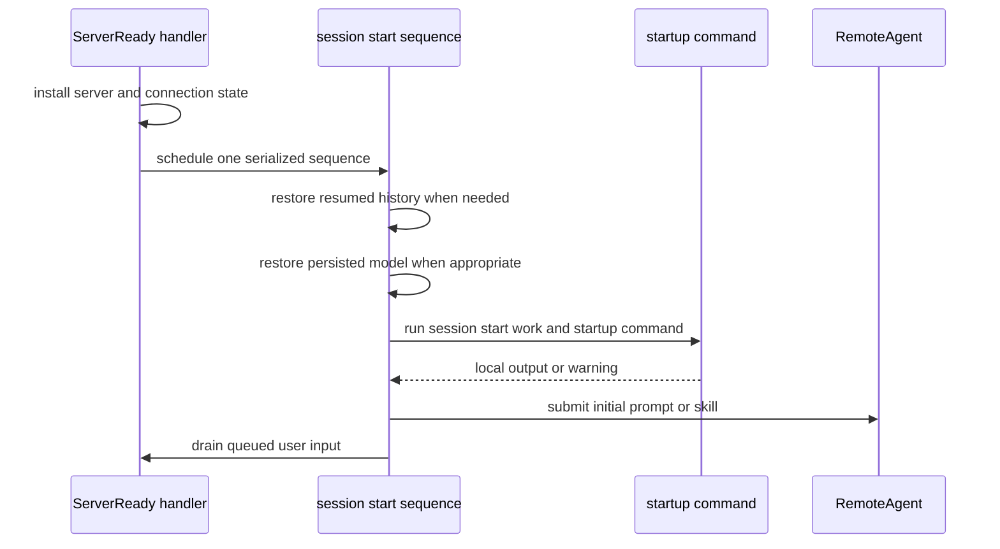
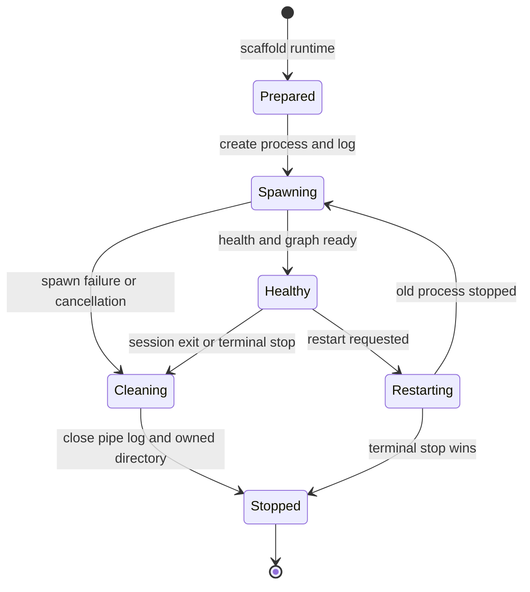

# Run a dcode Session

`dcode` has three session surfaces: the interactive Textual UI, one-task headless execution, and an ACP service. Interactive and headless modes launch a local LangGraph runtime and invoke its `agent` graph through `RemoteAgent`; ACP runs its own protocol server. The client owns the local process lifetime, but the server is authoritative for the durable workspace binding and graph runtime. See [code agent architecture](../architecture/code-agent.md), [configuration layering](../concepts/config-layering.md), [state persistence](../concepts/state-persistence.md), [MCP](../integrations/mcp.md), and [cost and sessions](../operations/cost-and-sessions.md).

## Choose the session surface

```bash
# Interactive UI with an initial prompt
dcode -M anthropic:claude-sonnet-4-5 -m "review this repository"

# One bounded, headless task
dcode -n "run the focused tests" --max-turns 8 --timeout 600

# Send piped context to a headless skill invocation
git diff | dcode --stdin --skill code-review -q

# Start the Agent Client Protocol service
dcode --acp
```

`cli_main` selects ACP before it processes stdin. ACP validates its resolved approval mode and MCP flags, loads sessions for its protocol contexts, and releases held thread leases and MCP resources when the protocol loop ends. Otherwise `apply_stdin_pipe` normalizes input first, then a nonempty `non_interactive_message` chooses `run_non_interactive`; the remaining root-mode path launches the TUI.

Piped stdin is trimmed and capped at 10 MiB. It is prepended to `-n` or `-m`; without either it becomes a headless task. An auto-detected pipe for `--skill` can seed an interactive initial prompt, but explicit `--stdin` makes the skill invocation headless. Thus automation should key off the final message predicate, rather than simply whether stdin is a TTY.



*ACP has an early path; stdin normalization determines whether the other launch path is headless or interactive.*

In headless mode, `-q` sends status, errors, tool activity, and `Thread: <id>` to stderr, leaving response text on stdout. `--no-stream` buffers response text until completion. A top-level `--timeout`, a headless turn limit, or a HITL iteration limit returns 124; Ctrl-C returns 130.

## Resolve trust, configuration, and executable authority

Project configuration is executable authority, not merely display metadata: project MCP can start servers, hooks can run commands, extensions execute Python, and sandbox setup can execute setup code. A sandbox does not itself confer trust on project MCP, hooks, extensions, or credentials in the dcode process.

The interactive path checks project MCP, hook, and extension trust before mounting the TUI; cancellation stops the launch. Headless project hooks require `--trust-project-hooks`. `--no-mcp` and `--mcp-config` are mutually exclusive, and an explicit MCP configuration is preflight-validated before a server subprocess is created.

The sandbox default is `none`. A bare `--sandbox` resolves the configured default and validates the requested provider and capabilities, but managed configuration does not force a launch which omitted `--sandbox` into a sandbox. Shell and filesystem restrictions are independent: a restricted shell allowlist is enforced by middleware, while omitted `--allow-fs-tools` and `all` use the SDK's default filesystem middleware. An explicit filesystem list is normalized and must include recognized tools, including `read_file`.

The server configuration separates client-claimable session policy from project-resolved fields. Changing to a different or unresolvable project fails closed: it drops project-derived MCP, sandbox setup, launch extensions, and project MCP trust, then re-reads extension trust. Effective interpreter PTC and its unsafe acknowledgement enter durable workspace policy, so a permission or acknowledgement change that is not resume-compatible is rejected instead of silently escalating authority.

## Startup, readiness, and workspace binding



*Startup waits for both transport health and resolution of the `agent` graph before handing a configured remote client to the session.*

`start_server_and_get_agent` captures project context, preflights explicit MCP configuration, builds and exports `ServerConfig`, scaffolds an owned temporary runtime directory, and constructs `ServerProcess` on loopback. Port `0` is resolved to a free ephemeral port; an explicit occupied port also falls back to a free port. The generated `langgraph.json` registers the built-in `agent` graph, with dcode operations served by an authenticated custom HTTP route rather than as sibling graphs.

`ServerProcess.start()` serializes lifecycle operations, spawns the subprocess, optionally runs `after_spawn`, and waits for `/ok`. It then separately requests `/assistants/agent/graph`, forcing lazy graph factory failures to surface before client handoff. If the process exits or a readiness request fails, captured output is included and marked startup errors can be reconstructed as actionable recovery errors. A missing runtime configuration can be regenerated through the scaffold hook on later startup or restart.

`start_server_and_get_agent` only hands off after graph readiness, `RemoteAgent` construction, and workspace configuration succeed. Its `finally` stops an unhanded server even when startup is cancelled. `ServerProcess.start()` independently reaps a process if cancellation or health failure occurs after spawn. Cleanup runs off the event loop; an abandoned unsandboxed startup uses a short grace period, while a sandboxed graph build retains normal graceful shutdown time so server-side sandbox cleanup can run. `server_session` wraps the headless handoff, stops the server on every exit, cleans an MCP session manager if present, and emits any deferred debug-log notice after terminal ownership is safe.

`RemoteAgent` requires an explicitly configured workspace before binding a thread. It posts its claim and fingerprint to the workspace endpoint, caches only the server-validated descriptor per thread, and changes active cwd/cache only after a switch succeeds. For each `astream`, it attaches that descriptor to run context, forwards ownership headers, delegates SSE routing to `RemoteGraph`, and converts messages and interrupts to client events.

The server persists a canonical workspace binding per thread. It validates the requested directory, separates access-policy from runtime identity, and requires client context to match the stored binding. `make_graph` rejects an empty thread ID or workspace context, verifies the durable binding, and selects a runtime keyed by binding identity and runtime fingerprint. Access-policy drift is rejected; runtime-only changes can rebuild the graph without replacing the binding.

## Turns, persistence, and resume

A new headless run generates a thread ID before running `--startup-cmd`. For `-r <id>`, it validates thread existence and resume age, requires the durable cwd to match the current usable directory, optionally adopts the stored agent, and reserves the thread **before** server startup. A resume failure never silently creates a replacement thread; reservation prevents competing ownership and deletion races.

`--startup-cmd` is non-fatal and remains local output rather than model context. In headless mode it runs before thread creation and agent startup, restores user LangSmith environment values for its shell child, warns on launch failure, timeout, or nonzero exit, and propagates cancellation only after terminating the child or process group. A resumed headless run subsequently adopts its persisted model unless `-M` overrides it. An unavailable persisted model warns and retains the launch model; a workspace conflict propagates because it is a policy mismatch.

The headless stream requests `messages`, `updates`, and `custom` events including subgraphs. It processes output and HITL continuation incrementally, records usage and file operations, and finalizes its request ledger even for an aborted round so replayed chunks do not double-count usage. Model retry wraps only the model node, avoiding a replay of completed tool calls; attempt and retry events let clients reconcile partial output.

Interactive sessions keep the server for multiple turns. The first `ServerReady` installs server state and schedules the serialized session-start sequence. On the initial resumed connection it latches `_resuming` into `_restoring_resumed_history` before connection state clears, so the status remains resuming through history restoration; reconnects neither re-arm it nor repeat initial setup.



*The interactive session sequence prevents queued user work from reaching the agent before restoration and one-time startup work complete.*

A workspace bind conflict during interactive model adoption is a workspace failure and prevents restoration. A later model endpoint failure leaves the fallback launch model active and reports that fallback without revealing server diagnostic secrets. The interactive `--startup-cmd` runs once after history restoration and session-start work but before the initial submission and queued messages; failure is non-fatal and its output stays local to the app.

## Server cleanup and restart lifecycle



*The lifecycle serializes starts and restarts, makes terminal stop final, and routes failures after a spawn through the same cleanup path.*

On POSIX, the server runs in a new session/process group and inherits an owner-lifetime pipe plus session-lock descriptors. The bootstrap watcher begins before dispatch; EOF before dispatch suppresses launch, while EOF after dispatch sends `SIGTERM` to its own process and, after the grace period, `SIGKILL`. The manager keeps the writer open throughout an explicit stop's graceful window, then closes descriptors and logs. Failed spawn and replacement paths also close their reader/writer/log resources. The inherited session lock is made non-inheritable in the bootstrap so a grandchild cannot keep an installation marked in use after the server exits.

Normal termination is platform-specific. On POSIX, a dedicated server process group receives `SIGTERM`; dcode waits for the **whole group**, not just the leader, and escalates that group to `SIGKILL` after the grace period. It refuses to signal dcode's own group and falls back to root-only signaling if a dedicated group cannot be established. On Windows, the new console group receives Ctrl+Break for graceful Uvicorn shutdown, falling back to `terminate()` if that signal cannot be delivered; escalation kills only the owned root process, so a surviving descendant can be orphaned. Signal-delivery and hard-kill failures are logged as possible orphan risks rather than reported as successful cleanup.

`stop()` is idempotent and synchronizes state with a generation counter. Restart offloads its blocking stop and shields it from cancellation until cleanup completes; if terminal stop wins during restart, the changed generation prevents a replacement from spawning. Staged restart environment overrides are scoped so startup failure restores the previous environment, while persistent server-prefixed overrides apply to future subprocesses. In debug mode, logs are preserved and their paths are queued for a single post-terminal notice; otherwise logs and owned configuration directories are removed.

## Focused validation

Run focused checks from `libs/code` when changing this workflow:

```bash
make test TEST_FILE=tests/unit_tests/test_server.py
make test TEST_FILE=tests/unit_tests/test_server_manager.py
make test TEST_FILE=tests/unit_tests/test_server_pipe.py
make test TEST_FILE=tests/unit_tests/test_non_interactive.py
make test TEST_FILE=tests/unit_tests/test_main_args.py
make test TEST_FILE=tests/integration_tests/test_headless_resume.py
make test TEST_FILE=tests/unit_tests/test_remote_client.py
make test TEST_FILE=tests/unit_tests/test_interpreter_workspace_policy.py
make check
```

For launch changes, cover ACP-before-stdin dispatch and pipe combinations that distinguish an interactive seed prompt from a headless task. For startup changes, cover health and graph readiness, early-exit diagnostic propagation, cancellation during `after_spawn` and graph readiness, and sandbox versus unsandboxed failed-start grace. For lifecycle changes, cover failed-spawn descriptor cleanup, owner-pipe EOF, group-wide POSIX escalation, Windows root-only hard kill, restart cancellation, and terminal-stop-versus-restart races. For workspace changes, retain the central invariant: a client can request a workspace, but the server validates and durably owns each thread's binding and access policy.
