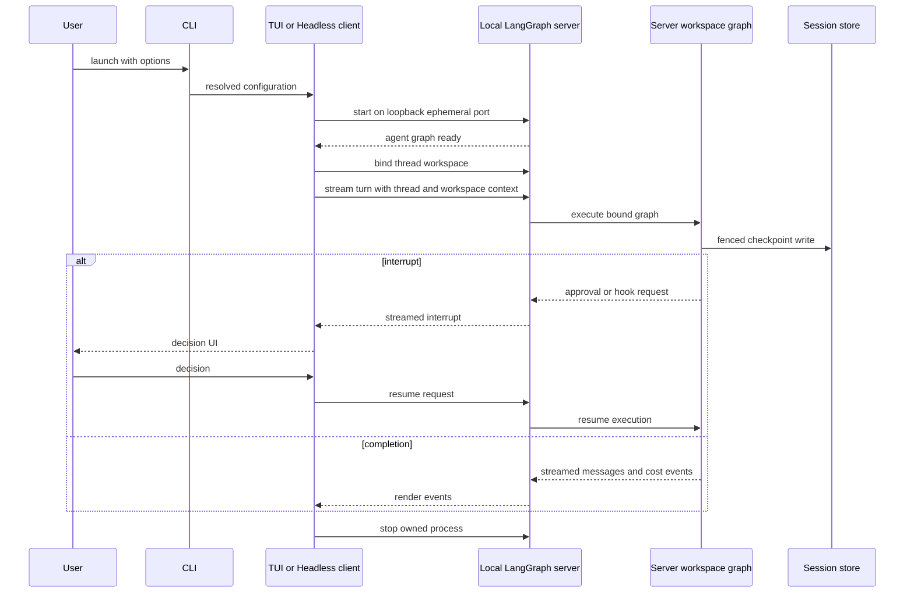
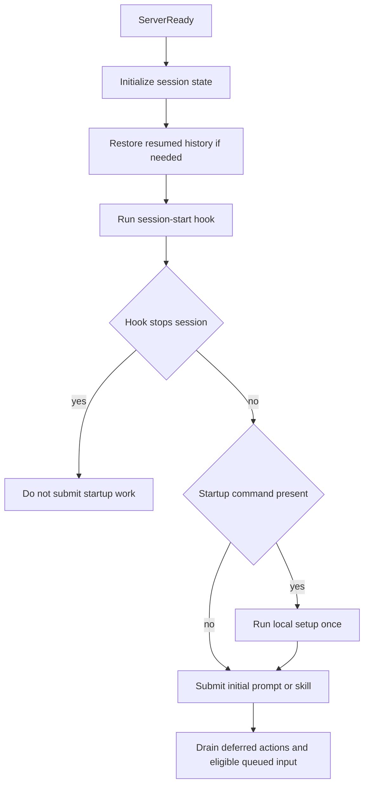
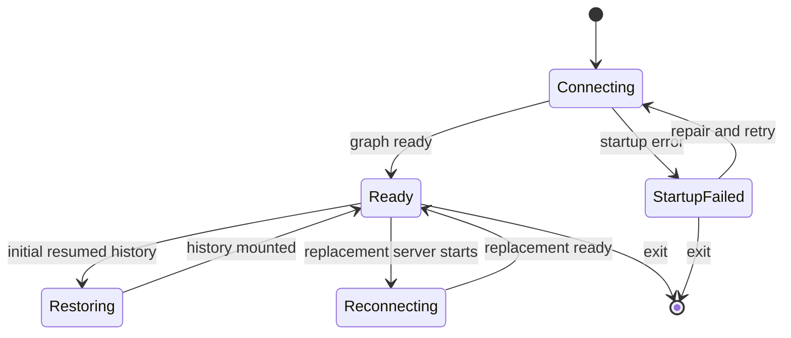

# Run a dcode Session

`dcode` has three execution surfaces: the default Textual UI, one-task headless execution (`-n`), and an ACP server over standard input/output (`--acp`). Interactive and headless modes launch a local LangGraph runtime and use `RemoteAgent` over HTTP/SSE; ACP constructs its session graphs in-process and serves an editor over stdio. See [code agent architecture](../architecture/code-agent.md), [configuration layering](../concepts/config-layering.md), [permissions and human-in-the-loop](../concepts/permissions-hitl.md), and [costs and sessions](../operations/cost-and-sessions.md).

## Choose an execution mode

```bash
# Interactive Textual UI
dcode -M anthropic:claude-sonnet-4-5

# One bounded task for automation
dcode -n "run the focused tests" --max-turns 8 --timeout 600

# Agent Client Protocol service over stdin/stdout
dcode --acp
```

Use the TUI when a person must review actions, select or resume a thread, or continue a conversation. Use `-n` for one autonomous task: its prompt directs the agent to make reasonable safe assumptions rather than request follow-up. Shell execution is disabled by default; `--shell-allow-list recommended`, an explicit list, or `all` enables it. Other tools are automatically approved in headless mode. `-q` reserves stdout for response text and sends status, tool notices, and errors to stderr; `--no-stream` buffers the response.

`-M/--model` provider-detects the model. `--model-params` overrides configured model values, `--max-retries` overrides `[retries]` (`0` disables retry), and `--summarization-model` can select a distinct compaction model. `--allow-fs-tools` controls filesystem tools exposed to the agent; omitting `execute` removes shell access even when shell is otherwise enabled. `--sandbox` with no type uses `[sandboxes].default`; its default is `none`, so remote execution is never silently enabled.

> **Treat repository integration as executable code.** Project MCP servers, hook commands, and Python extensions require a deliberate trust decision. In particular, headless runs load project hooks only with `--trust-project-hooks`; project MCP is controlled separately by `--trust-project-mcp`; project extensions are experimental and require explicit trust. A sandbox can contain supported filesystem and shell backend operations, but it does not automatically contain MCP, web tools, or credentials held by the dcode process.

## Startup, server, and workspace binding



*The client owns UI, input, and rendering. The separate local server owns graph execution, tools, model calls, and checkpointed agent state; the client never invokes the workspace graph directly.*

The launch manager captures project context, preflights an explicit MCP file, derives `ServerConfig`, scaffolds a temporary runtime, starts `langgraph dev` on loopback port `0`, and waits for the `agent` graph. It then creates `RemoteAgent` and configures its explicit workspace claim. Startup is transactional: if graph readiness, agent construction, binding, or cancellation fails before handoff, the manager stops the owned server.

A workspace binding is not merely a client cwd. `RemoteAgent` caches the server-validated descriptor per thread and supplies it to graph streams and server operations. A workspace switch changes its active cwd and cache only after server acceptance. On streamed execution, `make_graph` requires a nonempty thread ID and workspace context and verifies the durable binding. Server policy or access-policy drift refuses a resumed execution rather than silently changing permissions. Runtime-only changes, such as model parameters, can rebuild a runtime while retaining the binding and checkpoints.

The generated local-server checkpointer uses an ownership fence: a thread lease has an OS-lock-backed token, and every checkpoint mutation validates both that token and a live reservation. This prevents a stale server from writing after client exit, release, or takeover.

## Ordered first work

`--startup-cmd CMD` is local setup, not an agent tool call. In headless mode it runs before thread creation and the server/agent loop. It restores user LangSmith environment values for its shell child, has a 60-second command limit, and warns rather than aborting for launch failure, timeout, or nonzero exit. Cancellation terminates the child process or process group and propagates cancellation. In quiet mode its diagnostics go to stderr, preserving stdout for the response.

In the TUI, the post-connect sequence initializes session state, restores resumed history where required, runs the session-start hook, then runs the one-shot startup command before initial work. Startup-command output is rendered as local app output rather than model context. A nonzero exit or a failure to schedule its worker is reported but does not stop the session.



*The TUI serializes its first-session work. A reconnect does not bulk-load history or rerun this initialization; it can instead drain remaining work.*

## Approvals, Auto, and containment

Manual interactive sessions normally route gated tool calls through human approval. Agent construction installs approval middleware only when global auto-approval and restrictive-shell headless handling have not disabled it. A restrictive shell allow-list validates shell commands inline; it is not a general sandbox or a replacement for filesystem permission enforcement.

`-y/--auto-approve` selects classifier-backed **Auto** only for the local TUI or ACP. Auto replaces ordinary HITL only for eligible local graphs. A sandbox-backed graph resolves to Manual HITL, and an unavailable configured classifier fails closed for the initial batch rather than silently falling back to the main agent model. `--yolo` removes review only after its local risk acknowledgement; both flags are ignored with a warning in headless mode.

The first interactive enable of Auto is deliberately a modal transition, not a cosmetic toast. Before Auto is active, the notice explains that routine gated actions may proceed, names the classifier and whether it is separate from the coding model, and explicitly says Auto is not a sandbox. Enter confirms; Esc, programmatic dismissal, a failed modal push, a failed notice save, or a failed live-mode write leave the session in its prior mode. A versioned, install-local acknowledgement suppresses the notice on later enables.

Tool approval, tool visibility, filesystem permissions, and backend containment are separate controls. The explicit filesystem allow-list is injected into synchronous subagents as well as the main agent; otherwise delegated `task` work could bypass it. For policy detail, see [permissions and human-in-the-loop](../concepts/permissions-hitl.md).

Model retry wraps only the model node. A transient failure can retry the model handler with backoff and visible attempt/retry events without replaying completed tool calls, summaries, or archive writes. Clients consume those events to reconcile partial streamed output.

## Textual readiness, status, and recovery



*The connection indicator is client-owned UI state. “Resuming” covers only the initial history-restoration interval, not server-side graph execution or every reconnect.*

On the initial resume connection, `ServerReady` latches `_resuming` into `_restoring_resumed_history` before clearing connection state. The status bar therefore remains in “Resuming” until history restoration completes; reconnects do not re-arm it or repeat initial session setup. `ServerReady` installs the remote client/server state, refreshes MCP and model presentation, schedules serialized session start, and may drain deferred actions.

The `StatusBar` owns connection progress and the queue count, using a shared glyph-aware spinner for connecting, reconnecting, resuming, and local busy work. It also owns the three-state Manual/Auto/YOLO badge. Its model and reasoning-effort spans are independent click targets, so a user can open the matching picker; model display progressively drops the provider and then left-truncates the model while preserving an effort suffix where possible. The status message has explicit source ownership: a hook message temporarily outranks, but does not erase, an agent message.

A terminal server-start failure clears connection and resume flags while retaining formatted recovery information. `/install`, `/reload`, and `/update` bypass the command queue after such failure only when no agent, shell, or modal command is active. Static slash commands are declared in `COMMANDS`; the registry derives aliases, queue-bypass sets, and autocomplete entries, omitting experimental commands unless experimental mode is enabled.

Prompt-cache expiry is checked once per second. The TUI warns once in the final retention window and—only when `warnings.cache_prompt = "expiry"` and the application is idle—offers a handoff. An interactive post-expiry message can hand off, send, or cancel; handoff and cancellation preserve the draft. Handoff seeds a child thread without destroying the original conversation.

## Context offload and durable threads

Context compaction is server-owned because it operates on checkpointed history using the same backend and hooks as the graph. `RemoteAgent` first idempotently registers the HTTP-side thread, sends workspace and ownership context, and resumes hook interrupts using one operation ID. If local cancellation occurs, it waits for terminal server acknowledgement before propagating cancellation, preventing an apparently cancelled client from leaving a still-mutating operation behind.

Threads are checkpoint-backed records in the sessions SQLite store. Durable names are separate from checkpoint revisions, validated as trimmed printable one-line values of 1–50 characters, and preferred over legacy checkpoint metadata in listings. `/threads` may show cached rows before disk reload, supports cwd and all-directory scopes, and treats durable-name changes as a refresh difference.

Thread selection validates ownership before dismissing the modal. Selecting an occupied thread leaves the selector, filter, and selected row intact and does not load history or replace the active thread. Bare `-r` tries candidates by recency and skips occupied ones; an explicit occupied ID fails rather than unexpectedly choosing another conversation. `@@` completion searches saved name, thread ID, initial prompt, agent, branch, and cwd; it displays a saved name when available but inserts a stable ID-only `@@(thread:...)` reference.

For trusted local offline inspection, use the built-in skill rather than decoding checkpoint blobs manually:

```bash
python3 "$SKILL_DIR/scripts/inspect_sessions.py" THREAD_ID --mode latest-turn
python3 "$SKILL_DIR/scripts/inspect_sessions.py" THREAD_ID --mode summary
python3 "$SKILL_DIR/scripts/inspect_sessions.py" --list 20
```

This path is read-only. Report reconstruction warnings and truncation, and do not disclose unrelated secrets, personal data, or hidden reasoning.

## ACP boundary

`--acp` selects an ACP server over stdio rather than the Textual UI. It does not start the normal loopback `RemoteAgent` client path: the dcode process creates the graph factory, checkpointer, ACP adapter, and protocol runner in-process. ACP has its own session lifecycle and approval-choice projection. `--model-params` and `--max-retries` retain their CLI-over-configuration override behavior in this mode.

## Focused validation

Run tests from `libs/code`, beginning with the boundary changed:

```bash
make test TEST_FILE=tests/unit_tests/test_main_args.py
make test TEST_FILE=tests/unit_tests/test_non_interactive.py
make test TEST_FILE=tests/unit_tests/test_app.py
make test TEST_FILE=tests/unit_tests/test_server_manager.py
make test TEST_FILE=tests/unit_tests/test_server_graph.py
make test TEST_FILE=tests/unit_tests/test_thread_ownership.py
make test TEST_FILE=tests/unit_tests/tui/widgets/test_status.py
make check
```

For startup changes, cover history, hooks, startup-command, initial-submission, and queue ordering; continuation after a command failure; cancellation cleanup; and one-shot behavior across reconnect. For UI changes, use `textual.pilot` to exercise the actual modal and click path: Auto must not activate before confirmation, and status-bar picker clicks must not bubble to the app’s chat-input refocus handler. For lifecycle changes, cover cancellation-safe server cleanup, workspace binding and policy drift, fenced checkpoint writes, and explicit versus most-recent occupied-thread resume behavior.
