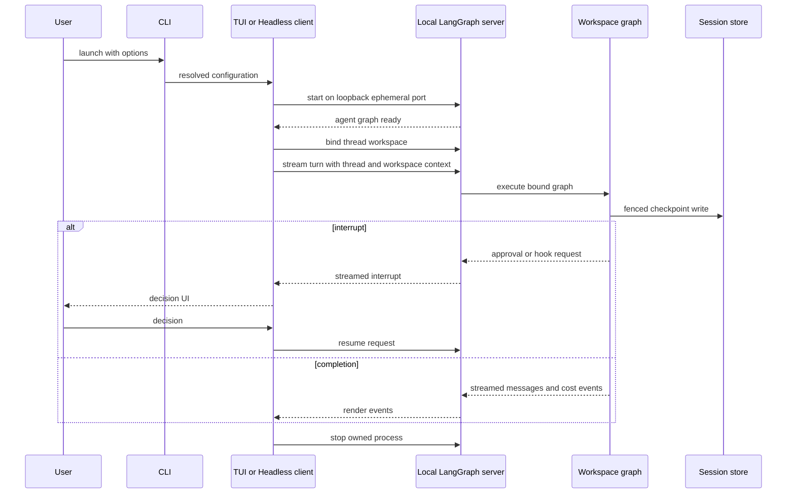
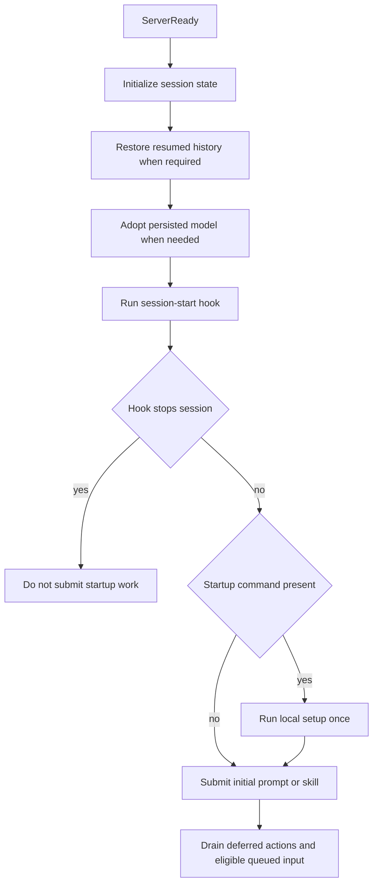

# Run a dcode Session

`dcode` has three execution surfaces: the default Textual UI, one-task headless execution (`-n`), and an ACP server over standard input/output (`--acp`). Interactive and headless modes launch a local LangGraph runtime and use `RemoteAgent` over HTTP/SSE; ACP constructs its session graphs in-process and serves an editor over stdio. See [code agent architecture](../architecture/code-agent.md), [configuration layering](../concepts/config-layering.md), [permissions and human-in-the-loop](../concepts/permissions-hitl.md), [sandbox partners](../integrations/sandbox-partners.md), and [costs and sessions](../operations/cost-and-sessions.md).

## Choose an execution mode

```bash
# Interactive Textual UI
dcode -M anthropic:claude-sonnet-4-5

# One bounded task for automation
dcode -n "run the focused tests" --max-turns 8 --timeout 600

# Agent Client Protocol service over stdin/stdout
dcode --acp
```

Use the TUI when a person must review actions, select or resume a thread, or continue a conversation. Use `-n` for one autonomous task. Shell execution is disabled by default in headless mode; `--shell-allow-list recommended`, an explicit list, or `all` enables it. `-q` reserves stdout for response text and sends status and diagnostics to stderr; `--no-stream` buffers the response.

`-M/--model` provider-detects the model. `--model-params` overrides configured model values, and `--max-retries` overrides `[retries]` (`0` disables retry). `--allow-fs-tools` controls filesystem tools exposed to the agent; omitting `execute` removes shell access even when shell is otherwise enabled. `--sandbox` with no type uses `[sandboxes].default`; its default is `none`, so remote execution is never silently enabled.

> **Treat repository integration as executable code.** Project MCP servers, hook commands, and Python extensions require a deliberate trust decision. In particular, headless runs load project hooks only with `--trust-project-hooks`; project MCP is controlled separately by `--trust-project-mcp`; project extensions are experimental and require explicit trust. A sandbox can contain supported filesystem and shell backend operations, but it does not automatically contain MCP, web tools, or credentials held by the dcode process.

## Startup, graph execution, and workspace binding



*The client owns input and rendering; the local server owns graph execution, tools, model calls, and checkpointed state.*

The launch manager captures project context, preflights an explicit MCP file, derives `ServerConfig`, scaffolds a temporary runtime, starts `langgraph dev` on loopback port `0`, and waits for the `agent` graph. It creates `RemoteAgent`, sets its explicit workspace claim, and cleans up the server on readiness, construction, binding, or cancellation failure before handoff.

A workspace binding is not merely a client cwd. `RemoteAgent` caches the server-validated descriptor per thread and changes its active cwd/cache only after the server accepts a switch. For streamed execution, `make_graph` requires a nonempty thread ID and workspace context, verifies the durable binding, then selects a runtime by binding identity and current runtime fingerprint. Access-policy drift refuses a resumed execution; runtime-only changes can rebuild the graph while retaining the binding and checkpoints. A generated local-server checkpointer also fences each mutation with an OS-lock-backed ownership token and a live reservation, so a stale server cannot write after release or takeover.

Interpreter policy is resolved as one configuration snapshot when an agent is built. Invocation-scoped PTC values are honored only when they originate at CLI rank; lower-ranked policy clears those overrides, while an explicitly acknowledged unsafe setting is combined with the resolved acknowledgement. The resulting interpreter values are included in the durable workspace policy, making a policy change a binding-compatibility concern rather than a hidden client-side toggle.

## Ordered initial work and safe resume



*The TUI serializes its first-session work; a later `ServerReady` does not mount the active history a second time.*

The background TUI startup resolves any requested resume and reserves its thread before server launch. On `ServerReady`, it latches the initial `_resuming` state into `_restoring_resumed_history` before clearing connection state, installs the server and client state, refreshes MCP/model presentation, and schedules the serialized startup sequence. Reconnects do not re-arm the resume indicator or redo first-session setup.

That sequence initializes state, conditionally restores history, optionally adopts the persisted thread model, runs the session-start hook, runs `--startup-cmd` once, optionally compacts after resume, submits the initial prompt or skill, then drains deferred actions and eligible queued input. The resume indicator clears after the history stage even if subsequent local setup is slow. A failure in the sequence is surfaced as a startup error rather than silently leaving an empty transcript.

`--startup-cmd CMD` is local setup, not an agent tool call. In headless mode it runs before thread creation and agent startup, restores user LangSmith environment values for its shell child, warns rather than aborting for launch failure, timeout, or nonzero exit, and propagates cancellation after terminating the child. In the TUI it runs after history restoration and the session-start hook but before first submission; output stays local app output rather than model context, and failure continues the session.

Resume restores workspace before attempting model adoption. If workspace restoration conflicts, dcode reports that failure without trying the model endpoint or changing the fallback model. If the workspace succeeds but model initialization fails, the selected fallback remains active and the UI reports that fact without exposing server diagnostic secrets.

## Commands, autocomplete, and Textual continuations

Keep static slash-command metadata in `COMMANDS` in `command_registry.py`. Each definition supplies its name, description, aliases, argument hint, fuzzy-only keywords, experimental flag, and queue-bypass tier. The registry derives bypass sets—including aliases—and autocomplete entries; do not duplicate classification in the input widget or application dispatch. Experimental entries are withheld until experimental mode is enabled. `ChatInput` builds its slash controller and argument hints from that registry alongside thread and file completion controllers.

Queue tiers are behavioral contracts: `ALWAYS` can run while busy, `CONNECTING` only during initial connection, `IMMEDIATE_UI` opens UI while its actual work is deferred, `SIDE_EFFECT_FREE` performs its local effect immediately while deferring chat output, and `QUEUED` waits for idle. `/install`, `/reload`, and `/update` remain normally queued; after terminal server-start failure they can bypass only when no agent, shell, or modal command is active, providing recovery without swapping the running environment mid-turn.

Modal continuations **must not be awaited in Textual's app message pump**. A command handler that awaits a confirmation modal prevents Enter/Esc from reaching that modal and appears frozen. Use `_schedule_off_message_pump` for a continuation that opens a modal: it creates a tracked task, admits only one global continuation, retains busy state until completion, and requires the detached flow to handle its own errors and cancellation. Cache-expiry confirmation uses this same pattern.

`@@` thread completion searches durable name together with thread ID, initial prompt, agent, branch, and cwd. It preferentially displays the saved name but inserts a stable ID-only `@@(thread:...)` token.

## Retry, cache expiry, and handoff

Model retry wraps only the model node, not the whole agent turn, so a transient failure can retry with backoff without replaying completed tool calls. The middleware owns transient-error classification, retry delay policy, attempt lifecycle events, and visible retry status. A runtime model switch can supply its own provider-specific retry budget per request. Clients validate and consume attempt/retry events to mark partial output as incomplete and reconcile accounting.

Prompt-cache expiry has two deliberately separate behaviors:

1. A one-second timer sends a once-per-window warning during the final retention window, subject to reconciliation, thread-switch, and exit guards. This is a notification; it does **not** change thread state or open a blocking prompt.
2. After expiry, the same timer may offer a handoff only when the application is genuinely idle, `warnings.cache_prompt = "expiry"`, and cost/opt-out policy permits it. It will not interrupt an agent turn, shell work, queued work, startup, typing, connection work, or another modal.

For an already submitted interactive message, the expiry continuation offers **handoff**, **send**, or **cancel**. Only explicit **send** dispatches the message. Handoff and cancellation preserve the draft; handoff summarizes into a newly seeded child thread while leaving the source conversation intact. The handoff captures source cwd, agent, and model context before awaits, reserves the child before switching, and releases it if it does not become active. This is user-directed recovery, not an automatic state-changing action.

## Durable threads and approvals

Threads are checkpoint-backed records in the sessions SQLite store. Durable names are independent of checkpoint revisions, validated as trimmed printable one-line values of 1–50 characters, and preferred in listings. `/threads` can render cached rows before disk reload, supports cwd or all-directory scope, and treats changed durable names as a refresh difference. Selection validates ownership before dismissing the modal: an occupied selected thread leaves the selector open and preserves its filter and row. Bare `-r` tries candidates in recency order and skips occupied threads; an explicit occupied ID fails rather than choosing a different conversation.

Manual interactive sessions normally route gated tool calls through human approval. Classifier-backed Auto applies only to eligible local graphs; sandbox-backed construction uses Manual HITL, and an unavailable configured classifier fails closed for an initial batch. The first interactive switch to Auto requires an acknowledged modal and persists that acknowledgement only after confirmation. Filesystem allowlists are passed to synchronous subagents as well as the main agent, preventing delegated bypass. See [permissions and human-in-the-loop](../concepts/permissions-hitl.md).

## ACP and focused validation

`--acp` selects an ACP server over stdio rather than the Textual UI. `--model-params` and `--max-retries` retain their CLI-over-configuration behavior. In the normal local path, status presentation remains client-owned: the status bar renders connection, queue, approval mode, runtime status, and session metrics; connection/busy use one spinner, hook status temporarily outranks agent status without discarding it, and model and effort labels are separate picker targets.

Run focused tests from `libs/code` before the wider suite:

```bash
make test TEST_FILE=tests/unit_tests/test_app.py
make test TEST_FILE=tests/unit_tests/test_cache_expiry.py
make test TEST_FILE=tests/unit_tests/test_resume_workspace_errors.py
make test TEST_FILE=tests/unit_tests/tui/widgets/test_autocomplete.py
make test TEST_FILE=tests/unit_tests/test_thread_ownership.py
make check
```

For startup changes, cover resume ownership, history/hook/startup-command/initial-submission ordering, reconnect one-shot behavior, and server cleanup on cancellation. For workspace changes, cover policy drift separately from runtime-only rebuilds and verify that resume workspace errors do not attempt model adoption. For registry changes, test aliases, experimental filtering, bypass tiers, and popup insertion. For cache changes, use `textual.pilot` to prove that timer warnings are nonblocking, typing defers the modal, a submitted message needs an explicit choice, and draft/source-thread preservation holds across handoff failures.
