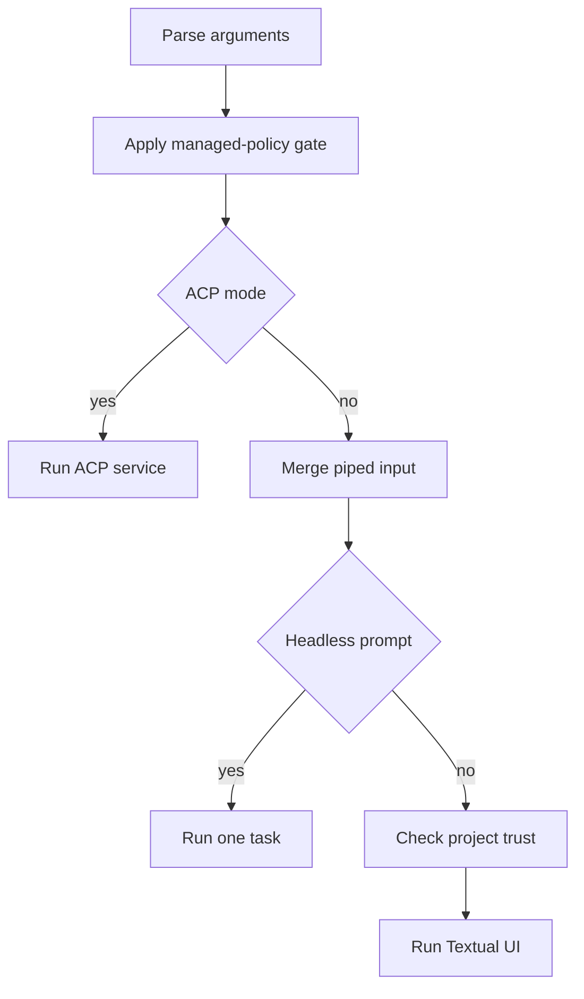
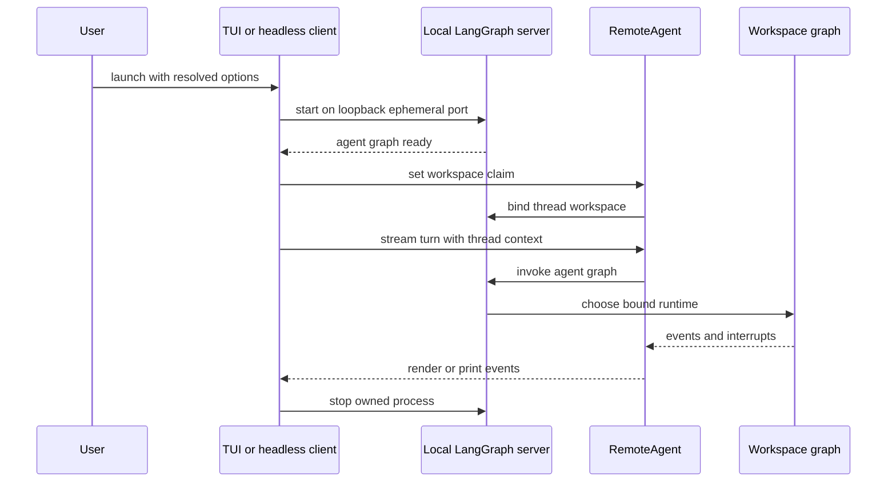
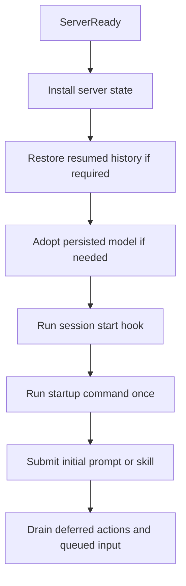

# Run a dcode Session

`dcode` has three execution surfaces: the interactive Textual UI, one-task headless execution (`-n` or piped input), and an ACP service (`--acp`). The UI and headless paths both own a temporary local LangGraph server and use `RemoteAgent` to invoke its `agent` graph; ACP runs its protocol server on standard input/output. See [code agent architecture](../architecture/code-agent.md), [configuration layering](../concepts/config-layering.md), [MCP](../integrations/mcp.md), [cost and sessions](../operations/cost-and-sessions.md), and [security](../operations/security.md).

## Choose the mode and shape input

```bash
# Interactive UI, with an initial prompt
 dcode -M anthropic:claude-sonnet-4-5 -m "review this repository"

# One bounded task
 dcode -n "run the focused tests" --max-turns 8 --timeout 600

# Headless task from standard input
 git diff | dcode --stdin --skill code-review -q

# Agent Client Protocol service
 dcode --acp
```

`cli_main` first parses arguments, dispatches lightweight commands where possible, requires enforceable managed configuration for remaining operations, then resolves model/profile/retry settings before selecting ACP, headless, or TUI execution. `--acp` is selected before stdin handling and avoids the Textual dependency check. For actual session launches, the headless predicate is a final nonempty `non_interactive_message`; therefore `-n` and most piped input use the same runner.

Piped text is trimmed and capped at 10 MiB. It is prepended to `-n` or `-m` text; a bare pipe becomes a headless prompt. A pipe plus `--skill` normally seeds the interactive UI, while explicit `--stdin` routes it to headless skill execution. An explicit `--stdin` without readable non-TTY input is an error rather than a silent empty task.

Use `-q` only for headless runs when a script needs response text on stdout: status, errors, tool activity, and the machine-readable `Thread: <id>` line go to stderr. `--no-stream` buffers response text until completion. `--max-turns`, `--timeout`, rubric options, `-q`, and `--no-stream` are rejected outside headless mode. A timeout exits 124; a turn/HITL iteration limit also uses 124, while Ctrl-C uses 130.



*CLI dispatch determines the mode after input normalization; ACP is a separate early branch.*

## Establish authority before starting code

Project configuration is executable authority, not passive metadata. Decide independently whether to trust project hooks, MCP, Python extensions, workspace policy, and a sandbox. Project-scoped MCP can start stdio or remote servers, sandbox setup executes in the sandbox, and extensions execute Python. A sandbox does not grant trust to MCP, hooks, extensions, or credentials held by the dcode process.

For an interactive launch, dcode asks for project MCP, hook, and extension trust before mounting the TUI; cancellation aborts the launch. Headless hooks are explicit opt-in (`--trust-project-hooks`), and project MCP/extension flags are passed into the server configuration. `--no-mcp` and `--mcp-config` are mutually exclusive. An explicit MCP config is validated before a server subprocess is created.

`--sandbox` without a value resolves `[sandboxes].default`; no flag means `none` and runs on the host. The provider must be registered and support any supplied sandbox ID or snapshot option. A managed default identifies the backend for a sandboxed invocation; it does not put an invocation that omitted `--sandbox` into a sandbox.

In headless mode, shell access is disabled unless `--shell-allow-list` enables it. A restrictive list is enforced through shell middleware; `all` permits unrestricted shell execution. Interactive approval flags do not provide headless approvals and are warned/ignored there. `--allow-fs-tools` independently controls filesystem middleware: omission and `all` retain the SDK default, while a restricted list must be recognized and include `read_file`.

## Bootstrap the local runtime and bind a workspace



*The client owns process lifetime; the server owns graph execution and durable workspace validation.*

Interactive and headless clients start a temporary, loopback LangGraph runtime on an ephemeral port, wait for the `agent` graph, construct `RemoteAgent`, and set the resolved workspace claim. Startup failure or cancellation before handoff stops the server. `server_session` encloses headless execution and always stops the server and cleans up any MCP session manager.

The subprocess server also has a POSIX parent-lifetime guard: EOF on an inherited pipe means its launching client has disappeared, so it terminates itself after dispatch. Ordinary stop is designed to be repeatable and escalates shutdown if necessary; debug-preserved log locations are queued and announced only after the terminal is usable.

A workspace is more than the UI cwd. `RemoteAgent` caches server-validated workspace descriptors per thread, requires a configured workspace before binding, and changes its active cwd/cache only after a successful switch. `make_graph` requires thread and workspace context, verifies the durable binding, and selects a runtime using binding identity and its runtime fingerprint. Access-policy drift is rejected; runtime-only drift can rebuild the graph.

The workspace payload divides authority: session fields are client claims for an invocation, while project fields (MCP configuration, sandbox setup, extension paths, and project trust) are resolved by the server for the target directory. Moving to a different or unresolvable project drops sensitive project-derived configuration and re-reads extension trust, so a grant from one checkout does not cross into another.

Interpreter options resolve together. Invocation-scoped PTC and unsafe acknowledgement overrides are rejected when lower-precedence policy supplies them; an effective acknowledgement can enable unsafe PTC. Effective PTC and acknowledgement are stored in the durable workspace policy, so unsafe or incompatible policy changes conflict on resume.

## Run a headless task and resume safely

Headless execution selects or creates its thread before `--startup-cmd`, so a bad `-r` request produces no startup-command side effect. A new run creates an ID; `-r <id>` checks existence, resume-age policy, and working directory, optionally adopts the saved agent unless `-a` was supplied, then reserves the thread before it starts the server. There is no fallback to a new thread. The reservation closes the delete race and prevents concurrent writers; deletion after initial lookup fails the run rather than silently creating or changing a thread.

The thread's stored directory must resolve to the current directory. Missing, malformed, or unavailable directories are rejected, and a real but different directory tells the user where to relaunch. Once connected, a resume normally adopts the saved model unless `-M` overrides it. Model resolution failure warns and continues with the launch model, but a workspace conflict aborts because it signals a durable policy mismatch. Resume also cannot be combined with `--rubric` in headless mode.

A headless run creates one turn identity, creates client hooks, derives shell/HITL behavior, builds stream configuration, starts the server, obtains server model metadata, and streams the task. It turns an initial skill into a server-resolved invocation envelope, so server-side skill resolution and trust remain authoritative. On successful completion it ends the hook session; stream cleanup commits a completed attempt or drops uncommitted transcript state after an aborted stream.

`--startup-cmd` is deliberately non-fatal and is not model context. It runs before server startup, restores user LangSmith values for its shell child, prints output locally, and warns on launch failure, timeout, or a nonzero exit. Cancellation terminates its child and propagates.

## TUI startup, streaming, and session operations



*First-connect initialization is serialized; a reconnect does not repeat one-shot session work.*

On initial resume connection, `ServerReady` latches `_resuming` into `_restoring_resumed_history` before clearing connection state, retaining resuming status through history restoration. It installs server state and schedules deferred-action draining. The TUI then restores history, runs session-start/startup work, submits the initial prompt or skill, and drains queued user work. Restore workspace before persisted-model adoption: a bind conflict blocks model restoration; an endpoint failure retains the fallback model without exposing server diagnostics.

In the TUI, `--startup-cmd` runs once after resumed history and the session-start hook but before initial submission and queue draining. Output is local application output, and command failure does not end the session.

Model retry wraps only the model node, so completed tool calls are not replayed. It classifies transient failures, controls backoff and visible retry status, and emits events that clients use to reconcile partial output. Prompt-cache expiry is checked once per second; the TUI warns once in its final retention window and, when configured, offers idle-only user-directed handoff that preserves the draft on handoff or cancellation.

## Commands and durable thread operations

Static slash commands are declared once in `COMMANDS`. The command registry derives aliases, queue-bypass sets, and autocomplete entries, omitting experimental commands unless enabled. `ChatInput` initializes completion and argument hints from the registry and can replace its list to add discovered skill commands; insertion uses the machine name to keep namespaced skills unambiguous.

`@@` completion searches durable thread name, ID, initial prompt, agent, branch, and cwd. It displays a saved name preferentially but inserts an ID-only `@@(thread:...)` token. `/threads -r [ID]` resolves a previous or explicit thread, gives near-match hints and expected-store retry handling, and uses separate transitions for cross-agent or remote-server targets.

Explicit `/rename NAME` persists immediately. Generated names are detached proposals: automatic naming is once per thread after its first response, captures its model settings at scheduling time, writes only unnamed threads, and discards stale proposals or waits behind modals so it cannot overwrite newer choices or steal input. Confirmation continuations likewise run outside Textual's message pump, where awaiting them would prevent Enter/Esc from reaching the modal.

## Focused validation

Run focused tests from `libs/code` before a broad suite:

```bash
make test TEST_FILE=tests/unit_tests/test_main_args.py
make test TEST_FILE=tests/unit_tests/test_headless_resume.py
make test TEST_FILE=tests/integration_tests/test_headless_resume.py
make test TEST_FILE=tests/unit_tests/test_interpreter_workspace_policy.py
make test TEST_FILE=tests/unit_tests/test_resume_workspace_errors.py
make test TEST_FILE=tests/unit_tests/test_thread_naming_app.py
make test TEST_FILE=tests/unit_tests/test_threads_resume.py
make test TEST_FILE=tests/unit_tests/tui/widgets/test_autocomplete.py
make check
```

For CLI changes, test mode selection after piped-input handling and reject headless-only options in the UI. For resume changes, cover missing IDs, age cutoff, cwd mismatch/unavailability, ownership contention, deletion during startup, policy conflicts, model override/adoption, and the invariant that failure never creates a new thread. For bootstrap changes, cover graph readiness, cancellation cleanup, parent-death cleanup, and normal context-manager teardown. For trust changes, prove that a declined or changed project cannot retain MCP, extension, sandbox, or hook authority from another directory.
