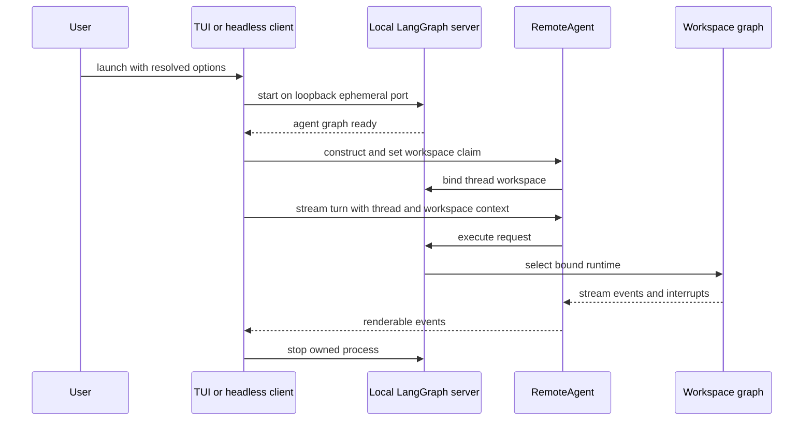
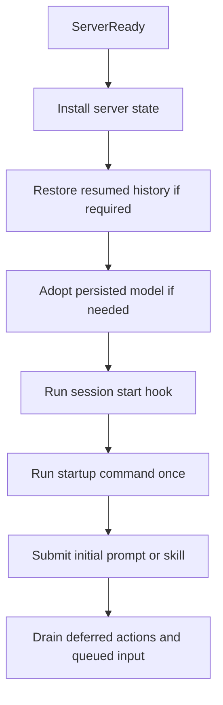

# Run a dcode Session

`dcode` provides a Textual UI, bounded headless execution (`-n`), and an ACP service (`--acp`). Interactive and headless clients launch a temporary local LangGraph runtime and communicate with it through `RemoteAgent`; ACP instead serves an editor through standard input/output. See [code agent architecture](../architecture/code-agent.md), [configuration layering](../concepts/config-layering.md), [permissions and human-in-the-loop](../concepts/permissions-hitl.md), [ACP](../integrations/acp.md), and [sandbox partners](../integrations/sandbox-partners.md).

## Select a launch mode and make trust choices

```bash
# Interactive Textual UI
dcode -M anthropic:claude-sonnet-4-5

# One bounded task
dcode -n "run the focused tests" --max-turns 8 --timeout 600

# Agent Client Protocol service
dcode --acp
```

Use the UI for conversation, approvals, thread selection, and resume. Use `-n` for a single automation task; its shell access is disabled by default, so opt in with `--shell-allow-list recommended`, an explicit list, or `all`. `-q` keeps stdout for response text and sends status/diagnostics to stderr; `--no-stream` buffers the response.

`--allow-fs-tools all` and an omitted flag both retain the SDK's full filesystem-tool default. A restricted comma-separated list is validated case-insensitively, must use known tool names, and must include `read_file`. Omitting `execute` from the filesystem tools removes that tool; this is distinct from deciding whether shell commands are enabled.

> **Project configuration is executable authority, not passive metadata.** Decide separately whether to trust project hooks, MCP, Python extensions, workspace policy, and a remote sandbox. In particular, project-scoped MCP can start stdio or remote servers, sandbox setup is code executed in the sandbox, and extensions execute Python. A sandbox is not a blanket trust grant for MCP, hooks, extensions, or credentials held by the dcode process.

`--sandbox` without a value resolves `[sandboxes].default`; no flag means `none` and runs on the host. The selected provider must exist in the sandbox registry, and snapshot/ID flags must be supported by that provider. Because the option has an optional argument, put a bare `--sandbox` last or name its provider explicitly. A managed default names the backend for a sandboxed launch; it does not force an omitted `--sandbox` launch into containment, and dcode emits a note when that could be misunderstood.

## Startup and workspace binding



*Interactive and headless launch owns the temporary runtime through startup and shutdown; the server owns graph execution and durable workspace validation.*

The launch manager starts an ephemeral-port runtime, waits for its `agent` graph, binds the resolved workspace, and tears down the server when startup is cancelled or fails before handoff. A workspace is more than the UI cwd: `RemoteAgent` caches server-validated descriptors by thread and changes its cwd/cache only after a successful workspace switch. Streamed `make_graph` requires both a thread ID and workspace context, checks the durable binding, and chooses a runtime using binding identity plus the current runtime fingerprint. Policy drift is refused; runtime-only changes may rebuild the graph.

The workspace payload deliberately divides authority. Session fields are values a managed client may claim for its own invocation. Project fields—MCP configuration, sandbox setup, extension paths, and the project MCP/extension trust choices—must be resolved by the server for the target directory rather than accepted from a client. Switching to a different or unresolvable project drops MCP and sandbox setup, clears project MCP trust, removes launch-supplied extensions, and re-reads extension trust; this fails closed rather than applying one checkout's grant to another.

Interpreter options are resolved together into one snapshot. Invocation PTC and unsafe acknowledgement overrides are discarded when lower-precedence policy supplies those settings; an effective acknowledgement can still enable unsafe PTC. The resolved interpreter PTC and acknowledgement enter the durable workspace policy, so a changed effective permission conflicts on resume. Explicit and omitted safe policy normalize compatibly, but unknown/different historical PTC, acknowledgement changes, and other policy changes are rejected.

## TUI startup ordering and resume failures



*First-connect initialization is serialized; reconnect does not restore the active transcript or run startup work again.*

On the initial resume connection, `ServerReady` latches `_resuming` into `_restoring_resumed_history` before clearing connection state, keeping the status in resuming state through history restoration; reconnects do not re-arm that indicator or repeat initial session setup. `ServerReady` also installs server state and schedules deferred-action draining. The resulting initialization sequence restores history, runs the optional startup command and initial prompt/skill, then processes queued work in order.

`--startup-cmd` is local setup, never model context. In headless mode it runs before thread creation and agent startup, restores user LangSmith environment values for the shell child, and warns rather than aborting on launch failure, timeout, or nonzero exit. Cancellation terminates the child and propagates. In the TUI, it runs once after history restoration and the session-start hook but before initial submission and queue draining; failure likewise leaves the session running.

Restore workspace before adopting the persisted model. A workspace-bind conflict is displayed as a workspace failure and prevents model restoration. If only the later model endpoint fails, dcode keeps the fallback model and reports it without leaking server diagnostic secrets.

## Commands, completions, threads, and modal work

Static slash commands are declared once in `COMMANDS`. The registry derives aliases, queue-bypass sets, and autocomplete entries, and suppresses experimental commands until experimental mode is enabled. `ChatInput` builds its slash controller and argument hints from that registry; the controller can subsequently replace that list to merge dynamically discovered skill commands. Completion searches command names, aliases, descriptions, and hidden keywords, but inserts the command machine name so namespaced plugin skills remain unambiguous.

After terminal server-start failure, `/install`, `/reload`, and `/update` can bypass the queue only while no agent, shell, or modal command is active; they otherwise retain their normal queued classification. Do not await confirmation modals directly in Textual's app message pump: doing so blocks Enter and Esc. `_schedule_off_message_pump` permits one tracked continuation, and that detached flow must own its errors and cancellation.

`@@` completion searches durable thread name, ID, initial prompt, agent, branch, and cwd. It displays the saved name where present but inserts the durable ID-only `@@(thread:...)` reference token.

Use `/threads` to open the selector. `/threads -r [ID]` resumes without it: bare `-r` first returns to the previous thread left by the session and then falls back to the most recent thread for the active agent; an explicit ID is resolved with its owner, with near-match hints when absent. Expected database/OS lookup failures ask the user to retry; unexpected failures are surfaced separately. A cross-agent target requires a transition flow; a remote session that cannot switch its server tells the user to relaunch with `dcode -r <thread-id>`.

`/rename NAME` persists an explicit name immediately, even while an agent or shell is busy. `/rename` without a name generates an editable proposal using a configured naming model or the selected chat model. Automatic naming runs at most once per thread after the first completed response, preserves the model parameters captured at scheduling time, and saves only if the thread remains unnamed. Generated proposals wait behind active modal screens and are discarded if their thread/name revision becomes stale, so they cannot steal input or overwrite a later choice.

## Retry and cache-expiry handoff

Model retry wraps only the model node, avoiding replay of completed tool calls; it owns transient-error classification, backoff, and visible retry status, while the clients consume attempt and retry events to reconcile partial output.

Prompt-cache expiry is checked once per second. The TUI warns once in the final retention window. When `warnings.cache_prompt` is `expiry`, it offers handoff only when idle; submitted interactive messages can hand off, send, or cancel while preserving the draft for handoff or cancellation. Handoff is therefore an explicit user recovery action, not an automatic switch.

## Focused validation

Run focused tests from `libs/code` before a broad suite:

```bash
make test TEST_FILE=tests/unit_tests/test_interpreter_workspace_policy.py
make test TEST_FILE=tests/unit_tests/test_resume_workspace_errors.py
make test TEST_FILE=tests/unit_tests/test_thread_naming_app.py
make test TEST_FILE=tests/unit_tests/test_threads_resume.py
make test TEST_FILE=tests/unit_tests/tui/widgets/test_thread_selector.py
make test TEST_FILE=tests/unit_tests/tui/widgets/test_autocomplete.py
make check
```

For a startup change, cover first-connect ordering, reconnect one-shot behavior, startup-command failure/cancellation, and cleanup. For workspace or interpreter changes, distinguish effective policy drift from runtime rebuild and verify that project policy cannot cross directories. For thread work, cover resume target lookup, ownership/cross-agent fallback, database errors, modal input isolation, stale naming proposals, and automatic-name races. For command changes, cover aliases, experimental filtering, completion insertion, and recovery bypass. For cache/retry changes, prove idle gating, explicit user choice, draft preservation, and no replay of completed tools.
