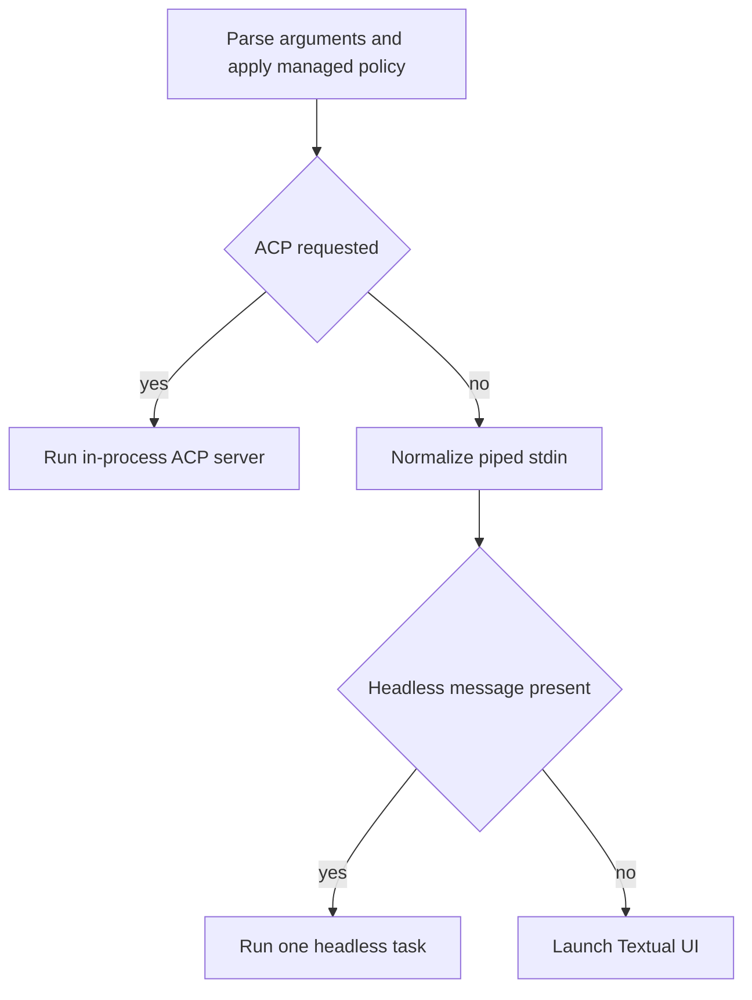
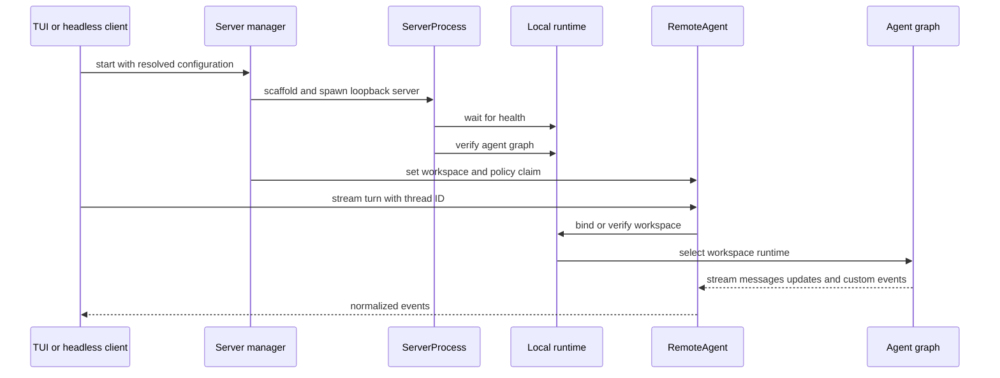
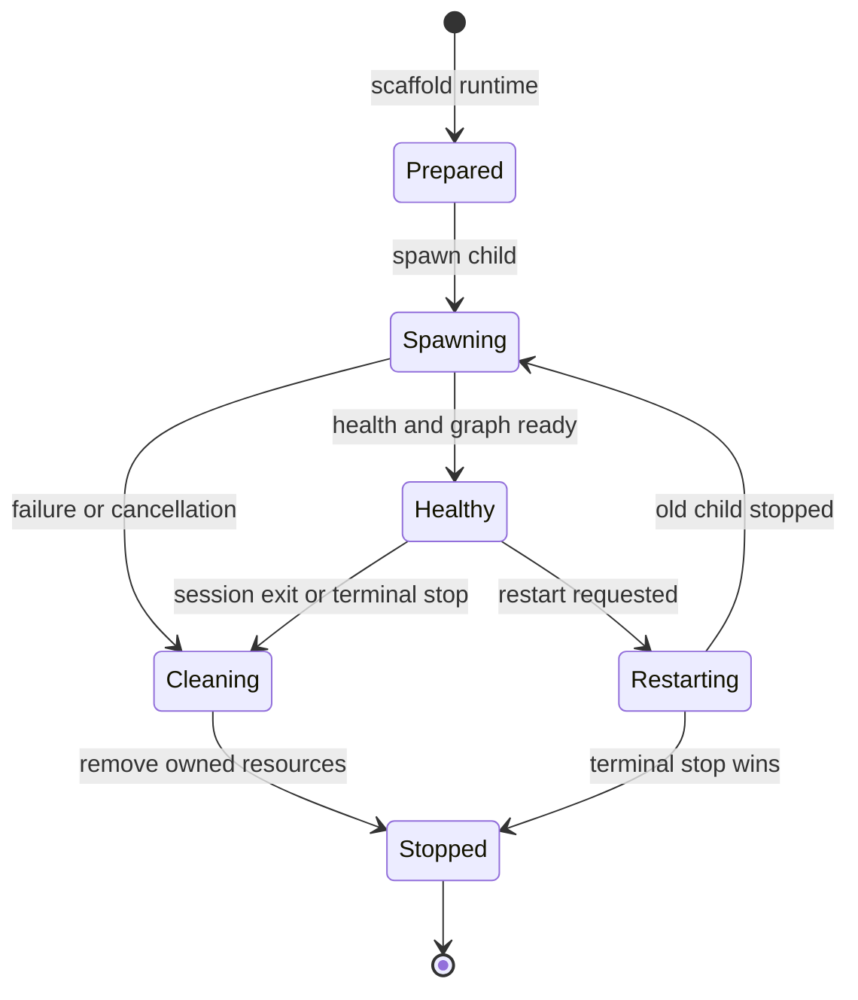

# Run a dcode Session

`dcode` has three execution surfaces: the interactive Textual UI, a single-task headless run, and ACP. Interactive and headless execution start an app-owned loopback LangGraph server and use `RemoteAgent` to access its `agent` graph; ACP takes an early in-process protocol path instead. The server, rather than the client, is authoritative for durable thread-to-workspace binding and runtime selection. See [code agent architecture](../architecture/code-agent.md), [configuration layering](../concepts/config-layering.md), [permissions and HITL](../concepts/permissions-hitl.md), [state persistence](../concepts/state-persistence.md), and [ACP](../integrations/acp.md).

## Choose the execution surface

```bash
# Interactive UI, optionally with an initial prompt
dcode -M anthropic:claude-sonnet-4-5 -m "review this repository"

# One bounded headless task
dcode -n "run the focused tests" --max-turns 8 --timeout 600

# Explicit stdin becomes a headless task
git diff | dcode --stdin --skill code-review -q

# Agent Client Protocol service
dcode --acp
```

`cli_main` parses and resolves policy before root-mode dispatch. `--acp` is selected **before** stdin is read; it checks ACP-specific approval semantics and then runs the ACP server. For non-ACP invocations, `apply_stdin_pipe` finalizes the prompt and a nonempty `non_interactive_message` chooses `run_non_interactive`; otherwise the Textual path is used.



*ACP bypasses stdin-based surface selection; stdin normalization distinguishes headless and interactive non-ACP launches.*

Operational implications:

- Headless-only controls such as `--max-turns`, `--timeout`, `--quiet`, `--no-stream`, and rubric options are rejected when no headless message is present. `--auto-classifier-model` is interactive-only; `--auto-approve` and `--yolo` are warned about and ignored in headless mode.
- `--no-mcp` and `--mcp-config` are mutually exclusive. An explicit MCP configuration is preflight-validated before spawning the server.
- Treat project configuration as executable authority. Project MCP can start processes, hooks can run commands, and extensions can execute Python. Headless project hooks require explicit `--trust-project-hooks`; project MCP and extensions have separate trust controls. A sandbox does not itself grant those trusts.
- In headless mode, shell access is controlled by `--shell-allow-list`: no list disables shell tools; a list gates shell commands while other tools are approved; `all` enables unrestricted shell access and approval. `-q` keeps agent response text on stdout and routes diagnostics to stderr.

## Start and hand off the local runtime

The TUI and headless runner call `start_server_and_get_agent` (headless through `server_session`). It captures project context, derives `ServerConfig`, creates an owned temporary runtime directory, scaffolds the `agent` graph, and spawns a loopback server. The manager waits for both HTTP health and `GET /assistants/agent/graph`; the latter makes lazy graph-factory failures visible before the client receives an agent. It then configures `RemoteAgent` with the current directory and a session workspace-policy claim.



*The client only receives the remote graph after health and `agent` graph readiness; execution subsequently carries a server-validated workspace descriptor.*

Startup is cancellation-safe at two layers. `ServerProcess.start()` serializes lifecycle work and reaps a child when spawning, its post-spawn gate, or health checking fails or is cancelled. `start_server_and_get_agent` also stops a process that was started but not handed off—for example when graph readiness, `RemoteAgent` construction, or workspace setup fails. `PrespawnedServer` permits the UI to overlap spawning with first paint, but an unadopted prespawn is cancelled and reaped. `server_session` owns the normal headless teardown.

The local runtime’s lifespan prebuilds the cached server runtime while clients poll for health. It also conditionally patches compatible in-memory run scheduling so inserting a run wakes a waiting consumer; the upstream polling fallback remains when that private API shape is unavailable. Runtime construction snapshots workspace environment outside the event loop and pins compatible tracing settings for the process lifetime.

## Bind a workspace before executing

A `RemoteAgent` cannot stream a thread until it has an explicit workspace. On first use it sends the configured cwd, session claim, and claim fingerprint to `/dcode/threads/{thread_id}/workspace`, then caches the returned descriptor by thread. Workspace switching updates the active cwd and cache only after the request succeeds; validation-only switches do not mutate client state.

The server canonicalizes the cwd and resolves project policy itself. Clients may claim only session-scoped policy and a matching fingerprint; project-scoped fields cannot be client-claimed. The server persists or verifies the binding, registers thread metadata, and constructs the selected runtime before returning success. A conflict is reported as HTTP 409, optionally with safe diagnostics.

Each graph execution requires both a nonempty thread ID and workspace context. The server compares that context with the durable binding, rejects identity or access-policy drift, and selects a runtime cached by workspace identity plus runtime fingerprint. Thus a permitted runtime-only change such as a model change can rebuild the runtime without discarding thread history, whereas changed approval, trust, tool, sandbox, or project policy fails closed. A process-wide sandbox cannot be shared by different workspaces, and incompatible LangSmith tracing settings also require separate server processes.

## Run, resume, and recover a headless turn

Headless execution creates or selects its thread before launching the local runtime. A fresh run gets a new ID. `-r <id>` never falls back to a new thread: it verifies the thread exists and passes resume-age policy, rejects a mismatched or unavailable persisted cwd, optionally adopts the saved agent and model, and reserves the thread before server startup. An explicit `-M` prevents saved-model adoption. If saved-model resolution fails, the run warns and continues with the launch model; a workspace conflict instead fails the resume.

`--startup-cmd` runs after valid thread selection and before agent startup. It is local shell work, not model context: output follows normal console routing, launch failures, timeouts, and nonzero exits warn without aborting, and cancellation terminates and reaps the command process.

The runner builds a one-turn stream configuration, starts `server_session`, reads model metadata, and streams `messages`, `updates`, and `custom` events with subgraphs. It renders response text incrementally by default, handles tool/HITL events, and keeps a request ledger across interrupt-resume passes so replayed chunks do not double-count usage. Headless mode cannot interactively approve untrusted skills: it returns a denial to the server.

Cancellation and recovery must respect remote execution. `RemoteAgent.acancel_active_runs()` best-effort cancels pending and running runs. If a recovery state write receives HTTP 409 because the server still considers the thread busy, the client cancels active runs with bounded waits and retries the write once. Ownership headers and server-side tokens fence stale writers, preventing an exited or replaced client from mutating the thread.

## Shutdown and restart behavior

`ServerProcess` serializes start, stop, and restart. Stop is idempotent and advances a terminal stop generation; a restart checks that generation after its old process is stopped, so terminal stop wins over a racing restart.



*Serialized lifecycle control ensures a cancelled start is reaped and prevents a restart from recreating a terminally stopped server.*

On POSIX, the server bootstrap uses an owner pipe and a dedicated process group. EOF before dispatch suppresses launch; EOF after dispatch causes termination and eventual escalation. Normal shutdown targets the dedicated group with `SIGTERM`, waits, then escalates to `SIGKILL`; it avoids signaling dcode’s own group. Windows attempts Ctrl+Break and then root-process termination, so descendant cleanup is necessarily weaker and possible orphan risks are logged.

## Focused validation

Run these focused unit tests from `libs/code` when changing this workflow:

```bash
make test TEST_FILE=tests/unit_tests/test_main.py
make test TEST_FILE=tests/unit_tests/test_main_args.py
make test TEST_FILE=tests/unit_tests/test_headless_resume.py
make test TEST_FILE=tests/unit_tests/test_non_interactive.py
make test TEST_FILE=tests/unit_tests/test_remote_client.py
make test TEST_FILE=tests/unit_tests/test_server_manager.py
make test TEST_FILE=tests/unit_tests/test_server_graph.py
make test TEST_FILE=tests/unit_tests/test_server.py
```

Cover ACP-before-stdin dispatch, piped stdin routing, headless-only argument rejection, and MCP preflight. For resume changes, cover missing/aged threads, cwd conflict, model adoption, and the invariant that failure never creates a replacement thread. For remote changes, cover workspace caching and rejection, ownership-header handoff, cancelling pending/running runs, and the single retry after a state-update conflict. For lifecycle changes, cover graph readiness after health, cancellation during startup, cleanup after failed handoff, owner-pipe behavior, and terminal-stop-versus-restart races.
