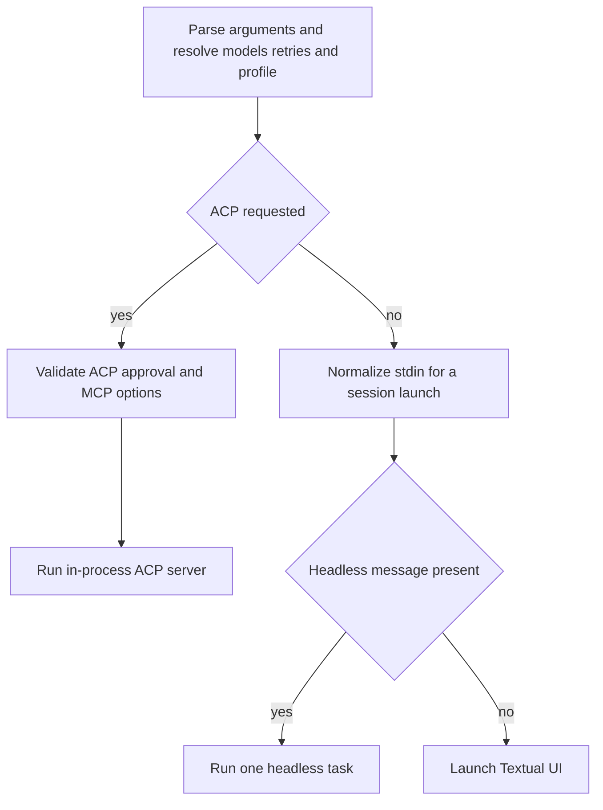
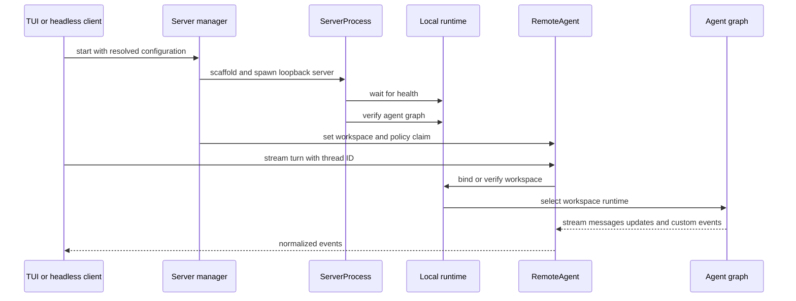
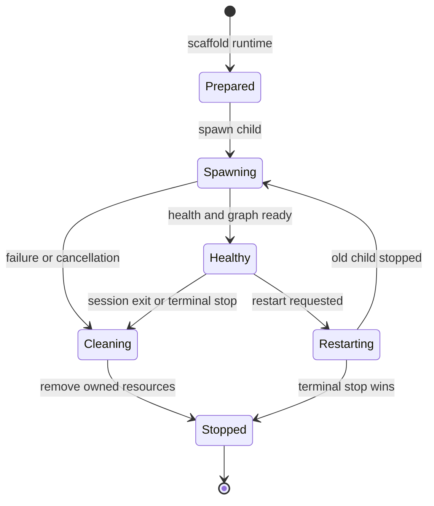

# Run a dcode Session

`dcode` has three session surfaces: the interactive Textual UI, a single-task headless run, and ACP. Interactive and headless execution use an app-owned loopback LangGraph server and `RemoteAgent`; ACP takes an earlier in-process protocol path. The server—not the client—is authoritative for durable thread-to-workspace binding and runtime selection. See [code agent architecture](../architecture/code-agent.md), [configuration layering](../concepts/config-layering.md), [context management](../concepts/context-management.md), and [ACP](../integrations/acp.md).

## Choose a surface and resolve launch configuration

```bash
# Interactive UI, optionally with an initial prompt
dcode -M anthropic:claude-sonnet-4-5 -m "review this repository"

# One bounded headless task
dcode -n "run the focused tests" --max-turns 8 --timeout 600

# Explicit stdin becomes a headless task
git diff | dcode --stdin --skill code-review -q

# Agent Client Protocol service
dcode --acp
```

Before mode dispatch, the CLI parses JSON `--model-params` and `--profile-override`, resolves the summarization model once, and collects retry configuration for the provider that the selected model will actually build. dcode owns the model retry budget: provider retry values supplied in `--model-params` are overridden and the CLI directs users to `--max-retries` or `[retries].max_retries` instead. The resolved summarization model, retry limit, and profile override are passed to the selected execution path rather than independently re-resolved per surface.

`--acp` is selected **before** stdin is read. ACP uses the resolved approval mode: YOLO requires a prior interactive acknowledgement, and `--auto-classifier-model` is valid there only in Auto mode. It also rejects the mutually exclusive `--no-mcp` and `--mcp-config` pair before entering the ACP server. Non-ACP session launches then normalize piped stdin; a final nonempty `non_interactive_message` selects headless execution, otherwise dcode launches the Textual UI.



*ACP bypasses stdin-based surface selection; non-ACP stdin normalization decides whether the session is headless or interactive.*

### Non-ACP argument boundaries

- `--max-turns`, `--timeout`, `--quiet`, `--no-stream`, and rubric options require a headless message. `--goal` is interactive-only and cannot be combined with a message or initial skill.
- `--auto-classifier-model` is rejected for headless runs and for sandboxed interactive runs. Explicit `--auto-approve` and `--yolo` in headless mode produce a warning and are ignored; headless shell access is instead governed by `--shell-allow-list` and MCP routing fails closed.
- `--no-mcp` and `--mcp-config` are mutually exclusive. The local-server launch manager preflight-validates an explicit MCP config before spawning a subprocess.
- An interactive launch may prompt about stale editable-install dependencies; headless mode reports the warning on stderr instead of blocking. ACP has already exited this branch.

## Start and hand off the local runtime

The TUI and headless runner call `start_server_and_get_agent` (headless through `server_session`). It captures project context, validates MCP configuration, derives `ServerConfig`, creates and scaffolds an owned temporary runtime directory, and starts a loopback `langgraph dev` subprocess. Port `0` selects an ephemeral free port; an explicitly requested busy port also falls back to one.

The manager waits first for HTTP health and then for `GET /assistants/agent/graph`. The graph request forces lazy graph construction, so missing credentials, provider packages, sandbox failures, and other marked startup failures are surfaced before handing a client an agent. Only after both gates pass does it construct `RemoteAgent` and set the cwd plus a session workspace-policy claim and fingerprint.



*The remote graph is handed to the client only after health and graph readiness; turns carry a server-validated workspace descriptor.*

Startup is cancellation-safe at both ownership layers. `ServerProcess.start()` serializes lifecycle work and reaps a child if spawn, its post-spawn gate, or health checking fails or is cancelled. `start_server_and_get_agent` also stops a server that started but was not handed off, including a graph-readiness or workspace-setup failure. `PrespawnedServer` can overlap spawning with first paint, but an unadopted prespawn is cancelled and reaped. `server_session` owns normal headless teardown.

The server child environment pins the launch profile and strips LangGraph cloud/auth variables and unsafe inherited carriers before applying permitted overrides. Persistent overrides must be app-owned server variables; scoped overrides are consumed by a restart. This keeps the server on the same profile and prevents a caller from injecting a different profile, carrier, or `PYTHONPATH` into the child.

## Runtime lifespan, workspace binding, and execution

At local-server startup, the lifespan conditionally patches a compatible in-memory run queue so an inserted run wakes a waiting scheduler instead of waiting for its polling interval; incompatible upstream shapes retain the normal fallback. It starts building the cached default runtime while the client polls for health. On shutdown it cancels and joins that prebuild, shuts down server extensions, and makes a bounded best-effort LangSmith trace flush.

Workspace runtimes snapshot workspace environment outside the event loop and pin compatible tracing settings for the process lifetime. Different LangSmith tracing settings cannot share this server process. Thread leases and ownership tokens fence stale checkpoint writers.

A `RemoteAgent` needs an explicit workspace before it can stream a thread. It sends the configured cwd, session claim, and claim fingerprint to `/dcode/threads/{thread_id}/workspace`, and caches the returned descriptor per thread. A successful workspace switch updates client state; validation-only requests do not.

The route canonicalizes the directory and resolves project policy on the server. Clients cannot claim project workspace policy, and a mismatched session claim or fingerprint is rejected. For a binding request, the server durably binds the thread, builds the selected runtime before replying, and mirrors thread metadata; workspace conflicts are HTTP 409. At graph execution, workspace context must agree with the durable binding. Compatible runtime changes can rebuild the runtime while preserving thread history, while identity or incompatible policy drift fails closed.

## Headless execution, resume, and offload recovery

Headless execution selects its thread before starting the local server. A fresh run uses a new ID. `-r <id>` never falls back to a new thread: it checks that the thread exists and satisfies resume-age policy, rejects mismatched or unavailable persisted directories, may adopt saved agent and model settings, and reserves the resumed thread before startup. An explicit `-M` prevents saved-model adoption; a saved-model resolution failure warns and continues with the launch model, while a workspace conflict fails the resume.

`--startup-cmd` is local pre-agent shell work, not model context. Its output uses normal console routing; launch errors, timeouts, and nonzero status warn without aborting the turn; cancellation terminates and reaps the command. The runner opens `server_session` and streams `messages`, `updates`, and `custom` events with subgraphs. It handles tool and HITL events and preserves a request ledger through interrupt/resume passes so replayed chunks do not double-count usage.

Remote cancellation is best effort for pending and running runs. If writing recovery state gets a 409 because the server still considers the thread busy, the client performs bounded cancellation waits and retries the write once. Ownership headers accompany remote requests and remove the incompatible configurable owner value.

## Shutdown, restart, and diagnostics

`ServerProcess` serializes asynchronous start and restart work, while a state lock protects synchronous teardown. Terminal `stop()` is idempotent, increments a stop generation, terminates the process, and removes owned runtime resources. A restart captures that generation before stopping its old process; if terminal shutdown wins meanwhile, the subsequent spawn is cancelled rather than resurrecting the server.



*Lifecycle serialization reaps a cancelled start and ensures a terminal stop wins over a racing restart.*

On POSIX, the bootstrap receives a parent-death pipe and launches the server in a dedicated process group. EOF before dispatch suppresses launch; EOF after dispatch sends termination and escalates after the grace period. Normal shutdown signals the dedicated group with `SIGTERM`, waits for the entire group, then escalates to `SIGKILL`; it refuses to signal dcode's own group. On Windows, shutdown first attempts Ctrl+Break and ultimately terminates the root process, so surviving descendants can be orphaned and are logged as such. With debug enabled, server logs are preserved and announced after the terminal is restored; otherwise log files are removed during teardown.

## Focused validation

Run focused tests from `libs/code` when changing this flow:

```bash
make test TEST_FILE=tests/unit_tests/test_main_args.py
make test TEST_FILE=tests/unit_tests/test_server.py
make test TEST_FILE=tests/unit_tests/test_headless_resume.py
make test TEST_FILE=tests/unit_tests/test_non_interactive.py
make test TEST_FILE=tests/unit_tests/test_remote_client.py
make test TEST_FILE=tests/unit_tests/test_server_manager.py
make test TEST_FILE=tests/unit_tests/test_server_graph.py
```

Cover resolution before mode dispatch, ACP-before-stdin behavior, ACP approval restrictions, piped-stdin routing, and headless-only argument failures. For startup changes, cover ephemeral/busy-port selection, health plus graph readiness, marked startup-error recovery, cancellation cleanup, and failed handoff. For workspace and offload changes, cover server-authoritative claim validation, 409 conflicts, cache/switch behavior, ownership headers, cancellation of pending/running runs, and the one recovery-write retry. For lifecycle changes, cover parent-pipe behavior, group termination, log handling, and terminal-stop-versus-restart races.
