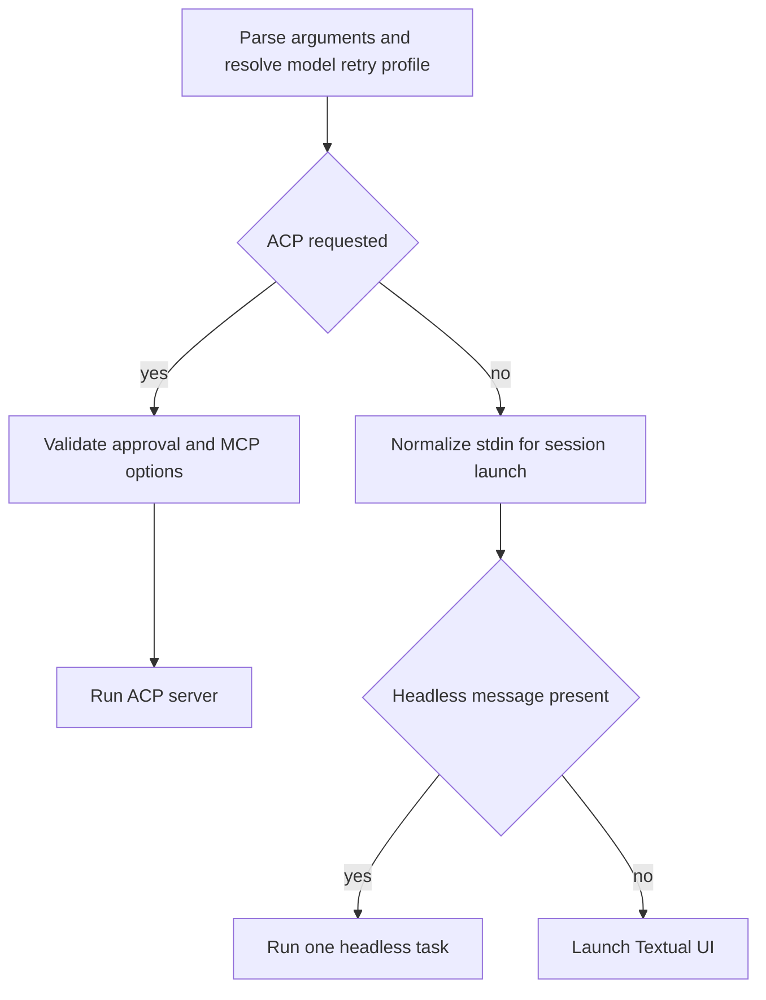
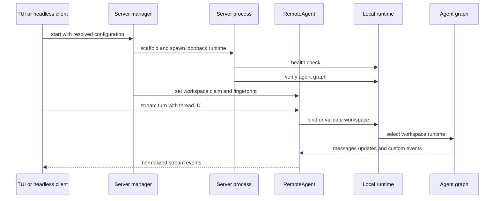
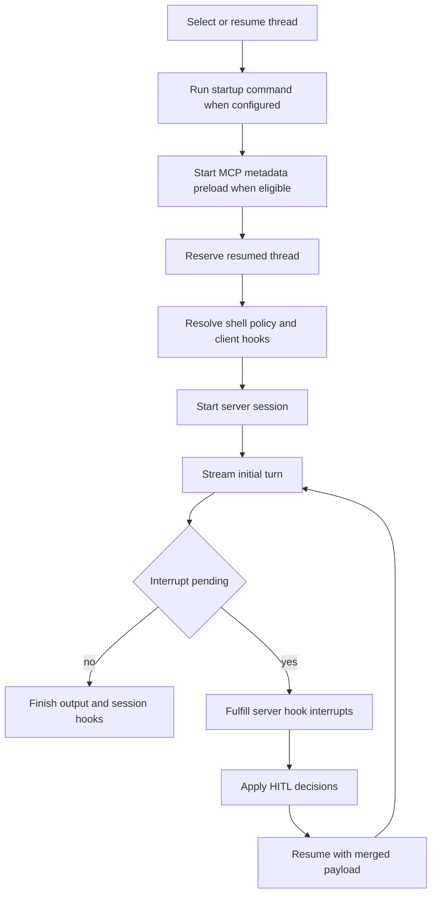

# Run a dcode Session

`dcode` has three execution surfaces: the interactive Textual UI, a one-task headless run, and ACP. Interactive and headless sessions use an app-owned loopback LangGraph server through `RemoteAgent`; ACP dispatches to its protocol server before stdin is considered. The server—not the client—authorizes a thread's durable workspace and selected runtime. See [code agent architecture](../architecture/code-agent.md), [hooks lifecycle](../concepts/hooks-lifecycle.md), [profiles and models](../concepts/profiles-models.md), [ACP](../integrations/acp.md), [MCP](../integrations/mcp.md), and [cost and sessions](../operations/cost-and-sessions.md).

## Choose the execution surface

```bash
# Interactive UI, optionally with an initial prompt
dcode -M anthropic:claude-sonnet-4-5 -m "review this repository"

# One bounded headless task
dcode -n "run the focused tests" --max-turns 8 --timeout 600

# Explicit stdin becomes a headless task
git diff | dcode --stdin --skill code-review -q

# Agent Client Protocol service
dcode --acp
```

Before dispatch, the CLI parses `--model-params` and `--profile-override`, resolves the summarization model once, and determines retry settings for the provider that will build the selected model. dcode owns the retry budget: provider retry parameters passed through `--model-params` are overridden, so use `--max-retries` or `[retries].max_retries` instead.

ACP is selected **before** stdin is processed. It resolves approval mode, requires a prior interactive acknowledgement for YOLO, accepts `--auto-classifier-model` only for Auto mode, and rejects the `--no-mcp` plus `--mcp-config` combination. For non-ACP session launches, stdin normalization determines the surface: a final nonempty `non_interactive_message` runs headless; otherwise dcode opens the TUI.



*ACP bypasses stdin-based mode selection; stdin only decides between the non-ACP surfaces.*

### Session-only argument rules

- `--max-turns`, `--timeout`, `--quiet`, `--no-stream`, and rubric options require a headless message. `--goal` is interactive-only and cannot be combined with an initial message or skill.
- `--auto-classifier-model` is rejected for headless runs and sandboxed interactive runs. An explicit `--auto-approve` or `--yolo` in headless mode is warned about and ignored.
- `--no-mcp` and `--mcp-config` are mutually exclusive. An explicit MCP configuration is preflight-validated before local-server spawn.
- Help-only and selected diagnostic paths avoid settings bootstrap and heavy runtime imports.

## Local runtime startup and workspace handoff

The TUI and headless runner enter `start_server_and_get_agent`—headless via `server_session`. It captures project context, validates explicit MCP input, derives `ServerConfig`, scaffolds an owned temporary runtime directory, and launches a loopback `langgraph dev` subprocess. The manager waits for HTTP health and then `GET /assistants/agent/graph`; the graph request forces lazy construction, so credential, provider, sandbox, and marked startup failures occur before an agent is handed to the caller.

Once both gates succeed, the manager creates `RemoteAgent` and assigns the cwd, workspace-policy claim, and fingerprint. On every streamed turn, `RemoteAgent` binds or verifies the thread through the workspace route, sends the returned descriptor as run context, and uses thread-ownership headers while removing an incompatible configurable owner value. The server canonicalizes the directory, refuses client assertions of project workspace policy, durably binds a new thread, builds or validates the selected runtime before replying, and returns workspace conflicts as HTTP 409.



*The graph is not exposed to a session client until both health and graph readiness succeed, and runtime selection is server-validated.*

Startup cleanup is cancellation-safe. `ServerProcess.start()` serializes lifecycle work and reaps a child if spawning, its post-spawn gate, or health checking fails or is cancelled. If graph readiness or workspace setup fails after startup, `start_server_and_get_agent` stops the unhanded server. `PrespawnedServer` may overlap child spawning with TUI first paint, but cancellation reaps an unadopted prespawn. `server_session` owns normal teardown and emits any preserved debug-log notice after stopping the server.

The server child environment pins the chosen profile and prevents persistent or scoped overrides from replacing the profile, inherited `PYTHONPATH`, or LangSmith carrier values. This preserves a consistent server configuration while keeping unsafe interpreter-path injection out of server startup.

## Headless lifecycle: policy, hooks, output, and status

A headless run first selects or validates its thread, then runs `--startup-cmd` if configured, starts optional MCP metadata preload, reserves a resumed thread, resolves approval policy, and enters `server_session`. It creates an agent with `interactive=False`, streams the initial prompt, and can issue further `Command(resume=...)` streams only to resolve interrupts.



*Headless execution performs local setup before server startup; hook and approval interruptions are folded into the next graph resume.*

### Approval policy and hook interruption

A headless run is deliberately non-interactive. Its actual approval behavior is derived from `--shell-allow-list`, not the ignored `--auto-approve` or `--yolo` flags:

- no allow-list disables shell access and auto-approves other tools;
- `recommended` or a concrete list enables shell access but interrupts only shell calls for allow-list enforcement;
- `all` enables unrestricted shell access and auto-approves all tools.

Permission-request hooks override those middleware shortcuts so gated calls reach the hook runtime. Project hooks require explicit invocation trust: persisted interactive hook trust does not enable project hooks in a headless run.

The client establishes one hook identity for the headless turn, starts the hook session before submitting the prompt, and can add hook-provided context or suppress the original prompt. A stop from session start or prompt submission ends the hook session and becomes an intentional headless stop. Server-owned lifecycle middleware is installed for the main agent and subagents. It gates events from the per-run hook snapshot, runs pre-tool hooks before downstream HITL routing, checkpoints post-tool work, and conveys `PreCompact`, pre/post-tool, `Stop`, and subagent lifecycle requests by LangGraph interrupt.

When the stream contains hook interrupts, the client validates the request snapshot, invokes the local handler, presents its decision, and returns a typed resume value. A session-scoped fulfillment ledger deduplicates concurrent or replayed deliveries by snapshot and invocation ID. The headless loop fulfills these pending hook interrupts before processing regular HITL decisions and merges both payloads into the next `Command(resume=...)`. This preserves server ownership of graph lifecycle while permitting client-side hook commands and policy decisions.

### Streaming, terminal status, and completion

`--quiet` routes status, headers, tool notices, HITL decisions, and errors to stderr so response text remains usable on stdout; it still emits the thread identifier for later resume. Normal streaming writes response chunks immediately. `--no-stream` buffers response text until completion, while reasoning stays on stderr and is not folded into the final response. In a non-quiet session, the runner records invocation statistics and, when enabled, prints a usage table with wall-clock duration; a completed background LangSmith thread-link lookup can also be shown without delaying completion.

Headless CLI dispatch reports an OSC 7501 `working` terminal record before calling the runner. It resolves `display.terminal_status` with a default of enabled and uses a reporter configured not to clear at process exit. In its `finally`, dispatch maps exit code 0 to `done`, known failure codes to `error` (including the turn budget or timeout at 124), and Ctrl-C at 130 or an unknown result to `clear`. Reporting is best-effort and cannot break the session. The interactive app instead tracks working, done, error, and permission/question blockers continuously and clears its record when it closes.

After a startup command has finished, a non-quiet MCP-enabled run starts a best-effort MCP metadata-preload task. It runs concurrently with thread reservation, policy setup, and server startup. Once the server session is ready, the runner awaits that task only to display the loaded-tool count; preload creation or completion errors are logged and do not prevent the task from running. Quiet or `--no-mcp` runs do not create this display-oriented preload.

The initial stream counts as turn 1 and each HITL resume consumes another turn. If `--max-turns` is omitted, an internal safety default bounds the loop. The runner checks the limit before another resume and returns exit code 124 when it is exhausted. On cancellation or error it ends the hook session, drains pending fire-and-forget hook tasks without replacing the selected exit code, and releases a resumed thread ownership lease.

`--startup-cmd` is local pre-agent shell work, not prompt context. After a resume target has passed lookup and directory checks (and before MCP preload, thread reservation, and local-server startup), the runner executes it. Its output follows normal console routing and it restores the project LangSmith environment for the child process; launch failure, a 60-second timeout, and nonzero exit warn but do not abort the task. Cancellation terminates and reaps it. Because reservation happens later, cancellation during this command leaves a resumed thread unreserved.

## Resume, failures, and shutdown

Headless execution chooses its thread before server startup. A new invocation generates a new ID. `-r <id>` never degrades to a new thread: it verifies existence and resume-age policy, rejects a mismatched or unavailable persisted directory, and reserves the existing thread before startup. It may adopt the saved agent and—unless `-M` was supplied—the saved model. If the saved model cannot be resolved, it warns and continues with the launch model; a workspace conflict remains fatal.

Remote cancellation is best effort for active runs. When a recovery-state write conflicts because the server still sees the thread as busy, the client cancels pending and running runs with bounded waits and retries that write once.

At local-server startup, the lifespan can patch a compatible in-memory run scheduler to wake on insertion and begins building the cached runtime while the client waits for health. Shutdown cancels that prebuild, shuts down extensions, and performs a bounded best-effort LangSmith trace flush. Workspace runtimes snapshot workspace environment and pin compatible tracing settings; thread leases and ownership tokens fence stale checkpoint writers.

`ServerProcess` serializes asynchronous start and restart actions, while a state lock protects synchronous teardown. Terminal `stop()` is idempotent and increments a stop generation. A restart captures that generation before stopping its old child; if a terminal stop wins the race, the replacement spawn is cancelled rather than recreating the server.

On POSIX, bootstrap uses a parent-death pipe and a dedicated process group. EOF before dispatch suppresses launch; EOF after dispatch triggers termination. Normal shutdown signals only that group with `SIGTERM`, waits, then escalates to `SIGKILL`, and refuses to signal dcode's own group. Windows attempts Ctrl+Break and finally terminates the root process, so descendants may survive and are reported. Debug mode preserves and announces server logs after terminal restoration; ordinary teardown removes them.

## Focused validation

Run focused tests from `libs/code` when modifying this workflow:

```bash
make test TEST_FILE=tests/unit_tests/test_main_args.py
make test TEST_FILE=tests/unit_tests/test_non_interactive.py
make test TEST_FILE=tests/unit_tests/test_headless_resume.py
make test TEST_FILE=tests/unit_tests/test_remote_client.py
make test TEST_FILE=tests/unit_tests/test_server_manager.py
make test TEST_FILE=tests/unit_tests/hooks/test_server_lifecycle.py
make test TEST_FILE=tests/unit_tests/test_app_program_status.py
make test TEST_FILE=tests/unit_tests/test_mcp_tools.py
```

Protect mode routing before stdin processing, headless-only argument errors, shell allow-list policy, quiet/no-stream routing, hook trust, hook-interrupt deduplication and resume ordering, HITL turn accounting, and exit code 124. Cover the OSC 7501 headless transition from `working` to final `done`, `error`, or `clear`, and the TUI's working/blocked/outcome transitions. For startup changes, cover the order of resume validation, `--startup-cmd`, MCP preload, reservation, and server launch—especially cancellation before a lease is acquired. For server and hook changes, cover health plus graph readiness, hook execution across main and subagent tool calls, resumable post-tool lifecycle, and cancellation cleanup. For MCP hook changes, retain original server/tool identity through routed names and ensure a headless guard cannot bypass a hook decision.
