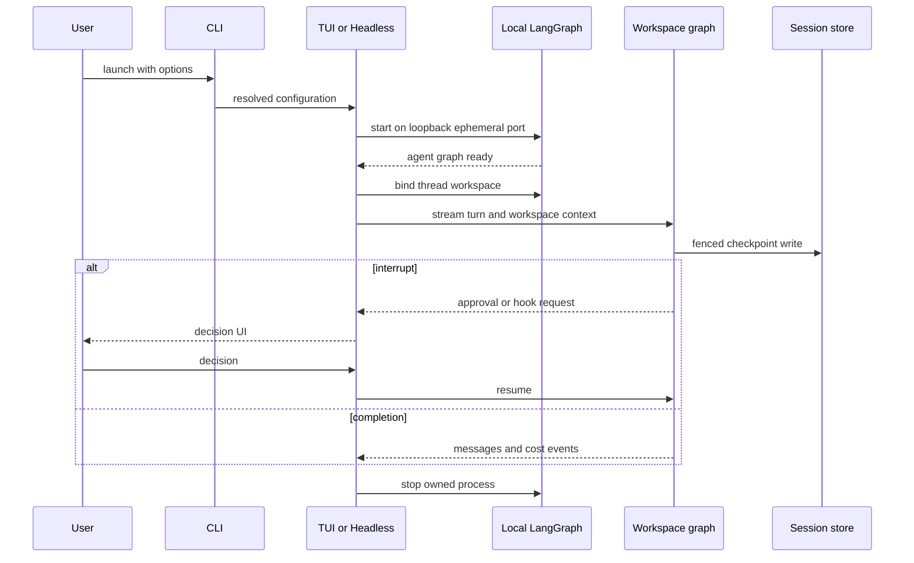
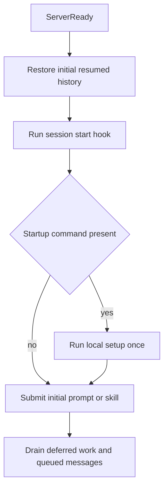
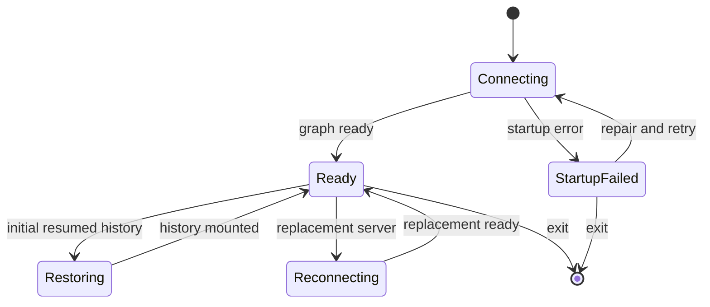

# Run a dcode Session

`dcode` has three execution surfaces: the default Textual UI, one-task headless execution (`-n`), and an ACP server over standard input/output (`--acp`). Interactive and headless modes launch a local LangGraph runtime and use `RemoteAgent` over HTTP/SSE; ACP constructs its session graphs in-process and serves an editor over stdio. See [code agent architecture](../architecture/code-agent.md), [configuration layering](../concepts/config-layering.md), [permissions and human-in-the-loop](../concepts/permissions-hitl.md), [ACP](../integrations/acp.md), and [sandbox partners](../integrations/sandbox-partners.md).

## Choose an execution mode

```bash
# Interactive Textual UI
dcode -M anthropic:claude-sonnet-4-5

# One bounded task for automation
dcode -n "run the focused tests" --max-turns 8 --timeout 600

# Agent Client Protocol service over stdin/stdout
dcode --acp
```

Use the TUI when a person must review actions, select or resume a thread, or continue a conversation. Use `-n` for one autonomous task: its prompt directs the agent to make reasonable safe assumptions rather than request follow-up. Shell execution is disabled by default; `--shell-allow-list recommended`, an explicit list, or `all` enables it. Other tools are automatically approved in headless mode. `-q` reserves stdout for response text and sends status, tool notices, and errors to stderr; `--no-stream` buffers the response.

`-M/--model` provider-detects the model. `--model-params` overrides model values supplied by configuration, `--max-retries` overrides `[retries]` (`0` disables retry), and `--summarization-model` can select a distinct compaction model. `--allow-fs-tools` controls the filesystem tools exposed to the agent; omission of `execute` removes shell access even when shell is otherwise enabled. `--sandbox` without a type uses `[sandboxes].default`; the default is `none` and does not silently enable remote execution.

> **Treat repository integration as executable code.** Project MCP servers, hook commands, and Python extensions require a deliberate trust decision. In particular, headless runs load project hooks only with `--trust-project-hooks`; project MCP is controlled separately by `--trust-project-mcp`; project extensions are experimental and require explicit trust. A sandbox can contain supported filesystem and shell backend operations, but it does not automatically contain MCP, web tools, or credentials held by the dcode process.

## Startup, local server, and workspace binding



*Interactive and headless clients own a temporary server, bind a workspace to each thread, and stream the bound graph through `RemoteAgent`.*

The launch manager captures project context, preflights an explicit MCP file, derives `ServerConfig`, scaffolds a temporary runtime, starts `langgraph dev` on loopback port `0`, and waits for the `agent` graph. It then creates `RemoteAgent` and explicitly binds the resolved workspace. Startup is transactional: if graph readiness, agent construction, binding, or cancellation fails before handoff, the manager stops the owned server.

A workspace binding is not merely a client cwd. `RemoteAgent` caches the server-validated descriptor per thread and supplies it to graph streams and server operations. A workspace switch changes its active cwd and cache only after server acceptance. On streamed execution, `make_graph` requires a nonempty thread ID and workspace context and verifies the durable binding. Server policy or access-policy drift refuses a resumed execution rather than silently changing its permissions. Runtime-only changes, such as model parameters, can select a rebuilt runtime while retaining the binding and checkpoints.

The server caches a workspace runtime containing the compiled agent, composite backend, and server-owned context-offload operation. A sandboxed runtime is process-scoped: the first sandboxed workspace claims the remote backend, and another workspace cannot share it. See [sandbox and partner integrations](../integrations/sandbox-partners.md) for provider setup, attachment, and deletion ownership.

## Startup command and ordered first work

`--startup-cmd CMD` is a local setup command, not an agent tool call. In headless mode it runs before a thread is generated and before the server/agent loop starts. It uses a shell, restores user LangSmith environment values for the child, prints captured stdout/stderr through the session console, and has a 60-second command limit. Launch failure, timeout, and a nonzero return code produce a warning but **do not abort the task**; cancellation terminates the child process or process group and propagates cancellation. In quiet mode this diagnostic output goes to stderr, preserving stdout for the final agent response.

In the TUI, the session-start sequence restores resumed history first, runs the session-start hook, then runs the startup command before an initial prompt or skill is submitted and before queued user input is drained. The command is consumed after one use, so reconnecting or replacing the server does not repeat it. Its header and output are rendered as local app messages rather than added to model context. A nonzero exit or even a failure to schedule the worker is reported but allows the session to continue.



*The TUI serializes first-session actions, so local setup completes before the agent receives initial or queued user work.*

## Approvals, Auto, and containment

Manual interactive sessions normally route gated tool calls through human approval. Agent construction installs approval middleware only when global auto-approval and restrictive-shell headless handling have not disabled it. A restrictive shell allow-list validates shell commands inline; it is not a general sandbox or a replacement for filesystem permission enforcement.

`-y/--auto-approve` selects classifier-backed **Auto** only for the local TUI or ACP. Auto replaces the ordinary HITL middleware with `AutoModeHITLMiddleware`, which applies deterministic policy, classifier review, and human fallback. The classifier is an authorization control: a configured classifier that cannot be constructed fails closed for its first batch rather than silently using the main model, and later batches escalate to human review. Auto is unavailable for sandbox-backed graphs and is resolved to Manual; do not imply that a remote sandbox and classifier review compose in the current runtime. `--yolo` removes review only after its local risk acknowledgement, and is likewise ignored in headless mode.

Tool approval, tool visibility, filesystem permissions, and backend containment are different controls. The explicit filesystem allow-list must be injected into synchronous subagents as well as the main agent; otherwise a delegated `task` could bypass it. For policy-level detail, see [permissions and human-in-the-loop](../concepts/permissions-hitl.md).

Model retry wraps only the model node. Thus a transient model failure can retry the model handler with backoff and visible attempt/retry events without replaying completed tool calls, summaries, or archive writes. Clients use those events to reconcile partial streamed output.

## TUI readiness, recovery, and queueing



*Initial resume restoration has a distinct status lifetime; reconnecting is not a second initial session.*

On the initial resume connection, `ServerReady` latches `_resuming` into `_restoring_resumed_history` before clearing connection state. This retains a resuming status while history mounts; reconnects do not re-arm it or repeat initial session setup. The handler installs the server state, refreshes MCP and model presentation, schedules the serialized session-start task, and can drain deferred work.

A terminal server-start failure clears connection and resume flags while retaining formatted recovery information. `/install`, `/reload`, and `/update` bypass the command queue after such failure only when no agent, shell, or modal command is active. Static slash commands are declared in `COMMANDS`; the registry derives aliases, queue-bypass sets, and autocomplete entries, omitting experimental commands unless experimental mode is enabled.

Prompt-cache expiry is checked once per second. The TUI warns once in the final retention window and—only when `warnings.cache_prompt = "expiry"` and the application is idle—offers a handoff. An interactive post-expiry message can hand off, send, or cancel; handoff and cancellation preserve the draft. Handoff seeds a child thread without destroying the original conversation.

## Context offload and cancellation

Context compaction is server-owned because it operates on checkpointed history using the same backend and hooks as the graph. `RemoteAgent` first idempotently registers the HTTP-side thread, sends workspace and ownership context, and resumes hook interrupts using one operation ID. If local cancellation occurs, it waits for terminal server acknowledgement before propagating cancellation, preventing an apparently cancelled client from leaving a still-mutating operation behind.

## Durable threads and resume safety

Threads are checkpoint-backed records in the sessions SQLite store. Durable names are separate from checkpoint revisions, validated as trimmed printable one-line values of 1–50 characters, and preferred over legacy checkpoint metadata in listings. `/threads` may show cached rows before disk reload, supports cwd and all-directory scopes, and treats durable-name changes as a refresh difference.

The generated local-server checkpointer has an ownership fence: a thread lease gets an OS-lock-backed token, and each checkpoint mutation validates that token and its live reservation. This prevents a stale server from writing after client exit, release, or takeover.

Thread selection validates ownership before dismissing the modal. Selecting an occupied thread leaves the selector, filter, and selected row intact and does not load its history or replace the active thread. Bare `-r` tries candidates by recency and skips occupied ones; an explicit occupied ID fails rather than unexpectedly choosing another conversation. `@@` completion searches saved name, thread ID, initial prompt, agent, branch, and cwd; it displays a saved name when available but inserts a stable ID-only `@@(thread:...)` reference.

For trusted local offline inspection, use the built-in skill rather than decoding checkpoint blobs manually:

```bash
python3 "$SKILL_DIR/scripts/inspect_sessions.py" THREAD_ID --mode latest-turn
python3 "$SKILL_DIR/scripts/inspect_sessions.py" THREAD_ID --mode summary
python3 "$SKILL_DIR/scripts/inspect_sessions.py" --list 20
```

This path is read-only. Report reconstruction warnings and truncation, and do not disclose unrelated secrets, personal data, or hidden reasoning.

## ACP boundary

`--acp` selects an ACP server over stdio rather than the Textual UI. It does not start the normal loopback `RemoteGraph` client path: the dcode process creates the graph factory, checkpointer, ACP adapter, and protocol runner in-process. ACP has its own session lifecycle and fixed approval-choice projection; see [Agent Client Protocol](../integrations/acp.md). `--model-params` and `--max-retries` retain their CLI-over-configuration override behavior in this mode.

## Focused validation

Run tests from `libs/code`, beginning with the boundary changed:

```bash
make test TEST_FILE=tests/unit_tests/test_main_args.py
make test TEST_FILE=tests/unit_tests/test_non_interactive.py
make test TEST_FILE=tests/unit_tests/test_app.py
make test TEST_FILE=tests/unit_tests/test_server_manager.py
make test TEST_FILE=tests/unit_tests/test_server_graph.py
make test TEST_FILE=tests/unit_tests/test_thread_ownership.py
make test TEST_FILE=tests/unit_tests/test_sessions.py
make check
```

For startup changes, test command ordering against history, hooks, initial submission, and queued input; continuation after nonzero exit, timeout, or launch failure; quiet stream routing; cancellation cleanup; and one-shot behavior across reconnect. For approval changes, cover headless shell policies, Auto classifier failure and fallback, Manual resolution with sandboxes, and subagent filesystem allow-list inheritance. For lifecycle changes, cover cancellation-safe server cleanup, workspace binding/policy drift, fenced checkpoint writes, and explicit versus most-recent occupied-thread resume behavior.
