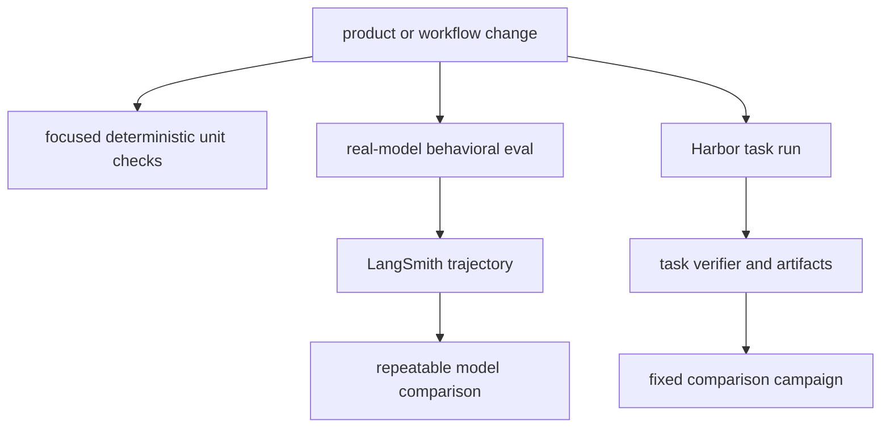
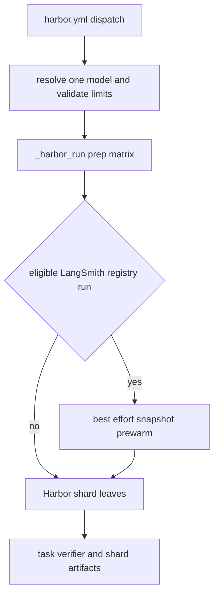
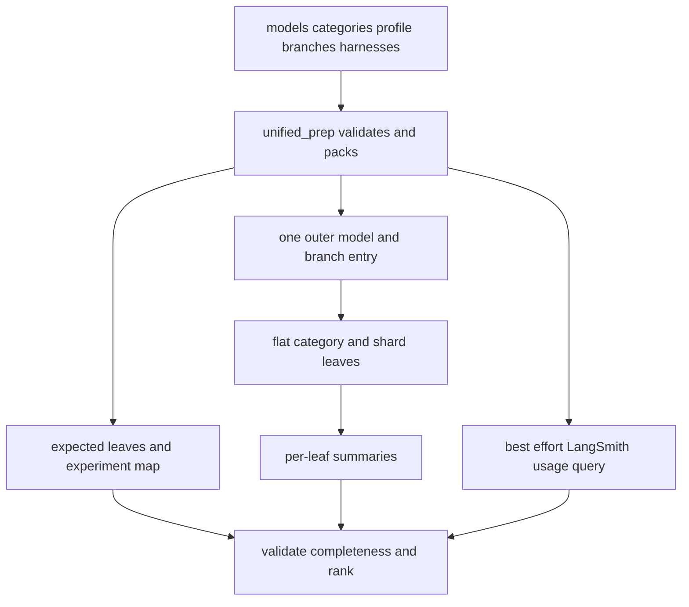

# Run Evals

Deep Agents has four evaluation boundaries. They answer different questions and must not be treated as interchangeable.

| Question | Route | Result to interpret |
| --- | --- | --- |
| Did repeatable implementation behavior regress? | Focused package/unit pytest | Deterministic pass or failure. |
| Does a particular SDK behavior work with a real model? | `libs/evals` behavioral pytest | A traced agent trajectory and correctness/efficiency scores. |
| Can the agent complete an external sandbox task? | Harbor locally or `harbor.yml` | The task-owned verifier result and Harbor artifacts. |
| How do fixed models, branches, and harnesses compare? | `unified_evals.yml` | A cross-model, cross-category scorecard. |

Run the deterministic check first. A behavioral rollout is stochastic and paid; a Harbor result includes task environment and verifier health; a unified score is meaningful only for its fixed battery and configuration.



Caption: the four routes provide complementary signals rather than successive grades of the same test.

## Behavioral pytest evals

`libs/evals` is an end-to-end behavioral evaluation suite for the Deep Agents SDK: each eval runs an agent against a real LLM, captures the full trajectory (tool calls, file mutations, final response), and scores it on correctness and efficiency. It is not the package unit suite.

```sh
cd libs/evals
uv sync --all-groups
export LANGSMITH_TRACING=true
export LANGSMITH_API_KEY=...
export ANTHROPIC_API_KEY=...

# Deterministic Harbor-harness checks.
uv run --group test pytest tests/unit_tests/test_harbor_langgraph_agent.py

# Narrow paid behavioral rollout.
make evals MODEL=claude-opus-5 PYTEST_EXTRA="--eval-category memory"
deepagents-evals run --model claude-opus-5 --eval-category memory --eval-tier baseline
```

The suite refuses to start unless `LANGSMITH_TRACING=true` and `LANGSMITH_API_KEY` are set, because `conftest.py` aborts the run when they are missing and every eval logs inputs, outputs, and feedback via `langsmith.testing`. The chosen provider credential is also required by the selected model.

A `TrajectoryScorer.success(...)` assertion is a correctness requirement and hard-fails the test. `.expect(...)` records trajectory-shape or efficiency expectations but never fails it. This permits a correct result to retain diagnostic evidence about a costly or indirect route.

`deepagents-evals run` shells out to `uv run --group test pytest tests/evals` from `libs/evals`, forwarding `--model` plus category, tier, and provider selection to pytest. For comparisons, use repeated trials and aggregate their reports rather than drawing conclusions from one rollout. The pytest reporter deliberately leaves the session exit status at zero even when evals fail; the CLI therefore determines trial and aggregate failure from `counts.failed.mean` in `trials_summary.json`, not a trial's `pytest_returncode`.

### Behavioral-eval CI

`evals.yml` resolves models into provider-partitioned matrices with `fail-fast: false` and one concurrent leaf per provider; each leaf calls `_eval.yml`. The reusable workflow receives one model and artifact-safe key, exposes that model's provider credential plus LangSmith, requires `evals_report.json` after `make evals`, and uploads `evals-report-<artifact_key>`. `evals_trials.yml` is the distinct N-trial route: it validates one `provider:model` and 1–20 trials, uses `trial-NNN-<model-slug>` artifact keys, runs sequentially unless parallelism is explicitly selected, and fails its summary job if usable reports are fewer than requested.

## Harbor task verification

Harbor is the end-to-end sandbox boundary: benchmark tasks own their environment and verifier. The standalone `harbor.yml` accepts exactly one resolved `provider:model`, validates shard/concurrency limits, derives a bounded shard pool, and delegates task leaves to `_harbor_run.yml`. `n_shards` partitions the selected work after `include_tasks`/`n_tasks`; it does not change the task selection.



Caption: snapshot prewarming is an optimization before independent Harbor task verification, never a prerequisite for a shard.

### Snapshot lifecycle and safe fallback

For eligible single registry-dataset LangSmith runs, `_harbor_run.yml` invokes `prewarm_harbor_snapshots.py` before shard execution. It is skipped for a flat unified matrix, local datasets, `tau3-subset`, forced builds, and non-LangSmith sandboxes. The prewarmer selects tasks in the same manifest/glob/limit order as a run, downloads them, and prepares both the task environment and a separate verifier environment when the task requests one. Compose environments have no snapshot and are reported as skipped.

Prewarming is explicitly best effort: it retries each environment three times under a concurrency semaphore and reports ready/skipped/failed counts. The workflow marks the step `continue-on-error`, and the Harbor job runs whether prewarm succeeded, failed, or was skipped. A missing snapshot is built by the trial at execution time, avoiding parallel duplicate builds when prewarming works without converting a transient prewarm failure into a missing benchmark result.

### Harnesses, tools, and secrets

`langgraph.json` registers three Deep Agents graphs: `bare`, `dcode`, and `tau3`. `bare` builds a prompt-free SDK agent with a local shell rooted at Harbor's task working directory, a minimal `PATH`/`HOME` environment, optional task skills, task-forwarded MCP tools, and an optional Tavily web-search tool. `dcode` builds the headless product CLI agent with its production prompt and a normalized bounded Harbor session ID; it populates the process-wide dcode model identity so that prompt can name the selected model. `tau3` loads task-forwarded MCP tools for the simulated-user conversation runtime.

Only remote MCP transports (`streamable-http`/`sse`) are accepted; `stdio` task definitions are rejected so a selectable dataset cannot supply a local command to execute in the agent sandbox. `skills_dir` must be an absolute path without `..`. Tavily search appears only if `TAVILY_API_KEY` is present; it caps result count and returned characters, and returns an error string rather than ending a long research run if search fails.

The dcode construction path temporarily removes provider keys and LangSmith tracing/credential variables while creating the shell-backed agent, then restores them. This prevents task shell operations from inheriting them. The reusable Harbor workflow separately gates execution: it rejects unknown sandbox names and missing LangSmith, sandbox, selected-provider, verifier, OpenRouter-judge, or research Tavily credentials rather than running a materially incomplete benchmark. Research specifically fails without Tavily because its prompts require web research.

## Unified multi-model evaluations

Dispatch `unified_evals.yml` when the question is comparative: it expands models, branches, harnesses, categories, and selected tasks into a flat Harbor matrix and combines expected leaves into a fixed scorecard. Defaults are `autonomous,conversation,research`; `context` is opt-in.

| Category | Dataset | Harness policy |
| --- | --- | --- |
| `autonomous` | `harbor-index/harbor-index` | Fan out across selected code harnesses. |
| `conversation` | `tau3-subset` | Always runs pinned `tau3`; selected native Harbor agents may additionally run it. |
| `context` | local `datasets/context-retrieval-evals` | Fan out across selected code harnesses. |
| `research` | local `datasets/drbench-evals` | Fan out across selected code harnesses with pinned runtime settings. |

The graph registry is the source of truth: registered Deep Agents graphs except the pinned `tau3` are selectable code harnesses. In addition, `codex`, `claude-code`, and `pi` are native Harbor implementations. They are provider-gated (`codex` OpenAI, `claude-code` Anthropic, `pi` either), cannot be used with branch comparisons, and Claude Code rejects `reasoning_effort=minimal`. An explicit task list is an exact-name filter; unknown tasks fail during prep, while a filter narrows active categories to those that contain requested tasks.



Caption: prep owns the expected comparison grid, so combination can expose absent work rather than quietly omit it.

### Matrix, profile, and resource invariants

`full` enumerates current task names before prep; `lite` uses frozen high-signal lists. Full research is intentionally capped to a declared 30-task proportional sample, and a stale declared task ID fails instead of changing a published denominator silently.

Prep produces one flat per-model matrix spanning category and harness groups. Below the shard cap it uses one task per entry; above it, it allocates group budgets proportionally and packs tasks without dropping or duplicating them. It derives inner and outer pools from a maximum of 40 concurrent tasks per model and 80 runners globally, accounting for branch count; it also rejects more than GitHub's outer matrix limit, more branches than the per-model budget permits, an empty matrix, or more than 400 post-pack jobs.

Research is a category-specific override, not a dispatch-wide setting: it pins `ubuntu-24.04-arm`, Docker, and concurrency 1 because DRBench images are arm64-only and each application stack is disk-heavy. It is the only category that receives web-search credentials. DRBench accepts its supported judges or a well-formed `openrouter/<vendor>/<model>` slug; an unsupported judge visibly falls back to `gpt-5.6-luna`, creating a different scoring baseline.

Each expected `(model, branch, config, category)` leaf receives a deterministic LangSmith experiment name and expected trace count. The reusable Harbor workflow passes the flat matrix directly to its leaf strategy with `fail-fast: false`, preserves each category's effective dataset/harness/runner/sandbox/concurrency values, and aggregates independently by category and harness.

### Combine and access boundaries

The combiner validates leaf-summary schema and rollout count, retains the expected grid so absent artifacts produce incomplete rows, quarantines duplicate leaves, ranks by macro `avg@K`, and emits radar data only when at least three categories are present. Missing rollouts cannot improve `avg@K`; for graded research, `avg@K` is the meaningful score because binary `pass@K` is structurally zero.

Usage collection is best effort and deliberately separated from publication. The usage job has the LangSmith key and only `contents: read`; the combine job has `contents: write`, downloads the usage artifact, and does not receive that key. Treat artifact-download, usage, and post-processing warnings as incompleteness diagnostics, not evidence that every rollout succeeded.

## Focused change routes

Use source-owning tests before dispatching paid work:

```sh
# From libs/evals
uv run --group test pytest tests/unit_tests/test_harbor_langgraph_agent.py

# From the repository root, exercise unified matrix policy and guards.
uv run --project libs/evals --group test pytest .github/scripts/tests/evals/test_unified_prep.py
```

`test_harbor_langgraph_agent.py` pins registry entries, credential scrubbing, model defaults/identity, shell and skills wiring, remote-MCP restrictions, session-ID normalization, and web-search bounds/failure behavior. `test_unified_prep.py` pins category mapping, graph/native-agent eligibility, task filters and profiles, local data presence, packing fidelity, category overrides, numeric input validation, branch safety, expected-leaf/experiment emission, and all pool/job guards. Static unified-workflow tests additionally protect dispatch forwarding, matrix/artifact wiring, branch overlays, secret/permission separation, and aggregation behavior without spending on an evaluation dispatch.

## Operating checklist

1. Use deterministic unit tests for implementation and orchestration changes.
2. Use a narrow traced pytest eval to diagnose a specified real-model behavior; use repeated trials for stochastic comparisons.
3. Use Harbor to establish task-verifier success, retaining sandbox, task, verifier, and artifact context when classifying failures.
4. Use unified evals only for a controlled comparison, holding task profile, judge, harness, branch SHA, sandbox, rollout count, and reasoning settings fixed.
5. Inspect incomplete-row and judge-fallback warnings before interpreting a leaderboard.
