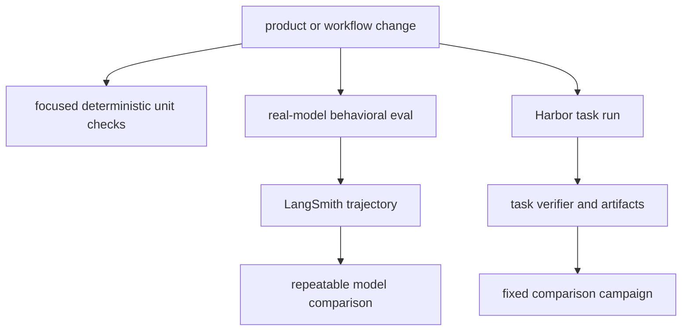
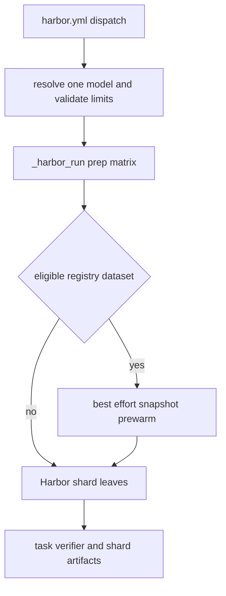
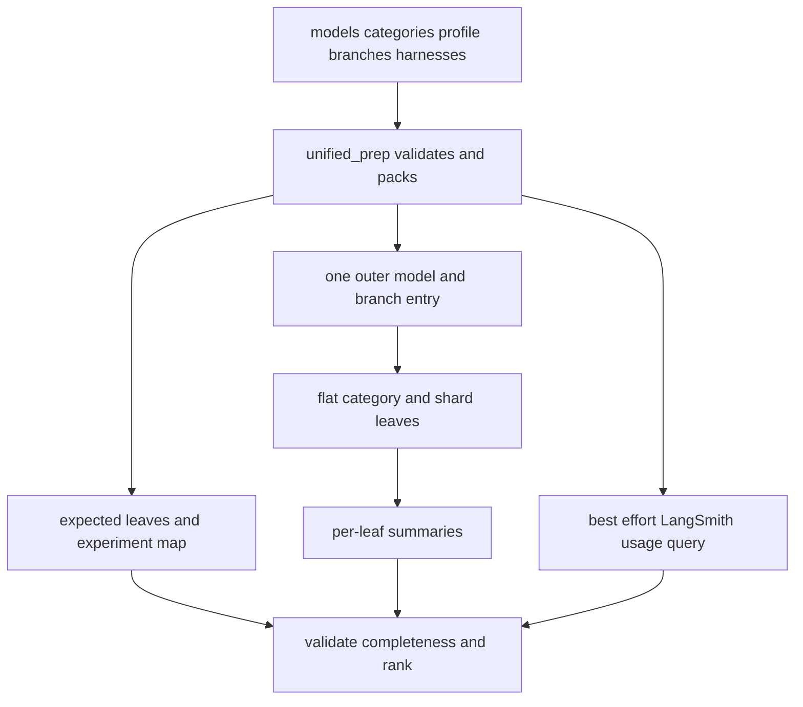

# Run Evals

Deep Agents has four evaluation boundaries. They answer different questions and must not be treated as interchangeable.

| Question | Route | Result to interpret |
| --- | --- | --- |
| Did repeatable implementation behavior regress? | Focused package/unit pytest | Deterministic pass or failure. |
| Does a particular SDK behavior work with a real model? | `libs/evals` behavioral pytest | A traced agent trajectory and correctness/efficiency scores. |
| Can the agent complete an external sandbox task? | Harbor locally or `harbor.yml` | The task-owned verifier result and Harbor artifacts. |
| How do fixed models, branches, and harnesses compare? | `unified_evals.yml` | A cross-model, cross-category scorecard. |

Run deterministic checks before paid, stochastic work. A Harbor result also depends on the task environment and verifier; a unified score is comparable only within its declared battery and fixed scoring configuration.



Caption: the four routes provide complementary signals, not successive grades of the same test.

## Behavioral pytest evals

`libs/evals` is an end-to-end behavioral evaluation suite for the Deep Agents SDK: each eval runs an agent against a real LLM, captures the full trajectory (tool calls, file mutations, final response), and scores it on correctness and efficiency. It is not the package unit suite.

```sh
cd libs/evals
uv sync --all-groups
export LANGSMITH_TRACING=true
export LANGSMITH_API_KEY=...
export ANTHROPIC_API_KEY=...

# Deterministic Harbor-harness checks.
uv run --group test pytest tests/unit_tests/test_harbor_langgraph_agent.py

# Narrow paid behavioral rollout.
make evals MODEL=claude-opus-5 PYTEST_EXTRA="--eval-category memory"
deepagents-evals run --model claude-opus-5 --eval-category memory --eval-tier baseline
```

The suite refuses to start without `LANGSMITH_TRACING=true` and `LANGSMITH_API_KEY`; the selected model's provider credential is also required. A `TrajectoryScorer.success(...)` assertion is a correctness requirement and hard-fails the test. `.expect(...)` records trajectory-shape or efficiency expectations but never fails it.

`deepagents-evals run` shells out from `libs/evals` to `uv run --group test pytest tests/evals`, forwarding model, category, tier, and provider controls. For stochastic comparisons, use repeated trials and aggregate their reports. The reporter deliberately leaves pytest's session exit status at zero even when evals fail, so the CLI determines trial/aggregate failure from `counts.failed.mean` in `trials_summary.json`, not a trial's `pytest_returncode`.

### Behavioral-eval CI

`evals.yml` partitions resolved models into provider matrices with `fail-fast: false` and one concurrent leaf per provider; each leaf calls `_eval.yml`. That reusable workflow takes one model and artifact-safe key, supplies LangSmith plus only the selected provider credential, requires `evals_report.json` after `make evals`, and uploads `evals-report-<artifact_key>`. `evals_trials.yml` is the separate N-trial route: it validates one `provider:model` and 1–20 trials, uses `trial-NNN-<model-slug>` keys, defaults to sequential trials, and fails its summary job when usable reports are fewer than requested.

## Harbor task verification

Harbor is the sandbox boundary: benchmark tasks own their environment and verifier. `harbor.yml` resolves exactly one model, validates shard and concurrency limits, derives a bounded shard pool, then calls `_harbor_run.yml`. Task selection happens before partitioning: `include_tasks` and `n_tasks` select the work, and `n_shards` splits that selected work without changing it.



Caption: snapshot prewarming optimizes independent Harbor task verification; it is never a prerequisite for a shard.

### Matrix, selection, and shard controls

`_harbor_run.yml` has two preparation modes. A normal single-dataset call expands the one model across its shard axis; a caller supplying `flat_matrix` supplies already-expanded leaves, including each leaf's category, dataset or local dataset path, agent implementation, runner, sandbox, concurrency, task filter, and effective shard count. The reusable workflow passes the flat matrix through rather than reconstructing it, derives aggregation legs by `(category, agent implementation)`, and uses `max_parallel` when it is a positive integer; otherwise it uses `shard_parallel`.

For the normal path, `n_shards` must be 1 through 200 and is capped to `n_tasks` when a positive task limit makes larger fan-out provably empty. The public dispatch derives `shard_parallel` from its resource validation, so high shard counts drain through a bounded runner pool rather than launching at once. The workflow permits residual empty shards when a glob selects fewer tasks than expected, writes an empty-shard marker, and still lets aggregation distinguish a successful no-op from a missing artifact.

Selection is deliberately performed before partitioning. Each shard resolves the dataset's native-order task names, applies `include_tasks` globs, applies the total `n_tasks` cap, and takes its modulo slice. Thus the union of all shard task lists matches the corresponding unsharded selection rather than applying the task cap once per shard. A glob that matches no task, unusable registry task names, an invalid shard index, or an invalid local dataset path fails the run rather than producing a green but materially empty evaluation.

### Snapshot lifecycle and staging

For an eligible single registry-dataset LangSmith run, `_harbor_run.yml` invokes `prewarm_harbor_snapshots.py` before shard execution. It is skipped for flat unified matrices, local datasets, `tau3-subset`, forced builds, and non-LangSmith sandboxes. The prewarmer uses the run's manifest/glob/limit selection order, downloads selected tasks, and prepares task plus separate verifier environments. Compose environments are skipped because they do not use snapshots.

Prewarming is best effort: each environment has three attempts behind a concurrency semaphore, and the workflow uses `continue-on-error`. Failed or skipped prewarms fall back to a trial-time build; they do not erase a shard result.

Before `harbor run`, the reusable workflow stages checked-out `deepagents`, `deepagents-code`, `acp`, and QuickJS sources into the LangGraph project's `.local_deps` for the sandbox install. For a branch comparison, it resolves and verifies an immutable remote SHA, overlays only those agent libraries, and deliberately retains the harness at the workflow ref. This separates the agent source under comparison from evaluation-infrastructure changes.

### Harnesses, tools, defaults, and secrets

`langgraph.json` registers `bare`, `dcode`, and `tau3`. `bare` is the prompt-free SDK agent with a local shell rooted at the task work directory, a minimal `PATH`/`HOME`, optional task skills, forwarded task MCP tools, and—only when `TAVILY_API_KEY` exists—a bounded Tavily search tool. `dcode` uses the production headless CLI agent. Before it constructs that filesystem-backed agent, it turns `HARBOR_SESSION_ID` into an ASCII `[A-Za-z0-9_-]` assistant ID of at most 64 characters: unsafe or overlong source IDs gain a digest suffix, while an absent or entirely unusable ID receives a UUID-based `harbor-...` fallback. This makes path-like session IDs safe without turning distinct raw IDs that normalize alike into the same state directory.

`dcode` also populates its process-wide runtime model identity from the selected Harbor model and resolved profile before creating the CLI graph. The production prompt can therefore identify the model, context limit, and unsupported input modalities; a missing or malformed profile clears the optional fields and produces a warning rather than leaking a previous graph's identity. `tau3` uses task-forwarded MCP tools for the simulated-user conversation runtime.

The graph builder applies provider safeguards: OpenAI models default to the Responses API unless callers explicitly choose otherwise; exact GLM-5.2 profiles get `reasoning_effort: high` only when no reasoning control is supplied; and Fireworks receives streaming, retry, and timeout defaults. A Harbor-only profile override supplies the 1,048,576-token input limit for `fireworks:accounts/fireworks/models/kimi-k3p1-pro` when its LangChain model profile lacks it. These are harness defaults, not unified-comparison constants—an explicit model kwarg wins.

Task-provided MCP definitions may use only remote `streamable-http` or SSE transports; `stdio` is rejected so a selectable dataset cannot define a local command to execute. `skills_dir` must be absolute and contain no `..`. The optional Tavily `web_search` tool clamps a request to 1–10 results and truncates rendered output at 20,000 characters; no key or no installed Tavily client means no tool, and a search exception becomes tool text rather than terminating a long run. The dcode and bare graphs attach this tool only when it is available.

The dcode factory temporarily removes provider and LangSmith credential/control variables while it constructs the shell-backed agent and restores them afterward, so that construction does not pass those variables into the shell-backed agent environment. `TAVILY_API_KEY` is deliberately not in that shell-scrub set: it is read only to construct the gated search tool, and the workflow forwards it only to research agents. The workflow separately validates the selected sandbox, LangSmith and sandbox credentials, model-provider key, verifier/judge keys, and research Tavily key before execution. Research fails rather than silently losing its required web-search capability.

## Unified multi-model comparisons

Use `unified_evals.yml` for a controlled comparison, not a general smoke test. It expands models, branches, category/harness groups, and selected tasks into a flat Harbor matrix, then combines an expected leaf grid into a scorecard. Defaults are `autonomous,conversation,research`; `context` is opt-in.

| Category | Dataset | Harness policy |
| --- | --- | --- |
| `autonomous` | `harbor-index/harbor-index` | Fan out across selected code harnesses. |
| `conversation` | `tau3-subset` | Always run pinned `tau3`; selected native Harbor agents may additionally run it. |
| `context` | local `datasets/context-retrieval-evals` | Fan out across selected code harnesses. |
| `research` | local `datasets/drbench-evals` | Fan out across selected code harnesses with pinned runtime settings. |

The graph registry is the source of truth for code graphs: all registered graphs except the non-fan-out pinned `tau3` are selectable. `codex`, `claude-code`, and `pi` are native Harbor implementations. They are provider-gated (`codex` OpenAI, `claude-code` Anthropic, `pi` either), cannot run branch comparisons, and Claude Code rejects `reasoning_effort=minimal`. Exact task filters reject unknown names and narrow active categories to categories containing a requested task.



Caption: prep owns the expected comparison grid, allowing combination to expose absent work instead of silently omitting it.

### Comparability contract: fixed versus selectable

| Fixed for a comparable scorecard | Caller-selectable, but hold fixed within the cohort |
| --- | --- |
| Category-to-dataset mapping; `tau3` for the conversation baseline; task profile and resulting task IDs; a resolved branch SHA; each category's verifier and score interpretation | Models; selected categories; profile (`full` or `lite`); exact task filter; code/native harnesses where permitted; current versus branch axis; rollouts; reasoning effort; judge model; retries; timeout multiplier; and normal category sandbox/concurrency inputs |
| Research always uses `ubuntu-24.04-arm`, Docker, and concurrency `1` | The caller's `runner_label`, `sandbox_env`, and concurrency apply only to categories without an override |

Changing a task set, harness, branch source, K/rollouts, reasoning setting, judge, or scoring baseline creates a new comparison cohort rather than a delta against an older score. Research judge changes are especially non-comparable: DRBench accepts its supported judges or one valid `openrouter/<vendor>/<model>` slug; otherwise research visibly falls back to `gpt-5.6-luna` while other categories retain the requested suite-wide judge.

### Matrix and pool invariants

`full` enumerates current task names; `lite` uses frozen high-signal lists. Full research is capped to a declared 30-task proportional sample, and a stale declared ID fails rather than silently changing a denominator.

Prep produces one flat per-model matrix. Under the shard cap it uses one task per entry; over it, it allocates group budgets proportionally and packs tasks without dropping or duplicating them. Its derived pools enforce at most 40 concurrent tasks per model and 80 runners globally, including the branch axis. It rejects an outer GitHub matrix over its cap, branches exceeding the per-model budget, no jobs, and more than 400 post-pack jobs.

Research's arm64 Docker/concurrency-1 override exists because DRBench images are arm64-only and each application stack is disk-heavy. The reusable Harbor workflow preserves every flat leaf's effective dataset, harness, runner, sandbox, and concurrency values, uses `fail-fast: false`, and aggregates independently by category and harness.

### Combine and score interpretation

Each expected `(model, branch, config, category)` leaf has a deterministic LangSmith experiment name and expected trace count. The combiner validates leaf-summary schema and rollout count, retains the expected grid, quarantines duplicates, marks missing artifacts incomplete, ranks by macro `avg@K`, and emits radar input only for at least three categories.

For binary categories, `pass@K` is the fraction of tasks passing at least one of K rollouts, while `avg@K` is passing trials divided by expected trials; missing rollouts cannot inflate it. Research is a graded reward: its structural `pass@K` is zero, so read research `avg@K`/macro reward and overall macro `avg@K`, not overall pass@K. Incomplete rows are diagnostic partial rankings, not a clean leaderboard.

Usage collection is best effort and isolated from publication: the usage job has the LangSmith key with only `contents: read`; the combine job has `contents: write`, downloads any usage artifact, and does not receive that key. Missing artifacts, usage, or post-processing warnings mean coverage is incomplete, not that all rollouts passed.

## Focused change routes

Use source-owning checks before dispatching paid work:

```sh
# From libs/evals
uv run --group test pytest tests/unit_tests/test_harbor_langgraph_agent.py

# From the repository root
uv run --project libs/evals --group test pytest .github/scripts/tests/evals/test_unified_prep.py
```

The Harbor graph tests are deterministic adapter tests, not credentialed model or sandbox evaluations: they replace model construction, CLI construction, search, and MCP endpoints as needed. They pin graph registration, secret scrubbing and restoration, model identity/defaults and profile overrides, shell and skills wiring, MCP transport restrictions, session-ID normalization/collision resistance, and optional-search absence, bounds, output truncation, and failure behavior. Unified-prep tests pin category mapping, graph/native-agent eligibility, task/profile validation, local data presence, packing fidelity, category overrides, numeric validation, branch safety, expected leaf/experiment emission, and pool/job guards. Static unified-workflow tests protect workflow forwarding, matrix and artifact wiring, secret/permission separation, branch overlays, and aggregation behavior without a paid dispatch.

## Operating checklist

1. Run focused deterministic checks for implementation or orchestration changes.
2. Run a narrow traced pytest eval to diagnose a particular real-model behavior; use repeated trials for stochastic behavioral comparisons.
3. Run Harbor when task-owned verifier success is the question, and retain task, sandbox, verifier, and artifact context when diagnosing failure.
4. Dispatch unified evals only for a controlled cohort; record the resolved task set, branch SHA, harness, rollouts, reasoning setting, judge, and category-specific runtime overrides.
5. Check incomplete-row, missing-artifact, and research-judge-fallback warnings before interpreting a score or rank.
