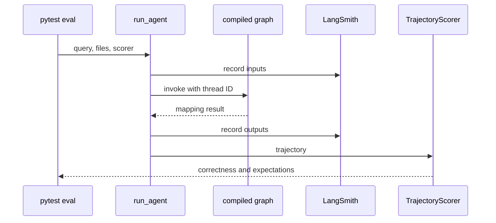
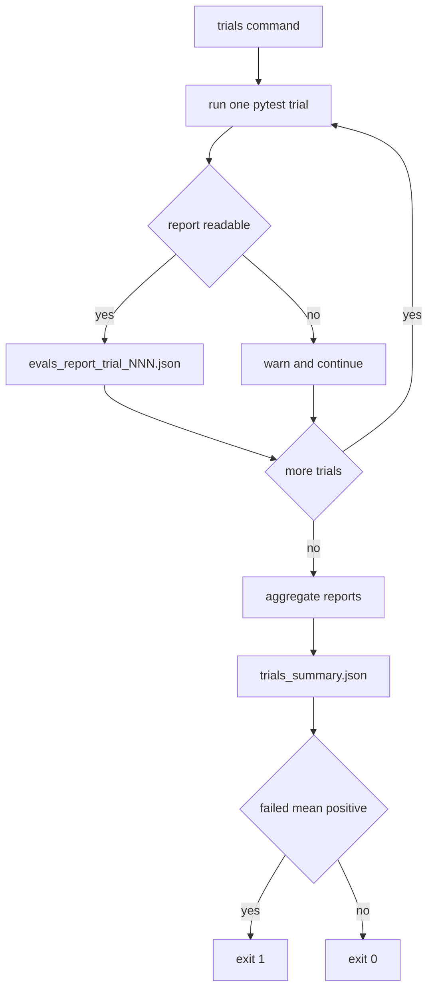

# Run Evaluations and Harbor Benchmarks

Deep Agents deliberately has separate validation boundaries. Use **deterministic package tests** to gate repeatable code behavior; use `libs/evals` for credentialed, real-model behavioral measurements; use **Harbor** for task-owned sandbox benchmarks; and use package-local CodSpeed targets for performance. Do not substitute one signal for another: a stochastic agent result is not a deterministic regression test, and an infrastructure failure is not model capability evidence.

Related guidance: [development](../operations/development.md), [CI labeling](../operations/ci-labeling.md), [testing guide](../testing/testing-guide.md), and [architecture overview](../architecture/overview.md).

## Select the right signal

| Question | Entry point | Result |
| --- | --- | --- |
| Did repeatable product behavior regress? | Changed package's `make test` | Deterministic pytest result. |
| Did eval infrastructure, discovery, or aggregation change? | `cd libs/evals && make test` | Unit tests in `tests/unit_tests`; non-Unix sockets are disabled. |
| Does a model perform a controlled SDK behavior? | `deepagents-evals run` | One LangSmith-traced pytest rollout and optional report. |
| Is that behavior stable across samples? | `deepagents-evals trials` | Per-trial reports and aggregate statistics. |
| Can an agent complete an external sandbox task? | `harbor run`, Harbor Make targets, or unified workflow | Task verifier reward, trajectory, and Harbor artifacts. |
| Did a package become slower or use more memory? | Owning package's `make bench` / `make bench-memory` | CodSpeed performance history. |

The normal `libs/evals` test target is intentionally not a real-model run: it executes `tests/unit_tests` with network sockets disabled except Unix sockets. `make evals` is the separate real-model suite. Likewise, the `deepagents` and `code` packages run deterministic unit tests by default and select separate integration directories only through their integration targets.

```sh
cd libs/evals
uv sync --all-groups
make test TEST_FILE=tests/unit_tests/test_eval_catalog.py

# This requires real credentials and incurs model usage.
make evals MODEL=claude-opus-5
```

Performance benchmarks remain package-owned: `libs/evals` has no `bench` target. `libs/deepagents`, `libs/code`, and `libs/partners/quickjs` provide local `benchmark` plus CodSpeed `bench` and `bench-memory` targets. The repository `bench-all` fan-out includes deepagents and code only.

## Behavioral SDK evals

`libs/evals` is an end-to-end behavioral suite: every eval runs a Deep Agents graph against a real LLM, records tool calls, file mutations, and final output, then scores correctness and efficiency. The preferred operator interface is `deepagents-evals`; the Make targets remain the compact CI-compatible interface.

### Prepare credentials and discover scope

The pytest harness refuses to start unless `LANGSMITH_TRACING=true` and `LANGSMITH_API_KEY` are present. Export the credential for the chosen model provider as well. Treat these runs as paid, remote measurements and start with the narrowest category and tier that answers the question.

```sh
cd libs/evals
uv sync --all-groups
export LANGSMITH_TRACING=true
export LANGSMITH_API_KEY=...
export ANTHROPIC_API_KEY=...

# Discovery does not import real-model test modules.
deepagents-evals list categories
deepagents-evals list tiers
deepagents-evals list models --group set0
deepagents-evals list evals --category memory

# One narrow rollout with a report.
deepagents-evals run --model claude-opus-5 \
  --eval-category memory --eval-tier baseline --report evals_report.json
```

`list` obtains categories from `deepagents_evals/categories.json`, tiers from the fixed `baseline`/`hillclimb` set, models from `.github/scripts/evals/models.py`, and evals through the catalog generator's AST walk. Thus discovery does not trigger test imports or require the full runtime environment.

`run` launches `uv run --group test pytest tests/evals` from `libs/evals`, forwarding model selection and eval filters to pytest. An explicit `--model` wins over `DEEPAGENTS_EVALS_MODEL`; absent both, the command exits with configuration code `2`. Category filters are repeatable, exclusion wins over inclusion, and pytest rejects requested category or tier values that are absent from collected tests.

```sh
# CI-compatible shortcuts; both validate required variables before running.
make evals MODEL=claude-opus-5
make evals-trials MODEL=openai:gpt-6-astra TRIALS=3 \
  TRIAL_ARGS="--eval-category memory"

# Script interface: JSON and dry-run are useful for automation.
deepagents-evals run --model claude-opus-5 --dry-run --json
deepagents-evals model-groups --check
```

The console script supplies `run`, `trials`, `aggregate`, `radar`, `catalog`, `model-groups`, and `list`. `catalog --check` and `model-groups --check` identify generated-document drift, so their nonzero result is a configuration failure (`2`), not an eval failure. Regenerate with `make eval-catalog` and `make model-groups`; `EVAL_CATALOG.md` is generated from AST-visible tests and must not be hand-edited.

### What a single eval measures

A real-model eval is a `@pytest.mark.langsmith` test that receives `model`, builds an agent (normally with `create_deep_agent(...)`), and invokes `run_agent(...)` with a `TrajectoryScorer`. The runner creates input from the query, optional initial files, and extra state; invokes the compiled graph with a thread ID; records inputs and outputs to LangSmith; makes an `AgentTrajectory`; and applies the scorer.



Caption: `run_agent` is the invocation-to-trajectory boundary; LangSmith records the observed rollout.

The scorer has an important invariant:

- `TrajectoryScorer.success(...)` is a required correctness assertion and hard-fails the test.
- `TrajectoryScorer.expect(...)` records an efficiency or trajectory-shape expectation but never fails the test.

Use `success` for behavior that must hold and `expect` to diagnose whether valid solutions take an undesirable route. Before changing an eval or declaring a regression, inspect its trace and failure message.

When adding an eval, first add deterministic coverage for framework or reporting changes. Then mark the real-model test, attach category and tier markers, run it through `run_agent`, and keep correctness separate from efficiency expectations. Update category metadata and catalog generation when needed. The catalog drift unit test invokes `scripts/generate_eval_catalog.py --check`, so it is a focused first check after discovery changes.

## Trials: aggregate stochastic results correctly

Use trials for a fixed model and configuration rather than treating a single rollout as comparative evidence. One `run_trials` invocation is sequential because concurrent in-process LangSmith experiment creation and provider calls are unsafe. CI can instead fan out separate jobs and run aggregate-only over the downloaded reports.

```sh
deepagents-evals trials --model openai:gpt-6-astra --trials 3 \
  --eval-category memory --out-dir trial_runs/memory

# Merge artifacts from independent jobs.
deepagents-evals aggregate trial_runs/memory --summary-out summary.json

# Retry each distinct failed pytest node ID once.
deepagents-evals trials --model openai:gpt-6-astra --trials 1 \
  --retry-failed trial_runs/memory/trials_summary.json
```



Caption: trials retain individual reports, then derive automation status from the aggregate rather than a pytest session return code.

Each report includes metrics and a `failures` array; `trials_summary.json` contains mean, median, sample standard deviation, minimum, and maximum for correctness, solve rate, steps, tool calls, duration, pass/fail counts, and category scores. Only numeric non-null values enter a metric. Standard deviation is `null` with fewer than two samples, and the aggregator warns if reports mix model or SDK versions.

The pytest reporter deliberately rewrites session status to zero even when an individual eval failed. Therefore the CLI uses aggregated `counts.failed.mean`, not `pytest_returncode`, to return status. `--retry-failed` accepts a summary or its report directory, deduplicates `failures[].test_name` across trials, and returns `3` when no usable retry set can be obtained.

| Exit | Meaning |
| --- | --- |
| `0` | Successful run or aggregate with no failed evals. |
| `1` | Eval failure, including a positive aggregate failed mean. |
| `2` | Bad configuration or arguments, missing model, registry failure, or generated-file drift. |
| `3` | No usable reports, including prior reports that cannot be parsed for retry. |

## Harbor: task-owned sandbox benchmarks

Harbor is a distinct end-to-end boundary: benchmark tasks provide sandbox environments and verifiers. `deepagents_harbor` supplies Deep Agents-side LangSmith dataset/experiment/feedback integration and failure classification. Its LangGraph project configuration is the authority for the packages installed into the Harbor agent environment.

For local code changes, stage source packages before creating a sandbox. The Makefile copies checked-out Deep Agents, deepagents-code, ACP, and QuickJS below `.local_deps`, then the Harbor targets select the LangGraph graph and sandbox backend. `-n` is concurrent sandbox trials, not the number of tasks.

```sh
cd libs/evals
make stage-harbor-local-deps
make run-hello-world MODEL=claude-opus-5
make run-terminal-bench-docker MODEL=claude-opus-5
```

The terminal-bench shortcuts use Docker, Modal, Daytona, Runloop, or LangSmith environments. The Harbor graph temporarily removes provider and LangSmith credentials while shell-backed operations are constructed and restores them afterward, so task shell commands do not inherit those secrets.

Do not describe every failed task as a model regression. `FailureCategory` separates model `CAPABILITY` from `INFRA_OOM` (exit `137`), `INFRA_TIMEOUT` (exit `124`), `INFRA_SANDBOX`, and unknown outcomes. It preferentially reads structured tool observations for exit codes rather than model prose that happens to mention one. Repair or retry infrastructure outcomes before comparing capability.

DRBench task directories are generated rather than committed. `make dataset` populates `datasets/drbench-evals` from the pinned upstream configuration, and `make dataset-check` verifies labels, subsets, and deterministic generation.

### CI Harbor execution

The reusable `_harbor_run.yml` first expands a task shard matrix (or accepts the unified workflow's pre-expanded flat matrix), caps shard count to selectable work, and makes an aggregate matrix per category. Each Harbor leaf runs with `fail-fast: false`; the category aggregate expects the matching shard set. This prevents empty shard jobs and allows a unified campaign to mix categories, agent implementations, datasets, and runners in one dispatch.

Before the paid work begins, the reusable workflow validates sandbox choice, LangSmith, selected model-provider credentials, verifier credentials, and the research-only Tavily key. It prunes unneeded provider dependencies from the ephemeral agent config, prepares local datasets through an allowlisted dispatcher, and can overlay only the agent libraries from a requested resolved branch SHA. The eval harness itself remains at the workflow ref. This separation makes branch comparisons agent comparisons rather than comparisons of diverged benchmark infrastructure.

## Unified cross-model campaigns

`unified_evals.yml` dispatches a fixed external battery for one or more `provider:model` values. Its prep step validates and resolves models, categories, profiles, selected tasks, branches, harnesses, and shard budgets into a per-model flat matrix. It calls `_harbor_run.yml` for the leaf work, collects LangSmith usage in a separate best-effort job, then downloads Harbor leaf artifacts to produce combined results. The usage job alone receives the LangSmith key alongside no repository-write permission; the publishing/combining job has repository write permission but not that key.

| Axis | Dataset | Harness |
| --- | --- | --- |
| Autonomous | `harbor-index/harbor-index` | `bare` or `dcode` |
| Conversation | `tau3-subset` | `tau3` |
| Context | `context-retrieval-evals` | `bare` or `dcode` |
| Research | `drbench-evals` | `bare` or `dcode` |

The default categories are autonomous, conversation, and research; context is opt-in. `bare` is the neutral SDK `create_deep_agent` graph and `dcode` is the product agent. Conversation must use `tau3`, because its runtime hosts the MCP user simulator needed for multi-turn interaction.

```sh
gh workflow run unified_evals.yml \
  -f models="anthropic:claude-opus-5,openai:gpt-6-astra" \
  -f categories="autonomous,conversation,research" \
  -f agent_impls="bare" \
  -f rollouts="3"
```

For pass/fail axes, pass@K is the fraction of tasks that pass at least one of K rollouts. avg@K is passing trials divided by expected trials, so missing rollouts cannot inflate it. Graded research uses avg@K because pass@K is structurally zero; change of judge, task set, harness, sandbox, profile, or rollout count requires a new baseline. A radar chart is emitted only for at least three axes. The combine phase uploads raw combined artifacts and may publish charts to the `eval-assets` branch; reporting failures are best-effort diagnostics rather than a reason to discard completed benchmark artifacts.

## Focused verification checklist

- Run the changed package's focused deterministic `make test TEST_FILE=...` first.
- After eval discovery or metadata changes, run `make test TEST_FILE=tests/unit_tests/test_eval_catalog.py`, `deepagents-evals catalog --check`, and `deepagents-evals model-groups --check` as applicable.
- For behavior work, make one narrow traced rollout, inspect the report and LangSmith trace, then run repeated trials before making a comparison.
- For Harbor work, retain the model, graph, task selection, rollouts, sandbox, judge, and artifacts; classify infrastructure separately from capability.
- For unified comparisons, keep tasks/profile, harness, judge, sandbox, and rollout count constant across models and branches.
