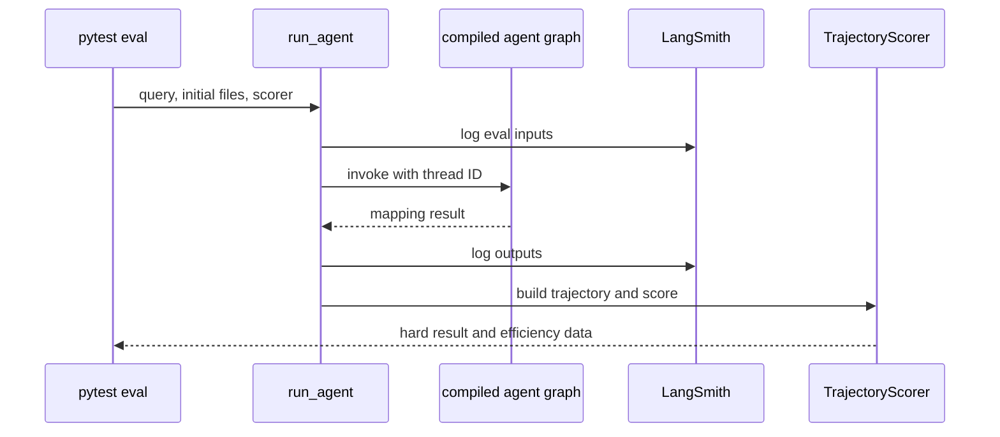
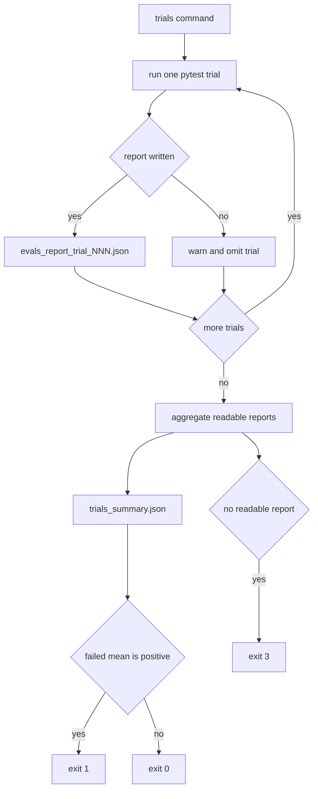

# Run Evaluations and Benchmarks

Deep Agents has separate validation boundaries. **Deterministic product tests** establish a code-regression signal without a real model or network. **Behavioral evals** in `libs/evals` run an agent against a real LLM, capture its trajectory—tool calls, file mutations, and final response—and score correctness and efficiency. **Harbor** runs task-owned sandbox benchmarks with their own verifiers. **CodSpeed benchmarks** measure package performance over time. A result in one boundary is not automatically evidence for another.

Use deterministic tests for framework, adapter, CLI, reporting, and package behavior; use behavioral evals to investigate observable agent behavior or model quality; use Harbor to measure benchmark-task performance in its sandbox; and use CodSpeed when changing performance-sensitive code. Do not replace a regression test with a stochastic LLM eval, or read a performance regression as a capability result.

Related guidance: [development](../operations/development.md), [testing guide](../testing/testing-guide.md), and [build a Deep Agent](build-a-deep-agent.md).

## Choose the validation boundary

| Question | Owner and entry point | Signal |
| --- | --- | --- |
| Did deterministic package behavior regress? | The changed package's `make test`; use `make integration_test` only when the integration boundary is intended. | A repeatable pytest result. |
| Did local eval infrastructure change safely? | `cd libs/evals && make test` | Unit tests in `tests/unit_tests`, with non-Unix sockets disabled. |
| Does a model satisfy a controlled SDK behavior? | `deepagents-evals run` | One traced pytest rollout and an optional JSON report. |
| Is a behavioral result stable rather than one stochastic observation? | `deepagents-evals trials` | Per-trial reports plus summary statistics. |
| Can an agent solve task-owned sandbox work? | `harbor run` or the Harbor Make targets | Harbor job artifacts, task verifier reward, and trajectory. |
| Did a performance-sensitive package become slower or use more heap? | That package's `make bench` or `make bench-memory` | CodSpeed wall-time or memory trend. |

The `deepagents` and `code` package test targets select `tests/unit_tests` by default, disable sockets other than Unix sockets, and disable benchmarks; their `integration_test` targets select `tests/integration_tests`. These are product regression tests, not `libs/evals` real-model tests.

```sh
cd libs/deepagents
uv sync --all-groups
make test TEST_FILE=tests/unit_tests/
make integration_test TEST_FILE=tests/integration_tests/

cd ../evals
make test TEST_FILE=tests/unit_tests/test_eval_catalog.py
```

## Run performance benchmarks without creating an eval result

Benchmark ownership is package-local. Only `libs/deepagents`, `libs/code`, and `libs/partners/quickjs` define `bench` and `bench-memory`; `libs/evals` has no `bench` target. Each package's Makefile is the authority for its invocation: `benchmark` is ordinary local `pytest-benchmark`, while `bench` and `bench-memory` add `--codspeed`. The `libs` fan-out target deliberately runs only `deepagents` and `code`.

```sh
# Plain local measurement, without CodSpeed instrumentation.
make -C libs/deepagents benchmark

# Same instrumented wall-time target that CI invokes.
make -C libs/deepagents bench
make -C libs/partners/quickjs bench-memory

# The repository fan-out: deepagents and code only.
make -C libs bench-all
```

The reusable `.github/workflows/_benchmark.yml` checks out the repository, syncs the package test group, then asks `CodSpeedHQ/action` to run `make bench` in wall-time mode. It authenticates with an OIDC ID token rather than a repository secret. Its optional memory step runs `make bench-memory` only when the caller sets `has-memory-benchmarks`; the input defaults to false. The nightly caller runs daily and supports manual dispatch, but currently sweeps only `libs/deepagents` and `libs/code`, not QuickJS. Consequently, add or change a benchmark by editing the owning package Makefile; opt a package into the nightly workflow separately if it needs tracked CI history.

## Run behavioral SDK evals

`libs/evals` is the Deep Agents SDK's end-to-end behavioral evaluation suite. The canonical operator interface is the `deepagents-evals` console script (`deepagents_evals.cli:main`), with `run`, `trials`, `aggregate`, `radar`, `catalog`, `model-groups`, and `list` subcommands. `--json` emits structured stdout and `--dry-run` previews execution where supported.

The pytest eval configuration requires a model and LangSmith tracing. Set `LANGSMITH_TRACING=true`, provide `LANGSMITH_API_KEY`, and export the provider credential for the selected model before a real run.

```sh
cd libs/evals
uv sync --all-groups
export LANGSMITH_TRACING=true
export LANGSMITH_API_KEY=...
export ANTHROPIC_API_KEY=...

# Discover without importing real-model test modules.
deepagents-evals list categories
deepagents-evals list tiers
deepagents-evals list models --group set0
deepagents-evals list evals --category tool_use

# A narrow rollout with a machine-readable artifact.
deepagents-evals run --model claude-opus-5 \
  --eval-category tool_use --eval-tier baseline --report evals_report.json
```

`list` reads categories from `deepagents_evals/categories.json`, exposes fixed `baseline` and `hillclimb` tiers, loads model entries from `.github/scripts/evals/models.py`, and finds evals with the catalog generator's AST walker. It does not import test modules merely to answer discovery questions. `run` launches `uv run --group test pytest tests/evals` from `libs/evals` and forwards model, category, tier, provider, reasoning, REPL, report, and extra pytest arguments.

`--model` takes precedence over `DEEPAGENTS_EVALS_MODEL`; if neither resolves, the CLI exits with configuration code `2` and displays known groups. Model specs and named groups are curated in `.github/scripts/evals/models.py`; `MODEL_GROUPS.md` is generated from it. Category inclusion flags are repeatable, exclusions take precedence, and collection rejects category or tier values that do not occur on collected tests.

The Make targets remain the compact CI-compatible interface and fail fast if required variables are absent:

```sh
make evals MODEL=claude-opus-5
make evals-trials MODEL=openai:gpt-6-astra TRIALS=3 \
  TRIAL_ARGS="--eval-category memory"
```

## How an eval becomes a score

An eval is a `@pytest.mark.langsmith` test which takes the `model` fixture, normally builds `create_deep_agent(...)`, and calls `run_agent(...)` with a `TrajectoryScorer`. `run_agent` creates graph inputs from the query, optional initial files, and extra state; invokes the graph with a thread ID; logs inputs and outputs to LangSmith; converts a mapping result to `AgentTrajectory`; then applies the scorer.



Caption: `run_agent` owns the invocation-to-trajectory boundary while the pytest/LangSmith layer records the run.

The scorer has two assertion tiers, which must remain semantically distinct:

- `TrajectoryScorer.success(...)` is a correctness assertion and fails the test when false.
- `TrajectoryScorer.expect(...)` records trajectory-shape efficiency expectations, such as steps or tool-call counts, but never fails the test.

Use `success` only for required behavior; use `expect` for diagnostic efficiency signals so legitimate alternate paths remain valid. Inspect the trace and failure message before treating a score as a root cause.

### Add or change an eval

1. Add focused deterministic coverage if changing framework, reporting, filtering, or adapters.
2. Mark a real-model test with `@pytest.mark.langsmith`; tag it with `eval_category` and an appropriate `eval_tier`.
3. Accept `model`, build the agent, invoke `run_agent`, and express must-pass versus efficiency behavior with `success` and `expect`.
4. If adding a category, add its name and label to `categories.json`, add it to `radar_categories` only when it is a capability axis rather than plumbing, and update category-tagging coverage.
5. Regenerate the catalog, run focused unit tests, then use multiple real-model trials before making a comparative claim.

`EVAL_CATALOG.md` is generated from AST-visible evals under `tests/evals/`, not hand-maintained. Regenerate it with `make eval-catalog`; the catalog drift test runs its generator with `--check`. Similarly, regenerate model documentation with `make model-groups`. `deepagents-evals catalog --check` and `model-groups --check` report generated-file drift as configuration exit code `2`, not an eval regression.

## Repeat trials and interpret artifacts

Use trials for a same-model, same-configuration sweep. A local `run_trials` invocation is sequential because concurrent in-process LangSmith experiment creation and provider rate limits are unsafe; CI can distribute trials across jobs and merge downloaded reports using aggregate-only mode.

```sh
deepagents-evals trials --model openai:gpt-6-astra --trials 3 \
  --eval-category memory --out-dir trial_runs/memory

# Merge reports produced by separate jobs.
deepagents-evals aggregate trial_runs/memory --summary-out summary.json

# Retry each distinct prior failing node ID once.
deepagents-evals trials --model openai:gpt-6-astra --trials 1 \
  --retry-failed trial_runs/memory/trials_summary.json
```



Caption: trials preserve usable reports, aggregate them after execution, and determine pass/fail from aggregate counts.

Each trial writes `evals_report_trial_NNN.json`, including metrics and a `failures` array. `trials_summary.json` reports mean, median, sample standard deviation, min, and max for correctness, solve rate, step and tool-call ratios, duration, pass/fail counts, and category scores; standard deviation is `null` when fewer than two values are available. `null` values do not contribute to a metric; nonnumeric values and mixed model or SDK versions are warned about.

The reporter rewrites pytest's session status to zero even after individual eval failures. The CLI therefore uses aggregated `counts.failed.mean`, not a trial's `pytest_returncode`: a positive mean is exit `1`. `--retry-failed` accepts a summary file or report directory, reads and deduplicates `failures[].test_name` node IDs, and returns `3` when no retryable IDs are found, including when discovered reports cannot be parsed.

| Exit | Meaning for automation |
| --- | --- |
| `0` | Success, or an aggregate with no failed evals. |
| `1` | Eval failure, including positive aggregate failed mean. |
| `2` | Invalid CLI/configuration, model registry problem, argparse usage error, or generated-file drift under `--check`. |
| `3` | No usable reports, including unparseable prior reports for retry. |

## Harbor: external sandbox benchmarks

Harbor is a separate boundary from the pytest behavioral harness: it runs task-owned sandbox environments and their verifiers. `deepagents_harbor` owns the Deep Agents-side LangSmith dataset, experiment, and feedback plumbing plus trial failure classification. Its LangGraph project declares the packages installed in the sandbox and exposes `dcode`, `bare`, and `tau3` graphs.

Stage local source packages before a sandbox install. The Make targets stage checked-out Deep Agents, deepagents-code, ACP, and QuickJS under `.local_deps`, then invoke Harbor with the selected graph and sandbox backend.

```sh
cd libs/evals
make stage-harbor-local-deps
make run-hello-world MODEL=claude-opus-5
make run-terminal-bench-docker MODEL=claude-opus-5
```

Terminal Bench targets select Docker, Modal, Daytona, Runloop, or LangSmith environments. Their `-n` value is concurrent sandbox trials, not task count. The LangGraph agent temporarily removes provider and LangSmith credentials while constructing shell-backed agent operations, then restores them; task shell commands must not inherit those secrets.

Do not call an outcome a model regression before classifying it. `FailureCategory` separates `CAPABILITY` from `INFRA_OOM` (exit 137), `INFRA_TIMEOUT` (exit 124), `INFRA_SANDBOX`, and unknown outcomes. Its extractor searches structured trajectory observations for exit codes, avoiding model text that merely mentions an exit code. Retry or repair infrastructure failures rather than folding them into a capability score.

The DRBench dataset is generated rather than committed: `make dataset` populates `datasets/drbench-evals` from the pinned upstream configuration, while `make dataset-check` verifies pins and deterministic generation.

## Unified cross-model evaluation

The unified eval workflow runs one or more models through a fixed battery mapped to capability axes: autonomous (`harbor-index`), conversation (`tau3-subset`), context (`context-retrieval`), and research (`drbench`). It publishes a cross-model leaderboard and, when at least three axes run, a radar chart.

| Axis | Benchmark | Runtime |
| --- | --- | --- |
| Autonomous | `harbor-index/harbor-index` | `bare` or `dcode` |
| Conversation | `tau3-subset` | `tau3` |
| Context | `context-retrieval-evals` | `bare` or `dcode` |
| Research | `drbench-evals` | `bare` or `dcode` |

`bare` is the neutral `create_deep_agent` graph and `dcode` is the product agent. Conversation is necessarily `tau3`: its runtime hosts the MCP user simulator required for the multi-turn protocol. Pass/fail axes report pass@K, the fraction of tasks passing at least one of K rollouts. Graded research has pass@K of zero by construction and reports avg@K instead.

Keep the model set, tasks/profile, rollouts, harness, sandbox, and judge constant for comparison. A judge change requires a new research baseline.

## Focused verification checklist

- Use the changed package's focused `make test TEST_FILE=...` as the first gate for deterministic product changes.
- Use `make -C <owning-package> benchmark` for local performance tuning and `make ... bench` when reproducing the instrumented CodSpeed path.
- Run `make test TEST_FILE=tests/unit_tests/test_eval_catalog.py` after changing eval discovery or catalog generation.
- Run `deepagents-evals catalog --check` and `deepagents-evals model-groups --check` in CI or before a metadata-only change.
- Run relevant `tests/unit_tests` for CLI, trial aggregation, reporter, Harbor adapter, or graph changes before a paid rollout.
- For a behavior change, execute a narrow category/tier rollout first, inspect its LangSmith trace and JSON report, then run repeated trials for a comparative claim.
- For Harbor or unified work, retain the exact run configuration and artifacts, separate infrastructure outcomes from capability outcomes, and compare only like-for-like campaigns.
