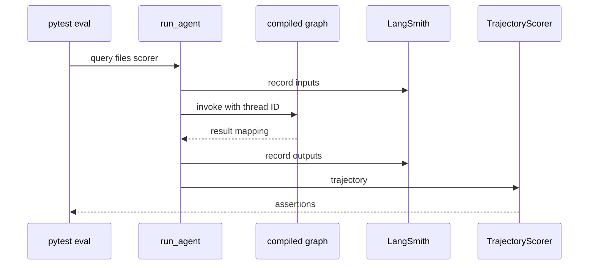
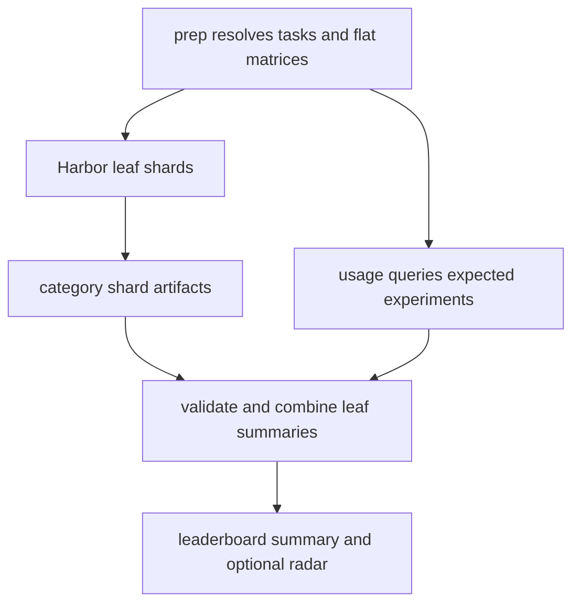

# Run Evals

Deep Agents has four intentionally different evaluation boundaries. Start with the one that answers the question; do not use a stochastic, paid model rollout as a replacement for a deterministic regression test, or interpret a sandbox outage as a capability result.

| Question | Use | Signal |
| --- | --- | --- |
| Did repeatable package behavior change? | The changed package's `make test` | Deterministic pytest. |
| Did a controlled SDK behavior hold for one real model rollout? | `libs/evals`: `make evals` or `deepagents-evals run` | LangSmith-traced behavioral trajectory. |
| Can an agent finish a sandbox task? | Local `harbor run`/Make targets or `harbor.yml` | Task-owned verifier result and Harbor artifacts. |
| How do models, branches, and harnesses compare on a fixed battery? | `unified_evals.yml` | Cross-model Harbor scorecard. |

The normal `libs/evals` `make test` target runs `tests/unit_tests` with non-Unix sockets disabled; `make evals` separately invokes real-model tests in `tests/evals`. Package unit and integration suites are likewise package-owned. Run focused deterministic tests first, then pay for the narrower remote measurement that is needed.

## Behavioral pytest evals

`libs/evals` is an end-to-end behavioral suite: an eval runs an agent against a real LLM, captures tool calls, file mutations, and final response, and scores correctness and efficiency. It requires `LANGSMITH_TRACING=true`, `LANGSMITH_API_KEY`, and the selected model provider's credential.

```sh
cd libs/evals
uv sync --all-groups
export LANGSMITH_TRACING=true
export LANGSMITH_API_KEY=...
export ANTHROPIC_API_KEY=...

# Deterministic framework/reporting checks.
make test TEST_FILE=tests/unit_tests/test_harbor_langgraph_agent.py

# A narrow real-model rollout.
make evals MODEL=claude-opus-5 PYTEST_EXTRA="--eval-category memory"
# Or use the richer CLI.
deepagents-evals run --model claude-opus-5 --eval-category memory --eval-tier baseline
```

An eval is a `@pytest.mark.langsmith` function using the `model` fixture, generally building with `create_deep_agent(...)` and calling `run_agent(...)` with a `TrajectoryScorer`. `run_agent` builds state from the query, optional files, and extra state; invokes the graph with a thread ID; records inputs and outputs to LangSmith; then turns the result into a trajectory for scoring.



Caption: a behavioral eval converts one traced graph invocation into a scored trajectory.

### Assertions, filtering, and repeated trials

Use `TrajectoryScorer.success(...)` for required correctness: it fails the test. Use `.expect(...)` for an efficiency or trajectory-shape expectation: it is reported but cannot fail the test. This distinction lets an otherwise correct answer retain diagnostic information about an inefficient route.

`deepagents-evals` is the automation-oriented interface (`run`, `trials`, `aggregate`, `radar`, `catalog`, `model-groups`, and `list`). `list` reads metadata and AST-visible evals rather than importing real-model test modules. `run` shells out to pytest and forwards model and category/tier selection. An explicit `--model` takes precedence over `DEEPAGENTS_EVALS_MODEL`; neither is a configuration error. Category exclusions take precedence over inclusions, and nonexistent requested category or tier markers fail collection.

For comparisons, use repeated trials rather than a single trace:

```sh
deepagents-evals trials --model openai:gpt-6-astra --trials 3 \
  --eval-category memory --out-dir trial_runs/memory
deepagents-evals aggregate trial_runs/memory --summary-out summary.json
```

Trials are sequential within one process because concurrent experiment creation and provider traffic are unsafe. Each trial writes an `evals_report_trial_NNN.json`; aggregation writes `trials_summary.json` with summary statistics, failures, per-category scores, and only numeric non-null metrics. The pytest reporter makes its session status zero even when individual evals fail, so trial automation uses aggregated `counts.failed.mean`, not a trial's pytest return code. A positive failed mean exits `1`; configuration/drift errors exit `2`; unusable reports exit `3`.

When discovery data changes, regenerate rather than hand-edit generated documentation: `EVAL_CATALOG.md` is generated from `tests/evals`, while model groups come from the curated registry. `catalog --check` and `model-groups --check` make stale generated output a configuration failure.

## Harbor benchmark runs

Harbor evaluates a different boundary: benchmark tasks own their sandbox environment and verifier. The `deepagents_harbor` adapter provides the Deep Agents LangGraph agent and forwards a task `skills_dir` into graph configuration, which is the runner's channel for it. The LangGraph registry defines the supported graph keys: `bare`, `dcode`, and `tau3`.

For local source changes, stage the checked-out package set before running Harbor. `-n` means concurrent sandbox trials, not task count.

```sh
cd libs/evals
make stage-harbor-local-deps
make run-hello-world MODEL=claude-opus-5
make run-terminal-bench-docker MODEL=claude-opus-5
```

The staging target copies Deep Agents, deepagents-code, ACP, and QuickJS into the LangGraph project's `.local_deps` so the sandbox installs the checkout rather than unrelated installed artifacts. The local shortcuts select the graph and sandbox backend; standalone CI uses `harbor.yml` for exactly one resolved model, validates its resource limits, derives a safe shard pool, then delegates the leaf execution to `_harbor_run.yml`.

### Agent and secret boundary

The Harbor graph uses `bare` for a neutral `create_deep_agent` graph, `dcode` for the product agent, and `tau3` for the conversation runtime. Before shell-backed agent construction, the graph removes provider, LangSmith, and tracing credential variables from the process environment and restores them afterward. Task commands therefore do not inherit those credentials. The focused Harbor-agent tests cover graph registration, task-skill forwarding, web-search behavior, bounded identifiers, and the secret-scrubbing boundary.

The reusable workflow validates the sandbox name and all credentials before paid execution. It routes only the selected model provider key to the agent, always supplies the OpenAI verifier key where required, and supplies `TAVILY_API_KEY` only for research. It fails for missing required keys rather than completing a benchmark without the model, verifier, or research web-search capability.

## Unified multi-model evaluations

Dispatch `unified_evals.yml` for a fixed, comparable external battery. Its default categories are `autonomous,conversation,research`; `context` is opt-in. Categories map to Harbor data and graph policy:

| Category | Dataset/source | Graph policy |
| --- | --- | --- |
| `autonomous` | `harbor-index/harbor-index` | Fan out across selected code graphs, default `bare`. |
| `conversation` | `tau3-subset` | Always `tau3`; it hosts the simulated-user protocol. |
| `context` | local `datasets/context-retrieval-evals` | Fan out across selected code graphs. |
| `research` | local `datasets/drbench-evals` | Fan out across selected code graphs, with enforced overrides. |

`agent_impls` may select registered code graphs for fan-out categories; it cannot replace the conversation graph. Full profiles enumerate live tasks first, while `lite` uses frozen high-signal task lists. An exact `include_tasks` selection is validated against the selected profile and categories before any leaf starts.

```sh
gh workflow run unified_evals.yml \
  -f models="anthropic:claude-opus-5,openai:gpt-6-astra" \
  -f categories="autonomous,conversation,research" \
  -f agent_impls="bare" \
  -f rollouts="3"
```

### Flat matrix and resource guards

Prep resolves models, task scope, branches, and harnesses into one flat per-model matrix: each entry is one category/config task shard. It applies a 40-concurrent-task budget per model, an 80-runner global budget, GitHub's outer matrix cap, and a 400 post-packing job cap. Pool sizing is derived before execution so adding compared branches shares the same per-model provider budget instead of multiplying it.

The reusable Harbor workflow passes a supplied flat matrix through directly, executes its leaves with `fail-fast: false`, and derives an aggregate matrix per category and graph. This preserves category-specific dataset, graph, shard, runner, sandbox, and concurrency information. Shards share one category experiment but upload independently; empty legitimate shard slices upload markers so aggregation can distinguish them from missing artifacts.

`research` deliberately overrides dispatch-wide defaults: it runs on `ubuntu-24.04-arm`, uses the Docker sandbox, and has concurrency `1`. Its upstream images are arm64-only and its full application stack is disk-heavy; allowing normal parallelism risks exhausting the runner. Research is also the only category that receives web search. Its judge accepts known DRBench-compatible values or an `openrouter/<vendor>/<model>` slug; an unsupported suite-wide judge falls back visibly to `gpt-5.6-luna`, so that score must be treated as a different baseline.

### Experiment identity, aggregation, and failures

Every `(model, branch, config, category)` leaf has a deterministic LangSmith experiment name shared by prep, Harbor execution, and unified aggregation. It includes sanitized branch/config/model/category, a hash of the raw branch, run ID and attempt, and optional reasoning effort. This lets all shards in a category converge on one project and lets the separate usage job query expected experiments without scanning artifacts.



Caption: prep establishes the expected leaf grid and experiment identities; combining can report incomplete leaves instead of silently omitting them.

For binary categories, `pass@K` is the fraction of tasks passing at least one of K rollouts; `avg@K` divides passing trials by expected trials so missing rollout data cannot inflate a result. Graded research uses `avg@K` because its `pass@K` is structurally zero. The combiner validates summary schema and rollout count, quarantines duplicate leaves, marks missing or malformed expected leaves incomplete, and ranks rows by macro `avg@K`. It emits a radar input only with at least three categories. Artifact-download, malformed-summary, and usage failures become structured warnings and incomplete diagnostics rather than silently improving a ranking.

The usage collector is best-effort and is isolated from the publishing job: it receives the LangSmith key, whereas the combine/publish job has repository write access but not that key. Keep model, task/profile, graph, branch SHA, sandbox, judge, reasoning effort, and rollout count fixed when interpreting a comparison. Branch comparisons overlay only `libs/deepagents`, `libs/code`, `libs/acp`, and `libs/partners/quickjs` from a verified resolved SHA; the Harbor harness and benchmark infrastructure remain at the workflow revision.

## Operating checklist

1. Run focused deterministic package or eval-infrastructure tests first.
2. For behavioral changes, make one narrow traced pytest rollout, inspect the LangSmith trace, then run trials before claiming a comparison.
3. For Harbor, retain task selection, graph, sandbox, verifier/judge, rollouts, and artifacts; separate infrastructure failures from model capability failures.
4. For unified runs, inspect the dispatch summary and incomplete-row warnings. Do not compare scores across changed task sets, judges, harnesses, profiles, or research fallback judges.
5. After metadata changes, run the generated-output checks and the focused unit tests that cover the changed matrix, agent, or aggregation logic.
